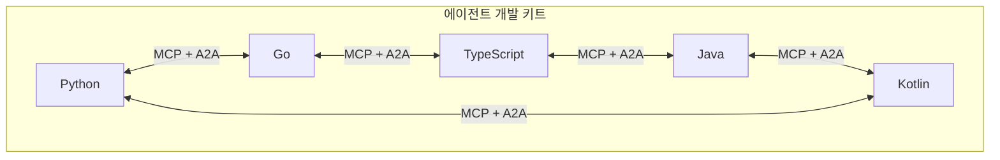

## 초록

쇼피파이가 화요일, 쇼핑객이 직접 자신의 AI 에이전트를 설정해 쇼피파이 카탈로그에서 바로 구매하게 하겠다고 밝혔다. 9월 28일 브라우저 체크아웃 에이전트에 접근을 열어준 데서 한 걸음 더 나가, 카탈로그 전체 10억 건이 넘는 상품 목록까지 범위를 넓힌 셈이다[^s01]. 구글의 에이전트 개발 키트(ADK)는 이제 Python, Go, TypeScript, Java, Kotlin 다섯 개 언어로 프로덕션 SDK를 제공한다. 전부 같은 MCP와 A2A 프로토콜을 쓰기 때문에, 팀이 런타임을 섞어 써도 상호운용성이 깨지지 않는다[^s02]. 그리고 플루토 시큐리티는 이 두 움직임의 기업 보안 짝으로 쓰일 법한 제품에 4,200만 달러를 투자받았다. 사용자가 아니라 에이전트의 행동을 감시하고, 작업 도중에도 개입할 수 있는 소프트웨어다[^s03]. 반면 x402, AP2, ACP, UCP, MPP, L402, Trusted Agent Protocol 같은 결제 프로토콜 쪽에서는 이번 주에도 출시된 게 없었다. 유일하게 눈에 띈 스펙 작업인 x402의 전달 영수증(delivery-receipt) 확장안도 여전히 머지되지 않은 PR 상태로 남아 있다[^s04].

## 서론

이번 호는 **2026년 10월 11일부터 10월 14일까지**를 다룬다. 결제 레일 쪽 배경지식은 이 사이트의 [에이전트 커머스 프로토콜 비교](../agent-commerce-protocol/)와 [x402 프로토콜 심층 분석](../x402-protocol/)에 있다. 10월 12일 호는 Claude Code 세션이 쓰인 은행 해킹 사건과 Cloudflare의 의사결정 모델 업데이트를 다뤘다. 이번 주는 보안 사건도, 프로토콜 출시도 없었다. 사용자에게 더 많은 자율성을 넘기는 제품 둘과, 그 자율성을 통제하려는 제품 하나가 있을 뿐이다.

## 이번 주 동향

### 쇼피파이, 카탈로그 접근권을 쇼핑객이 설정한 에이전트에 넘기다

쇼피파이는 9월 28일 열어준 브라우저 기반 체크아웃 에이전트뿐 아니라, 쇼핑객이 직접 자신의 AI 에이전트를 설정해 쇼피파이 매장에서 구매할 수 있게 하겠다고 발표했다[^s01]. 밝힌 규모는 크다. 쇼피파이의 기존 카탈로그 서비스로 표준화된 10억 건 이상의 상품 목록이, 쇼핑객이 고른 어떤 에이전트로든 접근 가능해진다는 것이다. 통합을 누가 통제하느냐가 바뀐 셈이다. 이전에는 쇼피파이가 지정된 AI 플랫폼과 하나씩 제휴하는 구조였다면, 이제는 쇼핑객 본인의 에이전트에게 문이 열린다. _(미확인, 단일 출처)_ 이번 주 이 소식을 다룬 매체는 더버지 하나뿐이었고, 이번 작업 중에는 원문 기사 자체를 불러올 수 없어 위 인용은 매체가 제공한 요약문에서 가져온 것이다.

### 구글 ADK, 다섯 개 언어로 확장

Python 중심이던 구글 ADK가 이제 Go, TypeScript, Java, Kotlin에도 프로덕션 SDK를 갖췄다. 각각 자신의 런타임에 맞춰 새로 만든 구현이고, Python을 그대로 옮긴 게 아니다[^s02]. 핵심은 프로토콜 통일이다. 모든 언어 구현이 MCP를 지원해 MCP 서버로 만든 도구는 어느 언어의 ADK에서 불러도 작동하고, A2A도 지원해 서로 다른 언어로 쓴 에이전트끼리 HTTP로 대화할 수 있다. Go와 TypeScript는 조건 분기와 병렬 실행을 지원하는 새 실행 모델인 ADK 2.0 그래프 워크플로 런타임을 쓰고, Kotlin 지원은 아직 실험적 단계다. 구글은 Claude Code, Codex, Antigravity 같은 코딩 에이전트가 ADK를 바로 다룰 수 있도록 설정해주는 한 줄짜리 설치 명령도 함께 내놨다. 별것 아닌 것 같지만 체감되는 변화다. 에이전트 프레임워크를 쓰려면 코딩 에이전트 자신은 모르는 벤더 고유의 스캐폴딩 지식이 필요했던 그간의 번거로움을 줄여주기 때문이다.

*ADK의 다섯 언어 구현은 모두 같은 두 프로토콜로 상호운용되므로, 한 언어로 쓴 에이전트가 다른 언어로 쓴 도구나 에이전트를 그대로 호출할 수 있다.*

### 플루토 시큐리티, 사용자가 아니라 에이전트를 감시하는 데 4,200만 달러

플루토 시큐리티가 TLV 파트너스가 주도한 850만 달러 시드 라운드와 점프 캐피털이 주도한 3,400만 달러 시리즈 A를 10월 13일 공개했다[^s03]. 이 회사의 메시지는 발상의 전환이다. 그동안 기업 AI 보안은 직원이 AI 도구로 무엇을 하는지 감시하는 데 치중했지만, 플루토의 소프트웨어는 그 직원이 만들거나 호출한 에이전트가 실제로 실행되는 동안 무엇을 하는지를 본다. 에이전트가 사용자가 승인한 권한보다 더 많은 접근을 시도하면 그 행동을 막거나, 에이전트가 먼저 확인을 받도록 강제한다. CEO 샤하르 바핫은 이를 "사용자 행동에서 에이전트 행동으로"의 전환이라고 설명했다. 회사는 자사가 발견하는 위험의 약 60%가 코드를 직접 쓰지 않은 직원들이 만든 도구, 특히 재무 부서에 몰려 있다고 밝혔다. _(벤더 발표)_ 이 수치도 투자 금액 구성과 마찬가지로 테크크런치를 통해 전해진 회사 측 발표이며, 독립적인 검증은 확인되지 않았다.

## 왜 중요한가

쇼피파이와 플루토가 답하는 질문은 같다. 에이전트의 접근 범위를 누가 설정하느냐를 두고, 둘은 정반대 방향에서 접근한다. 쇼피파이는 자사 카탈로그에 에이전트를 들이댈 수 있는 주체를 넓히는 쪽이고, 플루토는 그 넓어진 접근권이 기업이 쓰는 모든 SaaS 도구로 확산될 때 생기는 문제를 돈 받고 감시해주는 쪽이다. ADK의 다섯 언어 지원은 그 아래층에 있다. 둘 중 어느 쪽 이야기든, 결국 그 에이전트를 만드는 비용을 낮춰주는 기반 기술이라는 점에서는 같다. 결제 프로토콜 스펙 쪽은 이번에도 조용했다. 이번 주 유일하게 눈에 띈 제안인 x402의 전달 영수증 확장안은 서버가 유료 호출로 무엇을 전달했는지 암호학적으로 증명하게 해준다. 에이전트 커머스가 결국 필요로 할 법한 신뢰 장치인데도, 10월 12일 이후 머지되지 않은 채 멈춰 있다.

## 지켜볼 신호

- 다른 매체의 확인 보도, 또는 쇼피파이 자체 발표문. 지금은 검증할 수 없는 더버지 요약문 하나에 의존하고 있다.
- 벤더 발표 수준인 60%보다 구체적인 플루토의 고객 수나 사례.
- ADK Kotlin의 온디바이스 경로(LiteRT-LM, ML Kit, 안드로이드)가 구글 밖에서 실제로 나온 앱으로 이어지는지, 아니면 시연에 머무르는지.
- x402 전달 영수증 PR의 머지 여부, 그리고 AP2·ACP·UCP·MPP·L402·Trusted Agent Protocol 중 단 하나라도 다음 주에 실제로 출시될지. 결제 쪽 침묵은 이제 여러 주째 이어지고 있다.

## 한계

쇼피파이 항목은 더버지라는 단일 출처에 의존한다. 이번 작업 중 원문을 직접 불러올 수 없어 위 서술은 매체의 RSS 요약문을 바탕으로 했으며, 이를 뒷받침하는 다른 보도나 쇼피파이가 직접 낸 자료는 찾지 못했다. 플루토 시큐리티의 투자 금액과 위험 비율 수치는 테크크런치를 통해 전해진 회사 측 발표로, 독립적인 확인은 없었다. "결제 프로토콜 쪽 침묵"이라는 해석은 x402-foundation/x402와 google-agentic-commerce/AP2 두 저장소의 PR 활동을 살핀 것으로, 거론된 모든 스펙을 전부 확인한 것은 아니다. 피드, 웹 검색, 깃허브 레인은 이번 주 모두 정상 작동했다. 학술 자료 레인은 범위에 해당하는 새 연구가 보이지 않아 실행하지 않았다. X와 LinkedIn은 방침에 따라 직접 읽지 않았고, 이번 주 내용 중 두 플랫폼을 출처로 거슬러 올라간 사례도 없었다.
