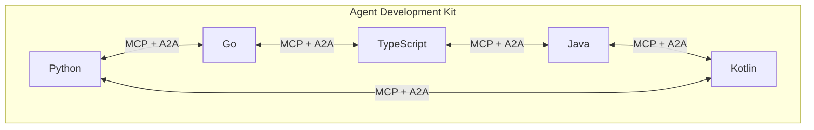

## Abstract

Shopify said Tuesday it will let shoppers configure their own AI agents to buy from its catalog directly, pushing agent access past the browser-checkout opening it announced on September 28 and toward more than a billion listings[^s01]. Google's Agent Development Kit now ships as production SDKs in five languages (Python, Go, TypeScript, Java, and Kotlin), all speaking the same MCP and A2A protocols, so a team can mix runtimes without losing interoperability[^s02]. Pluto Security raised $42 million to build the enterprise-security counterpart to both of those moves: software that watches what an *agent* does inside a company, not just what a user does, and can step in mid-task[^s03]. The named payment-protocol specs (x402, AP2, ACP, UCP, MPP, L402, Trusted Agent Protocol) again produced nothing shipped; the one piece of visible spec work, an x402 delivery-receipt extension, is still an open, unmerged pull request[^s04].

## Introduction

This edition covers **2026-10-11 through 2026-10-14**. Background on the payment-rail side of this beat lives in the site's [agent commerce protocol comparison](../agent-commerce-protocol/) and [x402 protocol deep dive](../x402-protocol/). The October 12 edition covered a bank-hacking campaign that used Claude Code sessions and a Cloudflare decision-model update; this window has no security incident and no protocol release, just two products shipping more autonomy to end users and one product built to contain it.

## What moved

### Shopify hands catalog access to shopper-configured agents

Shopify announced it will let shoppers set up their own AI agents to buy from Shopify stores, rather than relying only on the browser-based checkout agents it opened up on September 28[^s01]. The stated scope is big: more than a billion catalog listings, standardized through Shopify's existing Catalog service, become reachable by whichever agent a shopper chooses to configure. It changes who controls the integration. Previously Shopify partnered with named AI platforms one at a time; now the shopper's own agent gets a door in. _(unverified — single source)_ The Verge's report is the only coverage found this window, and the underlying article could not be fetched directly during this run, so the quote above comes from the outlet's own summary, not the full piece.

### Google's Agent Development Kit reaches five languages

Google's ADK, previously strongest in Python, now has production SDKs for Go, TypeScript, Java, and Kotlin as well, each built for its own runtime instead of ported from Python[^s02]. The unifying piece is protocol support: every language implementation speaks MCP, so a tool built as an MCP server works regardless of which ADK language called it, and A2A, so agents written in different languages can talk to each other over HTTP. Go and TypeScript both run the newer ADK 2.0 Graph Workflow runtime, a directed-graph execution model with conditional routing and parallel steps; Kotlin's support for it is still experimental. Google also shipped a one-line setup command that configures coding agents like Claude Code, Codex, or Antigravity to work against ADK directly, which matters more for daily developer friction than it sounds: an agent framework used to require vendor-specific scaffolding knowledge the coding agent itself didn't have.

*All five ADK language implementations interoperate through the same two protocols, so an agent written in one can call a tool or another agent written in any of the rest.*

### Pluto Security raises $42M to watch agents, not users

Pluto Security closed an $8.5 million seed round led by TLV Partners and a $34 million Series A led by Jump Capital, disclosed October 13[^s03]. The company's pitch is a reframing: enterprise AI security has mostly meant watching what employees do with AI tools. Pluto's software instead watches what the agents those employees built or invoked do once they're running, catching an agent that reaches for more access than its user approved and either blocking the action or forcing the agent to ask first. CEO Shahar Bahat put it as moving "from user behavior to agent behavior." The company says roughly 60% of the risks it finds sit in tools employees built themselves without writing code, concentrated in finance departments. _(vendor-stated)_ That figure, like the funding split, comes from the company via TechCrunch with no independent audit found.

## Why it matters

Shopify's move and Pluto's answer the same underlying question from opposite sides: who gets to configure an agent's reach. Shopify is widening who can point an agent at its catalog; Pluto exists because that widening, generalized across every SaaS tool a company uses, is exactly the problem its customers are now paying to monitor. ADK's five-language parity sits a layer below both, infrastructure that makes it cheaper to build the kind of agent either story is actually about, regardless of which side of the configuration question a given team is on. None of this touched the payment-protocol specs. The one visible proposal this window, x402's delivery-receipt extension, would let a server prove cryptographically what it delivered for a paid call, the kind of accountability layer agent commerce eventually needs, and it has sat open and unmerged since October 12.

## Signals to watch

- A second outlet, or Shopify's own newsroom, confirming the shopper-agent story. Right now it rests on one unverifiable Verge summary.
- A Pluto customer count or case study with harder numbers than the vendor-stated 60% figure.
- Whether ADK's Kotlin on-device path (LiteRT-LM, ML Kit, Android) produces a shipped app anyone outside Google has built, or stays a capability demo.
- The x402 delivery-receipt PR merging, or any of AP2, ACP, UCP, MPP, L402, or Trusted Agent Protocol shipping a change at all. This is now a multi-week silence on that half of the beat.

## Limitations

The Shopify item rests on a single source, The Verge, whose article could not be fetched directly this run; the claims above reflect the outlet's RSS summary, not the full text, and no corroborating report or Shopify-published source was found. Pluto Security's funding figures and risk-share statistic are vendor-stated via TechCrunch, with no independent confirmation. The "quiet protocol window" reading is based on sampling two repositories' pull-request activity (x402-foundation/x402 and google-agentic-commerce/AP2), not an exhaustive check of every named spec. Feeds, web search, and GitHub were all reachable this window; the papers lane was not run, since nothing in scope pointed to a new academic result. X and LinkedIn were not read directly, per standing policy, and nothing in this window traced back to either platform as an originating source.
