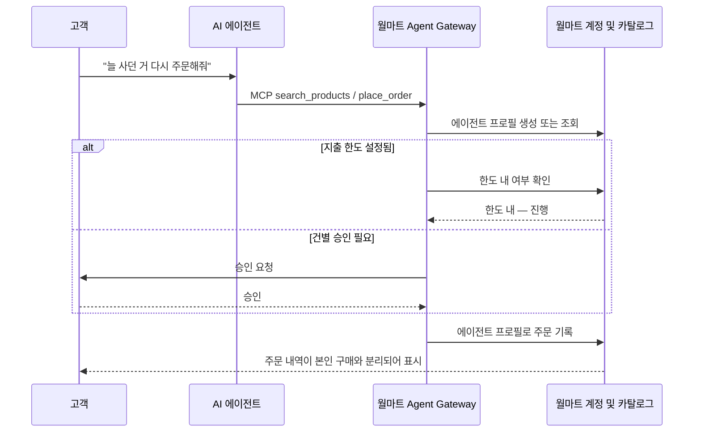

## 초록

월마트가 10월 21일 MCP 서버를 열었다. 승인된 AI 에이전트는 이제 월마트와 샘스클럽 카탈로그에서 직접 쇼핑할 수 있고, 모든 구매는 사람이 한도를 걸거나 건별로 승인하거나 삭제할 수 있는 "에이전트 프로필"을 거친다[^s01][^s02]. 같은 시기 업계 언론은 아마존이 에이전트 구매를 아예 막고 있다는 점을 계속 지적한다. 클라우드플레어와 Commerce.com은 더 새로운 표준인 WebMCP를 약 10만 개 스토어프런트에 기본으로 켰다. 에이전트가 버튼을 추측해 누르는 대신 `search_products` 같은 선언된 도구를 직접 호출하게 된다[^s03]. 구글은 자사 Agents CLI에 확장 시스템을 넣어, LangChain과 LangGraph 에이전트가 ADK 에이전트와 같은 도구로 돌아가게 만들었다 — CLI가 자사 프레임워크에 묶여 있던 상태를 끝낸 것이다[^s04]. 셋 다 에이전트가 할 수 있는 일을 넓히지 않았다. 셋 다 누가 허락할지를 정하는 층을 하나씩 더했다.

## 서론

이번 호는 **2026년 10월 19일부터 10월 22일까지**를 다룬다. 결제 레일 배경은 사이트의 [에이전트 커머스 프로토콜 비교](../agent-commerce-protocol/)에, 카드사 제품 배경은 [에이전트 커머스와 카드 결제](../agent-commerce-card-payments/)에 있다. 지난 몇 호는 Money20/20의 결제 레일 시범 사업과 x402 레퍼런스 구현의 페이월 버그를 다뤘다. 이번 주는 결제 프로토콜 자체는 움직이지 않았다. 뉴스는 한 층 위에 있다 — 에이전트를 문 안으로 들여보낼지 누가 정하느냐의 문제고, 그 결정권이 이번엔 소매업체의 계정 시스템, CDN의 기본 설정, CLI의 명령어 테이블에 각각 놓여 있다.

## 무엇이 움직였나

### 월마트, 쇼핑 에이전트에게 문을 열다: 아마존보다 선을 더 또렷하게 긋는다

월마트의 Agent Gateway는 MCP 서버다. 이 프로토콜을 지원하는 에이전트는 렌더링된 페이지를 클릭하며 돌아다니는 대신, 월마트와 샘스클럽의 실시간 재고를 검색하고 주문을 넣을 수 있다[^s01]. 월마트의 발표는 통제 장치 자체를 제품으로 내세운다. 에이전트가 게이트웨이를 통해 처음 쇼핑하는 순간 고객 계정 안에 전용 "에이전트 프로필"이 생기고, 그 에이전트의 주문은 고객 본인의 구매 내역과 분리된다. 고객은 모든 거래에 승인을 요구하거나, 대신 지출 한도를 걸거나, 각 에이전트가 산 것을 들여다보거나, 프로필을 통째로 지울 수 있다. 에이전트는 카드 정보를 볼 수 없고 결제 수단을 바꿀 수 없으며, 고객이 요청한 범위를 벗어나면 사이트에서 차단된다. 월마트가 내세운 가격 원칙은 이 개인정보 경계와 짝을 이룬다. "우리는 사람이 아니라 상품에 가격을 매긴다"[^s01] — 에이전트에게도 인간 쇼핑객과 같은 카탈로그 가격을 구매 전에 보여준다는 뜻이다.

이 설계는 아마존과 나란히 놓으면 결이 다르다. TechCrunch는 아마존을 "에이전트 구매를 걸러내는" 게 아니라 "막는" 쪽으로 그린다[^s02]. 월마트가 아마존에 없는 기술을 쓴 건 아니다. MCP는 서버를 세울 의지가 있는 소매업체라면 누구나 쓸 수 있었다. 차이는 제휴 없는 에이전트의 구매를 허락하기로 한 선택, 그리고 그 허락의 대가로 프로필·승인·삭제 스위치라는 책임 장치를 만들었다는 데 있다.

*화살표가 말하는 것: 월마트 발표에 따르면[^s01], 모든 에이전트 구매는 프로필 단위 관문을 통과해야 주문이 기록된다. 그 관문은 고정 지출 한도이거나 고객에게 직접 승인을 왕복으로 받는 것, 둘 중 하나다.*

### 클라우드플레어와 Commerce.com, WebMCP를 약 10만 개 스토어프런트의 기본값으로

WebMCP는 구글이 만든, 아직 실험 단계인 브라우저 표준이다. 사이트가 `search_products`, `add_to_cart` 같은 구조화된 도구를 선언하면 에이전트가 HTML을 해석하고 클릭할 요소를 추측하는 대신 `document.modelContext`를 통해 그 도구를 직접 호출할 수 있다[^s03]. 클라우드플레어 엣지는 8월부터 베타로 이 기능을 지원해왔는데, 이번 주 Commerce.com이 클라우드플레어 네트워크에서 운영하는 약 10만 개 스토어프런트 전체에 존 단위로 켰다. 클라우드플레어가 활성화 스크립트를 주입하고 Commerce.com 자체 MCP 서버의 도구 정의를 쇼핑객 브라우저에 그대로 중계하는 구조다. 에이전트가 자기 도구를 호출하는 걸 원치 않는 가맹점은 대시보드에서 끌 수 있고, 그 해제는 클라우드플레어나 Commerce.com과 다시 협상할 필요 없는 엣지 규칙 하나로 끝난다. 쇼핑객 브라우저가 WebMCP를 지원하지 않거나 가맹점의 MCP 서버가 다운되면 스크립트는 그냥 빠지고 페이지는 평소대로 뜬다.

10만이라는 숫자는 클라우드플레어가 집계한, 스크립트가 기본으로 켜진 스토어프런트 수다. 실제로 에이전트가 거쳐 간 스토어프런트 수가 아니다 _(벤더 발표)_. 이 변화가 바꾸는 건 실패 모드다. 스크래핑하는 에이전트는 사이트가 버튼을 재배치하면 깨진다. WebMCP를 쓰는 에이전트는 선언된 도구의 스키마가 바뀔 때 깨지는데, 이쪽이 더 작고 더 눈에 잘 보이는 표면이다. 이 표준을 따로 들여다본 보안 연구자들은 클라우드플레어 글도 이번처럼 좁게 짜인 도입도 다루지 않는 또 다른 표면을 짚는다. 선언된 도구의 설명이나 반환값에 지시문이 숨어 들어갈 수 있고, 쇼핑객 본인의 인증된 브라우저 세션으로 그 도구를 호출하는 에이전트는 그 세션이 이미 가진 권한을 그대로 물려받는다는 것이다[^s05] _(검증 안 됨 — 단일 출처)_.

### 구글, Agents CLI를 자사 프레임워크에서 떼어내다

구글의 Agents CLI는 에이전트를 구글 클라우드 운영 환경에 올리는 명령줄 도구다. v1.5.0에서 확장 시스템이 들어가면서, 팀은 구글 자체의 Agent Development Kit(ADK) 대신 LangChain, LangGraph, Deep Agents를 도구를 포크하지 않고도 끼워 넣을 수 있게 됐다[^s04]. 원래 여섯 개 명령어가 ADK 런타임을 전제로 짜여 있었다. 확장은 깃 저장소에 올린 YAML 파일 하나로 명령어를 덮어쓰거나 추가하며, `agents-cli extension add`로 설치하고 특정 커밋에 고정된다. 공식 LangChain 확장은 두 버전 뒤인 v1.8.0에서 나왔고, `playground` 명령은 ADK의 웹 UI 대신 LangGraph Studio를 띄운다. 구글 블로그 글은 호환성의 근거를 분명히 밝힌다. LangChain 1.0 이상은 이미 내부적으로 LangGraph를 상태 관리에 쓰고 있어서, LangChain과 LangGraph와 Deep Agents 모두 결국 같은 그래프 표현으로 컴파일된다[^s04].

이 시스템은 아직 실험 단계라는 표시가 붙어 있고, 구글이 드는 사례는 플랫폼팀의 규칙이 있는 상황이다. 배포 전 SBOM 스캔을 강제하거나 로그인을 SSO 뒤에 숨기는 것. 다른 팀의 프레임워크를 돌려보려는 취미가 아니라, 어느 팀이 어떤 프레임워크를 골랐든 플랫폼팀의 규칙이 똑같이 적용되게 하려는 목적이다.

## 왜 중요한가

이번 주 세 항목 모두 능력이 아니라 관문을 하나씩 더했다. 월마트 에이전트는 화요일 전에도 페이지를 긁을 수 있었다. 새로 생긴 건 특정 구매를 누군가의 책임으로 묶는 계정 단위 기록이다. 클라우드플레어 에이전트는 전부터 상품 페이지를 스크래핑할 수 있었다. 새로 생긴 건 가맹점이 고객센터에 문의하지 않고도 끄고 켤 수 있는 스위치다. 구글 CLI는 전부터 ADK 에이전트를 배포했다. 새로 생긴 건 플랫폼팀의 배포 규칙이 LangChain 에이전트에도 똑같이 걸린다는 점이다. 이 세 가지를 나란히 놓으면, 에이전트 커머스와 에이전트 도구 쪽에서 아직 풀리지 않은 질문은 "에이전트가 할 수 있는가"가 아니라 "스위치를 누가 쥐고 있고, 그 단위가 계정인지 스토어프런트인지 명령어인지"다.

## 지켜볼 신호

- 월마트 말고 다른 소매업체가 비슷한 에이전트 구매 약관을 내놓는가, 아니면 월마트가 차단이 대세인 가운데 예외로 남는가
- Commerce.com의 WebMCP 도입이 실제로 측정 가능한 에이전트 주문 비율을 만드는가, 아니면 표준을 아직 쓰지 않는 사이트를 에이전트들이 계속 긁는 동안 방치되는가
- 구글이 아직 안정화 전이라고 밝힌 확장 시스템의 스키마가 어떻게 바뀌는가
- 월마트의 승인·한도 규칙을 실제로 어떻게 집행하는지에 대한 독립적인 보도 — 에이전트가 따르기로 믿는 클라이언트 측 정책인지, 게이트웨이 자체가 서버에서 거는 검사인지

## 한계

월마트의 Agent Gateway와 에이전트 프로필은 회사 자체 발표와 이를 다룬 TechCrunch 보도에 기대고 있다. 이번 주 어느 매체도 게이트웨이를 직접 써보거나 승인 집행이 끝까지 어떻게 작동하는지 독립적으로 확인하지 않았다. 클라우드플레어/Commerce.com의 스토어프런트 수치와 "지연 없음" 주장은 클라우드플레어 자체 블로그에서 나온 벤더 발표로, 독립적인 벤치마크는 없다. WebMCP에서 언급한 프롬프트 주입과 세션 권한 승계 위험은 단일 보안 업체의 연구에서 나온 것으로, 이번 특정 도입을 검증한 결과가 아니다. 피드, 웹 검색, 깃허브 레인은 이번 주 모두 접근 가능했다. 소셜 레인은 해커뉴스만 결과를 냈고(블루스카이와 레딧은 이 환경에 설정된 인증 정보가 없다) 이 주제에서 참신성이나 실질을 통과한 항목은 없었다. 결제 레일 프로토콜(AP2, x402, ACP, UCP, MPP, L402, Trusted Agent Protocol) 쪽에서는 이번 주 새로 인용할 만한 내용이 나오지 않았다. 다른 레인에서 새 학술 결과를 가리키는 신호가 없어 논문 레인은 돌리지 않았다.
