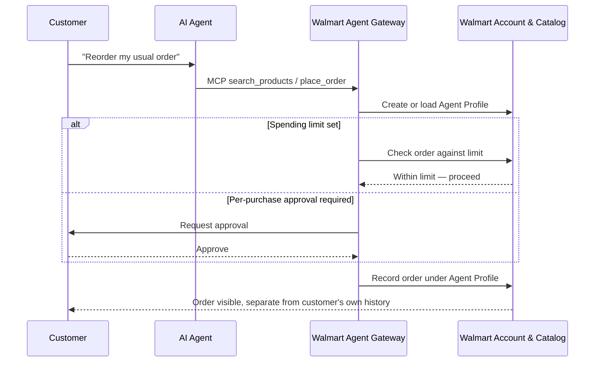

## Abstract

Walmart opened an MCP server on Oct. 21 that lets approved AI agents shop its catalog and Sam's Club's, with every agent's purchases routed through a profile a human can cap, approve line-by-line, or delete[^s01][^s02] — the same week trade press keeps noting that Amazon blocks agent purchases outright. Cloudflare and Commerce.com turned on the newer WebMCP standard across roughly 100,000 storefronts so agents can call a declared `search_products` tool instead of guessing which button to click[^s03]. And Google gave its Agents CLI an extension system that lets LangChain and LangGraph agents run through the same tool ADK agents use, ending the CLI's lock to its own framework[^s04]. None of the three expands what an agent is allowed to buy or build; each adds a layer that decides who gets to say yes.

## Introduction

This edition covers **2026-10-19 through 2026-10-22**. Background on payment rails lives in the site's [agent commerce protocol comparison](../agent-commerce-protocol/); background on card-network products lives in [agent commerce and card payments](../agent-commerce-card-payments/). The last several editions tracked Money20/20's payment-rail pilots and a paywall bug in x402's reference implementation. This window, no payment-rail protocol moved — the news sits one layer up, at who gets to let an agent through the door at all: a retailer's own account system, a CDN's default configuration, and a CLI's command table.

## What moved

### Walmart opens a gateway for shopping agents, draws a sharper line than Amazon's

Walmart's Agent Gateway is an MCP server: an agent that supports the protocol can search Walmart's and Sam's Club's live inventory and place an order, instead of clicking through a rendered page[^s01]. The company's own announcement frames the control layer as the actual product. Every agent gets an Agent Profile inside the customer's account the first time it shops through the gateway, so its orders sit apart from the customer's own purchase history. A customer can require approval for every transaction, set a spending limit instead, view what each agent has bought, or delete a profile outright. Agents can't see payment-card details, can't change the payment method on file, and get blocked from the site if they act outside what the customer asked for. Walmart's stated reasoning for the privacy boundary doubles as a pricing promise: "We price products, not people"[^s01] — the same catalog price a human shopper would see, shown to the agent before it buys.

That design reads differently next to Amazon, which TechCrunch frames as the retailer blocking agent purchases rather than gating them[^s02]. Walmart isn't claiming a technical breakthrough Amazon lacks; MCP has been available to any retailer willing to stand up a server. The difference is the choice to let an unaffiliated agent buy at all, and to build the accountability machinery (profiles, approval, a revocation switch) as the price of saying yes.

*What the arrows assert: per Walmart's own announcement[^s01], every agent purchase passes through a profile-scoped gate, either a standing spending limit or a live approval round-trip to the customer, before an order is recorded.*

### Cloudflare and Commerce.com make WebMCP the default across ~100,000 storefronts

WebMCP is a Google-originated, still-experimental browser standard that lets a site expose structured tools, like `search_products` or `add_to_cart`, that an agent can call directly through `document.modelContext`. The agent skips parsing HTML and guessing which element to click[^s03]. Cloudflare's edge already supported it in beta since August; this week, Commerce.com switched it on zone-wide for the roughly 100,000 storefronts it runs on Cloudflare's network, with Cloudflare injecting the enabling script and proxying Commerce.com's own MCP server tool definitions to the shopper's browser unchanged. A merchant that doesn't want agents calling its tools can opt out from its dashboard; the opt-out is an edge rule, not a renegotiation with Cloudflare or Commerce.com. If a shopper's browser doesn't support WebMCP, or the merchant's MCP server is down, the script exits and the page loads as if nothing changed.

The number is Cloudflare's own count of storefronts with the script active by default, not a count of storefronts an agent has actually shopped at yet _(vendor-stated)_. What it changes is the failure mode: a scraping agent breaks when a site redesigns a button; a WebMCP agent breaks when the declared tool's schema changes, which is a smaller and more visible surface. Security researchers reviewing the standard separately have flagged a different surface that neither Cloudflare's post nor this narrower rollout addresses: a declared tool's description or return value can carry injected instructions, and an agent calling that tool through the shopper's own authenticated browser session inherits whatever access that session already has[^s05] _(unverified — single source)_.

### Google decouples its Agents CLI from its own framework

Google's Agents CLI, the command-line tool for taking an agent to production on Google Cloud, shipped an Extension System in v1.5.0 that lets a team swap in LangChain, LangGraph, or Deep Agents instead of Google's own Agent Development Kit, without forking the tool[^s04]. Six commands had assumed an ADK runtime; an extension is a Git-hosted YAML file that overrides or adds commands, installed with `agents-cli extension add` and pinned to a commit SHA in a lockfile. The first-party LangChain extension landed two versions later, in v1.8.0, and runs LangGraph Studio in place of ADK's web UI for its `playground` command. Google's post makes the compatibility case explicit: LangChain 1.0 and above already use LangGraph for state management, so LangChain, LangGraph, and Deep Agents all compile down to one graph representation underneath[^s04].

The system is marked experimental, and Google names platform-team use cases, such as enforcing an SBOM scan before deploy or gating login behind SSO, as the reason the extension mechanism exists at all. The goal isn't running someone else's framework for its own sake; it's letting a platform team's rules apply regardless of which framework a given team picked.

## Why it matters

None of this week's three items made an agent capable of something it couldn't already attempt; an agent could crawl Walmart's pages, scrape a product listing, or run through Google's CLI on Monday just as well as Friday. What changed sits a level below capability, in who gets to revoke it and how finely. Walmart ties every purchase to an account a human owns and can shut off. Cloudflare's opt-out puts that switch in a merchant's dashboard instead of a support ticket. Google's extension scoping puts it in a platform team's YAML file instead of a framework vendor's roadmap. The granularity differs in each case, but the shape of the fix is the same: access didn't get wider, it got a named owner.

## Signals to watch

- Does any retailer besides Walmart publish comparable agent-purchase terms, or does Walmart's approach stay the exception against a wider pattern of blocking?
- Whether Commerce.com's WebMCP rollout produces a measurable share of agent-originated orders, versus sitting unused while agents keep scraping pages that haven't adopted the standard.
- Google's Extension System schema, which the company has flagged as subject to change before it stabilizes.
- Any independent report on how Walmart enforces its approval and spending-limit rules — client-side policy an agent is trusted to honor, or a server-side check the gateway itself makes.

## Limitations

Walmart's Agent Gateway and Agent Profiles are sourced to the company's own announcement and TechCrunch's reporting on it; no outlet in this window reports hands-on use of the gateway or independently confirms how approval enforcement works end to end. The Cloudflare/Commerce.com storefront count and the "no latency" claim for the opt-out mechanism are vendor-stated, from Cloudflare's own blog, with no independent benchmark; the prompt-injection and session-inheritance risk noted for WebMCP comes from a single vendor's security research, not an assessment of this specific rollout. Feeds, web search, and GitHub were all reachable this window; the social lane returned Hacker News results only (Bluesky and Reddit need credentials not configured in this environment), and nothing from it cleared the novelty or substance bar for this beat. No payment-rail protocol (AP2, x402, ACP, UCP, MPP, L402, Trusted Agent Protocol) produced new, uncited material this window; the papers lane wasn't run, since nothing scouted in the other lanes pointed to a new academic result.
