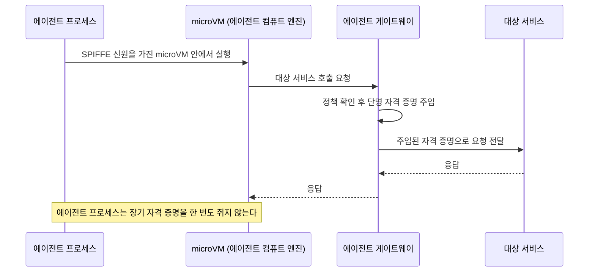

## 초록

1패스워드는 비밀번호를 한 번도 손에 쥐지 않고 에이전트가 사용자의 계정에 로그인하게 하는 기능을 내놨다. 자격 증명은 끝까지 1패스워드가 쥐고 있고, 사용자는 이름을 보고 로그인 시도를 하나씩 승인한다[^s01]. 구글은 같은 발상을 인프라 층에서 더 날카롭게 구현했다. 에이전트 컴퓨트 엔진은 실행 중인 모든 에이전트에게 하드웨어에 뿌리내린 신원을 부여하고, 그 신원은 필요 없는 비밀은 아예 쥐지 못한다[^s02][^s03]. 스트라이프가 머니20/20을 정리한 글은 이 두 해법이 건드리지 못한 조각을 짚는다. 결제 자격 증명은 에이전트가 돈을 쓸 권한이 있다는 걸 증명할 뿐, 소비자가 실제로 무엇을 사라고 했는지는 증명하지 못한다[^s05]. 셋 다 결제 레일 발표가 아니다. 셋 다 같은 질문을 서로 다른 층에서 던지고 있을 뿐이다. 로그인, 연산, 거래.

## 서론

이번 호는 **2026년 10월 20일부터 23일까지**를 다룬다. 결제 레일 배경지식은 사이트의 [에이전트 커머스 프로토콜 비교](../agent-commerce-protocol/)에, 신원 체계 배경지식은 [에이전트 신원과 평판 레지스트리](../agent-identity-reputation-registry/)에 있다. 지난 호는 누가 에이전트를 매장 문 안으로 들여보낼지를 다뤘다. 월마트의 게이트웨이, 클라우드플레어의 WebMCP 기본값, 구글 CLI의 확장 체계가 그랬다. 이번 주는 그 질문이 한 단계 아래로 내려갔다. 들여보낸 다음 에이전트 손에 쥐여주는 자격 증명이 정확히 무엇이고, 그것을 누가 거둬들일 수 있는지로.

## 이번 주 움직임

### 1패스워드, 비밀번호 없이 에이전트 로그인을 중개하다

1패스워드의 새 기능인 1Password for Agents는 사용자가 AI 에이전트에게 자신의 계정 로그인 권한을 넘겨주되, 아이디와 비밀번호 자체는 에이전트에게 전달하지 않는다[^s01]. 에이전트는 자신을 증명하는 서명된 요청을 보내고, 1패스워드는 사용자에게 알림을 띄워 이름으로 승인이나 거부를 받는다. 승인되면 자격 증명을 채워 넣는 일은 1패스워드가 직접 한다. 테크크런치는 출시 시점에 지원되는 에이전트 여섯 개를 꼽았다. 앤트로픽의 클로드 듀엣, 오픈AI의 닷츠와 챗GPT 워크, xAI의 그록 봇, 메타의 뮤즈, 그리고 스타트업 타운의 에이전트들이며 더 많은 업체가 뒤따를 예정이다[^s01].

이 설계는 한쪽 구멍은 막고 다른 쪽은 그대로 열어둔다. 비밀번호 자체는 에이전트의 컨텍스트 창이나 메모리, 제공사 로그를 통해 새어나갈 길이 없어졌다. 에이전트가 애초에 쥔 적이 없으니까. 하지만 1패스워드가 요구하는 승인은 이분법이다. 이 에이전트를 이 계정에 들일지 말지, 딱 거기까지다. 일단 들어간 에이전트가 무엇을 하는지는 범위에 들지 않는다. 여행 예약 에이전트의 항공사 계정 로그인을 승인한 사용자는, 비밀번호를 직접 건넸을 때와 똑같은 정도로 그 이후의 모든 판단을 에이전트에게 맡기는 셈이다. 테크크런치는 이 출시를 미국 은행들이 고객 계정에서 에이전트 활동을 감지하기 시작했지만 사용자가 승인한 활동과 그렇지 않은 활동을 안정적으로 구분하지 못한다는, 아직 검증되지 않은 보도와 나란히 놓는다. 1패스워드의 해법이 이 문제를 줄이기는 해도 없애지는 못한다는 뜻이다. 은행은 세션만 들여다봐서는 승인된 에이전트 로그인과 탈취된 로그인을 여전히 가려낼 수 없다.

### 구글, 에이전트에게 빌려온 신원이 아니라 하드웨어 신원을 쥐여주다

구글의 에이전트 컴퓨트 엔진은 에이전트 게이트웨이, 에이전트 레지스트리, 에이전트 아이덴티티, 에이전트 옵저버빌리티로 확장된 거버넌스 스택과 같은 주에 공개됐다. 이 엔진은 각 에이전트를 저마다의 microVM 안에서 돌리고, SPIFFE 기반의 암호학적 신원과 단명 자격 증명을 부여한다[^s02][^s03]. 에이전트가 다른 서비스에 접근할 때 쓰는 자격 증명은 네트워크 송신 지점, 즉 microVM 바깥에서 주입된다. 그래서 실행 중인 에이전트 프로세스 자체는 자신이 쓸 권한을 가진 장기 비밀을 한 번도 쥐지 않는다. 구글이 내세우는 이유는 보안 과시가 아니라 구조적 필요다. 제미나이의 에이전트들은 기존의 장수명 연산이 전제로 삼았던 속도보다 훨씬 자주 시작되고 멈추고 재개되는데, 서비스 계정을 VM 수명만큼 빌려 쓰는 기존 신원 모델은 몇 초짜리 세션에 맞춰 줄어들지 않는다.

같은 날 구글 개발자 블로그에 올라온 글은 프로젝트 크리살리스를 소개한다. ADK 기반 에이전트가 운영 장애를 진단하고 완화 코드를 작성해 서명한 뒤, 자신이 속한 멀티 에이전트 구조 자체를 영구적으로 바꾸자고 제안하는 연구용 참조 아키텍처다. 코드 샌드박싱, 암호 서명, 정책 검사, 변조 탐지 로깅으로 이어지는 네 단계 관문을 거친다[^s04]. 블랙프라이데이 캐시 폭주 상황을 가정한 시뮬레이션에서 이 체계는 최초 완화 조치까지 걸리는 시간을 15~45분에서 1.8초로 줄였다. 실제 운영 결과가 아니라 시연 결과지만, 에이전트 컴퓨트 엔진이 깔고 있는 것과 같은 내기를 보여준다. 스스로 판단해 행동하는 에이전트는 그 행동 하나하나가 개별적으로 서명되고 검사되고 추적될 수 있을 때만 그 위험을 감수할 가치가 있다는 내기다.

*화살표가 주장하는 것: 구글의 발표에 따르면[^s02][^s03] 다른 서비스 호출을 승인하는 자격 증명은 에이전트의 microVM 바깥, 게이트웨이 단계에서 붙는다. 실행 중인 에이전트 프로세스를 장악해도 재사용 가능한 비밀까지 손에 넣지는 못한다.*

### 스트라이프, 결제 업계가 엉뚱한 절반을 풀었다고 말하다

스트라이프가 정리한 머니20/20 2026 후기는 에이전트 결제 논의가 엉뚱한 질문에 답해왔다고 주장한다[^s05]. 카드 번호든 지갑 키든 API 토큰이든, 결제 자격 증명은 에이전트가 돈을 쓸 권한이 있음을 증명할 뿐이다. 그 권한을 준 소비자가 실제로 무엇을 의도했는지는 아무것도 말해주지 않는다. "싼 항공편을 찾아줘" 같은 지시는 "싸다"의 해석을 에이전트에게 맡기고, 소비자가 생각한 상한선이 40만원인지 400만원인지는 자격 증명 어디에도 남지 않는다. 스트라이프 자신의 해법은 금액과 판매자, 용도를 미리 명시해 구매자가 승인하는 지출 요청 방식이다. 아메리칸 익스프레스는 경쟁하는 접근을 내놓았는데, 같은 정보를 거래 더 이른 단계에서 받아 카드사가 승인 전에 자체 통제를 걸 수 있게 한다.

둘 중 어느 쪽도 업계 공통의 답이 되지 못했고, 스트라이프도 그렇게 주장하지 않는다. 이 글은 머니20/20의 에이전트 결제 패널들이 계속 돌아왔던 미해결 공백으로 이를 그리지, 자신이 풀었다고 말하지 않는다. 스트라이프 자신의 해법보다 이 틀 자체가 더 중요하다. 이 브리프가 추적하는 결제 레일 스펙 전부, x402, AP2, ACP, UCP, MPP, L402, 트러스티드 에이전트 프로토콜 가운데 어느 것도 "소비자의 의도"를 기계가 검증할 수 있는 형태로 정의하지 않는다. 그 스펙들은 누가 쓸 수 있는지를 정할 뿐, 소비자를 대신해 쓴다는 것이 실제로 어떤 모습이어야 하는지는 정하지 않는다.

## 왜 중요한가

세 회사가 이번 주 같은 구멍을 서로 다른 방향에서 메웠고, 그 해법들은 서로 겹치지 않는다. 1패스워드는 누가 에이전트를 로그인시킬지를 중개할 뿐, 들어간 에이전트가 무엇을 하는지, 그 자리에서 얼마까지 쓸 수 있는지는 말해주지 않는다. 구글의 하드웨어 신원은 에이전트 프로세스가 사칭되거나 자격 증명을 탈취당할 수 없다고 보장할 뿐, 그 신원이 승인한 행동이 사람이 실제로 원했던 것과 일치하는지는 말해주지 않는다. 스트라이프의 의도 계층은 바로 그 마지막 공백을 겨냥하지만, 아직 출시된 표준으로 존재하지 않는다. 셋을 나란히 놓으면 바닥은 단단하고 지붕은 없는 구조가 보인다. 신원과 접근 통제는 빠르게 여물어가는데, 특정 에이전트 행동이 특정 인간의 의도와 맞아떨어지는지를 가리는 문제는 결제 업계 스스로의 인정대로 여전히 풀리지 않았다.

## 지켜볼 신호

- 은행이나 카드사가 에이전트 발(發) 거래와 연결된 사기·분쟁 데이터를 시뮬레이션이 아니라 실제로 공개하는지. 스트라이프가 말한 의도 공백이 벌써 돈이 새고 있는 문제인지, 아직 이론상의 문제인지 가늠할 수 있다.
- 1패스워드의 로그인 단위 승인이 세션 단위 제한, 즉 인증된 에이전트가 할 수 있는 일에 시간이나 행동 상한을 두는 방향으로 확장될지.
- 에이전트 컴퓨트 엔진이 "수개월 내 프리뷰"에서 확정된 출시일로 넘어가는 시점, 그리고 그 전에 구글 밖 보안 연구자가 SPIFFE·microVM 주장을 검증하는지.
- 스트라이프의 지출 요청 형식과 아멕스의 발급사 중심 접근이 하나의 스펙으로 합쳐질지, 아니면 가맹점과 발급사가 각각 따로 지원해야 하는 호환되지 않는 두 방식으로 남을지.

## 한계

1패스워드의 출시는 테크크런치 기사 한 건에만 의존한다. 이번 주 창에서 다른 매체의 독립 취재는 찾지 못했고, 테크크런치가 언급한 미국 은행의 에이전트 계정 활동 감지 관련 액시오스 보도는 찾거나 검증할 수 없어 여기서는 빼고 간접 인용도 하지 않았다. 에이전트 컴퓨트 엔진과 그 거버넌스 스택은 전적으로 구글 자체 게시물에만 의존한다 _(벤더 발표)_. 이 글들은 겨냥했던 AGNTCon+MCPCon 행사 당일에 올라왔고, 작성 시점까지 독립적인 보안 검토나 외부 언론 보도는 나오지 않았다. 프로젝트 크리살리스의 1.8초 수치는 시뮬레이션 벤치마크이지 실제 운영 측정치가 아니다. 스트라이프의 머니20/20 후기도 마찬가지로 단일 벤더가 컨퍼런스 패널을 정리한 글이고 _(벤더 발표)_, 삼성·시티·발리노어 디지털·로빈후드를 거론한 부분은 독립적으로 확인하지 않았다. 이 브리프가 추적하는 결제 레일 프로토콜(AP2, x402, ACP, UCP, MPP, L402, 트러스티드 에이전트 프로토콜) 가운데 이번 주 새로 인용할 만한 내용을 낸 곳은 없었다. x402의 깃허브 활동은 자동화된 SDK 드리프트 봇 보고와 트래픽이 적은 커뮤니티 제안에 그쳐 신선도 기준을 넘지 못했다. 피드, 웹 검색, 깃허브 레인은 모두 이번 주 정상 작동했다. 소셜 레인은 이 주제에서 해커뉴스 결과가 없었고, 블루스카이와 레딧은 이 환경에 설정되지 않은 인증 정보가 필요하다. 논문 레인은 다른 레인에서 새 학술 결과로 이어질 단서가 나오지 않아 돌리지 않았다.
