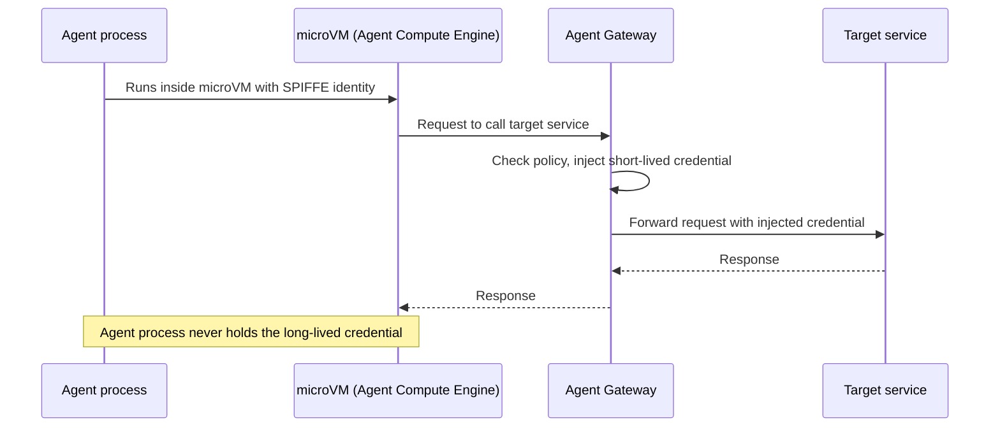

## Abstract

1Password shipped a way for an agent to log into a user's own accounts without ever holding the password; the credential stays with 1Password, and the user approves each login by name[^s01]. Google gave its agents a harder-edged version of the same idea at the infrastructure layer: Agent Compute Engine assigns every running agent a hardware-rooted identity that outlives nothing it shouldn't and holds no secret it doesn't need[^s02][^s03]. Stripe's recap of Money20/20 names the piece neither of those fixes: a payment credential proves an agent can spend, not what the consumer actually asked it to buy[^s05]. None of the three is a payment-rail announcement. All three are the same question, asked at a different layer: login, compute, transaction.

## Introduction

This edition covers **2026-10-20 through 2026-10-23**. Background on payment rails lives in the site's [agent commerce protocol comparison](../agent-commerce-protocol/); background on identity schemes lives in [agent identity and the reputation registry](../agent-identity-reputation-registry/). The previous edition tracked who gets to let an agent through a storefront's door — Walmart's gateway, Cloudflare's WebMCP default, Google's CLI extension system. This window the access question moved one level down, into what credential an agent is actually handed once it's let in, and who can revoke it.

## What moved

### 1Password brokers agent logins so the agent never sees a password

1Password's new feature, 1Password for Agents, lets a user hand an AI agent the ability to log into one of their own accounts without the agent ever receiving the username or password[^s01]. The agent sends a signed request identifying itself; 1Password alerts the user, who approves or denies by name; on approval, 1Password fills the credential into the page itself. TechCrunch names six agents at launch: Anthropic's Claude Duet, OpenAI's Dots and ChatGPT Work, xAI's Grok Bot, Meta's Muse, and agents from the startup Town, with more vendors in the pipeline[^s01].

The design closes one gap and leaves another open. The password itself can no longer leak through an agent's context window, memory, or provider logs, since the agent never holds it. But the approval 1Password asks for is binary, let this agent into this account or don't, and it isn't scoped to what the agent then does once inside. A user who approves a travel-booking agent's login to their airline account is trusting the agent's judgment for everything from there, the same trust they'd extend by handing over the password directly. TechCrunch frames the launch against a separate, unverified report that US banks have started detecting agentic logins in customer accounts without reliably telling user-authorized activity from unauthorized activity. That's a problem 1Password's fix narrows but doesn't close: a bank still can't distinguish an approved agent login from a compromised one by looking at the session alone.

### Google gives agents a hardware-rooted identity instead of a borrowed one

Google's Agent Compute Engine, unveiled the same week as an expanded governance stack (Agent Gateway, Agent Registry, Agent Identity, Agent Observability), runs each agent in its own microVM with a SPIFFE-based cryptographic identity and short-lived credentials[^s02][^s03]. The credential that lets the agent reach another service is injected at the network egress point, outside the microVM itself, so the running agent process never holds the long-lived secret it's authorized to use. Google's stated reason is architectural, not security theater: Gemini's agents start, pause, and resume at a rate traditional long-lived compute was never built around, and the existing identity model, a service account borrowed for the lifetime of a VM, doesn't shrink to match a session that might last seconds.

A same-day companion post from Google's developer blog describes Project Chrysalis, a research reference architecture that lets an ADK-based agent diagnose a production outage, write and sign a mitigation, and propose a permanent change to its own multi-agent structure, gated by a four-step chain of code sandboxing, cryptographic signing, policy checks, and tamper-evident logging[^s04]. In a simulated Black Friday cache-stampede test, that chain cut time-to-first-mitigation from 15–45 minutes to 1.8 seconds — a demo result, not a production one, but illustrative of the same bet Agent Compute Engine makes: an agent that can act on its own is worth the risk only if every action it takes is individually signed, checked, and attributable.

*What the arrows assert: per Google's own announcement[^s02][^s03], the credential that authorizes a call to another service is attached at the gateway, outside the agent's own microVM, so compromising the running agent process does not hand over a reusable secret.*

### Stripe says the payments industry solved the wrong half of the problem

Stripe's recap of Money20/20 2026 argues the agentic-payments conversation has been answering the wrong question[^s05]. A payment credential, whether a card number, a wallet key, or an API token, proves an agent is authorized to spend money. It says nothing about what the consumer who granted that authorization actually meant: an instruction like "find me a cheap flight" leaves "cheap" open to an agent's own interpretation, and no part of the credential records that the consumer's ceiling was $400, not $4,000. Stripe's own proposed fix is a spend request that names the amount, seller, and purpose up front for the buyer to approve before the agent completes a purchase; American Express's competing approach pushes the same information earlier in the transaction, so the card issuer can set its own controls before authorization rather than after.

Neither proposal has become the industry's shared answer, and Stripe doesn't claim it has: its post frames this as the unresolved gap the Money20/20 agentic-payments panels kept circling back to, not as a problem it has closed. The framing matters more than Stripe's own fix. Of all the published payment-rail specs this beat tracks (x402, AP2, ACP, UCP, MPP, L402, Trusted Agent Protocol), none define what "the consumer's intent" means in a machine-checkable way. They settle who can spend. They don't settle what spending on the consumer's actual behalf is supposed to look like.

## Why it matters

Three different companies spent this window patching the same hole from three different directions, and none of their fixes overlap. 1Password brokers who gets to log an agent in; it says nothing about what the agent does once it's in, or what dollar amount it's allowed to spend while it's there. Google's hardware identity says an agent's process can't be impersonated or have its credentials lifted; it says nothing about whether the action that identity authorizes was the one a human actually wanted. Stripe's intent layer is aimed precisely at that last gap, and it still doesn't exist as a shipped standard. Read against each other, the three items describe a stack with a solid floor and no roof: identity and access control are maturing fast, while the question of whether a specific agent action matches a specific human intent is still, by the payments industry's own admission, unsolved.

## Signals to watch

- Whether any bank or card network publishes real (not simulated) fraud or dispute data tied to agent-initiated transactions, which would test whether the intent gap Stripe describes is costing money yet or still theoretical.
- Whether 1Password's per-login approval model gets extended into session-scoped limits, a time or action cap on what an authenticated agent can do, rather than staying a binary gate.
- Agent Compute Engine's move from "preview in the coming months" to a firm release date, and whether any security researcher outside Google audits the SPIFFE/microVM claims before then.
- Whether Stripe's spend-request format and Amex's issuer-side approach converge into one spec, or ship as separate, incompatible mechanisms that merchants and issuers have to support in parallel.

## Limitations

1Password's launch is sourced to a single TechCrunch article; no second outlet's independent reporting was found in this window, and the Axios report on banks detecting agentic account activity that TechCrunch references could not be located or verified independently, so it is omitted here rather than cited secondhand. Agent Compute Engine and its governance stack are sourced entirely to Google's own posts _(vendor-stated)_, published the same day as the AGNTCon+MCPCon event they were timed to; no independent security review or outside press coverage had appeared as of this writing. Project Chrysalis's 1.8-second remediation figure is a simulated benchmark, not a production measurement. Stripe's Money20/20 recap is similarly a single vendor's synthesis of conference panels _(vendor-stated)_, and its named partner claims (Samsung, Citi, Valinor Digital, Robinhood) were not independently checked. No payment-rail protocol (AP2, x402, ACP, UCP, MPP, L402, Trusted Agent Protocol) produced new, citable material this window: x402's GitHub activity was limited to an automated SDK-drift bot report and low-traffic community proposals that didn't clear the novelty bar. Feeds, web search, and GitHub were all reachable this window; the social lane returned no Hacker News results for this beat, and Bluesky and Reddit need credentials not configured in this environment. The papers lane wasn't run, since nothing scouted elsewhere pointed to a new academic result.
