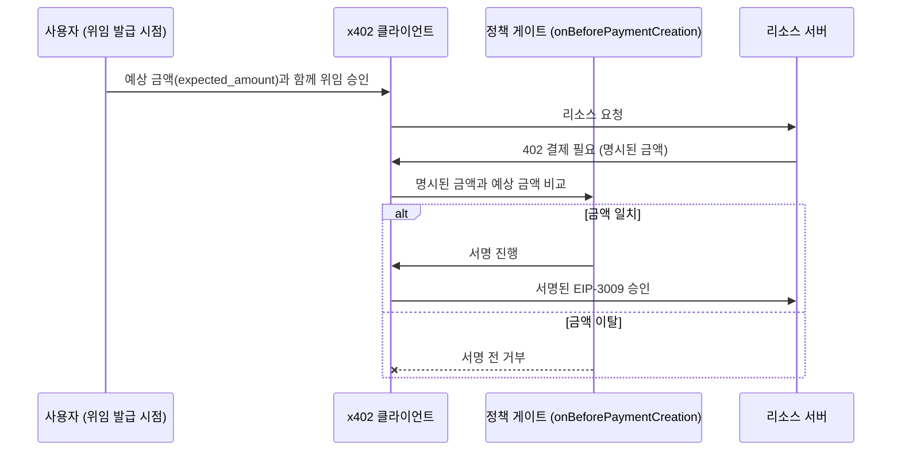

## 초록

이번 주 x402 결제 프로토콜에 올라온 두 건의 버그 리포트가 추상적인 우려를 실제 작동하는 익스플로잇으로 바꿔놓았다. 공식 클라이언트는 서버가 402 응답에 적어 보낸 금액을 그대로 서명하고 지불하며, 부풀려진 가격과 서명된 송금 사이를 막는 건 호출자가 설정한 지출 한도뿐이다[^s01]. 또 다른 미패치 의존성 문제로는, `@x402/core`를 쓰는 모든 프로젝트가 CI에서 심각도 높은 CVE를 해결할 방법이 없어 빌드를 실패시키거나 해당 취약점을 영구히 허용 목록에 올려야 하는 상황에 놓였다[^s02]. 두 건 모두 보도자료로 나온 소식이 아니다. 둘 다 공개 GitHub 스레드에서 드러났고, 지금 x402의 실질적인 보강 작업이 벌어지는 곳도 바로 거기다. 같은 기간 OpenAI는 전혀 다른 종류의 에이전트 도구 소식을 내놓았다. 신뢰의 문제가 아니라 속도의 문제다. Decisions API를 정식 출시하면서, 에이전트의 다음 행동 결정에서 밀리초를 누가 더 깎아낼 수 있는지를 둘러싼 경쟁에 뛰어들었다[^s03].

## 서론

이번 호는 **2026년 10월 21일부터 10월 24일까지**를 다룬다. 결제 레일 전반(x402, AP2, ACP, UCP, MPP, L402, Trusted Agent Protocol)에 대한 배경은 사이트의 [에이전트 커머스 프로토콜 비교](../agent-commerce-protocol/)에, 에이전트 신원 체계에 대한 배경은 [에이전트 신원과 평판 레지스트리](../agent-identity-reputation-registry/)에 있다. 지난 호는 같은 미해결 문제에 대한 세 가지 서로 다른 보완책, 에이전트의 로그인·자격 증명 보유·지출을 누가 허락하는가를 다루며, Stripe의 정리로 마무리됐다. "소비자를 실제로 대신해 지출한다"는 것이 기계가 검증할 수 있는 형태로 무엇을 의미하는지, 아직 어떤 결제 레일 스펙도 정의하지 않았다는 지적이었다. 이번 주, 그 공백은 더 이상 이론에 머물지 않았다.

## 이번 주 동향

### x402 공식 클라이언트, 서버가 부르는 금액을 그대로 지불한다

한 보안 연구자가 공식 x402 v2 TypeScript 스택(`@x402/fetch` + `@x402/core` + `@x402/evm` 2.28.0)을 적대적인 리소스 서버에 대해 테스트한 결과, 2026년 10월 21일 Base Sepolia에서 10배 과청구를 세 번 연속 재현했다[^s01]. 구조는 단순하다. x402의 402 응답은 가격을 명시하고, 클라이언트는 그 숫자를 그대로 지불할 가격으로 취급한다. 이 숫자를 대조할 독립적인 기준이 클라이언트 안에 없다. 세션 초반에 받은 서명된 견적도 없고, 서버가 방금 보낸 숫자보다 낮은 호출자 쪽 상한도 없다. 악의적이거나 침해당했거나 중간에서 가로채는 서버라면, 호출자가 설정한 지출 한도까지는 얼마든지 청구할 수 있고, 결제를 수행하는 자동화 에이전트는 이를 알아챌 방법이 없다.

이어진 스레드는 버그 리포트로서는 유독 내용이 알차다. 한 댓글 작성자가 원래 주장의 과도한 부분을 지적했다. 캡처된 것은 서명된 승인이 모의 정산 레이어로 넘어간 것이지, 확인된 온체인 과지불이 아니라는 점이었다. 보고자는 이 구분을 인정했고, 더 강한 주장을 그대로 밀고 가는 대신 버전을 고정한 정제된 픽스처로 증명을 다시 만들었다. 이어 x402 결제를 실제 운영 중이라는 또 다른 댓글 작성자가 작동하는 완화 방법을 공개했다[^s01]. 예상 가격을 사람이 결제 위임(mandate)을 승인하는 시점에 묶어두고, 이후 서버가 뭐라 말하든 그것과 무관하게 두며, 두 값이 어긋나면 서명이 생성되기 전에 거부하는 방식이다. 이 댓글 작성자 본인의 정책 게이트는 Base 메인넷에서 종단간 검증을 거쳤고, 10배 가격 이탈을 서명 전에 포착해 거부했다. 이것이 바로 프로토콜의 공식 클라이언트가 기본값으로는 제공하지 않는 수정이다.

*화살표가 주장하는 것: GitHub 이슈 스레드에 따르면[^s01], x402 클라이언트의 기본 경로는 402 응답이 명시한 금액이 무엇이든 그대로 서명한다. 가격 이탈에 대해 실증된 유일한 방어는 호출자가 추가한 정책 게이트로, 위임 발급 시점에 독립적으로 설정된 예상값과 서버가 보낸 숫자를 대조해 서명이 만들어지기 전에 거부하는 것뿐이다.*

### 패치판이 없는 의존성 CVE, 그리고 불분명한 피해 범위

10월 23일에 등록된 별도 이슈는 `@x402/core` 2.28.0이 `zod ^3.24.2`를 고정 의존성으로 잡고 있다는 사실을 드러냈다. 이 버전에는 심각도 높은 CVE(CVE-2023-54404, CVSS 7.5, 길이 제한 없는 배열 검증으로 인한 메모리 소진)가 있으며, 수정된 버전은 zod 4.6.6뿐이다[^s02]. 업그레이드할 수 있는 패치된 3.x 버전이 없고, override로 zod 4를 강제하면 `@x402/core`가 선언한 의존성 범위 자체를 어기게 된다. `npm audit --audit-level=high`를 CI에서 돌리는 하위 프로젝트는 전부, 빌드를 실패시키거나 해당 취약점을 영구히 허용 목록에 올리는 것 중 하나를 골라야 하는 처지다.

보고자는 "이 패키지가 CVE에 의존한다"에서 멈추지 않고, 실제로 도달 가능한 경로인지 확인하는 더 번거로운 일을 했다. 공개된 `dist/` 결과물을 따라가 보니, 길이 제한 없는 배열은 402 응답을 검증하는 두 개의 export 헬퍼 함수 `isPaymentRequiredV1`/`V2`에만 있었고, x402 내부 코드 중 이 함수들을 신뢰할 수 없는 입력에 호출하는 곳은 찾지 못했다. 이 한 번의 컴파일된 코드 분석이 말해주는 범위는, 서버 응답을 검증하려고 이 헬퍼들을 직접 가져다 쓰는 서드파티 프로젝트로 좁혀진다. "x402에 심각도 높은 CVE가 있다"보다 훨씬 좁은 문제이고, 하위 개발자에게는 감사 도구의 빨간 경고에 당황하는 대신 자기 코드에서 정확히 무엇을 확인해야 하는지를 알려주는, 더 쓸모 있는 결론이다.

### OpenAI, Decisions API 정식 출시로 같은 자리를 노리는 경쟁자와 맞붙다

결제 계층을 벗어나면, OpenAI는 10월 22일 Decisions API를 전체 고객에게 공개했다. 디벨로퍼 데이에서 발표한 지 3주 만이다[^s03]. 전용 결정 모델을 새로 학습시키는 대신 기존 Luna 모델을 추론 속도에 맞춰 재구성했고, 그 결과 응답 시간은 1~3초에서 약 100~180밀리초로 줄었다고 밝혔다. 음성·이미지 입력 지원과 지역별 추론 배치도 추가해 지연시간을 더 깎았다. OpenAI의 API 제품 리드는 별도의 아키텍처가 필요 없었던 이유를 이렇게 설명했다. "하지만 지금은 그냥 평범한 Luna가 일을 해내고 있는 것뿐입니다."

이 경쟁에는 이미 전담 선수가 있다. TypeSafe의 Jev는 범용 LLM이 같은 일을 느리게 처리하는 대신, 주어진 선택지 중 하나를 고르고 신뢰도를 반환하도록 처음부터 분류기 형태로 설계된 모델이다. 새로 생긴 이 "결정 모델" 카테고리의 초기 리더보드 두 곳에서 Jev는 현재 OpenAI보다 앞서 있다. 시범 고객 Speak는 빠른 결정 레이어로 전환하면서 자사 에이전트 루프의 단계 간 소요 시간이 1.4초에서 0.13초로 줄었다고 밝혔다. 에이전트가 결정 모델을 호출할 때 선택을 한 번만 하는 게 아니라 연쇄적으로 수십 번 한다는 점, 그리고 그 각각이 예전에는 LLM 왕복 전체의 비용을 치렀다는 점을 생각하면 이 개선이 왜 중요한지 알 수 있다.

## 왜 중요한가

x402의 두 스레드는 지난주의 추상적인 정리를 개발자가 직접 가리킬 수 있는 무언가로 바꿔놓았다. Stripe의 Money20/20 정리는 결제 자격 증명이 에이전트가 지출할 수 있음을 증명할 뿐, 그 금액이 소비자가 실제로 의도한 것과 일치함을 증명하지는 않는다고 짚었다. 이번 주, 그 정리가 암묵적으로 가리켰던 바로 그 프로토콜에서, 누군가 그 공백을 실제로 작동하는 개념증명으로 세 번 연속 구현해 보였다. 그리고 그 수정책은 프로토콜 자체의 스펙에서 나오지 않았다. 공식 클라이언트가 아직 반영하지 않은 댓글 스레드에서, 한 운영자의 실전 우회책으로 나왔다. 에이전트 결제 보안이 지금 실제로 어떻게 개선되고 있는지 보여주는 유용한 사례다. 표준화 기구를 통해서가 아니라, 공개 이슈 트래커에 드러나는 적대적 테스트를 통해서다. 두 스레드 모두에서 프로토콜 관리자들은 지금까지 침묵하고 있다.

Decisions API 경쟁은 완전히 다른 축이고, 지금 가장 빠르게 움직이는 축이라는 점이 눈에 띈다. 그 이야기에서는 누구도 에이전트의 행동이 승인받았는지를 놓고 다투지 않는다. 결정 하나에 몇 밀리초가 드는지를 놓고 경쟁할 뿐이다. 이를 x402의 발견들과 나란히 놓으면 대비가 선명해진다. 에이전트의 다음 행동 비용을 낮추려는 경쟁 압력은 실제로 강하게 작동하고 있지만, 그 행동이 사용자가 동의한 만큼의 비용인지 프로토콜 클라이언트가 스스로 확인하게 만드는 압력은 아직 상대적으로 약하다.

## 지켜볼 신호

- x402 Foundation 또는 `x402-foundation/x402` 관리자가 #3866, #3914 중 하나에라도 머지된 수정이나 문서화된 신뢰 경계 경고로 응답할지, 아니면 둘 다 그대로 둘지.
- 이슈 스레드의 "위임 발급 시점 가격 고정" 패턴: 공식 클라이언트 예제에 채택될까, 한 운영자의 비공식 레시피로 남을까?
- 어떤 하위 프로젝트든 `isPaymentRequiredV1`/`V2`를 신뢰할 수 없는 입력에 실제로 쓰고 있다고 확인되면, zod CVE는 CI상의 불편함에서 실제 익스플로잇 경로로 바뀐다.
- "결정 모델"을 위한 공통 벤치마크가 등장하거나, Jev와 OpenAI의 Decisions API가 측정 대상에 대한 합의 없이 계속 리더보드 순위를 주고받는다.

## 한계

x402 관련 두 발견 모두 관리자나 스레드 외부 독립 보안 연구자의 응답이 아직 없는 공개 GitHub 이슈에 근거하며, 작성 시점까지 언론에서도 다루지 않았다. 과청구 발견의 핵심 주장, 즉 클라이언트가 부풀려진 금액에 대한 승인을 서명한다는 점은 보고자 본인이 수정하여 픽스처 기반으로 재현한 결과로 확인됐다. 다만 그 승인이 실제 온체인 손실로 정산되는지는 확인되지 않았다. 테스트 하네스가 자금이 없는 지갑을 모의 정산자에 대해 사용했기 때문이다. zod CVE의 도달 가능성 분석은 한 보고자가 공개된 `dist/` 결과물만 검토한 것으로, 내부 호출처를 놓쳤을 수 있다고 본인도 밝혔다. OpenAI의 Decisions API 발표 원문은 직접 가져올 수 없었다. openai.com이 자동 수집 요청에 403을 반환했기 때문이다. 따라서 이 글의 수치는 TechCrunch 보도를 거친 것이며, OpenAI 관계자의 발언은 직접 인용했지만 벤치마크 순위는 2차 출처다. AP2, ACP, UCP, MPP, L402, Visa의 Trusted Agent Protocol과 관련해서는 이번 주 새로 인용할 만한 자료가 없었다. AP2와 Visa의 스펙 저장소는 72시간 창 안에 커밋이나 릴리스가 없었다. 피드, 웹 검색, GitHub 레인은 모두 접근 가능했다. Hacker News는 이 주제와 관련된 결과가 없었고, Bluesky와 Reddit은 이 환경에 자격 증명이 설정되어 있지 않다. 논문 레인은 다른 곳에서 새로운 학술 결과를 가리키는 신호가 없어 실행하지 않았다.
