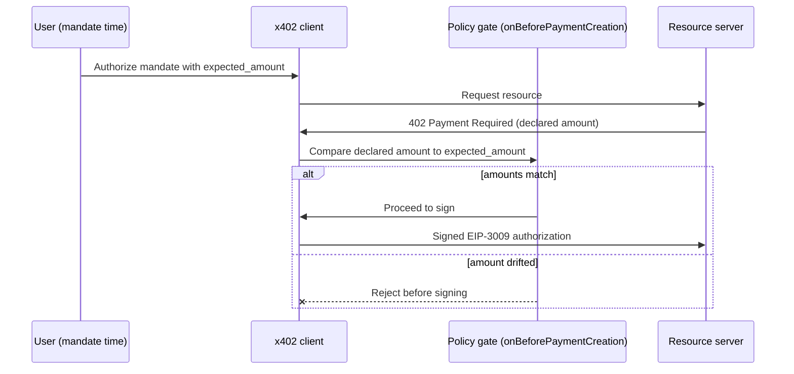

## Abstract

Two bug reports filed against the x402 payment protocol this week turn an abstract worry into a working exploit: the official client signs and pays whatever amount a server names in its 402 response, with nothing but the caller's own spend cap standing between an inflated price and a signed transfer[^s01]. A separate, unpatched dependency leaves every `@x402/core` user unable to clear a high-severity CVE in CI without either failing the build or allowlisting it indefinitely[^s02]. Neither story broke in a press release; both surfaced in open GitHub threads, which is where x402's actual hardening is happening right now. OpenAI shipped a different kind of agent-tooling news this window: it took its Decisions API to general availability, entering a scramble over who can shave the most milliseconds off an agent's next step[^s03].

## Introduction

This edition covers **2026-10-21 through 2026-10-24**. Background on the payment-rail landscape (x402, AP2, ACP, UCP, MPP, L402, Trusted Agent Protocol) lives in the site's [agent commerce protocol comparison](../agent-commerce-protocol/); background on agent identity lives in [agent identity and the reputation registry](../agent-identity-reputation-registry/). The previous edition tracked three separate fixes for the same unsolved problem: who gets to let an agent log in, hold a credential, or spend money. It closed on Stripe's framing that no payment-rail spec yet defines what "spending on the consumer's actual behalf" means in machine-checkable terms. This window, that gap stopped being theoretical.

## What moved

### The official x402 client pays whatever a server asks

A security researcher testing the official x402 v2 TypeScript stack (`@x402/fetch` + `@x402/core` + `@x402/evm` 2.28.0) against an adversarial resource server reproduced a 10x overcharge three times in a row on Base Sepolia on 2026-10-21[^s01]. The mechanism is simple: x402's 402 response names a price, and the client treats that number as the price to pay. There is no independent expectation built into the client to check it against: no signed quote from earlier in the session, no caller-supplied ceiling below the number the server just sent. A server that is malicious, compromised, or sitting in the middle of the connection can charge up to whatever spend cap the caller configured, and the automated agent making the payment has no way to notice.

The thread that followed is unusually substantive for a bug report. One commenter pushed back on an overreach in the original claim: the capture shows a signed authorization handed to a mocked settlement layer, not a confirmed on-chain overpayment. The reporter conceded the distinction and rebuilt the proof with sanitized, version-pinned fixtures instead of defending the stronger claim. A second commenter, running x402 payments in production, then posted a working mitigation: bind the expected price to the payment mandate at the moment a human authorizes it, not to anything the server says later, and veto the transaction before the signature is created if the two diverge[^s01]. Verified end-to-end on Base mainnet, the commenter's own policy gate caught a 10x drift and rejected it pre-signature. That is the fix the protocol's official client doesn't ship by default.

*What the arrows assert: per the GitHub issue thread, the x402 client's default path signs whatever amount a 402 response declares[^s01]; the only demonstrated defense against a drifted price is a caller-added policy gate that compares the server's number against an expectation set independently at mandate time, rejecting before a signature is ever created.*

### A dependency CVE with no patched version, and no clear blast radius

A separate issue, filed 2026-10-23, found that `@x402/core` 2.28.0 pins `zod ^3.24.2`, a version carrying a high-severity CVE (CVE-2023-54404, CVSS 7.5, memory exhaustion from an unbounded array) that is fixed only in zod 4.6.6[^s02]. There is no patched 3.x release to upgrade to, and forcing zod 4 via an override breaks `@x402/core`'s own declared dependency range. Every downstream project that runs `npm audit --audit-level=high` in CI is stuck choosing between a failing build and an advisory it allowlists forever.

The reporter did the harder work of checking whether the vulnerability is actually reachable instead of stopping at "this package depends on a CVE." Walking the published `dist/` output, they found the one unbounded array sits in `isPaymentRequiredV1`/`V2`, two exported helper functions that validate a 402 response, and that no code inside x402 itself calls them on untrusted input. The exposure, as far as this single pass through the compiled code can tell, is scoped to any third-party project that imports those helpers directly to check a server's response. That's a narrower problem than "x402 has a high-severity CVE," and a more useful one: it tells a downstream developer exactly what to check in their own code instead of leaving them to panic at an audit-tool red flag.

### OpenAI's Decisions API goes GA, racing a narrower model built for the same job

Away from the payment layer, OpenAI made its Decisions API available to all customers on 2026-10-22, three weeks after announcing it at developer day[^s03]. Rather than train a dedicated decision model, OpenAI reconfigured its existing Luna model for faster inference, cutting reported response times from 1-3 seconds down to roughly 100-180 milliseconds, and added voice and image input along with region-targeted inference to shave further latency. "But right now, it's just plain old Luna that gets the job done," OpenAI's API product lead said, by way of explaining that no bespoke architecture was needed to compete.

The competition it's entering already has a dedicated incumbent: TypeSafe's Jev, a classifier-style model built from the ground up to pick one option from a set and return a confidence score, instead of a general-purpose LLM doing the same job slower. On two early leaderboards for this new "decision model" category, Jev currently outranks OpenAI's offering. Trial customer Speak reported the switch to a fast decision layer cut the time between steps in its own agent loop from 1.4 seconds to 0.13 seconds. That improvement matters because an agent calling a decision model isn't making one choice; it's making dozens in sequence, and each one used to cost a full LLM round trip.

## Why it matters

The two x402 threads turn last week's abstract framing into something a developer can point at. Stripe's Money20/20 recap argued that a payment credential proves an agent can spend, not that the amount matches what the consumer actually meant. This week, in the protocol most of that framing was implicitly about, someone built exactly that gap into a working proof of concept, three times in a row. The fix that emerged wasn't from the protocol's own spec; it came from one operator's production workaround, posted in a comment thread the official client doesn't yet reflect. Agent-payment security is improving right now through adversarial testing surfacing in public issue trackers, not through standards bodies, and the protocol's maintainers have stayed silent on both threads so far.

The Decisions API race is a different axis entirely, and it's the one moving fastest. Nobody in that story is arguing about whether an agent's action was authorized; they're competing on how many milliseconds it costs to decide. The industry has real competitive pressure driving down the cost of an agent's next step, and comparatively little pressure yet driving a protocol's own client to check whether that step costs what the user agreed to.

## Signals to watch

- Whether the x402 Foundation or `x402-foundation/x402` maintainers respond to either #3866 or #3914 with a merged fix, a documented trust-boundary warning, or neither.
- The `onBeforePaymentCreation` mandate-time price-binding pattern from the issue thread: adopted into the official client's examples, or stuck as one operator's unofficial recipe?
- A downstream project confirming it actually imports `isPaymentRequiredV1`/`V2` on untrusted input would turn the zod CVE from a CI nuisance into a real exploit path.
- A shared benchmark for "decision models" either emerges, or Jev and OpenAI's Decisions API keep trading leaderboard positions with no agreed definition of what's being measured.

## Limitations

Both x402 findings are sourced to open GitHub issue threads with no response yet from the protocol's maintainers or independent security researchers outside the thread itself; neither has been picked up by trade press as of this writing. The overcharge finding's underlying claim, that the client signs an authorization for an inflated amount, is confirmed by the reporter's own revised, fixture-based reproduction. Whether that authorization would settle on-chain as a real-world loss is not confirmed, since the test harness used an unfunded wallet against a mocked facilitator. The zod CVE's reachability analysis covers only the published `dist/` output checked by one reporter, who notes they may have missed an internal caller. OpenAI's own Decisions API announcement could not be fetched directly: openai.com returned a 403 to automated retrieval, so figures here come through TechCrunch's reporting, which quotes OpenAI staff directly but relays benchmark rankings secondhand. No new, citable material appeared this window for AP2, ACP, UCP, MPP, L402, or Visa's Trusted Agent Protocol specifically; AP2's and Visa's spec repositories show no commits or releases inside the 72-hour window. Feeds, web search, and GitHub were all reachable. Hacker News returned nothing specific to this beat, Bluesky and Reddit remain unconfigured in this environment, and the papers lane wasn't run since nothing scouted elsewhere pointed to a new academic result.
