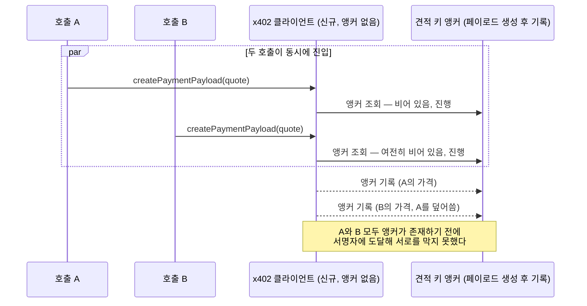

## 초록

지난 브리프가 2026-10-22에 다뤘던 x402 과다청구 버그는 댓글 두 개짜리 GitHub 스레드로 끝나지 않았다. 그 뒤 이틀 사이 제3자가 Base 메인넷에서 가격 조작 패턴이 실제로 얼마나 자주 발생하는지 측정했고, 별도로 개발된 세 가지 수정안이 같은 설계로 수렴했으며, 한 보안 리뷰어는 그 선두 수정안이 머지되기도 전에 동시성 문제를 찾아냈다[^s01][^s02]. 이 중 `@x402/core`에 반영된 것은 아직 없다. 같은 SDK에서는 이와 무관한 두 번째 금액 안전성 문제도 드러났다. 테스트넷으로 한정한 클라이언트가 서버가 구버전 결제 프로토콜로 응답하면 여전히 메인넷 결제에 서명해버리는 문제다[^s03]. 그 사이 워시 세틀먼트와 세틀먼트 오버라이드 과다 책정을 막는 두 건의 퍼실리테이터 측 점검도 리뷰를 거쳐 일부 머지됐다[^s04][^s05][^s06]. AP2, 비자의 Trusted Agent Protocol, L402, MPP, 카드 네트워크 등 이 분야의 다른 영역에서는 이번 창에 인용할 만한 소식이 없었다.

## 서론

이번 호는 **2026-10-22부터 2026-10-25까지**를 다룬다. 결제 레일 전반에 대한 배경은 사이트의 [에이전트 커머스 프로토콜 비교](../agent-commerce-protocol/)에, 에이전트 신원에 대한 배경은 [에이전트 신원과 평판 레지스트리](../agent-identity-reputation-registry/)에 있다. [지난 호](../ai-agent-brief-2026-10-24/)는 지켜볼 신호로 질문 하나를 남기고 끝났다: x402 재단이나 메인테이너들이 과다청구 이슈에 머지된 수정안, 공식 경고, 혹은 아무 반응도 없이 응답할 것인가. 사흘이 지난 지금도 답은 "아무 반응도 없다"이지만, 스레드 자체는 가만히 있지 않았다. 측정치 하나, 경쟁하는 수정안 세 개, 그리고 선두 수정안에서조차 구멍을 찾아내는 리뷰 과정이 그 사이에 쌓였다.

## 이번 주 동향

### 과다청구 스레드에 숫자, 수정안 세 개, 그리고 수정안의 균열이 붙었다

Base의 스테이블코인 세틀먼트를 지켜보는 제3자 AgenticFinanceGraph는 10월 12일부터 23일까지 x402 Bazaar에 등록된 판매자들로 들어간 모든 전송 내역을 읽어 같은 이슈 스레드에 결과를 올렸다. 세틀먼트가 20건 이상인 판매자 80곳(세틀먼트 32,605건, 총 18,950.78달러)을 보면 1,126건(3.5%)이 해당 판매자 자체 중앙값의 10배 이상, 65건이 100배 이상, 그 중 25건은 1달러도 넘었다[^s01]. 이 게시물은 자신이 보여주지 못하는 것에도 신중했다. 중앙값을 크게 벗어난 세틀먼트가 버그 리포트가 지적한 과다청구 메커니즘 자체를 증명하지는 않는다는 점, 판매자가 정당하게 가격을 올렸을 수도 있다는 점, 그리고 이 측정치가 확인된 x402 트래픽이 아니라 등록된 주소로 들어간 모든 스테이블코인 전송을 센다는 점이다. 이 측정이 보여주는 것은 규모다. 이론적으로 가능하다고만 지적됐던 패턴이 한 체인의 2주치 샘플에서 최소 수천 건 단위로 실제 벌어지고 있다.

이 숫자를 계기로 세 곳이 심각도 논쟁 대신 실제 수정안을 내놓았다. x402 재단 코어팀은 PR #3920을 열어 클라이언트 측 지출 통제에 `expectedAmount` 필드를 추가했다. 호출자가 기대하는 가격을 명시하거나, 처음 성공한 견적이 그 기준을 고정하도록 둔 뒤, 거기서 벗어나는 모든 변화는 서명 전에 거부된다. 중간에 가격이 떨어지는 경우도 포함되는데, 허용 범위를 넘는 하락은 같은 함정을 거꾸로 돌린 것이기 때문이다[^s02]. 서드파티 패키지 메인테이너 Tanilo는 이 PR을 리뷰하면서 자사가 배포 중인 `@x402/x402-guard` 0.1.1에도 같은 종류의 틈이 있었다고 요청받지 않았는데도 밝혔다. 호출자의 조건에 수신자가 명시된 경우에만 수신자를 확인했고, 자산이나 네트워크는 전혀 확인하지 않았다는 것이다. NSPG13이라는 아이디를 쓰는 두 번째 리뷰어는 PR #3920 자체의 문제를 찾아냈다. 최초 승인 가격을 고정해야 할 앵커가 결제 페이로드 생성 이후에야 기록되기 때문에, 신선한 클라이언트에서 동시에 날린 두 호출이 모두 빈 앵커 검사를 통과한 뒤 둘 중 어느 쪽도 커밋되기 전에 서명자에 도달할 수 있다는 것이다[^s01].

*화살표가 주장하는 바: PR #3920에 대한 리뷰어의 지적에 따르면, "최초 승인" 앵커는 결제 페이로드가 성공적으로 생성된 뒤에만 기록되므로, 사전 앵커가 없는 클라이언트에서 동시에 날린 두 호출은 각각 빈 앵커 검사를 통과해 서로의 커밋보다 먼저 서명에 도달할 수 있다[^s01].*

이 틈은 아직 닫히지 않았다. PR #3920은 이 글을 쓰는 시점까지 열린 채 활발히 수정되고 있고, 머지도 머지 일정도 없다.

### 두 번째의, 무관한 금액 안전성 버그: 엉뚱한 네트워크가 올바른 가격에 서명한다

10월 24일 등록된 별도 이슈는 x402의 Python 헬퍼가 EVM이나 솔라나 클라이언트를 등록할 때, 호출자가 고른 네트워크로 신버전 V2 결제 스킴은 제대로 걸러내면서도 구버전 V1 스킴은 그 필터와 무관하게 모든 레거시 네트워크에 대해 루프를 돌린다는 점을 지적했다[^s03]. 실제로 벌어지는 일은 이렇다. 테스트넷만 쓰도록 클라이언트를 설정해 다른 건 모두 거부되리라 기대한 개발자도, 리소스 서버가 V2 대신 V1 방식 402로 응답하면 메인넷 결제에 서명하게 된다. TypeScript SDK는 이미 V1 등록도 V2와 같은 방식으로 필터링하지만, Python과 Go 헬퍼는 그렇지 않다. 아직 메인테이너도 제3자도 이 리포트에 댓글을 달지 않아서, 실제 결함으로 받아들여질지는 여전히 열려 있다. 적어도 과다청구 스레드와 같은 계열의 문제다. 402 응답에 대해 아무것도 강제로 확인하지 않는 어떤 전제를 클라이언트가 그냥 믿어버리는 패턴이, 이번에는 다른 축에서 드러난 것이다.

### 퍼실리테이터가 세틀먼트 쪽 틈 두 개를 더 막았다

이번 창에는 퍼실리테이터 쪽에서도 두 가지 점검이 움직였고, 둘 다 이견 없이 진행됐다. 아직 열려 리뷰 중인 PR #3910은 `x402Facilitator.verify()`와 `settle()`이 지불자와 수신자가 같은 주소로 귀결되는 결제를 거부하도록 만든다. 한 주소가 자기 자신에게 결제해 겉보기 판매량을 부풀리거나 세틀먼트 기준으로 걸린 카탈로그 등재를 악용하는 워시 세틀먼트 경로를 막는 조치다[^s04]. 그리고 머지까지 끝난 두 포팅, Go용 #3881과 Python용 #3877은 TypeScript SDK에서는 이미 고쳐진 버그를 뒤늦게 따라잡았다. 퍼실리테이터의 세틀먼트 오버라이드 로직이 퍼센트나 달러 단위 오버라이드를 `PaymentRequirements`가 실제로 승인한 금액보다 높게 풀어버리던 문제인데, 원자 단위 1,000,000에 대한 500% 오버라이드가 거부되지 않고 5,000,000으로 풀렸던 사례가 있었다[^s05][^s06]. 두 수정 모두 과다청구 논쟁보다 범위가 좁고 이견도 적었는데, 그래서인지 PR #3920이 한 줄 한 줄 논쟁 중인 동안 이 둘은 하루 만에 머지됐다.

## 왜 중요한가

이번 창에 나온 모든 수정안은 스펙 판정이 아니라 누군가 코드를 짜고 다른 누군가 그걸 깨려 한 결과였다. x402 재단 자체는 과다청구 스레드든 새 테스트넷 이슈든 아무 말도 하지 않았다. 지금 우세한 설계, 즉 서명 전에 가격 기대값을 고정하고 어떤 변화든 거부한다는 안은 재단 코어팀이 낸 PR이지만, 옳다고 선언돼서가 아니라 외부 리뷰어 둘을 버텨내며 거기까지 왔다. 느린 이유도 같은 과정에 있다. 서드파티 패키지의 자진 공개와 선두 수정안의 동시성 버그가 같은 48시간 안에 나왔다는 것은 리뷰가 제 역할을 하고 있다는 신호이자, 아직 아무것도 머지되지 않은 이유다.

이번 창의 세 항목에서 반복되는 것은 하나의 버그가 아니라 하나의 원인이다. x402는 독립된 SDK 세 개를 함께 배포하는데, 그중 하나가 지키는 안전 속성(TypeScript의 네트워크 필터링, Go·Python 포트가 따라잡기 전까지 TypeScript에만 있던 세틀먼트 오버라이드 상한)이 다른 SDK에도 보장되려면 누군가 그 틈을 알아채고 수정을 포팅해야 한다. 프로토콜의 스펙이나 메인테이너 프로세스 중 어느 것도 그 드리프트를 버그 리포트보다 먼저 잡아내지 못하고 있다.

## 지켜볼 신호

- PR #3920: NSPG13이 지적한 동시성 문제를 고친 채 머지되는지, 그걸 중심으로 재설계되는지, 아니면 #3866 자체가 사흘째 그래 왔듯 멈춰 서는지.
- 이슈 #3930은 지금 미확인 상태다. 메인테이너나 제2의 제보자가 나서야, 메인넷 측정치가 과다청구 리포트를 확정시켰던 것처럼 이 건도 실체가 가려질 것이다.
- PR #3910은 선택적 클라이언트 옵션이 아니라 코어 검증 로직을 건드리므로 다른 둘보다 머지가 어렵다. 리뷰를 통과하기나 할지가 아직 열려 있다.
- AgenticFinanceGraph의 측정치를 재현하거나 반박하려는 시도는 그 스레드 바깥에서 아직 아무도 하지 않았다.

## 한계

이번 창의 출처 여섯 건 모두 x402-foundation/x402의 이슈·PR 스레드, 즉 1차 자료인 GitHub 자료다. 실제 소식이 거기서 일어났기 때문이다. 이 글을 쓰는 시점까지 어떤 업계 매체도 이를 다루지 않았다. 메인넷 세틀먼트 수치는 제3자 한 곳이 스스로 밝힌 방법론에 의존하며, 그 당사자 스스로도 확정된 악용 증거가 아니라 상한선이라고 못 박았고, 누구도 독립적으로 재현하지 않았다. 이슈 #3930은 제보자 한 명이 SDK 소스를 읽고 내린 해석일 뿐, 메인테이너나 제3자의 확인은 아직 없다. 열린 PR 세 건(#3920, #3910, 그리고 위에서 다루지 않은 문서 전용 동반 PR #3925) 중 어느 것도 메인테이너 리뷰 배정이나 머지 일정이 보이지 않는다. AP2, ACP, UCP, L402, MPP, 비자의 Trusted Agent Protocol, 카드 네트워크는 이번 창에 인용할 만한 소식을 내지 않았다. Universal Commerce Protocol 저장소는 반품 정책 확장과 수정 두 건 등 커밋 세 건이 있었지만 "이번 주 동향" 항목으로 다룰 만한 수준은 아니었고, 비자·마스터카드·스트라이프의 에이전트 결제 소식을 찾은 웹 검색은 날짜가 불분명한 과거 발표의 집계 사이트 요약만 내놓아 제외했다. 피드, 웹, GitHub 레인은 모두 접근 가능했다. 다른 곳에서 새 학술 결과를 가리키는 신호가 없어 논문 레인은 돌리지 않았다. 해커뉴스는 이 분야와 무관한 일반적인 AI 에이전트 소개 글만 내놓았고, Bluesky와 Reddit은 이 환경에서 여전히 설정돼 있지 않다.
