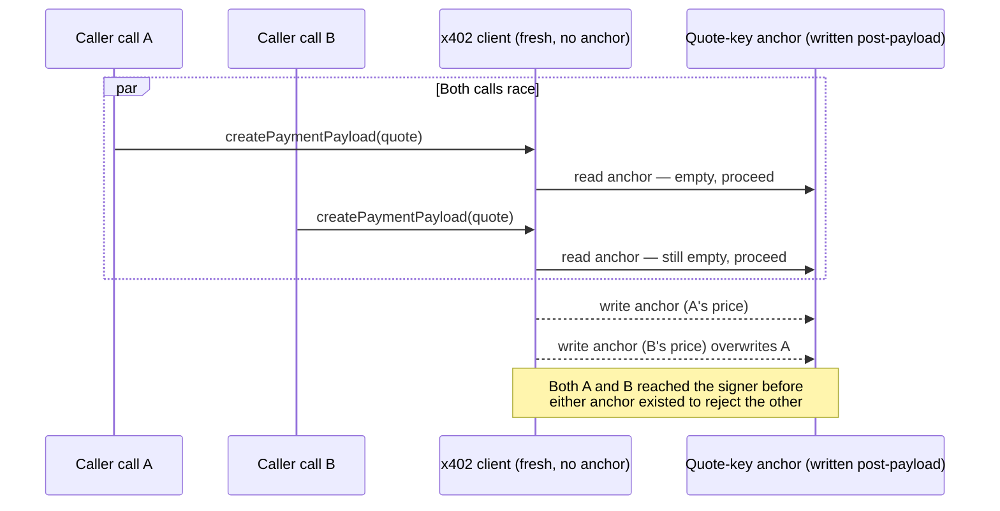

## Abstract

The x402 overcharge bug this brief covered on 2026-10-22 did not stay a two-comment GitHub thread. In the two days since, a third party measured how often the price-drift pattern actually fires on Base mainnet, three separately built fixes converged on the same design, and a security reviewer found a concurrency hole in the leading candidate before it had even merged[^s01][^s02]. None of it has landed in `@x402/core` yet. In parallel, a second and unrelated amount-safety gap surfaced in the same SDK: a client scoped to a testnet can still sign a mainnet payment if the server answers with the older payment version[^s03]. Two more facilitator-side checks, against wash settlement and against inflated settlement overrides, moved through review and partly merged[^s04][^s05][^s06]. Nothing elsewhere on the beat, including AP2, Visa's Trusted Agent Protocol, L402, MPP, and the card networks, produced anything citable this window.

## Introduction

This edition covers **2026-10-22 through 2026-10-25**. Background on the payment-rail landscape lives in the site's [agent commerce protocol comparison](../agent-commerce-protocol/); background on agent identity lives in [agent identity and the reputation registry](../agent-identity-reputation-registry/). The [previous edition](../ai-agent-brief-2026-10-24/) closed on a question it posed as a signal to watch: would the x402 Foundation or its maintainers respond to the overcharge issue with a merged fix, a documented warning, or neither? Three days later the answer is still "neither," but the thread did not sit still — it grew a measurement, three competing fix designs, and a review process that is still finding holes in the leading one.

## What moved

### The overcharge thread gets a number, three fixes, and a crack in the fix

AgenticFinanceGraph, a third party that watches stablecoin settlement on Base, read every transfer into x402's Bazaar-listed sellers from 12 to 23 October and posted the result into the same issue thread. Among the 80 sellers with at least 20 settlements each (32,605 settlements, $18,950.78 total), 1,126 (3.5%) came in at ten times or more the seller's own median, 65 at a hundred times or more, and 25 of those also cleared a dollar[^s01]. The post is careful about what it does and does not show: a settlement priced far above a seller's median is not proof of the exact overcharge mechanism from the bug report, since a seller might legitimately reprice, and the measurement counts any stablecoin transfer into a listed address rather than confirmed x402 traffic specifically. What it establishes is scale: the pattern this bug report flagged as theoretically possible happens, at minimum, in the low thousands across a two-week sample on one chain.

Three implementers used the number as a reason to actually ship a fix rather than keep arguing about severity. The x402-foundation core team opened PR #3920, adding an `expectedAmount` field to client-side spend controls: the caller states the price they expect, either explicitly or by letting the first successful quote anchor it, and anything that drifts gets rejected before a signature is ever created. That includes a mid-session price *drop*, since a drop beyond tolerance is the same bait pattern run backwards[^s02]. A third-party package maintainer, Tanilo, reviewed that PR against their own shipped `@x402/x402-guard` 0.1.1 and disclosed, unprompted, that their package had the same class of gap: it checked the recipient only when the caller's terms happened to name one, and never checked the asset or network at all. A second reviewer, going by the handle NSPG13, then found a problem in PR #3920 itself: the anchor that is supposed to lock in the first accepted price is only written after the payment payload is created, so two calls fired at once on a fresh client can both pass the empty-anchor check and reach the signer before either one commits[^s01].

*What the arrows assert: per the reviewer's finding on PR #3920, the "first-accepted" anchor is written only after a payment payload is successfully created, so two concurrent calls on a client with no prior anchor can each pass the empty-anchor check and sign before either commitment is recorded[^s01].*

The gap is not closed. PR #3920 remained open and under active revision as of this writing, with no merge and no date for one.

### A second, unrelated amount-safety bug: the wrong network signs the right price

A separate issue filed 2026-10-24 found that x402's Python helpers for registering an EVM or Solana client filter the newer V2 payment scheme by the caller's chosen networks, but loop over every legacy network when registering the older V1 scheme regardless of that filter[^s03]. The practical effect: a developer who configures a client for a testnet only, expecting it to refuse anything else, still gets a signed mainnet payment if the resource server happens to answer with a V1-style 402 instead of a V2 one. The TypeScript SDK already filters V1 registrations the same way the V2 ones are filtered; the Python and Go helpers do not. No maintainer or third party has commented on the report yet, so whether it is accepted as a real defect is still open. It is, at minimum, the same family of problem as the overcharge thread, showing up on a different axis: a client trusting something about a 402 response that nothing forces it to check.

### Facilitators close two more settlement loopholes

Two more checks moved on the facilitator side this window, neither contested. PR #3910, open and under review, would make `x402Facilitator.verify()` and `settle()` reject any payment where the payer and the recipient resolve to the same address, closing a wash-settlement path that let an address pay itself to inflate apparent sales volume or abuse settlement-gated catalog listing[^s04]. And two merged ports, #3881 for Go and #3877 for Python, fixed a bug already patched in the TypeScript SDK where a facilitator's settlement-override logic would resolve a percentage or dollar override to an amount above what `PaymentRequirements` actually authorized: a 500% override of 1,000,000 atomic units previously resolved to 5,000,000 rather than being rejected[^s05][^s06]. Both fixes are narrower and less contested than the overcharge debate, which is likely why they merged within a day while PR #3920 is still being argued over line by line.

## Why it matters

Every fix this window came from someone building code and someone else trying to break it, not from a spec ruling. The x402 Foundation itself has said nothing in either the overcharge thread or the new testnet issue. The design that is winning, anchor a price expectation before signing and reject any drift, is the Foundation's own core-team PR, but it got there by surviving two outside reviewers rather than by being declared correct. That process is also why it is slow: a self-disclosed gap in a third-party package and a concurrency bug in the leading fix both surfaced in the same 48 hours, which is a sign the review is doing its job and a reason nothing has merged yet.

The pattern repeating across this window's three items is not one shared bug but one shared cause: x402 ships three independent SDKs, and a safety property that one of them enforces (network filtering in TypeScript; settlement-override caps in TypeScript before the Go and Python ports caught up) is not guaranteed in the others until someone notices the gap and ports the fix. Nothing about the protocol's spec or its maintainers' process currently catches that drift before a bug report does.

## Signals to watch

- PR #3920: merges with the concurrency fix NSPG13 flagged, gets redesigned around it, or stalls the way #3866 itself has for three days now.
- Issue #3930 sits unconfirmed right now. A maintainer or a second reporter weighing in would settle whether it is real, the way the mainnet measurement settled the overcharge report.
- PR #3910 touches core verification logic, not an opt-in client control, so it is a harder merge than the others; whether it clears review at all is open.
- No one outside the thread that produced AgenticFinanceGraph's measurement has tried to replicate or dispute it yet.

## Limitations

All six sources this window are GitHub primary material, issue and PR threads on x402-foundation/x402, because that is where this window's actual news happened; no trade press has covered any of it as of this writing. The mainnet settlement figures rest on one third party's self-published methodology, which the party itself frames as a ceiling rather than confirmed exploitation, and no one has independently reproduced it. Issue #3930 is a single reporter's reading of SDK source with no maintainer or third-party confirmation yet. None of the three open PRs (#3920, #3910, #3925, the last a documentation-only companion not covered above) has a visible maintainer review assignment or merge timeline. AP2, ACP, UCP, L402, MPP, Visa's Trusted Agent Protocol, and the card networks produced no citable news in this window: the Universal Commerce Protocol repository took three minor commits (a return-policy extension and two fixes) that did not clear the bar for a "what moved" item, and web search for Visa, Mastercard, and Stripe agent-payment news returned only undated aggregator summaries of older announcements, which were excluded. Feeds, web, and GitHub were all reachable this window; papers was not run, since nothing scouted elsewhere pointed to a new academic result; Hacker News returned general AI-agent show-and-tell with nothing specific to this beat; Bluesky and Reddit remain unconfigured in this environment.
