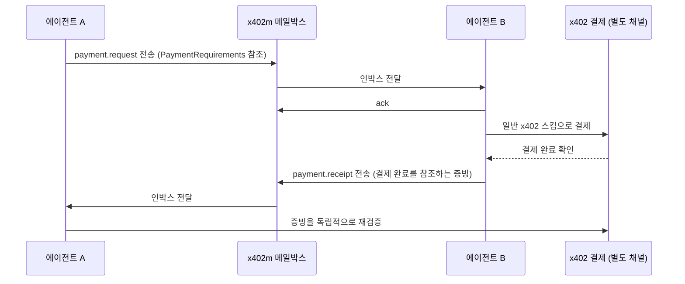

## 초록

이틀 전 이 브리프가 미확인 상태로 지적했던 x402 테스트넷 버그에 수정안이 나왔다. PR #3935는 Python SDK의 레거시 결제 스킴이 테스트넷으로 한정된 클라이언트에서도 메인넷 결제에 서명해버리는 문제를 막는다. `main`에서는 실패하고 패치를 적용하면 통과하는 테스트가 그 증거다[^s05][^s06]. 아직 병합되지 않았고, Go SDK에 같은 결함이 있는지는 누구도 확인하지 않았다. 한 외부 기여자는 같은 48시간 동안 버그를 고치는 대신 새로운 것을 제안했다. 두 에이전트가 결제 요청과 영수증을 주고받을 공용 메일박스를 두자는 `agent-messaging` 확장안으로, 당일 참조 구현까지 붙여 올라왔고 솔라나 생태계의 x402 포크에도 교차 게시됐다[^s01][^s02][^s03][^s04]. x402 재단 메인테이너는 아직 아무 반응도 보이지 않았다. x402와는 별개로, Universal Commerce Protocol은 반품 정책 확장을 출시했다. 에이전트가 환불 기간과 수수료, 반품 가능 여부를 산문으로 된 정책 페이지에서 추론하는 대신 구조화된 형태로 읽을 수 있게 됐다[^s08][^s09].

## 서론

이번 호는 **2026년 10월 23일부터 10월 26일까지**를 다룬다. 결제 레일 전반의 배경은 사이트의 [에이전트 커머스 프로토콜 비교](../agent-commerce-protocol/)에, 에이전트 신원 관련 배경은 [에이전트 신원과 평판 레지스트리](../agent-identity-reputation-registry/)에 있다. [지난 호](../ai-agent-brief-2026-10-25/)는 두 가지를 지켜볼 신호로 남겼다. PR #3920이 리뷰어가 발견한 동시성 결함을 딛고 살아남을 것인가, 그리고 이슈 #3930의 테스트넷 서명 버그가 확인될 것인가. 둘 중 뒤의 질문에는 이번 호에서 답이 나왔지만 앞의 질문은 여전히 열려 있다 — PR #3920은 여전히 열려 있고 병합 가능 상태이지만 병합되지 않았으며, 새로운 움직임도 없다[^s07].

## 이번 주의 변화

### 재단 바깥에서, 에이전트 간 메시징 계층을 제안하다

x402는 클라이언트가 리소스 서버에 결제하는 방식을 표준화한다. 하지만 결제를 협상하기 위해 두 **에이전트**가 서로에게 어떻게 도달하는지는 규정하지 않는다. 지금은 채팅이나 이메일, 혹은 각자의 독자적인 API로 처리될 뿐, 에이전트의 메시징 엔드포인트를 찾거나 전달 방식을 합의할 공통 규약이 없다. Solizardking이라는 아이디의 기여자가 10월 25일 이슈 #3943을 열어 이 틈을 메우자고 제안했다. 디스커버리 디스크립터, 저장-전달형 메일박스(`register`, `send`, `inbox`, `ack`, `link`), 그리고 x402의 기존 `PaymentRequirements`와 결제 완료 증빙을 참조하는 `payment.request`·`payment.receipt` 종류를 담은 메시지 봉투를 뼈대로 한다[^s01]. 설계상 경계는 분명하다. 메시징 자격 증명은 메시징에만 쓰이는 단명 서명 토큰으로, 그 자체로는 결제를 승인할 수 없다. 같은 날 스펙 전용 PR #3944가 뒤따라, 패키지 코드는 전혀 건드리지 않고 `specs/extensions/agent-messaging.md`에 468줄을 추가했다[^s02].

이 제안이 단순한 즉흥 아이디어를 넘어서는 지점은 체인 중립화 속도다. 처음에는 솔라나에 기대어 설계됐지만 몇 시간 만에 CAIP-2/10/19 식별자를 쓰도록 바뀌었고, 원래 Ed25519 토큰에 secp256k1 대안이 추가됐으며, 작동하는 솔라나 SPL Memo 전송 방식과 함께 아직 구현되지 않은 EVM calldata 전송 방식까지 명세에 포함됐다[^s02]. 같은 스펙은 솔라나 재단이 운영하는 x402 포크의 별도 PR에서도 검토 대상에 올라 있다[^s04]. 정작 원본 레포를 소유한 재단이 입을 열기도 전에 두 번째 검토 창구가 생긴 셈이다.

*화살표가 주장하는 것: 메일박스는 결제에 관한 제안과 증빙만 전달할 뿐 결제 권한 자체는 담지 않는다. 결제는 x402 본연의 경로로 이뤄지고, 수신 측 에이전트는 메시지를 그대로 믿는 대신 증빙을 독립적으로 재검증한다[^s01][^s02].*

문제는 바로 그 침묵이다. 이 글을 쓰는 시점까지 x402 재단 메인테이너는 #3943과 #3944 어느 쪽에도 댓글을 달지 않았다. 유일한 실질적인 논의는 작성자 본인이 올린 업데이트뿐으로, 에이전트 간 메시징 확장이 코어 스펙 디렉터리에 들어갈 자격이 있는지, 아니면 독립적인 두 번째 구현이 나오기 전까지는 서드파티 확장으로 두어야 하는지를 리뷰어들에게 묻고 있다[^s01]. 제안을 뒷받침하는 참조 구현 레포는 인용된 그날 만들어졌고 스타는 0개다[^s03]. GitHub Actions 봇은 이미 커밋에 서명이 없으면 일주일간 활동이 없을 경우 PR이 자동으로 닫힌다고 경고했다. 작동하는 데모가 붙은 그럴듯한 아이디어이지만, 아직 검토받은 아이디어는 아니다.

### 테스트넷 서명 버그, 수정안은 나왔지만 병합은 아직

이틀 전 이 브리프는 이슈 #3930을 미확인으로 남겼다. x402의 Python 클라이언트 등록 헬퍼가 EVM이나 솔라나용으로 새 V2 스킴은 호출자가 지정한 네트워크로 필터링하면서도, 레거시 V1 네트워크는 그 필터를 무시하고 전부 루프를 돈다는 문제였다. 그 결과 테스트넷만 쓰도록 설정한 클라이언트도 서버가 V1 방식으로 요청해오면 실제 메인넷 결제에 서명해버릴 수 있었다. 다음 날 열린 PR #3935은 정확히 이 문제를 고친다. V1 등록 대상을 호출자의 `networks` 인자와 CAIP-2 기준으로 일치하는 네트워크로 제한하는데, TypeScript SDK가 이미 쓰던 필터링 로직을 그대로 가져온 것이다[^s05][^s06]. PR에 포함된 테스트 두 개가 버그를 직접 증명한다. 패치 전 코드에서는 실패하고 패치 후에는 통과한다. 이 PR은 커밋이 AI의 도움으로 작성됐다는 사실을 명시적으로 밝히고 있다.

이 수정이 남기는 구멍은 지난주 과다 청구 사건이 드러낸 것과 같은 종류다. x402는 서로 독립된 SDK 세 개를 유지하는데, 그중 하나(여기서는 TypeScript의 네트워크 필터링)가 입증한 안전 속성이 누군가 알아채고 포팅하기 전까지는 다른 SDK에도 보장되지 않는다. 이번 창에서 Go SDK에 같은 결함이 있는지 확인한 사람은 없었다.

### UCP, 반품 정책 확장을 출시하다

x402의 결제 레이어 디버깅과는 별개로, Shopify와 Target, Walmart의 에이전틱 쇼핑 연동을 뒷받침하는 카탈로그·체크아웃 표준인 Universal Commerce Protocol이 10월 23일 반품 정책 확장을 병합했다. 에이전트가 가맹점의 산문형 정책 페이지를 긁어내는 대신 환불 기간과 수수료, 반품 가능 여부를 구조화된 형태로 읽을 수 있게 됐다[^s08]. 서로 연결된 두 PR을 통해 다듬어진 이 설계는 기존의 불린 플래그 `final_sale`을 명시적인 `eligibility` 타입(`window`, `unlimited`, `not_accepted`)으로 대체하고, 제시 가능한 조건과 확정된 사실을 분리한다. 반품 기한 시계가 아직 시작되지 않았을 때는 정책이 기간과 "배송 완료" 같은 기준 이벤트만 명시하고, 그 이벤트가 실제로 일어나고 나면 가맹점이 구체적인 마감일을 직접 명시한다. 그러면 어느 플랫폼도 시간대나 분할 배송을 가로질러 날짜를 계산할 필요가 없다[^s09]. 수수료는 UCP가 주문 총액에 이미 쓰던 방식과 같은 틀을 따른다. 범위를 지정하지 않은 `{"amount": 0}` 항목은 진짜로 무료라는 뜻이고, `{"methods": ["in_store"], "amount": 0}`처럼 채널을 지정한 항목은 다른 채널은 그대로 둔 채 매장 반품에만 이를 덮어쓴다.

여기에는 논쟁거리가 없다. 그냥 병합됐다. 다만 지금 단계에서는 스키마와 스펙일 뿐, 확인된 연동은 아니다. 이번 창에서 이를 실제로 쓰는 가맹점이나 에이전트 클라이언트는 발견되지 않았다.

## 왜 중요한가

세 항목을 나란히 놓으면 x402 쪽과 UCP 쪽이 서로 다른 속도로 돌아가고 있다는 게 보인다. 메시징 제안과 테스트넷 수정 모두 x402 재단의 메인테이너 그룹 바깥에서 나왔고, 둘 다 여전히 열려 있다. 하나는 아직 오지 않은 메인테이너의 의견을 기다리고, 다른 하나는 병합을 기다린다. 이는 앞선 두 호가 이미 짚었던 패턴을 그대로 잇는다. x402의 안전성과 기능 범위는 재단이 리뷰할 수 있는 속도보다 빠르게, 외부 기여자들에 의해 넓어지고 있다. 반면 UCP의 반품 정책 확장은 이름이 알려진 코어 기여자를 거쳐 7월에 시작된 다단계 설계 과정을 통해 예정대로 안착했다. 차이는 어느 쪽이 더 건강한가의 문제가 아니다. x402는 자신이 감당할 리뷰 역량을 아직 갖추지 못한 외부 기여의 물결을 흡수하고 있고, UCP는 더 좁은 기여자 기반으로도 그 속도를 따라잡는 수준의 밀린 작업을 처리하고 있다는 차이다.

## 지켜볼 신호

- 서명되지 않은 커밋 마감 시한이 강제로 닫아버리기 전에, 이슈 #3943·PR #3944에 메인테이너의 댓글이나 리뷰, 혹은 종료 처리가 붙는지.
- PR #3935이 병합되는지, 그리고 별도로 Go SDK에 같은 V1 네트워크 필터 결함이 있는지 누군가 확인하는지.
- 과다 청구 사건 측정치가 나온 지 닷새가 지났는데도 아직 병합되지 않은 PR #3920의 동시성 수정[^s07].
- UCP의 반품 정책 확장을 인용하는 실제 운영 중인 에이전트나 가맹점 연동이 나타나는지. 그러면 이번 창의 스키마 병합이 비로소 배포된 사례가 된다.

## 한계

이번 창의 출처 아홉 건은 모두 GitHub 1차 자료다. 이슈, 풀 리퀘스트, 그리고 참조 구현 레포 한 건. 이번 창에서 실제로 일어난 일이 그곳에서 벌어졌기 때문이다. 업계 언론과 해커뉴스, 일반 웹 검색은 이번 표준 주제의 어느 하위 영역에서도 2026년 10월 23일부터 26일 사이로 날짜가 찍힌 결과를 내놓지 못했다. AP2, ACP, 비자의 Trusted Agent Protocol, L402, MPP, 카드 네트워크 자체의 에이전트 커머스 제품 모두 이번 창에서 커밋도, 릴리스도, 인용할 만한 보도도 없었다. 이는 검색만이 아니라 각 프로젝트의 릴리스 피드와 최근 커밋 기록을 직접 확인해서 확정한 것이다. 에이전트 메시징 제안은 구현 상태와 생태계 간 검토에 대한 작성자 본인의 주장에 전적으로 의존한다. 같은 스펙을 검토 중이라는 솔라나 포크의 PR(#71)은 본문이 템플릿 그대로 비어 있어, 그 검토가 실제로 얼마나 이뤄졌는지는 가늠할 수 없었다. 피드와 웹, GitHub 레인은 이번 창에서 모두 접근 가능했고, 해커뉴스는 이 주제에 특화된 결과를 내놓지 않았으며, Bluesky와 Reddit은 이 환경에 아직 설정되어 있지 않다. 다른 레인이 새로운 학술 결과를 가리키지 않아 논문 레인은 실행하지 않았다.
