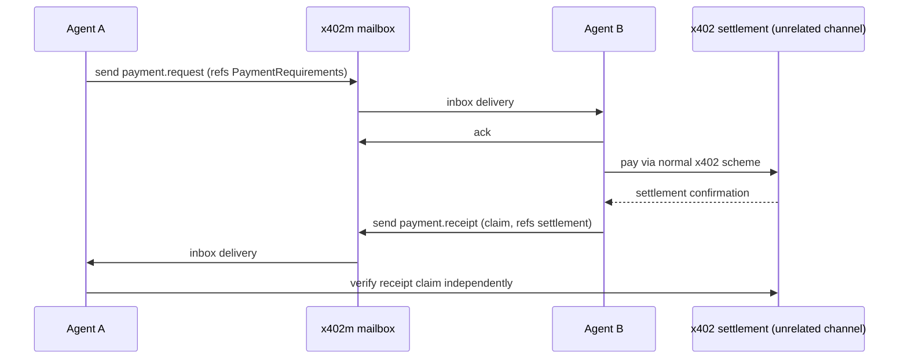

## Abstract

The x402 testnet bug this brief flagged two days ago as unconfirmed now has a fix: PR #3935 stops the Python SDK's legacy payment scheme from signing mainnet payments on a client scoped to testnet, with tests that fail on `main` and pass against the patch[^s05][^s06]. It is not merged, and nobody has checked whether the Go SDK has the same gap. A third-party contributor used the same 48 hours to propose something new rather than fix something broken: an `agent-messaging` extension that gives two agents a shared mailbox for payment requests and receipts, built same-day with a reference implementation and cross-posted into the Solana ecosystem's own fork of the spec[^s01][^s02][^s03][^s04]. No x402 Foundation maintainer has said anything about it yet. Away from x402 entirely, the Universal Commerce Protocol shipped a return-policy extension that gives agentic shopping flows a structured way to state refund windows, fees, and eligibility instead of leaving an agent to infer them from prose[^s08][^s09].

## Introduction

This edition covers **2026-10-23 through 2026-10-26**. Background on the payment-rail landscape lives in the site's [agent commerce protocol comparison](../agent-commerce-protocol/); background on agent identity lives in [agent identity and the reputation registry](../agent-identity-reputation-registry/). The [previous edition](../ai-agent-brief-2026-10-25/) left two open questions: would PR #3920 survive the concurrency hole a reviewer found in it, and would issue #3930's testnet-signing bug get confirmed. The second question is answered this window; the first is not — PR #3920 remains open, mergeable, and unmerged, with no new activity since[^s07].

## What moved

### A third party proposes a messaging layer between agents, outside the Foundation

x402 standardizes how a client pays a resource server. It says nothing about how two *agents* reach each other to negotiate that payment in the first place — today that happens over chat, email, or a proprietary API, with no shared way to discover an agent's messaging endpoint or agree on delivery semantics. A contributor going by Solizardking opened issue #3943 on 2026-10-25 proposing to close that gap: a discovery descriptor, a store-and-forward mailbox (`register`, `send`, `inbox`, `ack`, `link`), and a message envelope with `payment.request` and `payment.receipt` kinds that reference x402's existing `PaymentRequirements` and settlement claims[^s01]. The boundary is explicit in the design: messaging credentials are short-lived signed tokens scoped only to messaging, and can never authorize a payment themselves. A spec-only PR, #3944, followed the same day, adding 468 lines to `specs/extensions/agent-messaging.md` with no changes to any package code[^s02].

What makes this more than a one-off pitch is how fast it moved chain-agnostic. The first version leaned on Solana; within hours the author revised it to use CAIP-2/10/19 identifiers, added a secp256k1 alternative to the original Ed25519 tokens, and specified (though did not yet implement) an EVM calldata transport alongside the working Solana SPL Memo one[^s02]. The same spec is also under review as part of a separate PR on the Solana Foundation's own fork of x402[^s04], giving it a second venue even before the Foundation that owns the canonical repo has said a word.

*What the arrows assert: the mailbox carries only a proposal and a claim about payment, never a spending credential — settlement happens over x402 proper, and the receiving agent re-verifies the claim rather than trusting the message[^s01][^s02].*

That silence is the catch. As of this writing, no x402 Foundation maintainer has commented on either #3943 or #3944; the only substantive discussion is the author's own update, asking reviewers whether an agent-to-agent extension belongs in the core spec directory at all or should sit under third-party extensions until a second independent implementation exists[^s01]. The reference implementation backing the proposal is a repository the author created the same day it was cited, with zero stars[^s03]. A GitHub Actions bot has already warned that the PR closes automatically after a week of inactivity if its commits aren't signed. This is a plausible idea with a working demo behind it, not yet a reviewed one.

### The testnet-signing bug gets a fix, still unmerged

Two days ago this brief flagged issue #3930 as unconfirmed: x402's Python helpers for registering an EVM or Solana payment client filter the newer V2 scheme by the caller's chosen networks, but loop over every legacy V1 network regardless of that filter, so a client configured for testnet only could still sign a real mainnet payment if the server answered with a V1-style request. PR #3935, opened the next day, fixes exactly that — it restricts V1 registration to networks whose CAIP-2 equivalent matches the caller's `networks` argument, mirroring filtering logic the TypeScript SDK already has[^s05][^s06]. The PR's own test suite demonstrates the bug directly: two new tests fail against the unpatched code and pass against the fix. Signed-off by a contributor account, the PR carries an explicit note that its commit was produced with AI assistance.

The gap the fix leaves is the same one the overcharge thread exposed last week: x402 ships three independent SDKs, and a safety property proven in one (here, TypeScript's network filtering) isn't guaranteed in the others until someone notices and ports it. Nobody in this window checked whether Go has the same hole.

### UCP ships a return-policy extension

Away from x402's settlement-layer debugging, the Universal Commerce Protocol — the catalog-and-checkout standard behind agentic shopping integrations from Shopify, Target, and Walmart — merged a return-policy extension on 2026-10-23, giving an agent a structured way to read refund windows, fees, and eligibility instead of scraping them from a merchant's prose policy page[^s08]. The design, worked out across two linked pull requests, replaces an earlier boolean `final_sale` flag with an explicit `eligibility` type (`window`, `unlimited`, or `not_accepted`) and separates presentable terms from resolved facts: before a return's clock has started, a policy states a duration and an anchor event like "delivered"; once that event has actually happened, the merchant states the concrete deadline directly, so no platform has to compute a date across time zones or split deliveries[^s09]. Fees get the same treatment UCP already uses for order totals — a typed list where an unscoped `{"amount": 0}` entry means genuinely free, and a channel-scoped entry like `{"methods": ["in_store"], "amount": 0}` overrides it for one checkout path but not others.

None of this is contested or still in review; it merged. It is also, for now, a schema and a spec, not a confirmed integration — no merchant or agent client was found deploying it in this window.

## Why it matters

Line the three items up and the x402 beat and the UCP beat are moving on opposite cadences. The messaging proposal and the testnet fix both came from outside the x402 Foundation's own maintainer group, and both remain open: one waiting on a maintainer opinion that hasn't arrived, the other waiting on a merge. That continues exactly the pattern the previous two editions of this brief described — x402's safety and feature surface is being extended by outside contributors faster than the Foundation is reviewing it. UCP's return-policy extension, by contrast, went through a named core contributor and a multi-PR design process that started in July and landed on schedule. The difference isn't that one protocol is healthier than the other; it's that x402 is absorbing a wave of outside contribution it hasn't built review capacity to match, while UCP's narrower contributor base is still working through its backlog at a pace that keeps up with it.

## Signals to watch

- A maintainer comment, review, or closure on issue #3943 / PR #3944 before the unsigned-commit deadline forces it shut regardless.
- Whether PR #3935 merges, and separately, whether anyone checks the Go SDK for the same V1-network-filter gap.
- PR #3920's concurrency fix, still unmerged five days after the overcharge measurement that prompted it[^s07].
- Any production agent or merchant integration citing UCP's return-policy extension, which would turn this window's schema merge into a deployed one.

## Limitations

All nine sources this window are GitHub primary material — issues, pull requests, and one reference-implementation repository — because that is where this window's actual developments happened. Trade press, Hacker News, and general web search returned nothing dated inside 2026-10-23–2026-10-26 for any part of the standing topic: AP2, ACP, Visa's Trusted Agent Protocol, L402, MPP, and the card networks' own agent-commerce products produced no commits, releases, or citable coverage this window, confirmed by checking each project's release feed and recent commit history directly rather than by search alone. The agent-messaging proposal rests entirely on its own author's claims about implementation status and cross-ecosystem review; the Solana fork's PR (#71) that supposedly reviews the same spec has an unfilled template body, so the depth of that review could not be assessed. Feeds, web, and GitHub were all reachable this window; Hacker News returned nothing specific to the beat; Bluesky and Reddit remain unconfigured in this environment; papers was not run, since nothing scouted elsewhere pointed to a new academic result.
