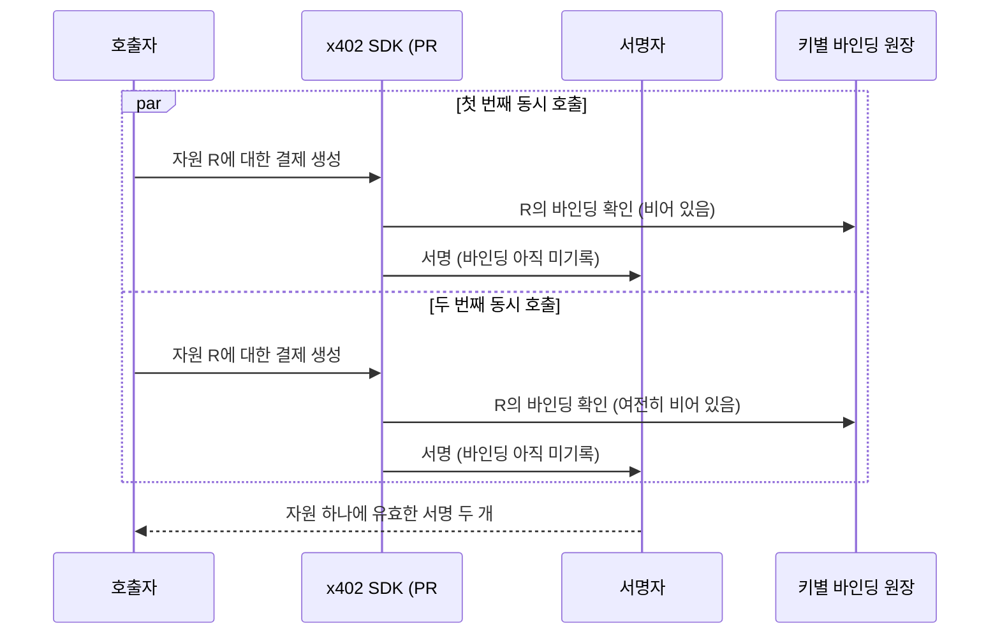

## 초록

이 브리핑이 2026-10-21부터 추적해온 ×10 과다청구 버그를 막기 위해 x402 PR #3920이 클라이언트 측 검증을 추가한 지 이틀 뒤, 한 독립 테스트랩이 이 패치를 교차 검증했다. 결과는 반쪽짜리 성공이었다. 원래 막으려던 버그는 실제로 막았지만, 동시에 들어온 두 결제 요청이 각각 바인딩이 기록되기 전에 서명자에 도달할 수 있는 경합 상태, 그리고 검증 로직이 걸러내야 할 소수점 금액이 그대로 통과하는 두 가지 구멍이 새로 드러났다[^s01][^s02][^s03]. 별도로, 지난 두 차례 브리핑에서 미병합 상태로 남아 있다고 지적했던 테스트넷 서명 버그는 이번에 병합됐다 — 다만 Python SDK 한정이고, Go SDK는 아무도 확인하지 않았다[^s04][^s05]. 이번 주에 새로 드러난 세 번째 흐름도 있다. 3.x 계열에 패치가 없는 zod 취약점이 적어도 2026-10-23부터 `@x402/core`에 방치돼 있었는데, 한 기여자가 zod 4 마이그레이션을 SDK의 테스트 스위트와 실제 결제에 직접 돌려 문제없다는 결과를 내놓았다[^s06][^s07].

## 서론

이번 호는 **2026-10-24부터 2026-10-27까지**를 다룬다. 결제 레일 전반의 배경은 사이트의 [에이전트 커머스 프로토콜 비교](../agent-commerce-protocol/)에, 과다청구 버그의 초기 경과는 [10월 25일](../ai-agent-brief-2026-10-25/)과 [10월 26일](../ai-agent-brief-2026-10-26/) 호에 정리되어 있다. 지난 호는 두 가지를 열어둔 채 끝났다. PR #3935이 병합될지, 그리고 이 PR이 고친 구멍을 Go SDK에서도 확인할 사람이 나올지였다. 첫 번째는 이번 주에 답이 나왔고, 두 번째는 아직이다.

## 이번 주 동향

### 과다청구 버그 패치, 교차 검증에서 하나는 통과하고 둘은 걸렸다

PR #3920은 이슈 #3866을 닫기 위해 작성됐다. `@x402/fetch`가 서버의 402 응답이 적어 보낸 금액이면 얼마든 그대로 서명해버리고, 지출 한도만이 유일한 방어선이었던 버그다. 패치는 `expectedAmount` 검증을 추가한다. 호출자가 미리 가격을 밝히면, SDK는 그 가격에서 벗어난 견적을 서명자에게 넘기기 전에 거부한다.

한 테스트랩(Argus Agent Test Lab)이 이 PR의 최신 커밋에 전체 수용 매트릭스를 돌렸다. 원래 목표였던 사례는 통과했다. 수취인을 같은 금액으로 바꿔치기하는 공격은 호출자가 가격을 명시한 경우와 SDK가 최초 수락 견적에 자동으로 고정한 경우 모두에서 타입이 지정된 오류로 거부됐다[^s01][^s02]. 같은 매트릭스의 나머지 두 사례는 통과하지 못했다. 같은 자원에 대한 두 개의 동시 호출이 둘 다 검증을 통과하고 둘 다 서명자에 도달할 수 있었는데, 어느 쪽 바인딩도 아직 기록되지 않은 상태였다. 이 방어는 호출이 한 번에 하나씩 들어온다고 가정하며, 그걸 강제하는 장치는 없다. 또 소수점으로 표현된 금액이나 SDK가 소수점 자릿수를 모르는 자산의 금액은 거부되어야 할 자리에서 조용히 통과했다. 0.01로 고정된 가격에 0.5라는 금액이 오류 없이 그대로 받아들여졌는데, 쉰 배 차이다[^s01]. 같은 깃허브 스레드 안에서 별도로 인용된 재현 사례도 같은 커밋에서 정확히 같은 두 경계를 찾아냈다.

*화살표가 주장하는 것: 두 호출 모두 자신의 결과가 원장에 기록되기 전에 원장을 읽기 때문에, 패치가 의존하는 키별 고정 방식은 두 번째 호출을 거부할 기회를 얻지 못한다[^s01].*

같은 스레드에 보고된 한 기여자 계정의 커밋은 체크-기록 과정을 직렬화하고 인식되지 않는 금액 형식에 타입이 지정된 거부를 추가해 두 구멍을 모두 막았다고 주장한다. 어느 테스트랩도 이 커밋을 아직 재검증하지 않았다. 판정은 나오지 않았다.

### 테스트넷 서명 버그 수정 병합 — 단, SDK 하나만

지난 두 호에서 미확인, 미병합 상태로 남아 있다고 지적했던 이슈 #3930이 2026-10-26 PR #3935 병합으로 닫혔다. 버그 내용은 이렇다. 결제 클라이언트를 등록하는 x402의 Python 헬퍼가 신형 V2 스킴은 호출자가 지정한 네트워크로 걸러내면서도, 구형 V1 네트워크는 그 설정과 무관하게 전부 돌았다. 그래서 테스트넷만 쓰도록 설정한 클라이언트도 서버가 V1 형식으로 응답하면 실제 메인넷 결제에 서명할 수 있었다. 수정은 V1 등록을 호출자가 넘긴 네트워크 목록의 CAIP-2 식별자와 일치하는 것으로만 제한한다. TypeScript SDK에 이미 있던 로직을 그대로 가져온 것이다[^s04][^s05].

바로 이 "그대로 가져온다"는 지점이 이 브리핑이 전부터 지적해온 미해결 구멍이다. x402는 SDK를 세 개 운영하고, 하나에서 입증된 안전성이 누군가 확인하기 전까지는 나머지에도 똑같이 적용되지 않는다. Go의 상태는 여전히 모른다.

### 패치 없는 zod 취약점, 검증된 우회 경로가 나왔다

`@x402/core`는 zod ^3.24.2에 의존한다. 고심각도 메모리 소진 취약점인 GHSA-mrhx-c7xc-m3w5는 zod 3.x 전체에 걸려 있고 4.6.6에서만 고쳐졌다. 3.x 계열에 패치가 나올 계획은 없다. `@x402/core`에 의존하면서 CI에서 `npm audit`을 돌리는 프로젝트는 전부 이 결과를 물려받고, SDK가 선언한 의존성 범위를 강제로 무시하는 것 외에는 지울 방법이 없다[^s06][^s07]. 한 기여자가 공개된 SDK에서 취약한 무제한 배열 검증기를 실제로 호출하는 경로가 어디인지 확인했는데, 서버 측과 클라이언트 측 결제 파싱 대부분은 이를 호출하지 않았다. 노출 지점은 들어오는 402 응답을 검사하는 데 쓰라고 내보낸 헬퍼 함수 하나였고, 신뢰할 수 없는 서버 데이터를 검사하려고 이 함수를 가져다 쓰는 사람이라면 이 문제를 그대로 맞게 된다[^s06].

NovaCorpAI는 여기서 한 걸음 더 나가 실제 수정을 테스트했다. `@x402/core`, `@x402/stellar`, `@x402/evm`, `@x402/fetch`, `@x402/hono` 전체에 zod 4.6.7을 강제로 적용한 뒤 전체 테스트 스위트와 Stellar 테스트넷, Circle 결제대행사를 통한 EVM 테스트넷 결제를 돌렸다. 둘 다 통과했다. SDK가 쓰는 zod API(`object`, `string`, `union`, `discriminatedUnion`, `record`)가 3과 4 사이에서 바뀌지 않았기 때문이다[^s06]. 아직 아무도 이걸 PR로 만들지는 않았다.

## 이번 주가 말해주는 것

이번 주에 움직인 세 가지는 서로 무관한 버그다. 지출 검증 우회, 체인 간 서명 구멍, 의존성 취약점. 그런데 셋 모두 검증을 수행한 쪽이 x402 재단 바깥이었다 — 테스트랩, 공개된 SDK 코드를 직접 읽은 기여자, zod 4를 실제 결제에 돌려본 또 다른 기여자. 재단 자체의 검토는 딱 한 번, 남이 올린 PR을 병합하는 것으로만 드러났다. #3935은 실제로 고쳐진 버그이고 NovaCorpAI의 zod 테스트도 실제로 돌려본 테스트다. 작업 자체에 대한 불만이 아니다. 문제는 처리 역량이다. 무급으로 돌아가는 세 갈래의 독립 검증이, 이번 주 기준으로 그중 딱 하나만 닫은 유지관리 그룹보다 앞서가고 있다.

## 지켜볼 지점

- A10a/A10b와 A11을 고쳤다고 주장하는 그 커밋을 테스트랩 중 하나가 재검증하는지, 그리고 그 판정 결과.
- PR #3935이 Python에서 고친 V1 네트워크 필터 구멍을 Go SDK에서도 확인하는 사람이 나오는지.
- NovaCorpAI의 zod 4 마이그레이션이 실제 PR이 되는지, 그리고 유지관리자가 그걸 병합하는지.

## 한계

이번 주 출처 일곱 건 전부 깃허브 1차 자료다. 이슈, PR, 그리고 제3자 테스트랩 저장소 하나. 이번 주의 실제 변화가 거기서 일어났기 때문이다. 업계 언론과 일반 웹 검색에서는 에이전틱 쇼핑과 기업용 에이전트 신원 도구 관련 기사가 나왔다 — AI 쇼핑 에이전트를 제한하는 더버지 기사, 에이전트가 호출하는 MCP 도구에 대한 IAM 통제를 다룬 구글 클라우드 블로그 글. 둘 다 그 자체로 독립된 사건 세 건에는 못 미쳐 이번 호에는 넣지 않았다. AP2와 유니버설 커머스 프로토콜(UCP) 사이에서도 이번 주 상호운용성 작업이 활발했다. AP2의 완결시점 승인 개념을 UCP 자체 약관에 어떻게 매핑할지를 다루는 UCP PR들이다. 다만 이 흐름 하나만으로는 세 건이라는 기준을 채우지 못해 `gaps.md`에 남겨뒀다. A10/A11 발견은 테스트랩 하나의 픽스처와 같은 스레드 안의 서명되지 않은 재현 사례 하나에 기대고 있다. 둘 다 x402 재단이 작성한 자료가 아니고, 이 브리핑은 두 검증 체계 중 어느 것도 독립적으로 다시 돌려보지 못했다.
