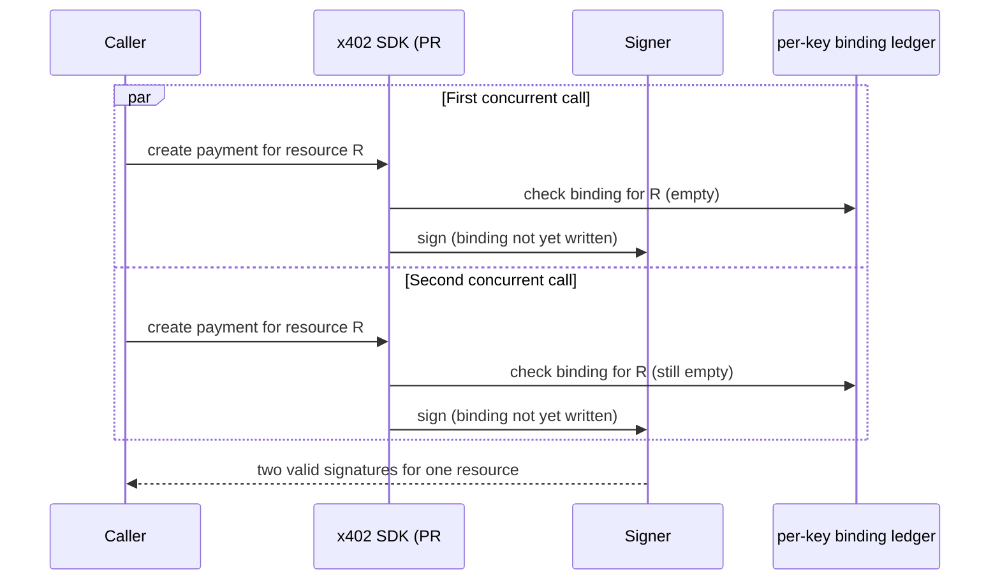

## Abstract

Two days after x402 PR #3920 added a client-side control meant to stop the ×10 overcharge bug this brief has tracked since 2026-10-21, an independent test lab cross-checked the patch and found it closes the bug it was built for while leaving two others open: a race between two concurrent payment calls that can both reach the signer before either is recorded, and a decimal amount that slips past the check meant to catch it[^s01][^s02][^s03]. Separately, the testnet-signing bug this brief flagged as unmerged two editions ago now has a merged fix — though only for Python, and nobody has checked Go[^s04][^s05]. A third thread, also new this window: a zod vulnerability with no 3.x fix available has sat unaddressed in `@x402/core` since at least 2026-10-23, until a contributor tested the zod-4 migration directly against the SDK's own test suite and live payments and reported it clean[^s06][^s07].

## Introduction

This edition covers **2026-10-24 through 2026-10-27**. Background on the payment-rail landscape lives in the site's [agent commerce protocol comparison](../agent-commerce-protocol/); background on the overcharge bug's first week lives in the [2026-10-25](../ai-agent-brief-2026-10-25/) and [2026-10-26](../ai-agent-brief-2026-10-26/) editions. The previous edition left two questions open: would PR #3935 merge, and would anyone check the Go SDK for the same gap it fixed. The first is answered this window; the second is not.

## What moved

### A patch for the overcharge bug gets cross-checked, and survives one test while failing two others

PR #3920 was written to close issue #3866 — a bug where `@x402/fetch` would sign a payment for whatever amount a server's 402 response declared, with a spend cap as the only guard. The fix adds an `expectedAmount` check: the caller states a price up front, and the SDK rejects any quote that drifts from it before the signer is ever called.

A test lab (Argus Agent Test Lab) ran a full acceptance matrix against the PR's head and reported the fix does what it claims for the case it was built for: a same-amount recipient substitution now gets rejected with a typed error, both when the caller sets the price explicitly and when the SDK auto-anchors it to the first accepted offer[^s01][^s02]. Two other cases in the same matrix did not pass. Two concurrent calls for the same resource can both clear the check and both reach the signer before either call's binding is written — the guard assumes one call at a time, and nothing enforces that. Separately, an amount expressed as a decimal, or in an asset whose decimal count the SDK doesn't recognize, passes the check silently instead of being rejected: a price pinned at 0.01 let a 0.5 offer through, fifty times over, with no error raised[^s01]. A second, independently credited reproduction inside the same GitHub thread found the identical two boundaries on the identical commit.

*What the arrows assert: both calls read the ledger before either call's result is written back to it, so the per-key anchoring the fix relies on never gets a chance to reject the second call[^s01].*

A commit from a contributor account, reported in the same thread as addressing both gaps with a serialized check-and-record step and a typed rejection for unrecognized amount formats, has not been re-run by either lab. No verdict exists on it yet.

### The testnet-signing fix merges — for one SDK

Issue #3930, flagged unconfirmed two editions ago and unmerged in the last one, closed on 2026-10-26 when PR #3935 merged. The bug: x402's Python helpers for registering a payment client filtered the newer V2 scheme by the caller's chosen networks but looped over every legacy V1 network regardless, so a client configured for testnet only could still sign a real mainnet payment if a server answered with a V1-style request. The fix restricts V1 registration to networks whose CAIP-2 identifier matches the caller's own list, mirroring logic the TypeScript SDK already had[^s04][^s05].

That mirroring is also the gap this brief flagged before and nobody has closed: x402 ships three SDKs, and a safety property proven in one isn't guaranteed in the others until someone checks. Go's status is still unknown.

### A zod vulnerability with no patch gets a tested workaround

`@x402/core` depends on zod ^3.24.2. GHSA-mrhx-c7xc-m3w5, a high-severity memory-exhaustion advisory, affects all zod 3.x and is fixed only in 4.6.6 — there is no patched 3.x release coming. Every project that depends on `@x402/core` and runs `npm audit` in CI inherits the finding with no way to clear it short of forcing an override against the SDK's own declared range[^s06][^s07]. A contributor checked which code paths actually touch the vulnerable unbounded-array validator in the published SDK and found most server- and client-side payment parsing doesn't call it; the exposure sits in an exported helper function that validates an incoming 402 response, which anyone importing it to check untrusted server data would hit[^s06].

NovaCorpAI went further and tested the actual fix: forcing zod 4.6.7 across `@x402/core`, `@x402/stellar`, `@x402/evm`, `@x402/fetch`, and `@x402/hono`, then running the full test suite and live payments on Stellar testnet and an EVM testnet through the Circle facilitator. Both passed, because the SDK's zod usage (`object`, `string`, `union`, `discriminatedUnion`, `record`) is unchanged between zod 3 and 4[^s06]. Nobody has turned that into a PR yet.

## Why it matters

Three unrelated bug classes moved this window: a spend-control bypass, a cross-chain signing gap, a dependency CVE. In every one, the party doing the verification was outside the x402 Foundation — a test lab, a contributor reading the published SDK's bundled code, another contributor running zod 4 against live payments. The Foundation's own review shows up only once, as a merge of someone else's PR. #3935 is a real fix, and NovaCorpAI's zod test is a real test; neither is a complaint about the work itself. It is a capacity question. Three independent threads of unpaid scrutiny are running ahead of a maintainer group that has, this window, closed exactly one of them.

## Signals to watch

- Whether the disputed commit addressing A10a/A10b and A11 gets re-run by either test lab, and with what verdict.
- Whether anyone checks the Go SDK for the same V1-network-filter gap PR #3935 fixed in Python.
- Whether NovaCorpAI's zod-4 migration becomes an actual PR against `@x402/core`, and whether a maintainer merges it.

## Limitations

All seven sources this window are GitHub primary material: issues, pull requests, and one third-party test-lab repository, because that is where this window's developments happened. Trade press and general web search returned coverage of agentic shopping and enterprise agent identity tooling — a Verge piece on merchants restricting AI shopping agents, a Google Cloud post on IAM controls for agent-invoked MCP tools — but neither reached three independent, dated events on its own, so neither made this edition. AP2 and the Universal Commerce Protocol both show active interoperability work this window, including UCP pull requests on how AP2's completion-time authorization maps onto UCP's own terms, but it did not clear the three-item bar by itself and is noted in `gaps.md` instead. The A10/A11 findings rest on one test lab's fixtures plus one unsigned reproduction inside the same comment thread. Neither is x402-foundation-authored, and this brief could not independently re-run either rig.
