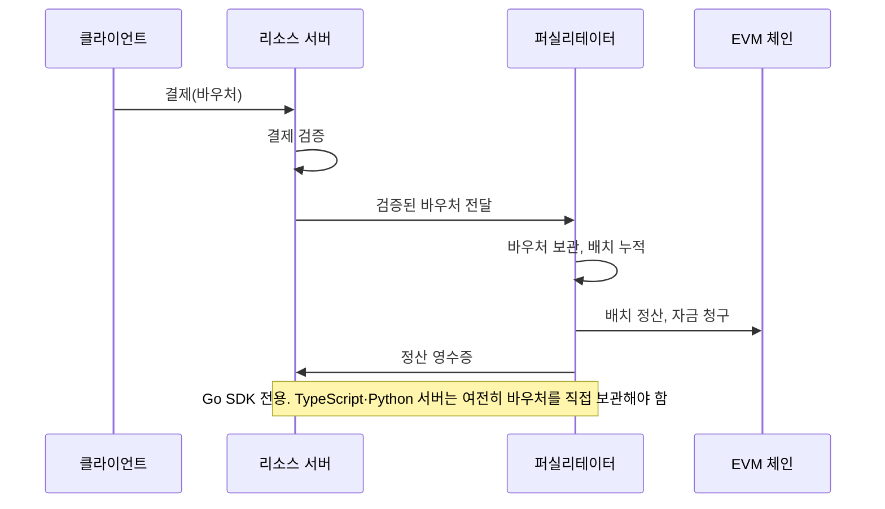

## 초록

이번 창에서는 세 갈래가 서로 반대 방향으로 움직였다. 구글 클라우드는 IAM Helper를 내놓으면서, 에이전트가 IAM 정책을 스스로 진단하게는 두고 실제로 바꿀 때만 사람의 확인을 거치게 했다[^s01]. 뱅크오브아메리카는 고객들에게 은행 비밀번호를 AI 비서에게 넘긴다고 해서 그 뒤에 벌어지는 일의 책임이 넘어가는 것은 아니라고 이메일로 알렸다[^s02]. x402의 Go SDK는 배치 정산용 보관 기능을 TypeScript·Python보다 먼저 병합했고, 이 프로젝트 자체 드리프트 봇이 같은 날 그 격차를 잡아냈다. 이번 창에서 봇이 찾아낸 다섯 건 중 하나다[^s03][^s04]. 네 번째 갈래는 지난 호의 zod CVE로 이어진다. `@x402/core`에 남아 있던 패치되지 않은 그 취약점이 `@coinbase/cdp-sdk`에도 그대로 들어 있어서, 한 패키지에서 추적하던 의존성 문제가 두 단계 위에 있는 또 다른 패키지에서도 똑같이 드러났다[^s05][^s06].

## 서론

이번 호는 **2026-10-25부터 2026-10-28까지**를 다룬다. 결제 레일 전반의 배경은 사이트의 [에이전트 커머스 프로토콜 비교](../agent-commerce-protocol/)에 있고, 일주일 넘게 이어온 x402 SDK 버그 스레드는 [2026-10-27 호](../ai-agent-brief-2026-10-27/)에서 계속된다.

## 무엇이 움직였나

### 구글 클라우드, "읽기"와 "쓰기" 사이에 선을 긋다

2026-10-28에 발표된 IAM Helper는 공개 Agent Skills 표준으로 만든 패키지형 스킬들과, IAM의 정책 트러블슈터·정책 분석기·정책 시뮬레이터를 읽기 전용 함수로 노출하는 구글 관리형 MCP 툴 모음이다. 출시 시점에 네 가지 스킬이 함께 나왔다. 하나는 `403 PERMISSION_DENIED` 오류를 진단하고, 하나는 `allUsers`나 `roles/owner` 같은 위험한 설정을 걸러내며 허용·거부 정책 변경을 생성·검증하고, 하나는 적용 전에 제안된 변경을 90일치 접근 로그에 재생해 보며, 하나는 Privileged Access Manager를 통해 임시 권한 상승을 관리한다[^s01].

눈에 띄는 설계는 이것이다. 진단과 시뮬레이션은 사람 없이 자동으로 돌지만, 정책에 실제로 쓰기가 일어나는 순간에는 위험도 등급에 따라 사람의 확인을 기다린다. "이제 에이전트가 IAM을 관리한다"보다는 훨씬 좁은 주장이다. 왜 요청이 거부됐는지 같은 지루한 분석 작업은 에이전트에게 맡기면서도, 쓰기 권한까지 기본값으로 넘기지는 않으려는 시도다. 구글은 프리뷰인지 GA인지 등급을 밝히지 않았고 실제로 쓰는 고객 이름도 없다. 글은 그저 Agent Skills Catalog에서 지금 바로 만들어 보라고 안내할 뿐이다 _(공급업체 발표)_[^s01].

### 뱅크오브아메리카, 비밀번호를 넘긴다고 책임이 넘어가진 않는다고 못 박다

"AI 시대의 자산 보호"라는 제목의 이메일에서 은행은 고객들에게 자신을 대신해 행동하겠다고 나서는 AI 도구나 에이전트를 포함해 누구에게도 아이디와 비밀번호를 넘기지 말라고 요청했고, 넘긴 뒤에는 그 접근으로 벌어진 일의 책임이 여전히 고객 본인에게 있다고 경고했다[^s02]. TechCrunch는 이를 새로운 통제 수단이 아니라 기존 책임 원칙을 다시 알리는 공지로 본다. 새 인증 수단도, 범위를 제한한 대안 자격증명도 없이 그냥 다시 한번 말해둔 것뿐이다. 뱅크오브아메리카는 TechCrunch의 확인 요청에 응답하지 않았고, 다른 매체의 독립 확인도 없다 _(단독 소스, 미확인)_[^s02].

여기서 드러나는 빈틈은 이 은행만의 문제가 아니다. 은행권에는 AI 에이전트에게 의도한 용도 밖으로는 못 쓰게 범위를 제한한 자격증명을 발급할 표준 수단이 아직 없다. 그래서 오늘 은행이 쓸 수 있는 유일한 지렛대는 "필요한 만큼만 주라"가 아니라 "아예 비밀번호 하나를 통째로 넘기지 말라"는 당부뿐이다.

### x402의 Go SDK, 다른 두 SDK에 없는 배치 정산 기능을 먼저 갖다

2026-10-27에 병합된 PR #3726은 Go SDK에 EVM 배치 정산의 두 번째 방식을 더했다. 기존에는 리소스 서버가 정산할 때까지 결제 바우처를 직접 보관했지만, 이제는 서버가 검증을 마친 바우처를 퍼실리테이터에게 넘기기만 하면, 퍼실리테이터가 보관·청구·정산·환불을 모두 처리한다[^s04].

*화살표가 말하는 것: Go SDK의 새 모드에서는 바우처 보관과 정산이 모두 퍼실리테이터로 넘어가지만, TypeScript나 Python을 쓰는 판매자에게는 대응하는 경로가 없어 서버가 계속 보관자 역할을 맡아야 한다[^s03][^s04].*

프로젝트 자체 자동 드리프트 검사는 같은 날 이 간극을 잡아냈고, 같은 병합과 그 앞선 PR 하나에서 새로 생긴 다섯 건의 SDK 간 불일치 중 하나로 등록했다. 그중 하나는 이렇다. 정산 후(after-settle) 훅이 실패하면 Go는 이를 치명적 실패로 보고 영수증 발급을 막지만, TypeScript와 Python은 같은 오류를 치명적이지 않은 경고로만 처리해 정산이 실패했는데도 성공으로 보고된다[^s03]. 다섯 건 모두 아직 추적 중인 수정안이 없다. 이는 2026-10-26 호에서 짚었던 패턴과 같다. x402의 세 SDK 중 하나에서 증명된 안전성이나 기능은, 누군가 포팅하기 전까지는 나머지 두 곳에서 보장되지 않는다. 그리고 지금은 드리프트 봇이 새 간극을 찾아내는 속도를 그 누구도 따라가지 못하고 있다.

### `@x402/core`에 남아 있던 zod 취약점, 한 단계 위 패키지에서 다시 나타나다

`@coinbase/cdp-sdk` 1.60.0은 `zod ^3.25.76`을 명시한다. 이 범위에는 지난 2026-10-27 호에서 다룬 메모리 고갈 취약점 GHSA-mrhx-c7xc-m3w5도 포함되는데, zod 4.6.6 이상에서만 고쳐졌고 zod 3 계열에는 수정판이 없다. `@coinbase/cdp-sdk`는 `@coinbase/x402`와 CDP 퍼실리테이터 설정의 의존성이기 때문에, CDP 퍼실리테이터를 쓰는 x402 판매자라면 `npm audit`을 깨끗하게 통과할 길이 없다. `npm audit fix`가 제시하는 유일한 해법은 결제가 깨지는 `@coinbase/x402` 구버전으로의 다운그레이드뿐이다[^s05].

이틀 앞서 같은 패키지에서 전혀 다른 버그도 드러났다. cdp-sdk 1.59.0은 `@x402/*`를 선택적인, 지연 로딩 의존성으로 바꾸려 했지만, 모듈 하나가 여전히 `@x402/evm`을 정적으로 import하고 있어서 번들러가 지연 로딩 래퍼를 무시하고 이를 그대로 따라간다. 1.53.0부터 1.59.0까지의 모든 cdp-sdk 릴리스가 선택적 피어가 설치되지 않은 상태에서 Vite/Rolldown 빌드에 실패하며, 보고된 유일한 우회법은 1.52.0으로 고정하는 것이다[^s06]. 두 이슈 모두 이번 호 기준으로 병합된 수정이 없다.

## 왜 중요한가

이번 창에서 두 기관은 사람에게 묻지 않고 에이전트가 할 수 있는 일의 범위를 좁혔다. 구글은 IAM 정책 쓰기에 관문을 달았고, 뱅크오브아메리카는 자격증명을 에이전트와 공유해도 책임 소재가 바뀌지 않는다고 선을 그었다. 둘 다 에이전트에게 범위를 좁힌 대안을 내놓지는 않았고, 둘 다 "필요 이상은 주지 말라" 또는 "아예 아무것도 주지 말라" 쪽으로 물러났다. 반면 이 브리프가 가장 꾸준히 추적해온 결제 레일은 반대 방향으로 자기 내부 간극을 계속 벌리고 있다. 한 SDK에서 기능이 먼저 생기고, 한 패키지에서 다루던 의존성 문제가 한 단계 떨어진 다른 패키지에서 똑같이 다시 나타나며, 어느 쪽도 아직 이슈로만 남아 있을 뿐 병합된 수정이 아니다. 두 흐름이 같은 이야기라는 뜻은 아니다. "에이전트가 하는 일을 믿을 수 있는가"와 "인프라가 실제로 일관되게 동작하는가"는 서로 다른 질문이고, 이번 창은 그중 첫 번째 질문에 더 많이 답했다.

## 지켜볼 신호

- IAM Helper의 프리뷰·GA 등급 공개 여부와, 실명으로 쓰겠다는 고객의 등장.
- TypeScript·Python이 퍼실리테이터 관리형 바우처 보관 간극을 메우는 순서. Go는 이미 최소 다섯 가지 추적 항목에서 약 2주를 앞서 있다.
- `@coinbase/cdp-sdk`가 zod 4 마이그레이션을 받아들일까? 메인테이너에게는 아직 테스트되지 않은 열린 요청이 하나 있다.

## 한계

카드 네트워크·PSP의 에이전트 커머스 제품들, 이를테면 마스터카드 Agent Pay, 비자의 Trusted Agent Protocol과 Intelligent Commerce, 스트라이프의 Agentic Commerce Protocol은 이번 창 안에서 날짜가 찍힌 1차 발표를 내지 않았다. 웹 검색은 비교·설명 콘텐츠만 돌려주었다. AP2와 Universal Commerce Protocol 모두 저장소 활동은 이어지고 있지만, 창 안에 날짜가 찍히고 독립적으로 확인된 사례는 없어 세 항목 기준을 넘기지 못했다. 더리얼리얼이 AI 쇼핑 에이전트에 대한 봇 방어를 강화했다는 The Verge 보도는 이번 실행 중 가져오지 못해 인용하지 않는다. 가져왔다면 "기관들이 에이전트 접근을 좁힌다"는 흐름에 다섯 번째 사례를 더했을 것이다. x402 드리프트 결과는 모두 프로젝트 자체 자동 검사에 근거하며, 이 브리프는 보고된 다섯 가지 동작 중 어느 것도 독립적으로 재현하지 않았다.
