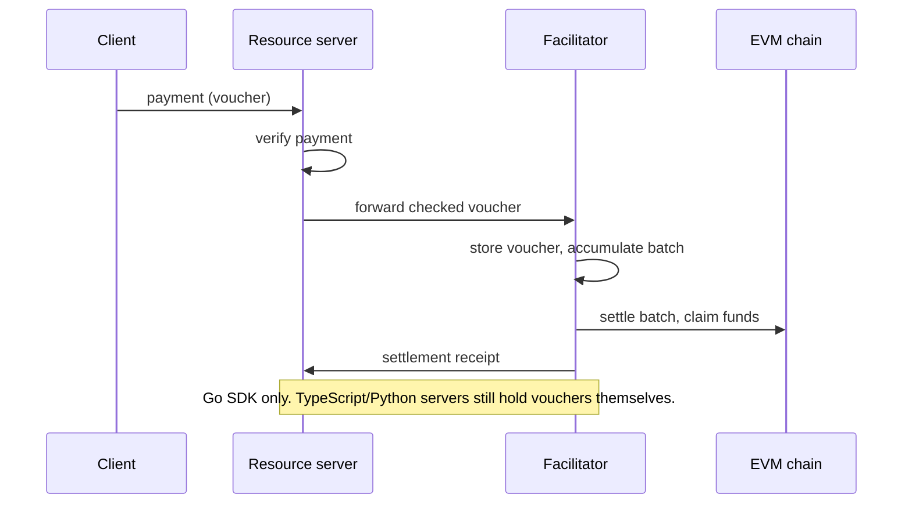

## Abstract

Three things moved against each other this window. Google Cloud shipped IAM Helper, an agent-facing toolkit that lets an agent diagnose IAM policy on its own but pauses for a human the moment it tries to change one[^s01]. Bank of America emailed customers to say that handing banking credentials to an AI assistant doesn't transfer the liability for what happens next[^s02]. x402's Go SDK pulled ahead of its own TypeScript and Python siblings by merging facilitator-managed voucher custody for batch settlement, a capability gap the project's own drift bot flagged the same day it landed, one of five it caught this window[^s03][^s04]. A fourth thread ties back to last edition's zod CVE: the same unpatched advisory that sits in `@x402/core` also sits in `@coinbase/cdp-sdk`, so the dependency problem this brief tracked in one package is now visible in a second one two layers up the chain[^s05][^s06].

## Introduction

This edition covers **2026-10-25 through 2026-10-28**. Background on the payment-rail landscape lives in the site's [agent commerce protocol comparison](../agent-commerce-protocol/); the x402 SDK bug thread this brief has followed for over a week continues from the [2026-10-27 edition](../ai-agent-brief-2026-10-27/).

## What moved

### Google Cloud draws a line between an agent reading IAM policy and an agent changing it

IAM Helper, announced 2026-10-28, is a set of packaged skills built on the open Agent Skills standard, plus a family of Google-managed MCP tools that expose IAM's Policy Troubleshooter, Policy Analyzer, and Policy Simulator as read-only functions an agent can call directly. Four skills ship at launch: one diagnoses `403 PERMISSION_DENIED` errors, one generates and validates allow/deny policy changes while blocking configurations like `allUsers` or `roles/owner`, one replays a proposed change against 90 days of access logs before it's applied, and one manages just-in-time elevated access through Privileged Access Manager[^s01].

Diagnostics and simulations run autonomously, but any actual write to a policy pauses for a human, gated by a configurable risk tier. That's a narrower claim than "agents can manage your IAM now": it lets an agent do the unglamorous triage work, such as why a request got denied, without extending it write authority by default. Google names no availability tier (preview or GA) and no customer using it in production; the post points developers to the Agent Skills Catalog to start building today _(vendor-stated)_[^s01].

### Bank of America tells customers that sharing a password with an AI agent doesn't move the liability

In an email titled "Protecting your finances in the AI World," the bank asked customers never to hand their username and password to another person or service, explicitly including "an AI-enabled tool or agent that offers to act on your behalf," and warned that anyone who does so stays responsible for whatever that access is used for[^s02]. TechCrunch frames it as a reminder, not a new control: there's no new authentication mechanism and no scoped-credential alternative offered, just a restatement of existing liability. BofA didn't respond to a request for comment, and no other outlet has independently confirmed the email's wording _(unverified — single source)_[^s02].

The gap this exposes is structural, not BofA-specific: banks have no standard way to issue an AI agent a scoped credential that can't be reused outside its intended purpose, so the only lever available to a bank today is an advisory telling customers not to share their one unscoped credential at all.

### x402's Go SDK gets a batch-settlement capability the other two SDKs don't have

PR #3726 merged into x402-foundation/x402 on 2026-10-27, giving the Go SDK a second way to run EVM batch settlement. In the old mode, the resource server holds payment vouchers until it settles them itself. In the new mode, the server simply forwards checked payments, and the facilitator stores, claims, settles, and refunds them[^s04].

*What the arrows assert: in the Go SDK's new mode, voucher custody and settlement both move to the facilitator; a seller running TypeScript or Python has no equivalent path and must keep the server as custodian[^s03][^s04].*

The project's own automated drift check caught this the same day and filed it as one of five new cross-SDK inconsistencies opened by the same merge and one earlier PR — including a case where Go now treats a failed after-settle hook as a hard failure that blocks a receipt, while TypeScript and Python still treat the same error as a non-fatal warning that lets the settlement report success anyway[^s03]. None of the five has a tracked fix yet. This is the same pattern the brief flagged on 2026-10-26: a safety or capability property proven in one of x402's three SDKs isn't guaranteed in the others until someone writes the port, and nobody is porting faster than the drift bot can find new gaps.

### The zod advisory already open in `@x402/core` turns up again, one layer up the dependency chain

`@coinbase/cdp-sdk` 1.60.0 declares `zod ^3.25.76`. GHSA-mrhx-c7xc-m3w5, the memory-exhaustion advisory this brief covered on 2026-10-27, is fixed only in zod 4.6.6 and above, and runs through that range too. Because `@coinbase/cdp-sdk` is a dependency of `@coinbase/x402` and the CDP facilitator setup, any x402 seller using the CDP facilitator fails `npm audit` with no clean fix: `npm audit fix` offers only a downgrade to a `@coinbase/x402` version that breaks payments[^s05].

A second, unrelated bug surfaced in the same package two days earlier: cdp-sdk 1.59.0 tried to make `@x402/*` an optional, lazily-loaded dependency, but one module still carries a static import of `@x402/evm` that bundlers follow regardless of the lazy-load wrapper around it. Every cdp-sdk release from 1.53.0 through 1.59.0 fails a Vite/Rolldown build when the optional peer isn't installed; the only workaround reported is pinning to 1.52.0[^s06]. Neither issue has a merged fix as of this edition.

## Why it matters

Two institutions spent this window narrowing what an agent is allowed to do without asking a human first: Google by gating IAM policy writes, Bank of America by refusing to accept that credential-sharing with an agent changes who's liable. Neither offers the agent a scoped alternative; both fall back to "don't give it more than it needs" or "don't give it anything at all." Meanwhile the payment rail this brief tracks most closely keeps widening its own internal gap in the other direction: a capability lands in one SDK, a dependency problem resurfaces in a package one layer removed from where it was first found, and the fix for either is still an open issue, not a merged PR. These aren't the same story. "Can we trust what the agent does" and "does the infrastructure actually behave consistently" are separate questions, and this window answered the first one more than the second.

## Signals to watch

- A preview/GA tier for IAM Helper, or a named customer going on record using it.
- TypeScript or Python closing the facilitator-managed voucher custody gap. Go already has roughly two weeks' lead on at least five tracked behaviors.
- Will `@coinbase/cdp-sdk` take the zod-4 migration? The request sits open and untested.

## Limitations

Card-network and PSP agent-commerce products, including Mastercard Agent Pay and Visa's Trusted Agent Protocol, Intelligent Commerce, and Stripe's Agentic Commerce Protocol, produced no dated primary announcement inside this window; web search returned only comparison and explainer content. AP2 and the Universal Commerce Protocol both show ongoing repository activity, but nothing that was both dated inside the window and independently confirmed, so neither cleared the three-item bar. A Verge report on The RealReal tightening its bot defenses against AI shopping agents could not be fetched during this run and is not cited, even though it would have added a fifth data point to the "institutions tightening agent access" thread. The x402 drift findings rest entirely on the project's own automated check; this brief has not independently reproduced any of the five behaviors it reports.
