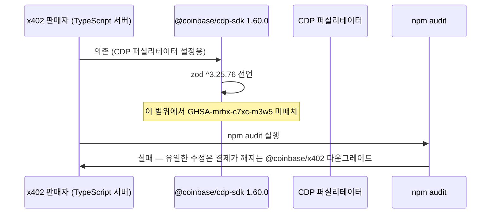

## 초록

이번 주기에는 의회, 결제 프로토콜, 결제 클라이언트가 공통된 패턴을 보였다. 서류상으로는 보호장치나 수정이 존재하지만, 실제로 보호해야 할 지점에는 닿지 않는다는 것이다. 미국 하원은 AI 에이전트가 회사 전체를 운영하도록 허용하는 델라웨어주의 계획에 대해 문서 조사를 시작했고, 주정부가 제안한 책임 차단 구조가 실제로 유지될지 의문을 제기했다[^s06][^s07]. x402 재단은 이 브리프가 10월 중순부터 추적해온 메모리 고갈 취약점에 대한 zod 4 패치를 자체 TypeScript, Go, Python 패키지에 병합했지만, 대다수 판매자가 실제로 거쳐가는 의존성인 `@coinbase/cdp-sdk`는 패치 시점보다 엿새 전, 세 버전 뒤에 머물러 있다[^s01][^s04]. 그리고 Machine Payments Protocol(MPP)이 문서화한 대체 경로(mpp에서 x402, mcp로 이어지는 순서)는 서버의 402 응답이 Payment 스킴을 명시하지 않는 경우 두 참조 클라이언트 모두에서 작동하지 않는 것으로 드러났다[^s09][^s10].

## 서론

이번 호는 **2026년 10월 26일부터 29일까지**를 다룬다. 결제 레일 전반에 관한 배경은 사이트의 [에이전트 커머스 프로토콜 비교](../agent-commerce-protocol/)에 있으며, x402 zod 취약점 흐름은 [10월 28일 호](../ai-agent-brief-2026-10-28/)에서 이어진다.

## 무엇이 움직였나

### 의회, AI가 운영하는 회사를 허용하는 델라웨어 계획에 문서 조사 착수

하원 감독위원회 위원장 제임스 코머는 2026년 10월 26일 델라웨어 주지사 매트 마이어에게 보낸 네 쪽짜리 서한에서, 주정부가 제안한 "인공지능 회사(AIC)" 법인 형태와 관련된 모든 위험 평가, 컨설팅 계약, 법안 초안, 내부 소통 기록을 2025년 1월까지 거슬러 요구했다[^s06]. AIC는 사람이 아닌 AI 에이전트가 일상적인 업무를 운영하는 샌드박스형 법인으로, 자기 이름으로 제소하거나 제소당할 수 있고 재산을 보유하며 채무를 질 수 있다. 이를 자본화한 개인이나 법인은 사기나 고의적 법 위반이 아닌 한 AIC의 채무로부터 보호받는다[^s08]. 코머의 위원회가 우려하는 지점은 정확히 그 반대 방향이다. 서한은 이 구조가 "강력한 AI 기업과 그 투자자들을 무모하고 유해한 행위에 대한 책임으로부터 보호하는 동시에, 주정부 AI 이니셔티브 뒤에 숨은 불투명한 세력의 반경쟁적 규제 포획을 보호하는 데 쓰일 수 있다"고 우려한다고 적었다[^s06]. 코머는 11월 9일을 답변 시한으로 제시했고, 주정부의 권한을 제한하는 연방 법안 가능성도 언급했다.

이 제안 자체는 새로운 것이 아니다. 델라웨어 국무장관 차루니 파티반다산체스와 Norm Ai CEO 존 네이가 2026년 7월 포천 기고문에서 발표했고, 이후 30개월짜리 규제 샌드박스를 향해 움직여왔다[^s08]. 새로운 것은 이번이 공식 기록상 최초의 연방 차원 대응이라는 점이다. 아이디어가 공개된 지 3개월, 주의회가 2027년 1월 이 안건을 다루기 전이다. 마이어 측 대변인은 서한을 수령해 검토 중이라는 답변만 남겼다[^s07]. 아직 누구도 코머가 제기한 본질적 문제에 답하지 않았는데, 이는 제안 자체에 남아있는 공백과도 겹친다. 델라웨어의 샌드박스는 주정부가 AIC를 정지하거나 해산할 권한을 부여하지만, 이 브리프가 10월 28일 호에서 다룬 IAM 헬퍼의 정책 게이트처럼 인프라 변경에 사람이 개입하는 지점을 명시하지는 않는다. 한쪽은 아무것도 출시하기 전에 선을 긋고 있고, 다른 쪽은 그 선이 실제로 존재하는지를 의회로부터 질문받고 있다.

### x402 재단, 두 호 동안 추적한 zod 취약점을 패치하다 — 판매자가 실제로 서는 지점 한 발짝 앞에서 멈춘다

x402-foundation/x402의 PR #3983이 2026년 10월 28일 병합되어 모든 TypeScript 패키지를 zod 3에서 zod ^4.6.6으로 옮겼다. 이 브리프가 10월 27일 처음 다룬 비제한 배열 메모리 고갈 취약점인 GHSA-mrhx-c7xc-m3w5를 실제로 고치는 첫 릴리스 라인이다[^s01]. 패치된 zod 3.x는 존재하지 않는다. 같은 날 병합된 Python과 Go용 PR도 같은 종류의 공개된 취약점에 대해 의존성 하한을 끌어올렸다[^s02][^s03]. 이 PR은 마이그레이션한 스키마 자체도 강화했다. `PaymentRequired`의 `accepts` 배열을 1,024개로 제한해, zod 패치만 기다리는 대신 비제한 배열 경로를 직접 차단한 것이다.

*화살표가 주장하는 것: 2026년 10월 28일 x402 자체 패키지에 병합된 패치는 `@coinbase/cdp-sdk`에 의존하는 판매자에게 닿지 않는다. 이 패키지가 x402 패치 병합 이후 두 버전이 지난 지금도 취약한 zod 범위를 그대로 고정하고 있기 때문이다[^s01][^s04].*

`@coinbase/cdp-sdk`는 패치가 병합되기 나흘 전인 2026년 10월 22일 이후 계속 1.60.0에 머물러 있으며, 여전히 `zod ^3.25.76`을 선언하고 있다[^s04]. 이번 조사 시점까지 이 패키지에 마이그레이션을 제안하는 이슈나 PR은 보이지 않았다. CDP 퍼실리테이터를 쓰는 판매자는 10월 28일 호 시점과 정확히 같은 수준으로 노출되어 있다. 패치는 "어디에도 존재하지 않는" 상태에서 "대부분의 판매자가 실제로 import하는 지점보다 한 단계 위에 존재하는" 상태로 옮겨갔을 뿐이다. 한편 x402의 자동 드리프트 봇은 10월 28일 두 건의 SDK 간 불일치를 추가로 보고했는데, 둘 다 Go에서만 변경된 SVM 트랜잭션 처리 때문이며 TypeScript와 Python은 아직 따라가지 못한 상태다. 드리프트 패턴은 해소되지 않고 계속되고 있다[^s05].

### Machine Payments Protocol의 두 참조 클라이언트 모두 같은 대체 경로 약속을 어긴다

MPP의 핵심 주장은 클라이언트가 프로토콜을 순서대로(mpp, 그다음 x402, 그다음 mcp) 시도한다는 것이다. 그래서 MPP를 지원하지 않는 서버라도 자신이 지원하는 다른 프로토콜을 통해 결제를 받을 수 있다. 하지만 GitHub 스타 189개를 보유한 TypeScript MPP 클라이언트 `wevm/mppx`는 그렇게 동작하지 않는다. 402 응답의 `WWW-Authenticate` 헤더가 `Payment`가 아닌 다른 스킴을 명시할 때(예를 들어 `Payment` 지시어 없는 단순 `X402` 챌린지), 클라이언트는 `No Payment schemes found.`를 던지고 전체 fetch를 중단한다. MPP를 건너뛰고 x402로 넘어가는, 대체 경로가 보장하는 그 동작은 일어나지 않는다[^s09]. x402 제안에 응답할 수 있도록 설정된 클라이언트조차 그 기회를 얻지 못한다. 10월 27일 등록된 이 이슈는 버그의 원인을 하나의 누락된 검사로 추적한다. MPP 전송 계층이 `WWW-Authenticate` 헤더가 있는 모든 402 응답을 MPP 응답으로 간주하고, Payment 챌린지가 실제로 존재하는지 확인하지 않은 채 바로 파싱을 시도한다는 것이다.

같은 결함이 또 다른 참조 구현체인 Solana Foundation의 pay-kit에도 있다. `SessionFetch`가 정확히 같은 경우에 예외를 던지는데, 이는 10월 6일 등록된 이슈 #358에서 보고됐다. 수정 PR #359는 실제 Payment 스킴을 추출해 일치하는 것이 없을 때 깨끗하게 다음 단계로 넘어가도록 하지만, 3주가 지난 지금도 병합되지 않았다[^s10][^s11]. 서로 독립적으로 개발된 두 클라이언트가 동일한 결함에 도달했다는 사실은, MPP가 문서화한 대체 경로가 Payment가 아닌 챌린지를 내보내는 서버를 상대로는 이번 주 전까지 한 번도 제대로 시험된 적이 없었다는 뜻이다.

## 왜 중요한가

델라웨어의 샌드박스는 해산 권한은 갖고 있지만 명시된 인간 검토 지점은 없고, 의회는 사실상 설계의 나머지 부분도 믿지 못하겠다고 말한 셈이다. x402의 zod 패치는 실재하고 훌륭하지만 프로젝트 경계에서 멈춘다. 대다수 판매자가 실제로 거쳐가는 퍼실리테이터 패키지는 아직 이를 반영하지 않았고, 그래서 10월 27일 "열려 있던" 취약점은 10월 29일 "패치됐지만 중요한 곳에는 미치지 못한" 상태가 됐다. MPP의 대체 경로는 서로 다른 두 팀이 똑같은 방식으로 구현할 만큼 명확하게 문서화되어 있는데, 두 구현체 모두 똑같은 방식으로 틀렸다. 이 가운데 어느 것도 의도의 실패는 아니다. 각각은 올바르게 설계된 보호장치이지만, 쓰여진 지점 이후로는 어디에서도 검증되지 않았다.

## 주시할 신호

- 2026년 11월 9일로 예정된 델라웨어의 코머 서한 답변, 그리고 2027년 1월 주의회 회기 전에 AIC 제안의 샌드박스 설계에 인간 검토 지점이 추가될지 여부.
- `@coinbase/cdp-sdk`의 zod 4 마이그레이션: 이번 호 시점까지 이를 제안하는 추적 이슈는 없다.
- pay-kit의 PR #359 병합 여부와 mppx의 동등한 수정 여부. 둘 중 하나라도 이루어지면 MPP의 대체 경로가 비-MPP 서버를 상대로 실제로 작동한다는 첫 실증 사례가 될 것이다.

## 한계

Mastercard Agent Pay, Visa의 Trusted Agent Protocol·Intelligent Commerce, Stripe의 Agentic Commerce Protocol, PayPal의 Agent Ready 등 카드 네트워크·PSP 에이전트 커머스 제품은 이번 조사 기간 내 날짜가 확인된 1차 발표를 내지 않았다. 10월 28일 호와 같은 공백이다. OpenAI의 Agentic Commerce Protocol은 이번 조사 시점까지 공식 GitHub 저장소를 찾을 수 없어, 이 브리프의 ACP 관련 보도는 계속 2차 자료에 의존하고 있다. 이번 호의 어느 항목도 X나 LinkedIn 게시물에서 직접 비롯되지 않았다. 셋 모두 벤더 자체 블로그, 스펙 저장소, 혹은 의회 문서에서 나왔다. mppx와 pay-kit의 버그는 이슈 트래커상의 재현으로 입증된 것이며, 실제 운영 환경에서 관찰된 결제 실패는 아니다.
