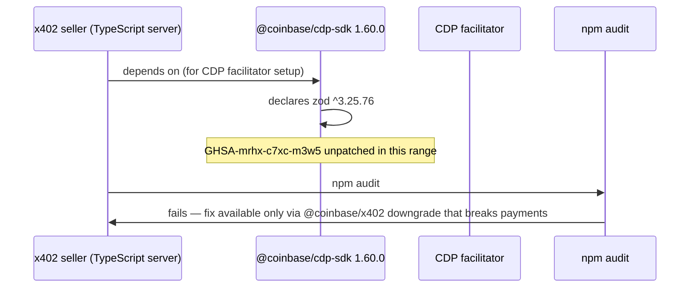

## Abstract

A House committee, a payment protocol, and a payment client all hit the same shape this window: a fix or a guardrail exists on paper but doesn't reach the place it's supposed to protect. Congress opened a records probe into Delaware's plan to let AI agents run entire companies, challenging whether the liability shield the state is proposing would actually hold[^s06][^s07]. The x402 Foundation merged the zod-4 patch, in its own TypeScript, Go, and Python packages, for the memory-exhaustion CVE this brief has tracked since mid-October, but the dependency most sellers actually run through, `@coinbase/cdp-sdk`, is still three versions and six days behind the fix[^s01][^s04]. And the Machine Payments Protocol's documented fallback chain, mpp → x402 → mcp, turns out not to execute in either of its two reference clients when a server's 402 response doesn't name a Payment scheme explicitly[^s09][^s10].

## Introduction

This edition covers **2026-10-26 through 2026-10-29**. Background on the payment-rail landscape lives in the site's [agent commerce protocol comparison](../agent-commerce-protocol/); the x402 zod-CVE thread continues from the [2026-10-28 edition](../ai-agent-brief-2026-10-28/).

## What moved

### Congress opens a records probe into Delaware's plan for AI-run companies

House Oversight Committee Chairman James Comer sent a four-page letter to Delaware Governor Matt Meyer on 2026-10-26, demanding every risk assessment, consulting contract, draft bill, and internal communication connected to the state's proposed Artificial Intelligence Company (AIC) entity going back to January 2025[^s06]. An AIC would be a sandboxed legal entity whose day-to-day affairs an AI agent runs, not a person: it could sue and be sued, hold property, and incur obligations in its own name, while the human or company that capitalizes it stays shielded from the AIC's debts except in cases of fraud or willful violation of law[^s08]. Comer's committee worries the structure runs the other way: that it "could be used to protect powerful AI companies and their investors from responsibility for reckless harmful actions, while also protecting non-transparent forces seeking anticompetitive regulatory capture behind state AI initiatives[^s06]." He set a November 9 deadline and floated federal legislation to cap what states can do here.

The proposal itself dates to July 2026, when Delaware Secretary of State Charuni Patibanda-Sanchez and Norm Ai CEO John Nay announced it in a Fortune op-ed; it's been moving toward a 30-month regulatory sandbox ever since[^s08]. What's new is that this is the first federal response on record, three months after the idea became public and ahead of the state legislature taking it up in January 2027. A spokesperson for Meyer told reporters only that the office had received the letter and was reviewing it[^s07]. Nobody has yet answered the substance of Comer's concern, which is also the open question in the proposal itself: Delaware's sandbox gives the state power to suspend or dissolve an AIC, but it doesn't specify a human-review checkpoint the way the IAM Helper policy gate this brief covered on 2026-10-28 does for infrastructure writes. One institution is drawing a bright line before anything ships; the other is being asked by Congress whether its line exists at all.

### x402 Foundation patches the zod CVE this brief has tracked for two editions, one dependency hop short of where sellers actually run

PR #3983 merged into x402-foundation/x402 on 2026-10-28, moving every TypeScript package from zod 3 to zod ^4.6.6, the first release line that actually fixes GHSA-mrhx-c7xc-m3w5, the unbounded-array memory-exhaustion advisory this brief first covered on 2026-10-27[^s01]. There is no patched zod 3.x; companion PRs the same day raised dependency floors in the Python and Go SDKs for the same class of advisories[^s02][^s03]. The PR also hardens the schemas it migrated: `PaymentRequired`'s `accepts` array is now capped at 1,024 entries, closing off the unbounded-array path directly, on top of the zod fix.

*What the arrows assert: the fix merged into x402's own packages on 2026-10-28 does not reach a seller who depends on `@coinbase/cdp-sdk`, because that package still pins the vulnerable zod range two versions after the x402 patch landed[^s01][^s04].*

`@coinbase/cdp-sdk` has been at 1.60.0 since 2026-10-22, four days before the fix even merged, and still declares `zod ^3.25.76`[^s04]. No issue or PR proposing the migration was visible in that package as of this run. Sellers running the CDP facilitator are exactly as exposed today as they were in the 2026-10-28 edition; the patch just moved from "doesn't exist anywhere" to "exists one layer up from where most sellers actually import it." The project's drift bot, meanwhile, filed two more cross-SDK gaps on 2026-10-28, both caused by Go-only changes to SVM transaction handling that TypeScript and Python haven't picked up, continuing the capability-drift pattern rather than resolving it[^s05].

### Both of the Machine Payments Protocol's reference clients break the same fallback promise

MPP's pitch is that a client tries protocols in order (mpp, then x402, then mcp), so a server that doesn't speak MPP still gets paid through whatever it does speak. `wevm/mppx`, the TypeScript MPP client with 189 GitHub stars, doesn't do that: when a 402 response's `WWW-Authenticate` header names a scheme other than `Payment` (for example, a bare `X402` challenge with no `Payment` directive), the client throws `No Payment schemes found.` and aborts the whole fetch. It never skips MPP to let x402 run, which is the behavior the documented fallback order promises[^s09]. A client configured to pay the x402 offer never gets the chance. The issue, opened 2026-10-27, traces the bug to one missing check: the MPP transport treats any 402 carrying a `WWW-Authenticate` header as an MPP response and parses it for Payment challenges without first confirming one is present.

The same defect sits in Solana Foundation's pay-kit, the other reference implementation: `SessionFetch` throws on exactly this case, reported in issue #358 on 2026-10-06. A fix, PR #359, extracts the actual Payment schemes and falls through cleanly when none match; it has sat unmerged for three weeks[^s10][^s11]. Two independent teams built two independent clients and landed on the identical gap, which says the fallback chain MPP documents was never actually exercised against a server advertising a non-Payment challenge — until someone tried it this week.

## Why it matters

Delaware's sandbox has a dissolution power but no specified human-review checkpoint, and Congress just said, in effect, that it doesn't trust the rest of the design either. x402's zod fix exists and is good, but it stops at the project boundary; the facilitator package most sellers actually run through hasn't picked it up, so the CVE that was "open" on 2026-10-27 is now "patched, but not where it counts" on 2026-10-29. MPP's fallback chain is written down clearly enough that two separate teams implemented it the same way — and both implementations are wrong the same way. None of these are failures of intent. Each is a guardrail that was designed correctly and verified nowhere past the point it was written.

## Signals to watch

- Delaware's response to Comer's letter, due 2026-11-09, and whether the AIC proposal's sandbox design gets a human-review checkpoint added before the January 2027 legislative session.
- `@coinbase/cdp-sdk`'s zod-4 migration: still no tracked issue proposing it, as of this edition.
- Whether pay-kit's PR #359 merges, and whether mppx ships an equivalent fix; either would be the first real-world confirmation that MPP's fallback chain works against a non-MPP server.

## Limitations

Card-network and PSP agent-commerce products (Mastercard Agent Pay, Visa's Trusted Agent Protocol and Intelligent Commerce, Stripe's Agentic Commerce Protocol, PayPal's Agent Ready) produced no dated primary announcement inside this window; this is the same gap the 2026-10-28 edition reported. OpenAI's Agentic Commerce Protocol has no discoverable canonical GitHub repository as of this run, so this brief's ACP coverage continues to rely on secondary write-ups; no spec repo exists to cite directly. No item in this window traced back to an X or LinkedIn post; all three came from a vendor's own blog, a spec repo, or a congressional document. The mppx and pay-kit bugs are demonstrated by reproduction in an issue tracker, not by an observed payment failure in production.
