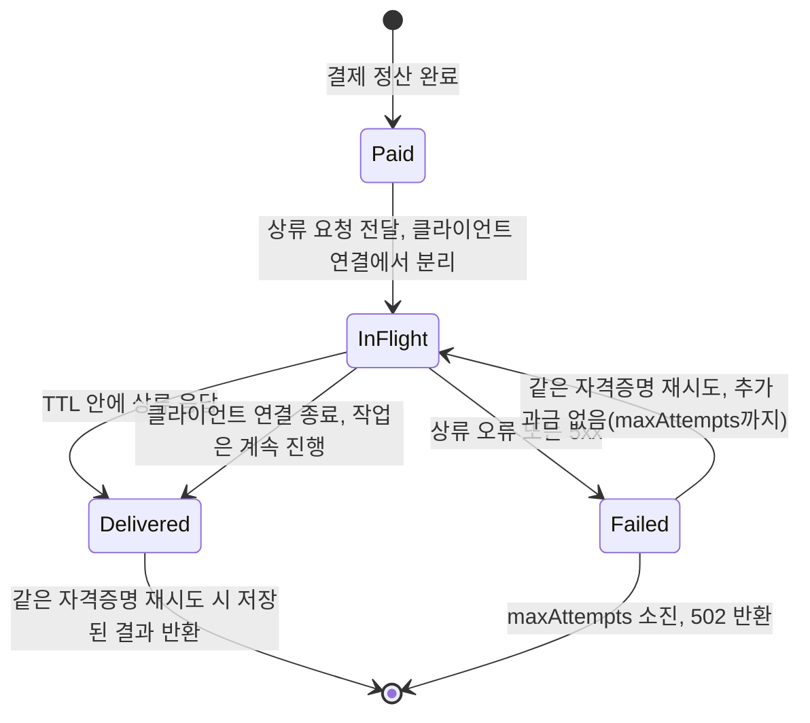

## 초록

지난 2026-11-02판에서 미해결로 지적했던 두 버그가 그날 바로 수정 병합됐다. x402의 Python SIWX 재사용 방지 검증이 실제로 동작하기 시작했고, Go 퍼실리테이터의 V2 중단 경로도 훅이 남긴 진단 메시지를 더는 버리지 않는다[^s01][^s03]. 같은 48시간 동안 전혀 다른, 그러나 결코 가볍지 않은 버그 하나가 더 닫혔다. x402의 Python SDK가 실패한 솔라나 결제를 성공으로 보고하던 문제다[^s08]. 그리고 다른 프로토콜의 SDK인 wevm의 `mppx`에서는 10월 중순부터 열려 있던 문제 하나가 해결됐다. 결제는 이미 끝났는데 클라이언트가 작업 중간에 연결을 끊으면, 지불한 쪽이 그 대가를 돌려받을 방법이 없던 문제다[^s10].

## 서론

이번 호는 **2026-10-31부터 2026-11-03까지**를 다룬다. 결제 레일 전반의 배경은 사이트의 [에이전트 커머스 프로토콜 비교](../agent-commerce-protocol/)를 참고하면 된다. 이번에 마무리된 두 x402 버그, Python SIWX 논스 검증과 Go 퍼실리테이터의 메시지 소실은 [2026-11-01판](../ai-agent-brief-2026-11-01/)에서 처음 보고됐고 [2026-11-02판](../ai-agent-brief-2026-11-02/)까지는 미해결로 남아 있었다.

## 무엇이 움직였나

### x402, 전날 지적한 두 패리티 버그를 고치고 뒤처리까지 끝내다

2026-11-02에 병합된 PR #4080은 한 줄짜리 수정이다. Python SIWX 확장의 `create_siwx_request_hook`이 `has_record_nonce`라는, 코드베이스 어디에도 존재하지 않는 스토리지 메서드를 확인하고 있었다. 문서화된 이름이자 TypeScript SDK가 실제로 확인하는 이름은 `record_nonce`다. 이 불일치 때문에 문서대로 올바르게 구현된 스토리지는 훅 생성 단계에서 실패했고, `record_nonce`만 구현한 스토리지는 이 망가진 검사를 통과하긴 했지만 정작 호출된 적이 없어서 재사용된 서명을 걸러내지 못했다[^s01][^s02]. 같은 날 병합된 PR #4082는 짝을 이루는 버그를 고친다. Go 퍼실리테이터의 V2 중단 경로가 훅 작성자가 설정한 진단 문자열 대신 빈 문자열로 에러를 만들고 있었던 반면, V1 경로와 서버 측 V2 처리는 둘 다 이 메시지를 그대로 보존하고 있었다[^s03][^s04]. 두 수정 모두 두 줄짜리이며, 수정 전 코드에서는 실패하는 회귀 테스트가 함께 들어갔다.

같은 기간 동일한 코드 영역에서 Go 수정이 두 건 더 나왔다. PR #4088은 배치 결제 클라이언트에 `RPCURL` 옵션을 추가해, RPC에 직접 연결되지 않은 서명자로도 가스 스폰서링이 동작하도록 했다. exact/upto 클라이언트와 TypeScript 배치 결제 클라이언트는 이미 이 옵션을 갖고 있었다[^s05]. PR #4096은 늘 "구현되지 않음"만 반환하던 `ProcessPaymentRequest` 스텁을 삭제했다. 저장소 어디에서도 호출하는 곳이 없었다[^s06]. 이어진 PR #4102는 이 네 건을 다시 훑으며 코드에 이미 드러난 헬퍼 이름을 그대로 되풀이하던 테스트 주석 다섯 줄을 지웠다. 네 사람이 각자 고친 게 아니라 누군가 전체를 한 번에 검토했다는 흔적이다[^s07].

### x402의 Python SDK, 실패한 온체인 트랜잭션을 더는 "정산 완료"라 부르지 않는다

2026-10-28에 제기된 이슈 #4032는 Python SDK의 SVM(솔라나) 서명자가 confirmed나 finalized 상태이면서 실제로는 실패한 트랜잭션을 성공한 정산으로 처리한다고 보고했다. 2026-11-02에 병합된 PR #4033은 이제 `transaction_failed`를 반환하도록 고치면서, 트랜잭션 서명은 보존하고 성공을 전제로 쌓여 있던 대기·중복 캐시 항목을 함께 정리한다[^s08][^s09]. 수정은 단위·MCP 테스트 2,890개와 새로 추가된 확인·재시도 회귀 테스트 32개를 통과했지만, PR 설명에는 자격증명과 실제 RPC를 쓰는 통합 테스트는 이번 점검에 포함되지 않았다고 적혀 있다. 즉 CI에서 검증된 수정이며, 실제 솔라나 RPC 환경에서 확인된 수정은 아니다.

### mppx 프록시, 클라이언트가 먼저 끊어도 결제가 사라지지 않게 고치다

2026-10-14부터 열려 있던 이슈 #1044는 다음과 같은 간극을 지적했다. `mppx/proxy`는 결제를 정산한 뒤 요청을 상류로 전달하는데, 이때 클라이언트 자신의 연결에 그대로 묶여 있다. 상류 작업이 클라이언트, 또는 그 앞단의 엣지 프록시가 기다려 줄 수 있는 시간보다 오래 걸리면 클라이언트 연결이 끊기고 상류 요청도 함께 죽는데, 결제는 이미 끝난 뒤다. 제보자는 2~4분 걸리는 Seedance 영상 생성 호출에서 이 문제를 겪었다. 약 2분 뒤 결과 없이 HTTP 524가 돌아왔다. 같은 결제 자격증명으로 재시도하면 재사용으로 간주돼 402가 돌아오고, 새 자격증명으로 재시도하면 작업이 다시 실행되며 또 요금이 청구된다[^s11]. 2026-11-02에 병합된 PR #1157은 Redis 방식 저장소를 쓰는 옵트인 `replay` 옵션을 추가했다. 결제가 끝난 상류 요청은 클라이언트 연결에서 분리돼 TTL(기본 15분)로만 제한되고, 같은 자격증명으로 재시도하면 저장된 결과를(아직 진행 중이면 202를, 실패했다면 과금 없이 한 번 더 시도한 뒤 502를) 돌려받으며, 그 과정에서 결제를 다시 검증하거나 다시 정산하지 않는다[^s10].

_Figure 1 — mppx/proxy의 옵트인 `replay` 복구: 클라이언트가 연결을 끊어도 이미 정산된 결제가 고아 상태로 남지 않는다. 상류 요청과 그 결과가 연결보다 더 오래 살아남기 때문이다[^s10]._

## 왜 중요한가

수정 세 건, 프로토콜 두 개, 짧은 한 창(window), 그런데 성격이 전혀 다른 버그 세 종류다. 문서와 어긋난 하드코딩된 메서드 이름, 트랜잭션의 confirmed 상태를 실제 온체인 결과보다 믿어버린 정산 검사, 그리고 클라이언트가 작업이 끝나기 전에 떠나는 경우를 아예 고려하지 않은 결제·전달 설계. 셋 다 diff만 읽어서는 리뷰어가 잡아내기 어려운 종류다. SIWX 버그는 Python 훅을 TypeScript 쌍둥이와 직접 대조해야 보였고, SVM 버그는 솔라나 트랜잭션에서 confirmed와 succeeded가 서로 다른 주장이라는 걸 알아야 보였으며, mppx의 간극은 누군가 엣지 타임아웃에 걸릴 만큼 긴 작업을 실제로 돌려봐야 드러났다. PR #4102는 이틀간의 병합 네 건을 뒤처리하려고만 존재하는 커밋인데, 바로 이 습관이 이번 창을 읽는 더 나은 방식을 알려준다. "x402에 버그가 많다"가 아니라 "x402와 주변 프로토콜이 이런 버그를 찾아낼 만큼 들여다보이고 있다"는 쪽이다. 전혀 다른 이야기이고, 다음 성장 국면에서 이 프로토콜들을 얼마나 신뢰할지에 대해서는 오히려 반대 방향을 가리킨다.

## 지켜볼 신호

- mppx의 `replay` 옵션이 실제 운영 중인 MPP 게이트웨이에 채택되는지, 아니면 과거 일부 복구 제안처럼 옵트인으로 남아 쓰이지 않는지.
- PR #4033에는 아직 단위 테스트만 있다. 자격증명·실제 RPC 통합 테스트가 뒤따라야 한다.
- PR #4102를 낳은 검토 습관이 x402의 다른 확장으로 번지는지도 지켜볼 지점이다. 2026-11-02판은 Bazaar와 배치 결제 트레저리 로직이 이런 종류의 버그에 대해 아직 검증되지 않았다고 짚었다.

## 한계

Mastercard Agent Pay, Visa Intelligent Commerce와 Trusted Agent Protocol, Stripe의 Agentic Commerce Protocol, PayPal 같은 카드사·PSP의 에이전트 커머스 제품은 이번 창에서도 날짜가 명시된 1차 발표가 전혀 없었다. 일곱 번째 호 연속이다. AP2는 병합된 PR이 하나도 없었다. 9월 초부터 열려 있는 위임 재사용 이슈를 포함한 미해결 버그 목록은 뉴스로 보도하는 대신 `working/gaps.md`에 남겨 뒀다. UCP의 활동은 미해결 제안 여섯 건뿐이었고 병합된 변경은 없었다. 이번 호의 출처 열한 건은 모두 두 저장소(x402-foundation/x402와 wevm/mppx)의 GitHub 풀 리퀘스트와 이슈다. 세 항목 모두 그 저장소 밖에서 다뤄질 만한 종류의 변경이 아니어서, 독립된 언론 보도로 확인된 내용은 없다.
