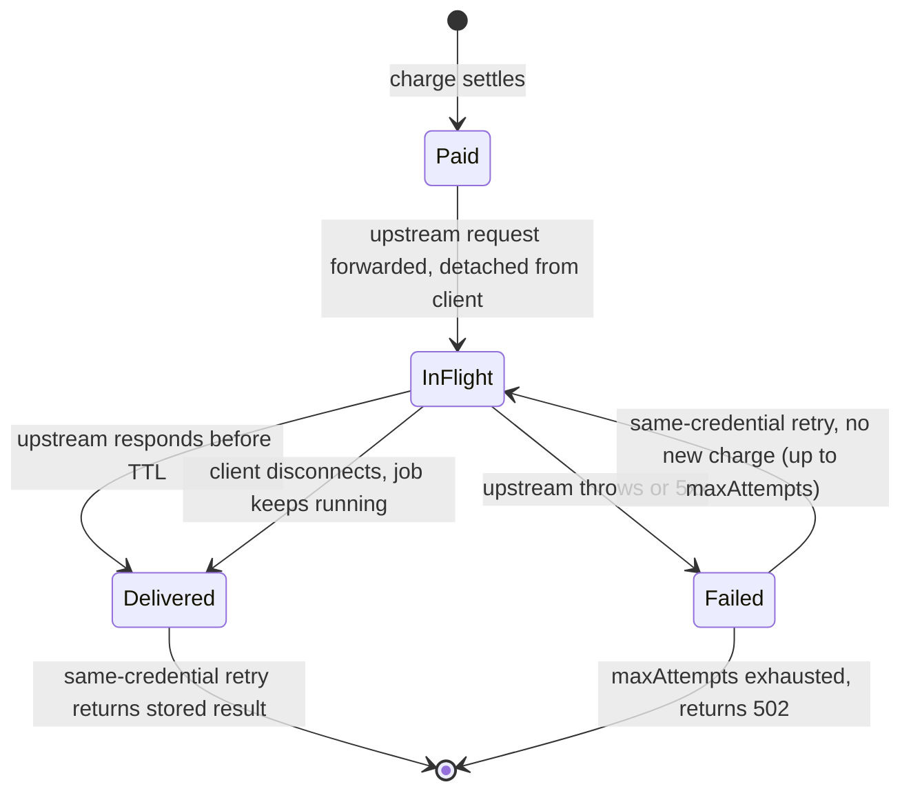

## Abstract

The two bugs the 2026-11-02 edition flagged as unfixed both got merged fixes the same day they were written up: x402's Python SIWX replay check now actually runs, and the Go facilitator's V2 abort path keeps a hook's diagnostic message[^s01][^s03]. The same 48 hours also closed a third, unrelated defect of real consequence: x402's Python SDK stopped reporting a failed Solana settlement as successful[^s08]. And a different protocol's SDK, wevm's `mppx`, shipped a fix for a problem that has been open since mid-October — a client disconnecting mid-job while the payment has already settled, with no way for the payer to collect what they paid for[^s10].

## Introduction

This edition covers **2026-10-31 through 2026-11-03**. Background on the payment-rail landscape lives in the site's [agent commerce protocol comparison](../agent-commerce-protocol/). The two x402 bugs this edition closes out, the Python SIWX nonce check and the Go facilitator's dropped abort message, were first reported in the [2026-11-01 edition](../ai-agent-brief-2026-11-01/) and covered as still-open in the [2026-11-02 edition](../ai-agent-brief-2026-11-02/).

## What moved

### x402 fixes the two parity bugs this beat flagged yesterday, then cleans up after itself

PR #4080, merged 2026-11-02, is a one-line fix: the Python SIWX extension's `create_siwx_request_hook` was checking for a storage method named `has_record_nonce`, which doesn't exist anywhere in the codebase. The documented name, and the one the TypeScript SDK actually checks, is `record_nonce`. The mismatch meant a correctly-implemented storage backend failed at hook creation, and a backend that happened to implement only `record_nonce` passed the broken guard but never had it called, so replayed signatures were never caught[^s01][^s02]. PR #4082, merged the same day, fixes the companion bug: the Go facilitator's V2 abort path built its error with an empty message string instead of passing through whatever diagnostic text the hook author set, while the V1 branch and the server-side V2 handling both kept it[^s03][^s04]. Both are two-line fixes with regression tests that fail on the pre-fix code.

The same window produced two more Go fixes in the same part of the codebase: PR #4088 gives the batch-settlement client an `RPCURL` option so gas-sponsoring works with a signer that isn't itself RPC-backed, matching what the exact/upto clients and the TypeScript batch-settlement client already had[^s05]; PR #4096 deletes a `ProcessPaymentRequest` stub that always returned "not implemented" and that nothing in the repo called[^s06]. Then PR #4102 went back over all four merges and removed five lines of test comments that just restated the helper names already visible in the code, the mark of someone reviewing the whole batch at once rather than four people fixing four unrelated things[^s07].

### x402's Python SDK stops calling a failed on-chain transaction "settled"

Issue #4032, filed 2026-10-28, reported that the Python SDK's SVM (Solana) signer treated a confirmed or finalized transaction that had actually failed on-chain as a successful settlement. PR #4033, merged 2026-11-02, makes it return `transaction_failed` instead, while preserving the transaction signature and clearing the pending and duplicate-cache entries that had assumed success[^s08][^s09]. The fix shipped with 2,890 unit and MCP tests plus 32 new confirmation-and-retry regressions, though the PR notes that credential and live-RPC integration tests weren't run as part of that check — this is a CI-verified fix, not one confirmed against live Solana RPC behavior yet.

### mppx's proxy stops losing a payment when the client hangs up early

Issue #1044 described a gap that's been open since 2026-10-14: `mppx/proxy` settles a charge, then forwards the request upstream bound to the client's own connection. If the upstream job runs longer than the client, or an edge proxy in front of it, is willing to wait, the client disconnects, the upstream request dies with it, and the payment has already gone through. The reporter hit this with a two-to-four-minute Seedance video-generation call that returned an HTTP 524 after about two minutes with no result. Retrying with the same payment credential comes back `402`, rejected as a replay; retrying with a new one runs the job again and charges again[^s11]. PR #1157, merged 2026-11-02, adds an opt-in `replay` option backed by a Redis-style store: the paid upstream request is detached from the client's connection and bounded by a time-to-live instead, a same-credential retry gets the stored result (or a `202` if it's still running, or one capped retry attempt if it failed), and none of that re-verifies or re-settles the payment[^s10].

_Figure 1 — mppx/proxy's opt-in `replay` recovery: a client disconnect no longer orphans a settled payment, because the upstream request and its eventual result outlive the connection that started it[^s10]._

## Why it matters

Three fixes, two protocols, one short window, and three different kinds of bug: a hardcoded method name that didn't match its own documentation, a settlement-status check that trusted a transaction's confirmation over its actual on-chain result, and a payment/delivery design that never accounted for the client leaving before the paid-for work finished. None of these are the kind of defect a code reviewer catches by reading a diff. The SIWX bug required comparing a Python hook against its TypeScript twin, the SVM bug required knowing that "confirmed" and "succeeded" are different claims about a Solana transaction, and the mppx gap required someone to actually run a job long enough to hit an edge timeout. The sweep PR #4102 exists only to tidy up after four merges in two days, and that habit is the better reading of the window: less "x402 has a bug problem" than "x402 and its adjacent protocols are getting the kind of attention that finds bugs like these" — a different thing, and one that cuts the other way on whether to trust the protocols going into their next growth phase.

## Signals to watch

- Adoption of mppx's `replay` option by production MPP gateways, versus staying opt-in and unused the way some past recovery proposals have.
- Live-RPC and credential integration tests for PR #4033, which so far has only unit-test coverage.
- Does the review habit behind PR #4102 reach Bazaar and the batch-settlement treasury logic next? Both were named in the 2026-11-02 edition as untested for this class of bug.

## Limitations

Card-network and PSP agent-commerce products (Mastercard Agent Pay, Visa Intelligent Commerce and Trusted Agent Protocol, Stripe's Agentic Commerce Protocol, PayPal) produced no dated primary announcement inside this window, for the seventh edition running. AP2 had no merged pull request at all; its open bug backlog, including a mandate-reuse issue open since early September, is tracked in `working/gaps.md` rather than reported as news. UCP's only activity was six open proposals and no merged change. All eleven sources in this edition are GitHub pull requests or issues across two repositories (x402-foundation/x402 and wevm/mppx); there is no independent trade-press confirmation of any of the three items, because none of them is the kind of change that gets covered outside the repositories where it happened.
