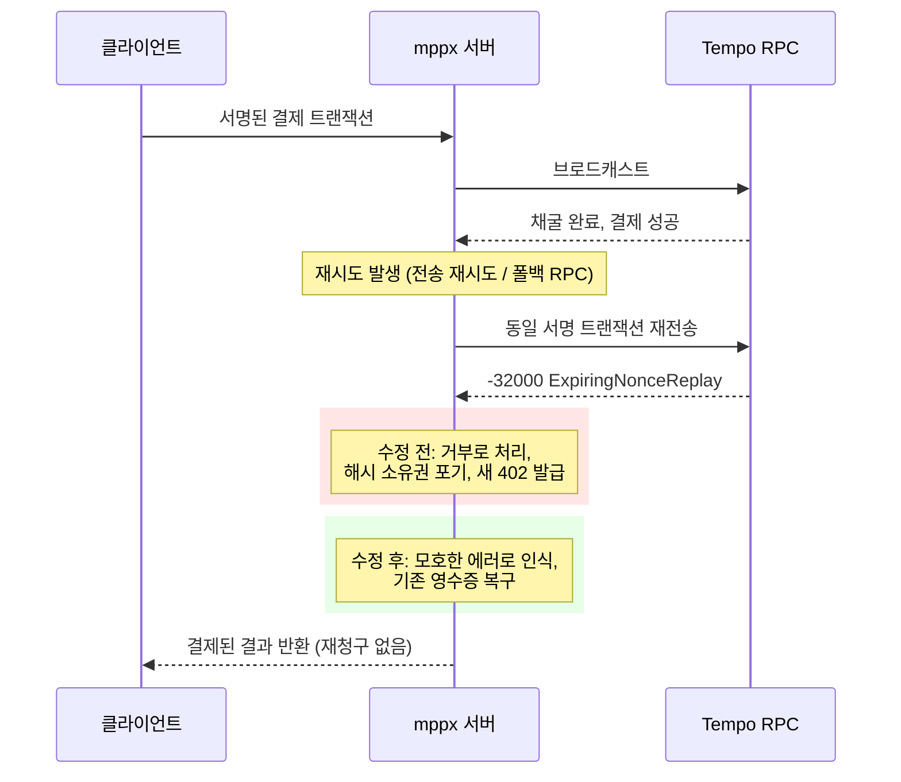

## 초록

mppx가 실서비스에서 터진 버그를 고쳤다. 재전송된 브로드캐스트 하나 때문에 이미 채굴되고 이미 결제된 Tempo 트랜잭션이 새 402 챌린지로 되돌아가는 문제였고, Mercator는 한 시간 동안 자사의 유료 Exa 검색 중 약 4%가 이 문제를 겪었다고 밝혔다[^s01]. 같은 48시간 동안 세션 결제 기능에 여섯 건의 추가 수정이 들어갔는데, 그중 둘은 단순 버그가 아니라 보안 구멍이었다[^s02][^s03][^s04][^s05][^s06][^s07]. 별개로 x402는 자체 SDK 드리프트 감지 봇이 며칠째 지적하던 두 항목을 닫았다. 결제 페이로드가 잘못됐을 때 SDK마다 다른 에러 코드를 반환하던 문제, 그리고 결제가 온체인에서 이미 성공한 뒤에도 Python facilitator 훅이 그 결과를 "실패"로 뒤집을 수 있던 문제다[^s08][^s09][^s10][^s12][^s13]. 다섯 번째 수정은 이 둘과 무관하다. x402의 TypeScript SDK가 캡처 성공 후 에스크로 잔액을 갱신하지 않아 환불이 막혀 있던 버그를 고쳤다[^s14].

## 서론

이번 호는 **2026년 11월 1일부터 11월 4일까지**를 다룬다. 결제 레일 전반의 배경은 사이트의 [에이전트 커머스 프로토콜 비교](../agent-commerce-protocol/)에 있고, mppx의 설계는 [Machine Payments Protocol: 스펙과 결제 흐름](../mpp-spec-and-payment-flows/)에서 다뤘다. 직전 호인 2026-11-03 호는 다른 x402·mppx 버그들을 다뤘고, 이번 호 항목과 겹치지 않는다.

## 이번 주 동향

### 재전송된 Tempo 브로드캐스트가 이미 낸 돈을 다시 청구시켰다

2026-11-03에 머지된 PR #1164는 mppx의 Tempo 결제 정산 로직에 있던 버그를 고친다. 수수료 지불 서버가 서명된 결제 트랜잭션을 브로드캐스트해 채굴까지 끝난 뒤, 같은 브로드캐스트에 대한 재전송(전송 계층 재시도거나 폴백 RPC)이 `ExpiringNonceReplay` 에러로 되돌아오면 서버는 이를 확정적 거부로 처리했다. 트랜잭션 해시에 대한 소유권 주장을 풀어버리고 이미 결제를 마친 클라이언트에게 새 402 챌린지를 내보낸 것이다. PR은 실제 사례를 인용한다. `api.exa.ai`로 유료 트래픽을 중계하던 Mercator가 한 시간 동안 1,016건의 유료 Exa 검색 중 44건, 약 4%에서 이 문제를 겪었고, 그중 한 트랜잭션 해시는 동일한 raw 바이트를 Tempo RPC에 다시 보내면 원래의 성공 영수증이 그대로 돌아왔다[^s01]. 수정은 모호한 브로드캐스트 에러와 실제 거부를 구분해, 소유권 주장을 버리는 대신 기존 영수증을 복구하도록 바꿨다.

_그림 1 — mppx의 수정은 이미 성공한 브로드캐스트와 실제로 거부된 브로드캐스트를 구분해, 이미 돈을 낸 클라이언트가 다시 결제하지 않도록 한다[^s01]._

### mppx, 48시간 동안 세션 결제 버그 여섯 건을 닫다. 그중 둘은 보안 구멍

여섯 건은 이렇다. 검증 프로브가 `skipPayment`를 요청했는데도 전역 결제 fetch 래퍼를 그대로 썼다가 실제 결제가 발생할 수 있던 문제(#1153)[^s02], 세션 매니저를 다른 오리진에 재사용하면 기존 결제 채널이 노출되고 원래 대상이 아니었던 엔드포인트에 바우처를 승인해버릴 수 있던 문제(#1155)[^s03], 요청당 가격이 매겨진 SSE 라우트가 채널에 돈이 있는지 확인하기 전에 핸들러를 실행해 반복 거부된 요청으로도 무상 작업이 가능했던 문제(#1156)[^s04], 결제 거부 시 에러 본문이 프로토콜의 123바이트 종료 사유 제한을 넘으면 웹소켓이 닫히지 않고 남아있던 문제(#1152)[^s05], 자체 구현이 내보내는 형식만 매칭해 RFC 9530 바이트 시퀀스 형식의 정상적인 본문 다이제스트를 검증 실패로 처리했던 문제(#1154)[^s06], 그리고 `tempo()` 클라이언트의 지출 한도(통화, 최대 금액, 수신자 제한)가 일회성 청구에는 적용되면서 세션 결제에는 적용되지 않던 문제(#1166)[^s07]다. 앞의 두 건은 단순 버그가 아니라 접근 제어 수정이다. 하나는 미승인 청구로 가는 경로를, 다른 하나는 오리진을 넘나드는 정보·권한 유출 경로를 막는다.

### x402, 드리프트 봇이 지적한 두 항목을 닫다

#4052(TypeScript, exact 스킴), #4060(Python, upto 스킴), #4115(TypeScript, upto 스킴) 세 PR이 EIP-3009나 Permit2 결제 페이로드가 잘못됐을 때 세 SDK 모두 같은 구조화된 에러를 반환하도록 맞췄다. 2026-10-29 드리프트 리포트(#4050)가 지적했던 TypeScript exact 스킴의 공백을 메우고, 같은 작업을 Python·TypeScript의 upto 스킴까지 확장했다[^s08][^s09][^s10][^s11]. 별개로 PR #4072는 TypeScript가 먼저 적용한 facilitator 훅 에러 격리(#3151)를 Python SDK로 포팅했다. `after_verify`, `after_settle`이나 실패 단계 훅이 예외를 던져도, 결제가 온체인에서 이미 실행된 뒤라면 `settle()` 호출을 더 이상 뒤집을 수 없다. 2026-10-31 드리프트 리포트(#4071)는 이 항목이 Python에서 여전히 열려 있다고 사흘 전에 지적한 바 있다[^s12][^s13].

### x402의 TypeScript SDK, 캡처 성공 뒤 에스크로 잔액을 놓치는 버그를 고치다

2026-11-02에 머지된 PR #4092는 동기식 auth-capture가 성공했는데도 TypeScript가 저장된 에스크로 잔액을 갱신하지 않던 버그를 고친다. Go는 이미 올바르게 처리하고 있었다. 이 불일치 때문에 캡처 자체는 성공했어도 같은 캡처에 대한 이후 환불이 결제 상태 에러로 실패했다[^s14].

## 왜 중요한가

오늘 다룬 다섯 항목 중 셋은 코드 리뷰어가 diff를 읽다가 찾아낸 것이 아니다. 실제 수수료 지불 서버의 운영 트래픽(#1164), SDK끼리 비교하는 드리프트 감지 봇(#4052·#4060·#4115, #4072), 그리고 손으로 짠 구현이 스펙의 테스트 형식에서 조용히 벗어난 경우(#1154)에서 나왔다. 어제 호에서 수정 네 건이 한 사람이 백로그를 순서대로 처리하며 나온 것과는 다른 양상이다. mppx의 세션 결제 기능은 핵심 청구 로직보다 더 새롭고 덜 검증된 영역으로 보인다. 몇 달 전에는 존재하지 않았던 이 기능이 같은 기간에 평범한 정합성 버그 네 건과 접근 제어 버그 두 건을 동시에 냈다.

## 지켜볼 신호

- x402 이슈 #4050이 이번 주 세 건의 페이로드 정합성 PR 이후에도 미해결 항목을 남기고 있는지, 아니면 완전히 닫혔는지.
- PR #1164에 적힌 Exa·Mercator 사고 수치의 독립적인 검증. 현재는 PR 작성자 본인의 설명에만 의존하고 있다.
- mppx의 세션 결제 수정이 특정 통합사의 트래픽에 묶여 몰아서 나오는 패턴을 계속 보일지, 아니면 운영 사례가 늘면서 더 다양한 엣지 케이스로 분산될지.

## 한계

Mastercard Agent Pay/AP4M, Visa Trusted Agent Protocol, Stripe의 Agentic Commerce Protocol, PayPal 등 카드사·PSP의 에이전트 커머스 제품은 이번 기간에도 날짜가 명시된 1차 발표를 내지 않았다. 여덟 번째 호째 이어지는 공백이며, 자세한 내용은 `working/gaps.md`에 있다. AP2와 UCP는 확인한 저장소에서 아무 활동이 없었다. 이번 호의 출처 열네 건은 모두 두 저장소(x402-foundation/x402, wevm/mppx)의 GitHub 풀 리퀘스트나 이슈이며, 다섯 항목 어디에도 독립적인 언론 보도가 없고, PR #1164의 사고 수치 역시 단일하고 검증되지 않은 보고에 기대고 있다.
