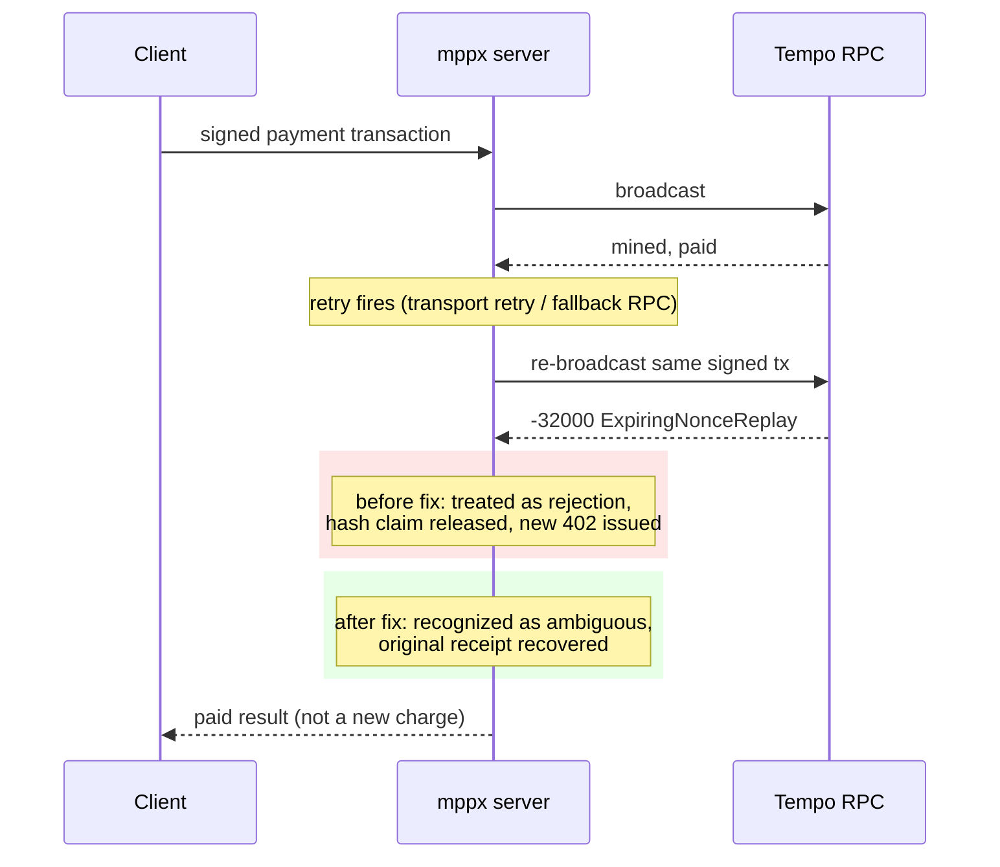

## Abstract

mppx fixed a production bug where a retried broadcast could turn an already-mined, already-paid Tempo transaction into a fresh 402 — Mercator traced it to roughly 4% of its paid Exa searches in one hour[^s01]. The same 48 hours produced six more mppx fixes to its session-payment feature, two of them closing real security holes rather than correctness bugs[^s02][^s03][^s04][^s05][^s06][^s07]. Separately, x402 closed out two items its own SDK-drift bot had been flagging for days: cross-SDK error codes for malformed payment payloads, and a Python facilitator hook that could still flip a settled payment to "failed" after the fact[^s08][^s09][^s10][^s12][^s13]. A fifth, unrelated fix stopped x402's TypeScript SDK from losing track of escrow balances after a successful capture, which was breaking refunds[^s14].

## Introduction

This edition covers **2026-11-01 through 2026-11-04**. Background on the payment-rail landscape lives in the site's [agent commerce protocol comparison](../agent-commerce-protocol/); mppx's design is covered in [Machine Payments Protocol: spec and payment flows](../mpp-spec-and-payment-flows/). The previous edition, 2026-11-03, closed out a different set of x402 and mppx bugs; none of today's items overlap with it.

## What moved

### A retried Tempo broadcast could turn a paid transaction into a second 402

PR #1164, merged 2026-11-03, fixes a bug in mppx's Tempo charge settlement: when a fee-payer server broadcasts a signed payment transaction, has it mined, and then a retry of that same broadcast (a transport retry, or a fallback RPC) comes back with `ExpiringNonceReplay`, the server treated that error as a definite rejection. It released its claim on the transaction hash and issued a new 402 challenge to the client — which had already paid. The PR cites a real incident: Mercator, routing paid traffic to `api.exa.ai`, hit this on about 4% of its paid Exa searches in a one-hour window (44 of 1,016), with one example transaction hash where re-sending the exact same raw bytes to the Tempo RPC returned the original, already-successful receipt[^s01]. The fix distinguishes an ambiguous broadcast error from a genuine rejection and recovers the receipt instead of discarding the claim.

_Figure 1 — mppx's fix distinguishes a genuinely rejected broadcast from one that already succeeded before the retry, so a client that already paid is not asked to pay again[^s01]._

### mppx closes six session-payment bugs in 48 hours, two of them security holes

The six: a validation probe could trigger a real payment despite asking the client to skip it, because the probe reused the global payment-aware fetch wrapper (#1153)[^s02]; a session manager reused against a second origin could disclose its existing payment channel and authorize vouchers for an endpoint it was never meant to pay (#1155)[^s03]; a request-priced SSE route could run the application handler before confirming the channel had funds, so repeatedly rejected requests could still perform unpaid work (#1156)[^s04]; a WebSocket could stay open after a rejected payment if the error body exceeded the protocol's 123-byte close-reason limit (#1152)[^s05]; a spec-valid RFC 9530 byte-sequence body digest failed verification because the code only matched the bare form it itself emitted (#1154)[^s06]; and the `tempo()` client's own spending limits (currency, max amount, expected recipient) were enforced on one-shot charges but not on session payments (#1166)[^s07]. The first two are access-control fixes, not just bugs: one closes a path to an unauthorized charge, the other closes a path to a cross-origin information and authorization leak.

### x402 closes two items its SDK-drift bot had flagged open

Three PRs, #4052 (TypeScript, exact scheme), #4060 (Python, upto scheme), and #4115 (TypeScript, upto scheme), bring all three x402 SDKs to the same structured error reasons for malformed EIP-3009 or Permit2 payment payloads, tracking the gap the 2026-10-29 drift report (#4050) opened for TypeScript's exact scheme and extending the same work to the upto scheme across Python and TypeScript[^s08][^s09][^s10][^s11]. Separately, PR #4072 ports TypeScript's facilitator-hook error isolation (shipped as #3151) into the Python SDK: a throwing `after_verify`, `after_settle`, or failure-phase hook can no longer reject a `settle()` call after the underlying payment already executed onchain. The 2026-10-31 drift report (#4071) had flagged this as still open in Python three days before the fix landed[^s12][^s13].

### x402's TypeScript SDK stops losing escrow balances after a successful capture

PR #4092, merged 2026-11-02, fixes a bug where a successful sync auth-capture left the stored escrow balance unchanged in TypeScript, while Go updated it correctly. The mismatch meant a later refund against that same capture failed with a payment-state error, even though the capture itself had gone through[^s14].

## Why it matters

Three of today's five items trace back to something other than a code reviewer reading a diff: a real fee-payer's production traffic (#1164), a drift-detection bot comparing SDKs against each other (#4052/#4060/#4115, #4072), and a protocol spec test that a hand-written implementation quietly diverged from (#1154). That is a different failure mode than last edition's, where four of the fixes came from one reviewer working through a backlog in order. mppx's session-payment feature in particular reads as a newer, less-scrutinized surface than core charge handling — it shipped two access-control bugs in the same window that produced four plain correctness bugs, on a feature that did not exist a few months ago.

## Signals to watch

- Whether x402 issue #4050 still has open items after this week's three payload-parity PRs, or whether it is fully closed.
- Independent confirmation of the Exa/Mercator incident numbers in PR #1164, which currently rest on the PR author's own account.
- Whether mppx's session-payment fixes keep arriving in bursts tied to one integrator's traffic, or spread out as more production use surfaces more edge cases.

## Limitations

Card-network and PSP agent-commerce products (Mastercard Agent Pay/AP4M, Visa Trusted Agent Protocol, Stripe's Agentic Commerce Protocol, PayPal) produced no dated primary announcement inside this window, for the eighth edition running; see `working/gaps.md`. AP2 and UCP had no activity in the repos checked. All fourteen sources in this edition are GitHub pull requests or issues across two repositories (x402-foundation/x402 and wevm/mppx); there is no independent trade-press coverage of any of today's five items, and the production-incident numbers in PR #1164 come from a single, unverified report.
