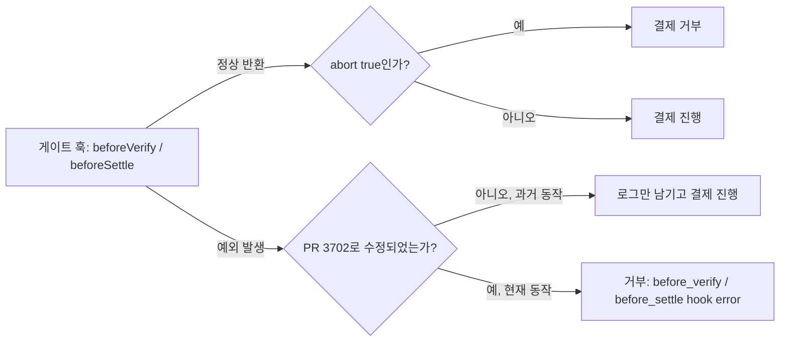

## 초록

우버가 에이전트 주문량이 얼마나 미미한지 직접 숫자로 밝혔다. 가장 바쁜 주라고 스스로 부른 한 주 동안 AI 에이전트가 주문한 승차는 4건, Eats 주문은 약 500건뿐이었다. 같은 주 전체 승차·주문 건수는 약 3억 2천만 건이었다[^s01]. 그 반대편에서는 인프라가 계속 쌓이고 있다. 클라우드플레어는 사용자를 대신해 행동하는 "개인 에이전트"별로 가시성과 접근 정책을 적용하는 기능을 내놓았고[^s02], x402는 결제 게이트 훅이 예외를 던졌을 때 결제를 막지 못하고 그냥 통과시키던 버그를 고쳤다[^s03][^s04][^s05][^s06]. x402는 별도로 XRPL 결제에서 정수 단위 가격이 지출 한도를 우회하던 버그도 수정했고[^s07], mppx는 세션 결제 관련 수정 세 건을 더 머지했는데 그중 하나는 세션이 원래 허용되지 않은 출처(origin)에서도 재사용될 수 있었던 문제다[^s08][^s09][^s10].

## 서론

이번 호는 **2026-11-02부터 2026-11-05까지**를 다룬다. 결제 레일 전반의 배경은 사이트의 [에이전트 커머스 프로토콜 비교](../agent-commerce-protocol/)에, mppx의 설계는 [Machine Payments Protocol: 스펙과 결제 흐름](../mpp-spec-and-payment-flows/)에 정리되어 있다. 직전 호(2026-11-04)는 Tempo 영수증 버그 하나와 mppx 세션 결제 수정 여섯 건을 다뤘으며, 오늘 다루는 항목과는 겹치지 않는다.

## 무슨 일이 있었나

### 우버의 자체 수치: 가장 바쁜 주에 에이전트가 예약한 승차 4건

우버는 2026-11-04 3분기 실적 발표에서 CFO 발라지 크리슈나무르티의 입을 통해, 회사가 스스로 꼽은 가장 바쁜 주인 핼러윈 주간 동안 AI 에이전트가 주문한 승차는 4건, Eats 주문은 약 500건이었다고 밝혔다. 같은 주 두 사업 전체 승차·주문은 약 3억 2천만 건이었다[^s01]. CEO 다라 코스로샤히는 이를 "아주, 아주 초기 단계이고 매우 제한적인 견인력"이라 표현하면서도, 결국은 수요에 순긍정적일 것이고 "모든 AI 시스템 회사"와 대화 중이라고 덧붙였다. 이 수치는 일주일 전 도어대시가 밝힌 에이전트 주문 수백 건과 같은 맥락이다. 두 번째 회사가 같은 이야기를 자기 숫자로 반복하고 있는 셈이다. _(vendor-stated)_

### 클라우드플레어, 사이트에 에이전트별 가시성과 정책 제공

클라우드플레어가 2026-11-04 공개한 기능은 보안 분석(Security Analytics)과 상위 통계(Top statistics)에 "Personal Assistants" 범주를 추가해, 사용자를 대신 움직이는 특정 AI 에이전트(예컨대 예약을 대신 처리하는 브라우저 코파일럿)의 트래픽만 따로 떼어 볼 수 있게 한다[^s02]. 더 눈에 띄는 부분은 아직 얼리 액세스인 계정 어뷰즈 방지(Account Abuse Protection) 쪽이다. 모든 로그인·가입 이벤트에서 개인 에이전트가 요청했는지, 어떤 에이전트였는지가 표시되고, 부정이용 대응팀은 이 기준으로 계정을 필터링할 수 있다. 정책도 세분화됐다. 지금까지는 "에이전트" 전체에 허용/차단 하나만 걸 수 있었지만, 이제는 지원되는 에이전트마다 허용, 광고 수익화 페이지에서만 차단, 완전 차단 중 하나를 따로 설정할 수 있고, 특정 계정이 악용된 것으로 보이면 그 계정의 해시된 사용자 ID에만 WAF 규칙을 걸어 다른 이용자의 에이전트는 막지 않고 그 계정만 조치할 수 있다. x402와 mppx가 몇 달째 "누가 결제를 승인할 자격이 있는가"를 다듬어 온 것과 짝을 이루는, "누가 이 사용자로서 행동할 자격이 있는가"를 다루는 쪽의 움직임이다.

### x402, 결제 게이트 훅이 예외를 던질 때 통과시키던 구멍을 닫다

x402의 `beforeVerify`와 `beforeSettle` 훅은 결제를 검증·정산하기 전에 리소스 서버가 거부할 수 있도록 하는 게이트다. 확장(extension)은 `{ abort: true }`를 반환해 결제를 막을 수 있다. 2026-10-04에 등록된 이슈 #3689는 훅이 정상적으로 반환하는 대신 예외를 던지는 경우 로그만 남기고 결제가 그대로 진행된다는 점을 지적했다. 즉 디코딩 실패, 잘못된 서명, 처리되지 않은 커밋먼트 같은 이유로 확장이 검사를 끝내지 못하면, 그 게이트는 막아야 할 결제를 오히려 통과시켰다[^s04]. 한 달 뒤인 2026-11-04 머지된 PR #3702는 두 단계 모두에서 예외가 발생하면 전용 오류 사유와 함께 결제를 거부하도록 바꿨다[^s03]. 같은 날 올라온 후속 PR #4133은 이 오류 사유 이름을 손봤다. 기존엔 "확장 훅" 오류로 통칭했지만, 실제로는 수동 훅과 스킴 훅도 같은 게이트를 지나가기 때문에 확장에만 해당한다는 이름이 오해를 부른다고 판단한 것이다[^s05]. #4132는 라이프사이클 훅 문서를 이에 맞춰 갱신했다[^s06]. `after*`, `on*Failure`, 보강(enrichment) 단계 같은 권고성 훅은 여전히 의도적으로 열려 있다. 바뀐 것은 두 게이트 단계뿐이다.

_그림 1 — 수정 전에는 게이트 훅이 예외를 던져도 abort 없이 반환한 것과 똑같이 처리되어 결제가 진행됐다. 수정 후에는 예외 발생이 곧 거부로 처리된다[^s03][^s04]._

### x402, 정수 단위 XRPL 가격이 지출 한도를 우회하던 버그도 수정

x402의 또 다른 수정은 XRPL 결제 스킴의 클라이언트 측 지출 한도와 관련이 있다. XRPL은 RLUSD 같은 발행 화폐를 고정된 소수점 스케일로 표현하는데, 한도 검사 코드가 이 스케일된 원장 값을 이미 최소 단위인 것처럼 취급했다. 그 결과 $100 같은 평범한 가격이 $1 한도와 비교될 때 $0.000100처럼 계산되어, 막혔어야 할 검사를 통과했다. 소수점이 있는 가격은 이미 다른 비교 경로를 타고 있어 영향받지 않았다. 2026-11-04 머지된 PR #4110은 정수 가격에 스케일링을 적용하지 않도록 고쳐, 서명 전에 올바르게 비교되도록 했다[^s07].

### mppx, 세션 결제 수정 세 건 추가 머지

지난 두 호에 이어 mppx는 2026-11-04에 세션 결제 관련 수정 세 건을 머지했다. PR #1167은 Tempo 액세스 키 세션이 닫히지 않던 문제를 고쳤다. 종료 승인 서명을 키체인 봉투로 감싸고 있었는데, TIP-1034는 액세스 키 서명자에게 이 방식을 거부한다. 바우처에 이미 쓰이던 `Account.signVoucher`의 원시 서명 방식과 달랐던 것이다[^s08]. PR #1172는 선결제된 SSE 스트림이 과금 후 전달에 실패하는 경우를 다룬다. 이런 실패는 환불 처리되지 않고 있었고, 로컬 크레딧으로 안전하게 되돌릴 수 없는 경우에 대한 가맹점용 조정 절차도 없었다[^s10]. 가장 심각한 건 세 번째, PR #1168이다. 자동 결제 경로가 중계된 세션 챌린지에 서명하거나, 저장된 채널이 실제로 그 출처(origin)에 속하는지 확인하지 않고 두 번째 출처에서 재사용할 수 있었고, 중첩된 어댑터는 적용해야 할 승인·결제자 컨텍스트 정책을 조용히 누락시킬 수 있었다[^s09]. 이는 직전 호에서 나온 두 버그, 세션 매니저가 채널을 다른 출처로 유출한 문제(#1155)와 자금 확인 전에 라우트가 먼저 실행된 문제(#1156)와 같은 유형이 같은 서브시스템에서 세 번째로 반복된 것이다[^s11][^s12].

## 왜 중요한가

오늘 다섯 항목을 나누면 두 가지 이야기가 동시에 읽힌다. 우버와 도어대시의 자체 수치는 실제 소비자 거래량에서 에이전트 커머스가 아직 거의 존재하지 않는다고 말한다. 나머지 네 항목은 모두 그때를 대비한 인프라 보강이고, 그중 셋(x402의 게이트 훅, x402의 XRPL 한도, mppx의 출처 검증)은 보호 장치가 없었던 게 아니라 조용히 아무 일도 하지 않았던 실패다. mppx의 세션 결제 기능은 세 개 호에 걸쳐 정확히 같은 종류의 실패를 세 번째로 냈다. 새로운 전송 경로(액세스 키, 크로스 오리진 재사용, 중첩 어댑터)가 추가될 때마다 경계 검증 로직에 새 구멍이 생기는 기능으로 읽힌다.

## 지켜볼 신호

- 우버나 도어대시가 다음 분기에도 에이전트 주문량을 공개할지, 그리고 그 수치가 움직였을지.
- x402의 훅 체인에서 `beforeVerify`/`beforeSettle` 외의 다른 단계도 fail-closed로 바뀔지. 권고성 단계는 지금은 의도적으로 열려 있다고 문서화돼 있지만, 이는 누군가 다시 검토할 수 있는 설계 선택이다.
- mppx의 세션 결제 서브시스템에서 네 번째 호에도 출처·권한 경계 버그가 또 나온다면, 별도로 주시할 패턴이 된다.
- 이번 주 Go에서 TypeScript로 포팅된 x402의 facilitator 관리형 바우처 커스터디 기능(PR #4061)[^s13]은 EVM 배치 정산의 권위 있는 상태를 누가 들고 있는지를 바꾼다. 실제 운영에 쓰이기 시작하면 확인할 가치가 있다.

## 한계

마스터카드 Agent Pay/AP4M, 비자 Trusted Agent Protocol, 스트라이프의 Agentic Commerce Protocol, 페이팔 등 카드 네트워크·PSP의 에이전트 커머스 제품은 이번 기간에 날짜가 명시된 1차 발표가 없었다. 아홉 번째 호째 이 소주제가 비어 있다. 자세한 내용은 `working/gaps.md`를 참고. AP2와 UCP의 공식 저장소에도 이 기간 활동이 없었다. 우버와 도어대시의 에이전트 주문 수치는 각 회사의 실적 발표에서 나온 것으로, 독립적인 측정은 없다. 더버지(The Verge)의 우버 관련 병행 보도는 가져올 수 없어, 해당 항목은 테크크런치 단일 소스에 의존한다.
