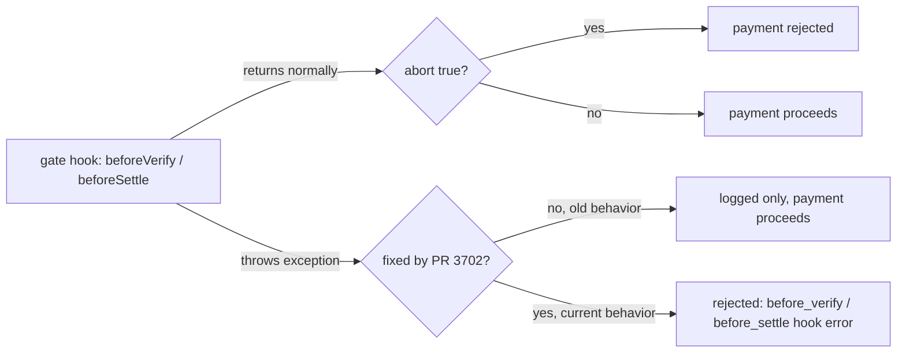

## Abstract

Uber put a number on how little its agent-order traffic actually is: four rides and about 500 Eats orders placed by an AI agent during the week it calls its busiest, against roughly 320 million trips and orders overall[^s01]. On the infrastructure side of the same gap, Cloudflare shipped per-agent visibility and access policies for "personal agents" acting on a user's behalf[^s02], x402 closed a bug where a throwing payment gate hook failed open instead of rejecting the payment[^s03][^s04][^s05][^s06], x402 separately fixed an XRPL spend cap that a whole-dollar price could bypass[^s07], and mppx merged three more session-payment hardening fixes, including one that could let a session be reused across origins it was never authorized for[^s08][^s09][^s10].

## Introduction

This edition covers **2026-11-02 through 2026-11-05**. Background on the payment-rail landscape lives in the site's [agent commerce protocol comparison](../agent-commerce-protocol/); mppx's design is covered in [Machine Payments Protocol: spec and payment flows](../mpp-spec-and-payment-flows/). The previous edition, 2026-11-04, covered a different Tempo receipt bug and six earlier mppx session-payment fixes; none of today's items repeat it.

## What moved

### Uber's own numbers: four agent-booked rides in its busiest week

On Uber's 2026-11-04 Q3 earnings call, CFO Balaji Krishnamurthy said that during the week of Halloween, Uber's busiest week, an AI agent placed only four ride orders and about 500 Uber Eats orders, out of roughly 320 million trips and orders across both businesses that week[^s01]. CEO Dara Khosrowshahi called the traction "very, very early and very limited," while saying Uber expects it to become a net positive for demand and is in talks with "every single AI system company." The figure echoes DoorDash's own disclosure a week earlier that it had received only a few hundred agent orders: the same adoption story, recurring with a second company's numbers. _(vendor-stated)_

### Cloudflare gives sites per-agent visibility and policy

Cloudflare's 2026-11-04 launch adds a "Personal Assistants" category to Security Analytics and Top statistics, so a site can isolate and inspect traffic from a specific AI agent acting on a user's behalf (a browser copilot booking something, for instance) instead of lumping it in with bots generally[^s02]. The more consequential piece sits in Account Abuse Protection, currently in early access: every login or signup event now shows whether a personal agent made the request and which one, and a fraud team can filter accounts by that signal. Policy also gets finer-grained. Instead of one Allow/Block setting for "agents," a site can set Allow, Block on ad-monetized pages, or Block per supported agent, and can mitigate a single compromised account by its hashed user ID without blocking the agent for every other user who relies on it. x402 and mppx have spent months hardening who gets to authorize a charge; Cloudflare is now doing the equivalent for who gets to act as a given user at all.

### x402's payment gate hooks stop failing open on a throw

x402's `beforeVerify` and `beforeSettle` hooks let a resource server reject a payment before it verifies or settles: an extension can return `{ abort: true }` to stop it. Issue #3689, filed 2026-10-04, pointed out that a hook which *threw* instead of returning normally was only logged, and the payment proceeded anyway. An extension gate that couldn't finish its check (a decode failure, a bad signature, an unresolved commitment) failed open instead of blocking anything[^s04]. PR #3702, merged a month later on 2026-11-04, makes a throw in either phase reject the payment with a dedicated error reason instead[^s03]. A same-day follow-up, #4133, renamed that reason from a generic "extension hook" code to phase-specific ones, since manual and scheme hooks run through the same gate and the original naming implied only extensions were affected[^s05]; #4132 updated the lifecycle-hooks docs to match[^s06]. Advisory hook phases (`after*`, `on*Failure`, enrichment) still fail open by design. Only the two gating phases changed.

_Figure 1 — before the fix, a gate hook that threw an exception behaved the same as one that returned without aborting; after it, a throw is treated as a rejection[^s03][^s04]._

### x402 fixes a spend cap that whole-dollar XRPL prices skipped

A separate x402 fix addresses the XRPL payment scheme's client-side spend cap. XRPL represents issued currencies like RLUSD at a fixed decimal scale, and the cap-checking code treated a scaled ledger value as if it were already in atomic units. A normal price such as $100 therefore compared against a $1 cap as if it were $0.000100, passing a check it should have failed. Fractional prices, which happened to go through the decimal-comparison path already, were unaffected. PR #4110, merged 2026-11-04, applies zero scaling so whole-number prices are compared correctly before signing[^s07].

### mppx merges three more session-payment fixes

Continuing the session-payment hardening from the prior two editions, mppx merged three fixes on 2026-11-04. PR #1167 fixed Tempo access-key sessions that failed to close: the close-authorization signature was being wrapped in a keychain envelope that TIP-1034 rejects for access-key signers, unlike the raw signature `Account.signVoucher` already used for vouchers[^s08]. PR #1172 addressed prepaid SSE streams that failed after the charge had already settled: those failures weren't being credited back, and merchants had no reconciliation hook for cases where a local credit can't safely reverse the charge[^s10]. The third, PR #1168, is the most serious. Automatic payment paths could sign a relayed session challenge or reuse a stored channel against a second origin without checking that the channel actually belonged to that origin, and nested adapters could silently drop approval or payer-context policy they were supposed to enforce[^s09]. That is the same class of bug as two fixes from the prior edition, a session manager leaking its channel across origins (#1155) and a route executing before confirming funds (#1156), recurring for a third time in the same subsystem[^s11][^s12].

## Why it matters

Split today's five items and the window tells two different stories at once. Uber's and DoorDash's own numbers say agent commerce barely exists yet in consumer transaction volume. The other four items are all infrastructure hardening for when it does, and three of them (x402's gate hooks, x402's XRPL cap, mppx's origin check) are bugs where the failure mode was "the protection silently did nothing," not "the protection was merely absent." mppx's session-payment feature has now produced that exact failure mode three times across three editions; it reads less like isolated bugs and more like a feature whose boundary-checking logic keeps growing new gaps as new transport paths (access keys, cross-origin reuse, nested adapters) get added to it.

## Signals to watch

- Whether Uber or DoorDash disclose agent-order volume again next quarter, and whether it moved.
- Whether x402's hook-chain gets the same fail-closed treatment for any phase beyond `beforeVerify`/`beforeSettle` — the advisory phases are documented as fail-open by design, but that is a design choice someone could revisit.
- mppx's session-payment subsystem: a fourth origin- or authorization-boundary bug in a fourth edition would make this worth its own scrutiny, not routine hardening.
- x402's facilitator-managed voucher custody feature (PR #4061)[^s13], ported from Go to TypeScript this window, changes who holds authoritative state for EVM batch settlement. Worth checking once it sees production use.

## Limitations

Card-network and PSP agent-commerce products (Mastercard Agent Pay/AP4M, Visa Trusted Agent Protocol, Stripe's Agentic Commerce Protocol, PayPal) produced no dated primary announcement inside this window, for the ninth edition running; see `working/gaps.md`. AP2 and UCP had no activity in their canonical repos. Uber's and DoorDash's agent-order figures are vendor-stated, from the companies' own earnings calls, with no independent measurement. The Verge's parallel coverage of the Uber story could not be fetched, so that item rests on a single source (TechCrunch).
