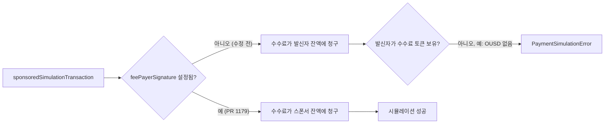

## 초록

클라우드플레어는 2026-11-05에 에이전트 위임(delegation) 표준을 다루는 업계 연합체를 발표했다. 다만 브라우저 안에서 한 에이전트가 다른 에이전트를 거쳐 행동하는 가장 어려운 경우는 명시적으로 미해결로 남겨뒀다[^s01]. 구글 클라우드는 같은 날 보안 서밋에서 에이전트 아이디(Agent Identity)용 Auth Manager를 정식 출시(GA)하며 비슷한 방향으로 한 걸음을 더 뗐다[^s02]. 테크크런치 단독 보도에 따르면 같은 날 클로드에 플레이드(Plaid) 연동 기반의 읽기 전용 "Personal Finance" 기능이 추가됐다고 하나, 다른 매체나 앤트로픽 자체 발표로는 확인되지 않았다[^s03]. 결제 레일 쪽에서는 x402가 새 기능 대신 TypeScript·Go·Python SDK 간 동작 격차를 메우는 데 하루를 썼고[^s04][^s05][^s06][^s07], mppx는 자체 사고 보고서에서 템포(Tempo) 노드 업그레이드로 스폰서 결제 시뮬레이션이 몇 시간 동안 깨져 유료 호출의 약 4분의 1이 실패했다고 밝혔다[^s08].

## 서론

이번 호는 **2026-11-03부터 2026-11-06까지**를 다룬다. 결제 레일 전반의 배경은 사이트의 [에이전트 커머스 프로토콜 비교](../agent-commerce-protocol/)에서, mppx의 세션 설계는 [Machine Payments Protocol: 스펙과 결제 흐름](../mpp-spec-and-payment-flows/)에서, 에이전트 아이디 체계는 [AI 에이전트 아이디: EAS vs. DID](../ai-agent-identity-eas-vs-did/)에서 다뤘다. 직전 호(2026-11-05)는 우버의 자체 에이전트 주문 수치, 클라우드플레어의 개인 에이전트 가시성 출시, x402 게이트 훅 수정, x402 XRPL 지출 한도 수정, mppx 세션 결제 수정 세 건을 다뤘으며, 오늘 항목 중 이를 반복하는 것은 없다.

## 오늘의 소식

### 클라우드플레어, 에이전트 위임 연합체를 띄우면서 위임 문제 자체는 미해결로 인정

클라우드플레어는 2026-11-05 포스트에서 "신뢰 가능한 에이전트 위임(TAD)"이라는 연합체를 발표했다. 업계 전반의 참여자를 한자리에 모아 기존 신원 확인 메커니즘을 검토하고, 벤더마다 제각각 프로토콜을 만드는 대신 격차를 IETF에 전달하겠다는 취지다[^s01]. 에이전트가 자기 요청에 직접 서명하게 하는 Web Bot Auth를 지지하고, 사용자 식별자 없이 속도를 제한하는 MOLE, 그리고 x402와 Private Access Tokens를 이미 쓰이는 조각으로 언급한다. 포스트에 빠진 것은 연합체 참여 기업 명단, 헌장, 일정이다. "표준이 성숙해지는 대로 더 나올 것"이라는 문장이 이 연합체 발표에 대한 유일한 향후 약속이다.

반면 함께 나온 제품 변경은 구체적이다. Security Analytics에 "Personal Assistants" 트래픽 카테고리가 생기고, 사이트 운영자는 전체 허용/차단 하나 대신 허용·광고 페이지만 차단·에이전트별 차단을 고를 수 있다. 아직 얼리 액세스인 Account Abuse Protection은 로그인·가입 요청이 개인 에이전트에서 왔는지 표시하고, 해시된 계정 식별자로 WAF 규칙을 걸 수 있게 한다. 그런데 포스트는 이 모든 것이 닿지 않는 지점을 스스로 지목한다. 에이전트 A가 브라우저 C 안의 에이전트 B를 거쳐 행동하는 경우, "메커니즘이 아직 정의되어야 한다"는 것이다. 클라우드플레어는 단일 홉 에이전트 신원은 표준화하면서, 에이전틱 커머스 흐름이 결국 필요로 할 위임 체인은 열려 있다고 공개적으로 밝힌 셈이다.

### 구글 클라우드, 에이전트 아이디 인증을 GA로

구글 클라우드는 2026-11-05 보안 서밋에서 OAuth 2.0/PKCE 흐름을 자동화하고 위임된 토큰을 에이전트 대신 갱신해주는 Auth Manager for Agent Identity가 "정식 출시됐다"고 밝혔다. 장기 API 키 없이 에이전트가 인증할 수 있게 하는 OIDC 기반 Agent Identity JWT는 아직 프리뷰 단계다[^s02]. 두 주장 모두 변경 로그가 아니라 발표 포스트 자체에서 나온 벤더 발표다. 같은 날 클라우드플레어 발표와 겹쳐 보면, 두 대형 인프라 업체가 같은 문제의 양 끝에서 작업한 셈이다. 어떤 에이전트가 행동하고 누구의 권한으로 행동하는지 증명하는 문제를, 클라우드플레어는 사이트에 도착하는 트래픽 쪽에서, 구글 클라우드는 에이전트가 제시하는 토큰 쪽에서 각각 풀고 있다.

### 보도: 클로드에 플레이드 연동 Personal Finance 기능

테크크런치는 2026-11-05, 앤트로픽이 Pro·Max·Ultra 미국 사용자 대상으로 베타 형태의 "Personal Finance" 기능을 내놓고 있다고 보도했다. 플레이드로 은행·신용카드 계정을 연결해 읽기 전용으로 지출 요약, 중복 결제·이상 수수료 감지, APR 설명 등을 제공한다는 내용이다[^s03]. 기사는 "광고나 협찬 추천 없음", 자체 신용카드·대출 상품 없음이라는 앤트로픽 측 설명을 그대로 인용했고, 이 기능 안의 대화는 모델 학습에 쓰이지 않는다고 전했다. _(unverified — single source)_ 더 버지의 같은 사안 보도는 가져올 수 없었고, 앤트로픽 자체 뉴스룸에서도 이 글을 쓰는 시점까지 해당 발표를 찾지 못했다. `working/gaps.md` 참고.

### x402, 새 기능보다 SDK 간 격차 메우기에 집중

2026-11-05에 머지된 두 쌍의 PR 모두 새 프로토콜 동작이 아니라 기존 TypeScript·Go 동작을 다른 SDK로 옮기는 작업이다. 첫 쌍은 TypeScript·Go에 이미 있던 `settlement_preflight_failed` 취소 사유를 Python에도 넣었다. 퍼실리테이터에 도달하기 전에 발생하는 정산 실패(`before_settle` 중단, 페이로드 보강 오류 등)는 이제 `on_settle_failure`가 아니라 이 사유로 검증된 결제를 취소한다. `on_settle_failure`는 퍼실리테이터에 도달한 이후의 실패에만 쓰도록 구분됐다[^s04][^s05]. 두 번째 쌍은 TypeScript와 Python이 훅의 중단 *메시지*를 버리고 있던 문제를 고쳤다. Go는 `before_verify`/`before_settle` 훅의 선택적 메시지를 결과 오류에 이미 복사하고 있었지만, TypeScript와 Python은 그러지 않아서 클라이언트는 요청이 중단됐다는 사실만 보고 이유는 알 수 없었다[^s06][^s07]. 두 수정 모두 같은 추적 이슈(#4097)와 같은 Go 구현을 참조하며, 하루 사이 두 번 포팅된 셈이다.

### mppx: 템포 노드 업그레이드가 몇 시간 동안 스폰서 결제를 끊어놓다

mppx의 PR #1179 설명에 따르면, 2026-11-05 태평양시간 07:21부터 템포 메인넷에서 스폰서 결제가 실패하기 시작했다. mpp-proxy를 거치는 유료 MPP 호출 중 약 4분의 1이 fal, firecrawl, OpenAI, RPC, 스토리지 서비스 전반에서 실패했다[^s08]. 원인은 템포 노드가 트랜잭션의 수수료 지불자를 `feePayerSignature` 필드로만 복원하고 단순한 `feePayer` 주소는 무시한다는 데 있었다. mppx의 스폰서 시뮬레이션 경로는 이 필드를 비워둔 채로 두었고, 그 결과 시뮬레이션은 스폰서가 아니라 발신자에게 스폰서의 수수료 토큰으로 요금을 청구했다. 메인넷에서 흔히 쓰이는 OUSD처럼 발신자가 보유하지 않은 토큰이 선택되면 시뮬레이션은 실패했다. 시점은 템포 노드가 태평양시간 07:12~07:20 사이 `tempo/v1.18.1`로 롤아웃된 것과 일치하며, 그 시간에 mppx나 스폰서 쪽 배포는 없었고 스폰서 계정 자금도 충분했다.

_그림 1 — PR #1179 이전에는 `feePayerSignature`가 비어 있으면 템포 노드가 스폰서 트랜잭션의 시뮬레이션 수수료를 발신자에게 청구했고, 발신자가 스폰서의 수수료 토큰을 보유하지 않을 때마다 실패했다[^s08]._

최근 여러 호에서 다룬 항목들은 배포 전에 코드 리뷰로 잡힌 버그였던 반면, 이번은 처음으로 실제 운영 장애에 가깝다. mppx가 통제하지 않는 인프라의 소프트웨어 업그레이드가 몇 시간 동안 멀쩡히 동작하던 경로를 끊었고, 수정은 가정이 아니라 당일 대응이었다.

## 왜 중요한가

오늘 소식은 누가 어떤 일을 했는지로 깔끔하게 갈린다. 클라우드플레어와 구글 클라우드는 2026-11-05를 에이전트 신원과 인증 — 어떤 에이전트가 말하고 있고 누구의 권한으로 말하는지 증명하는 일 — 에 썼고, 둘 다 더 어려운 다단계 위임 문제는 다음으로 미뤘다. 클라우드플레어는 그 문제를 직접 이름 붙여 공개했고, 구글 클라우드는 아직 다루지 않았을 뿐이다. x402와 mppx는 이 기간에 새것을 만들지 않았다. x402는 한 SDK의 올바른 동작을 다른 두 SDK로 옮겼고, mppx는 자신이 통제하지 않는 인프라 때문에 생긴 장애를 고쳤다. 클로드 Personal Finance 보도는 이번 호에서 유일하게 최종 사용자에게 직접 닿는 항목이면서, 동시에 단일 매체 수준을 넘어 확인하지 못한 유일한 항목이기도 하다.

## 지켜볼 지표

- 클라우드플레어 TAD 연합체: 실제 참여 기업 명단이나 IETF 제출물이 나오는가, 아니면 프레이밍에 머무는가.
- '브라우저 안 에이전트 간 위임' 문제. 클라우드플레어가 미해결로 지목한 이 지점을 누가 먼저 풀든, 그 방식이 에이전틱 커머스 전반의 위임 체인 설계를 좌우할 것이다.
- 앤트로픽 뉴스룸의 확인 혹은 반박, 그리고 더 버지 보도가 접근 가능해지는지.
- x402 훅 라이프사이클에서 네 번째 SDK 격차가 나오면, TypeScript/Go/Python 포팅 패턴 자체를 따로 들여다봐야 한다는 뜻이 된다.
- mppx가 노드 버전 변화에 대응하는 방식을 바꾸는지. 이번 실패는 mppx 자신의 배포가 아니라 외부에서 시작됐다는 점이 그 이유다.

## 한계

마스터카드 Agent Pay/AP4M, 비자 Trusted Agent Protocol, 스트라이프 Agentic Commerce Protocol, 페이팔 등 카드사·PSP의 에이전트 커머스 제품은 이번 기간 날짜가 명시된 1차 발표가 없었다. AP2와 UCP도 공식 저장소에 변화가 없었다. 클로드 Personal Finance 항목은 단일 소스에 의존한다. `working/gaps.md` 참고. 해커뉴스·블루스카이·레딧에서 이번 주제의 프로토콜 용어를 검색했지만 쓸 만한 결과가 없었다. 블루스카이와 레딧은 이 환경에서 인증이 돼 있지 않고, 해커뉴스에는 일치하는 토론이 없었다.
