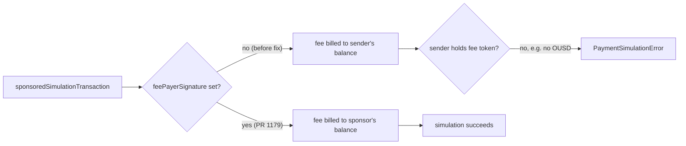

## Abstract

Cloudflare used 2026-11-05 to announce a cross-industry coalition on agent delegation standards, while leaving the hardest case — one agent acting through another inside a browser — explicitly unsolved[^s01]. Google Cloud moved its own agent-identity plumbing further along the same path, taking Auth Manager for Agent Identity to general availability at its Security Summit[^s02]. A single TechCrunch report says Claude picked up a Plaid-linked, read-only Personal Finance feature the same day, though no second outlet or Anthropic post could confirm it[^s03]. On the payment-rail side, x402 spent the day closing gaps between its TypeScript, Go, and Python SDKs instead of adding anything new[^s04][^s05][^s06][^s07], and mppx's own incident writeup describes a Tempo node upgrade that broke sponsored-payment simulation for about a quarter of its paid calls for several hours[^s08].

## Introduction

This edition covers **2026-11-03 through 2026-11-06**. Background on the payment-rail landscape lives in the site's [agent commerce protocol comparison](../agent-commerce-protocol/); mppx's session design is covered in [Machine Payments Protocol: spec and payment flows](../mpp-spec-and-payment-flows/); agent identity schemes are compared in [AI agent identity: EAS vs. DID](../ai-agent-identity-eas-vs-did/). The previous edition, 2026-11-05, covered Uber's own agent-order numbers, a Cloudflare personal-agent visibility launch, an x402 gate-hook fix, an x402 XRPL spend-cap fix, and three mppx session-payment fixes; none of today's items repeat it.

## What moved

### Cloudflare convenes a coalition on agent delegation, and admits it hasn't solved delegation

Cloudflare's 2026-11-05 post announces "Trusted Agent Delegation" (TAD), a coalition meant to pull "representatives across the ecosystem" into one room, examine existing identity mechanisms, and bring the gaps to the IETF rather than let each vendor ship its own[^s01]. It backs Web Bot Auth for letting an agent sign its own requests, points to MOLE for rate-limiting without user identifiers, and name-checks x402 and Private Access Tokens as pieces already in play. What the post does not do is name a single coalition member, a charter, or a date — "more will follow as the standards mature" is the only commitment attached to the convening itself.

The product changes riding alongside it are concrete, by contrast. Security Analytics gets a "Personal Assistants" traffic category; site owners get an Allow / Block-on-ad-pages / Block-per-agent policy instead of one global switch; and Account Abuse Protection, still early access, now flags whether a personal agent made a given login or signup and lets a WAF rule target the hashed account behind it. Then the post names the case none of this reaches: agent A acting through agent B inside browser C, where "a mechanism still needs to be defined." Cloudflare is standardizing single-hop agent identity while openly flagging that delegation chains — the shape every agentic-commerce flow eventually needs — remain open.

### Google Cloud takes agent-identity auth to GA

At its Security Summit on 2026-11-05, Google Cloud said Auth Manager for Agent Identity — which automates OAuth 2.0/PKCE flows and refreshes delegated tokens on an agent's behalf — is "now generally available," with a related capability, OIDC-based Agent Identity JWTs that let an agent authenticate without a long-lived API key, still in preview[^s02]. Both claims come from the announcement post itself, with no changelog entry to check them against. Paired with Cloudflare's launch the same day, two large infrastructure vendors spent 2026-11-05 shipping pieces of the same problem — proving which agent is acting, and on whose authority — from opposite ends: Cloudflare from the traffic a site sees arriving, Google Cloud from the token an agent presents to authenticate.

### Reported: Claude gets a Plaid-linked Personal Finance tool

TechCrunch reported on 2026-11-05 that Anthropic is rolling out a "Personal Finance" feature in beta to Pro, Max, and Ultra users in the US, connecting bank and credit-card accounts through Plaid for read-only spending summaries, duplicate-charge and fee flagging, and APR explanations[^s03]. The article quotes Anthropic's own framing — "no ads or sponsored recommendations," no credit cards or loans of its own — and says conversations in the feature aren't used for model training. _(unverified — single source)_ No second outlet's coverage could be fetched, and no matching post turned up on Anthropic's own newsroom index as of this writing; see `working/gaps.md`.

### x402 keeps closing SDK-parity gaps rather than shipping anything new

Two pairs of PRs merged on 2026-11-05 both port existing TypeScript or Go behavior into the other SDKs; neither introduces new protocol behavior. The first pair gives Python the `settlement_preflight_failed` cancellation reason that TypeScript and Go already had: a settle failure that happens before the facilitator is ever reached (a `before_settle` abort, a payload-enrichment error) now cancels the verified payment under that reason instead of being folded into `on_settle_failure`, which is reserved for failures after the facilitator was reached[^s04][^s05]. The second pair fixes TypeScript and Python dropping a hook's abort *message*: Go already copied a `before_verify`/`before_settle` hook's optional message into the resulting error, but TypeScript and Python were discarding it, so a client saw only that a request was aborted, not why[^s06][^s07]. Both fixes trace to the same tracking issue (#4097) and the same underlying Go reference implementation, ported twice in one day.

### mppx: a Tempo node upgrade broke sponsored payments for several hours

mppx's own writeup for PR #1179 describes sponsored payments failing on Tempo mainnet starting 07:21 PST on 2026-11-05, with roughly a quarter of paid MPP calls through mpp-proxy failing across fal, firecrawl, OpenAI, RPC, and storage services[^s08]. The root cause: Tempo nodes recover a transaction's fee payer only from a `feePayerSignature` field, ignoring a bare `feePayer` address, but mppx's sponsored-simulation path left that field unset. Simulated transactions were therefore billed to the sender in the sponsor's fee token instead of the sponsor, and failed whenever the sender didn't hold that token — on mainnet, often OUSD. The timing lines up with Tempo nodes rolling to `tempo/v1.18.1` between 07:12 and 07:20 PST; no mppx or sponsor-side deploy happened at that time, and the sponsor account was adequately funded throughout.

_Figure 1 — before PR #1179, an unset `feePayerSignature` let Tempo nodes bill a sponsored transaction's simulated fee to the sender instead of the sponsor, failing whenever the sender lacked the sponsor's fee token[^s08]._

Recent editions' mppx items were bugs caught by code review before they shipped. This one is different: a node-software upgrade on infrastructure mppx doesn't control broke a working path for hours, and the fix is a same-day response to something that already happened, not hardening against something that might.

## Why it matters

Today splits cleanly along who is doing the work. Cloudflare and Google Cloud both spent 2026-11-05 on agent identity and authorization — proving which agent is talking and on whose authority — and both left the harder multi-hop delegation problem for later, Cloudflare by naming it directly and Google Cloud by simply not addressing it yet. x402 and mppx are not building anything new this window: x402 ported one SDK's correct behavior into two others, and mppx fixed a production outage caused by infrastructure outside its control. The Claude Personal Finance report, if it holds up, is the one item that touches an end user directly instead of infrastructure, and it's also the one item this edition could not verify past a single outlet.

## Signals to watch

- Cloudflare's TAD coalition: does it name actual member organizations or produce an IETF submission, or does it stay a framing exercise?
- The multi-agent-through-a-browser case Cloudflare flagged as unsolved. Whoever addresses it first sets the pattern for every agentic-commerce flow that needs a delegation chain.
- Anthropic's own confirmation (or denial) of the Personal Finance feature, and whether The Verge's parallel coverage becomes fetchable.
- A fourth SDK-parity gap in x402's hook lifecycle would make the TypeScript/Go/Python porting pattern worth its own scrutiny, not routine maintenance.
- Whether mppx changes how sponsored-simulation handles node-version drift, since this failure originated outside its own deploys.

## Limitations

Card-network and PSP agent-commerce products (Mastercard Agent Pay/AP4M, Visa Trusted Agent Protocol, Stripe's Agentic Commerce Protocol, PayPal) produced no dated primary announcement inside this window. AP2 and UCP had no activity in their canonical repos. The Claude Personal Finance item rests on a single source; see `working/gaps.md`. Hacker News, Bluesky, and Reddit searches for the standing topic's protocol terms returned nothing usable this window — Bluesky and Reddit are not credentialed in this environment, and Hacker News had no matching discussion.
