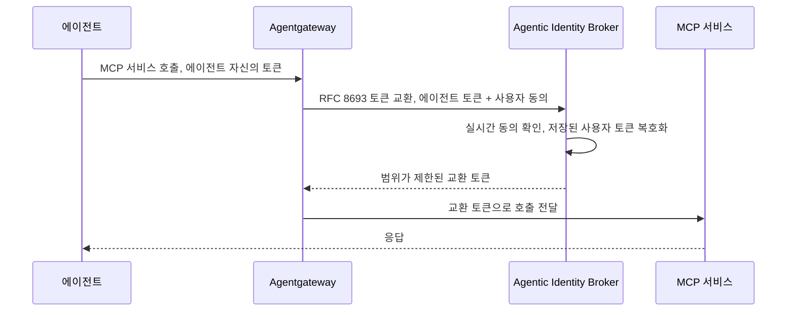

## 초록

잘란도(Zalando)가 사용자 토큰을 에이전트에게 넘기지 않고도 MCP 서비스에 범위가 제한된, 철회 가능한 접근 권한을 부여할 수 있는 OAuth2 브로커를 오픈소스로 공개했다. 대형 플랫폼의 새 기능이 아니라 대형 이커머스 운영사 내부에서 실제로 돌아가던 신원 관리 패턴이 밖으로 나온 사례다[^s01][^s02]. 같은 기간 mppx는 x402 계열 결제 프록시가 점점 더 많이 돌아가는 환경, 즉 Cloudflare Workers에 맞춰 스스로를 뜯어고쳤다. Durable Object와 SQL 백엔드를 추가했고, 연동사가 쓸 수 있는 정산 복구용 프리미티브 두 가지를 공개했으며, 2026-11-05 목요일에 스폰서 결제 장애를 더디게 만들었던 바로 그 진단 공백을 메웠다[^s03][^s04][^s05][^s06][^s07][^s08]. 카드사, PSP, AP2, UCP 쪽은 이번 주기 동안 조용했다.

## 서론

이번 호는 **2026-11-05부터 2026-11-07까지**를 다룬다. 결제 레일 전반의 배경은 사이트의 [에이전트 커머스 프로토콜 비교](../agent-commerce-protocol/)에, mppx의 세션 설계는 [머신 결제 프로토콜: 스펙과 결제 흐름](../mpp-spec-and-payment-flows/)에, 에이전트 신원 체계 비교는 [AI 에이전트 신원: EAS vs. DID](../ai-agent-identity-eas-vs-did/)에 정리되어 있다. 직전 호인 2026-11-06판은 Cloudflare와 Google Cloud의 에이전트 신원 기능 출시, 단일 출처로만 확인된 Claude 개인 금융 기능 보도, x402의 SDK 간 기능 맞추기, 그리고 mppx 스폰서 결제를 몇 시간 동안 멈춰 세운 Tempo 노드 업그레이드를 다뤘다. 오늘 다룰 항목들은 그 내용을 되풀이하지 않지만, 그중 하나는 바로 그 사건의 후속 조치다.

## 무엇이 움직였나

### 잘란도, 에이전트가 사용자 토큰을 쥐지 않는 OAuth 브로커를 공개하다

잘란도는 2026-11-06 Agentic Identity Broker(AIB)를 MIT 라이선스로 공개하면서, "자격 증명을 넘기지 않고도 AI 에이전트에게 범위가 제한된, 철회 가능한 접근 권한을 위임"하는 컴포넌트라고 설명했다[^s01]. Show HN에 글을 올린 잘란도 엔지니어는 README가 짧게만 언급한 작동 방식을 구체적으로 풀어놓았다. 브로커는 타사 토큰을 암호화해서 보관하고, 요청이 들어올 때마다 Agentgateway 같은 게이트웨이가 저장된 토큰을 그대로 내주는 대신 RFC 8693 토큰 교환을 수행한다[^s02]. 이 설계에서는 에이전트가 대신 행동하는 대상의 자격 증명을 쥐고 있는 쪽이 에이전트가 아니라 브로커다. 에이전트는 자기 자신으로 인증하고, 브로커가 사용자를 대신 보증하는 구조이지, 에이전트가 사용자 권한의 복사본을 들고 다니는 구조가 아니다.

_그림 1 — 에이전트는 사용자의 원본 토큰을 전혀 받지 않는다. 게이트웨이가 자기 토큰을 브로커에서 범위가 제한된 토큰으로 교환하며, 브로커는 실시간이고 철회 가능한 동의가 있을 때만 그 토큰을 내준다[^s02]._

글쓴이는 이 프로젝트가 이미 잘란도 내부에서 "수백 개 에이전트와 수십 개의 내외부 MCP 서버"를 묶어 실제 운영 규모로 돌고 있으며, 버전은 v0.1이라고 밝혔다[^s02]. _(벤더 주장)_ 이 수치는 프로젝트를 만든 당사자의 발언에만 의존한다. 잘란도 직원이 따로 쓴 HackerNoon 글도 내부 운영 사실은 뒷받침하지만 구체적인 수치까지는 반복하지 않는다[^s03]. Show HN 스레드에는 댓글이 세 개 달렸을 뿐이고 메인테이너의 답변은 하나도 없었다. 그중에는 에이전트가 다른 에이전트를 거쳐 행동하는 다단계 위임을 이 브로커가 어떻게 처리하는지 묻는 질문도 있었지만 답을 받지 못했다. 이는 같은 날인 2026-11-05 Cloudflare가 Trusted Agent Delegation 글에서 풀지 못한 채로 남겨둔 문제와 같다. 서로 다른 두 조직이 이틀 사이에 같은 미해결 문제를 공개적으로 인정한 셈이다.

### mppx, Cloudflare Workers에서 돌아가도록 스스로를 고치고 연동사에게 복구 수단을 내주다

mppx는 2026-11-06 Durable Object 스토어와 SQL(Postgres, SQLite, D1) 스토어를 내장 기능으로 추가했다. `tempo.session()`의 채널 상태와 재사용 방지 로직이 오래 떠 있는 서버가 아니라 Cloudflare Worker 안에서도 돌아가게 하려는 목적이다[^s04][^s05]. Durable Object 구현은 채널 키마다 별도 객체를 두어, 채널이 여러 아이솔레이트로 흩어져 확장되면서도 채널별 업데이트는 선형적으로 유지되도록 한다. `update`는 지터를 섞은 재시도와 compare-and-swap으로 뒷받침되는데, 이는 운영 중인 tempoxyz/mpp-proxy가 이미 쓰고 있는 패턴과 같다[^s04].

새 스토어와 함께 mppx는 자체적으로 해결하지 못한 실패를 복구할 수 있는 프리미티브 두 가지도 공개했다. `Errors.BroadcastOutcomeUnknownError`는 모호한 브로드캐스트(타임아웃, 연결 끊김, "already known" 응답) 뒤에 mppx가 영수증을 기다리다 끝내 확인하지 못했을 때 서명된 트랜잭션 해시를 담아 던져진다. 이전에는 해시 없이 원본 RPC 에러만 그대로 다시 던져서, 호출자가 직접 에러를 재분류해야 했다[^s06]. 새로 추가된 `stripe.recordPayment` 헬퍼는 결제를 브로드캐스트한 뒤 기록하기 전에 프로세스가 죽어버린 경우처럼, mppx가 놓친 정산을 연동사가 mppx와 같은 idempotency 키로 마무리 처리할 수 있게 해준다[^s06]. 두 기능 모두 같은 대상을 겨냥한다. mpp-proxy를 운영하면서 mppx가 어찌할 수 없는 일이 벌어졌을 때 뒷수습을 해야 하는 사람들이다.

### 타입화된 에러 하나가 목요일 Tempo 장애의 공백을 메우다

2026-11-05 목요일 Tempo 메인넷 스폰서 결제 장애는 mppx의 프리플라이트 시뮬레이션이 발신자의 잔액 부족과 스폰서의 잔액 부족을 구분하지 못한 탓에 진단이 몇 시간 걸렸다. 노드 레벨 에러 메시지만 그대로 노출됐기 때문이다[^s07][^s08]. 2026-11-06에 머지된 PR #1202는 두 실패 경로를 모두 새 `Errors.PaymentSimulationError`로 감싸, `phase` 필드(`sender` 또는 `sponsored`)와 해석된 fee-payer 주소, 원본 노드 에러를 `cause`로 함께 담는다[^s07]. 같은 PR은 관련된 서명 문제도 함께 고쳤다. 역직렬화된 트랜잭션 엔벨로프는 서명된 엔벨로프가 명시적으로 인코딩하는 0짜리 priority fee를 누락시켜, 일부 스폰서 결제의 서명 복원을 실패시키고 있었다. 이번 수정은 사건을 예측해서 막은 것이 아니라 이미 벌어진 사건에 대응한 것이고, 목요일 장애가 드러낸 바로 그 실패 유형에 직접 답한 수정이다.

## 왜 중요한가

오늘 신원과 결제 레일 양쪽에서 나온 진전은 모두 프로토콜 스펙 저장소가 아니라 실제 트래픽을 운영하는 당사자에게서 나왔다. 잘란도는 자사 MCP 서버 위임 문제를 풀기 위해 AIB를 만들었고, mppx의 수정들도 새 스펙 개정이 아니라 mpp-proxy를 운영하는 쪽이 더 나은 복구 도구와 Cloudflare Workers 지원을 필요로 했기 때문에 나왔다. 다단계 위임은 여전히 아무도 풀지 못한 문제로 계속 떠오른다. 잘란도의 답변 없는 HN 질문은 Cloudflare가 2026-11-05에 짚었던 것과 같은 공백이다. 다만 이번에는 오픈소스 MIT 프로젝트와 CDN 벤더가 같은 주에 나란히 그 벽에 부딪혔다는 점에서, 한 회사의 로드맵보다 더 많은 당사자가 같은 문제를 겪고 있다는 뜻이다.

## 지켜볼 신호

- AIB가 잘란도 밖에서 채택되거나 관심을 받는지. 댓글 세 개와 메인테이너의 무응답만으로는 아직 어느 쪽으로도 신호가 아니다.
- AIB의 댓글과 Cloudflare의 글 양쪽이 남겨둔 다단계 위임 질문에 누군가 답을 내놓는지.
- mppx의 새 스토어 백엔드가 이 설계를 끌어낸 tempoxyz/mpp-proxy 외의 다른 서비스에서도 쓰이는지.
- 또 다른 Tempo 관련 장애 보고. PR #1202의 타입화된 에러가 실제로 진단 시간을 줄이는지 확인할 수 있을 것이다.

## 한계

Mastercard Agent Pay/AP4M, Visa Trusted Agent Protocol, Stripe의 Agentic Commerce Protocol, PayPal 등 카드사·PSP의 에이전트 커머스 제품은 이번 기간 동안 날짜가 명시된 1차 발표를 내지 않았다. 직전 호와 같은 공백이다. AP2와 UCP의 공식 저장소에서도 문서만 고친 UCP PR 세 건 외에는 움직임이 없었고, 기사로 다룰 만한 수준은 아니었다. x402-foundation/x402는 이미 배포된 SVM 퍼실리테이터 기능 두 가지를 설명하는, 봇이 작성한 문서 PR을 머지했지만 두 기능이 어떤 문제를 풀려는 것인지는 설명하지 않았다. 이 건은 본문 항목으로 다루는 대신 `working/gaps.md`에 기록했다. Bluesky와 Reddit은 이 환경에 인증 정보가 설정되어 있지 않고, Hacker News에서도 AIB 게시물 외에는 이번 주제의 프로토콜 용어로 걸리는 글이 없었다.
