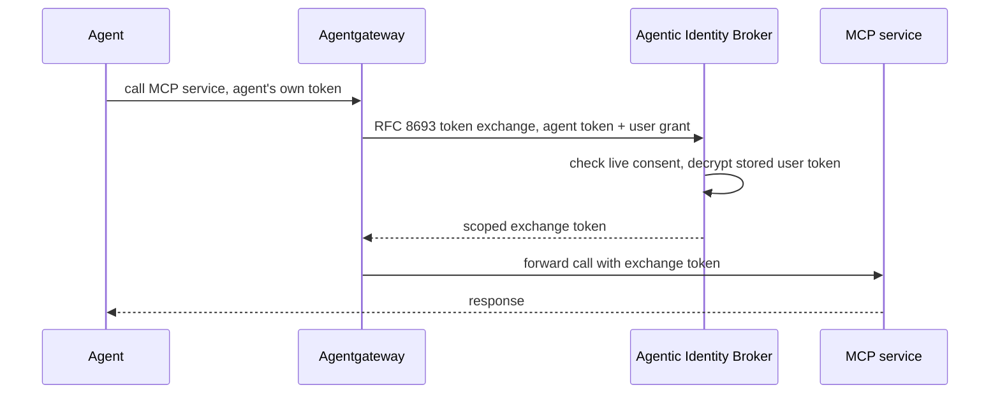

## Abstract

Zalando open-sourced an OAuth2 broker that lets a user hand an AI agent scoped, revocable access to MCP services without ever giving the agent the user's own token. It's a production identity pattern from inside a large e-commerce operator, released directly as MIT-licensed code[^s01][^s02]. mppx spent the same window making itself deployable where x402-style payment proxies increasingly run: it shipped Durable Object and SQL backends for Cloudflare Workers, exposed two settlement-recovery primitives for integrators, and closed the exact diagnostic gap that slowed Thursday's (2026-11-05) sponsored-payment outage[^s03][^s04][^s05][^s06][^s07][^s08]. Card networks, PSPs, AP2, and UCP stayed quiet.

## Introduction

This edition covers **2026-11-05 through 2026-11-07**. Background on the payment-rail landscape lives in the site's [agent commerce protocol comparison](../agent-commerce-protocol/); mppx's session design is covered in [Machine Payments Protocol: spec and payment flows](../mpp-spec-and-payment-flows/); agent identity schemes are compared in [AI agent identity: EAS vs. DID](../ai-agent-identity-eas-vs-did/). The previous edition, 2026-11-06, covered Cloudflare's and Google Cloud's agent-identity launches, a single-sourced Claude Personal Finance report, x402's cross-SDK porting, and the Tempo node upgrade that broke mppx's sponsored payments for several hours. None of today's items repeat it, though one directly follows up on it.

## What moved

### Zalando open-sources an OAuth broker so an agent never holds the user's token

Zalando published the Agentic Identity Broker (AIB) under the MIT license on 2026-11-06, describing it as a component that "delegate[s] scoped, revocable access to AI agents — without handing them your credentials"[^s01]. The submitter, a Zalando engineer posting to Show HN, filled in the mechanism the README only gestures at: the broker holds third-party tokens encrypted, and at request time a gateway such as Agentgateway performs an RFC 8693 token exchange; the stored token itself never reaches the agent[^s02]. That design puts the broker, not the agent, in possession of the credential the agent is acting on behalf of: the agent authenticates as itself, and the broker vouches for the user, rather than the agent carrying a copy of whatever the user could do.

_Figure 1 — the agent never receives the user's underlying token; the gateway exchanges its own token for a scoped one at the broker, which releases it only against a live, revocable consent grant[^s02]._

The submitter says the project already runs at production scale inside Zalando — "hundreds of our agents with dozens of internal and external MCP servers" — and is tagged v0.1[^s02]. _(vendor-stated)_ Those counts come only from the submitter, who works on the project; a Zalando employee's separate HackerNoon piece corroborates that it's been running internally but doesn't repeat the specific numbers[^s03]. The Show HN thread drew three comments and no reply from a maintainer, including a direct question about how the broker handles transitive delegation (an agent acting through another agent) that went unanswered. That is the same open problem Cloudflare named without solving in the same day's (2026-11-05) Trusted Agent Delegation post. Two different organizations have now put the multi-hop case on the record as unsolved within the same two-day window.

### mppx makes itself deployable on Cloudflare Workers and gives integrators a recovery path

mppx shipped a built-in Durable Object store and a SQL store (Postgres, SQLite, D1) on 2026-11-06, so that `tempo.session()` channel state and replay protection also work when mppx runs inside a Cloudflare Worker, not just on a long-lived server[^s04][^s05]. The Durable Object implementation gives each channel key its own object, so updates stay linearizable per channel while channels themselves scale out across isolates; a compare-and-swap with jittered retry backs `update`, matching the pattern tempoxyz/mpp-proxy already runs in production[^s04].

Alongside the new stores, mppx exposed two primitives for recovering from failures mppx itself couldn't resolve. `Errors.BroadcastOutcomeUnknownError` now carries the signed transaction hash after an ambiguous broadcast (a timeout, a dropped connection, an "already known" response) that mppx polled for and still couldn't confirm. Previously it rethrew the raw RPC error with no hash attached, so callers had to reclassify it themselves[^s06]. A new `stripe.recordPayment` helper lets an integrator finish recording a settlement for a process that died between broadcasting a payment and logging it, using the same idempotency key mppx itself would have used[^s06]. Both are aimed at the same audience: whoever runs mpp-proxy in production and has to clean up after mppx when something it can't control goes wrong.

### A typed error closes the gap from Thursday's Tempo outage

Thursday's (2026-11-05) sponsored-payment outage on Tempo mainnet took hours to diagnose because mppx's preflight simulation couldn't distinguish a sender's insufficient balance from a sponsor's — it surfaced only a node-level error message[^s07][^s08]. PR #1202, merged 2026-11-06, wraps both failure paths in a new `Errors.PaymentSimulationError` carrying a `phase` field (`sender` or `sponsored`), the resolved fee-payer address, and the original node error as `cause`[^s07]. The same PR also fixes a related signing gap: a deserialized transaction envelope drops a zero priority fee that the signed envelope encodes explicitly, which previously made some sponsored completions fail signature recovery. This fix shipped the day after the outage it answers, built from the exact failure mode Thursday exposed.

## Why it matters

Today's identity and payment-rail progress both came from the companies running production traffic: Zalando built AIB to solve its own MCP-server delegation problem, and mppx's fixes came from whoever operates mpp-proxy needing better recovery tools and Cloudflare Workers support, with no new spec revision behind either. Multi-hop delegation keeps surfacing as the problem nobody has solved. Zalando's unanswered HN question is the same gap Cloudflare named on 2026-11-05, and now an open-source MIT project and a CDN vendor have both put it on the record in the same week — more organizations hitting the same wall than one company's roadmap would suggest.

## Signals to watch

- Whether AIB gets adoption or even engagement outside Zalando; three thin comments and no maintainer reply is not yet a signal either way.
- Anyone answering the transitive-delegation question AIB's own commenters and Cloudflare's post both left open.
- Whether mppx's new storage backends see use by a service other than tempoxyz/mpp-proxy, the operator the design was built around.
- A second Tempo-adjacent incident report, which would say whether PR #1202's typed errors actually shorten diagnosis time in practice.

## Limitations

Card-network and PSP agent-commerce products (Mastercard Agent Pay/AP4M, Visa Trusted Agent Protocol, Stripe's Agentic Commerce Protocol, PayPal) produced no dated primary announcement inside this window, matching the previous edition. AP2's and UCP's canonical repos saw no activity beyond three documentation-only UCP PRs, not substantive enough to count as news. x402-foundation/x402 merged a bot-generated documentation PR describing two already-shipped SVM facilitator features without explaining what problem either solves; `working/gaps.md` has the detail, since it doesn't clear the bar for an item here. Bluesky and Reddit are not credentialed in this environment, and Hacker News had nothing on the standing topic's protocol terms beyond the AIB post itself.
