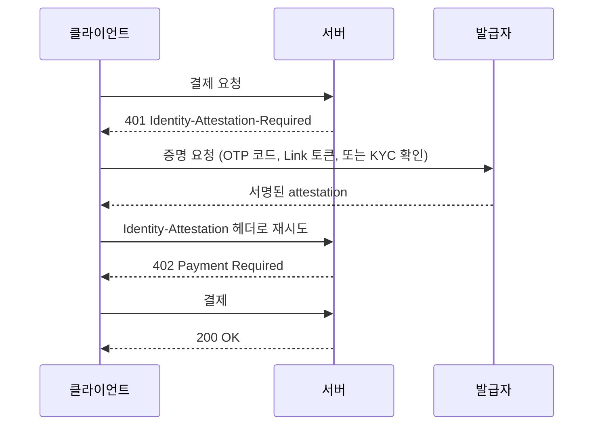

## 초록

이번 창에서 기준을 넘긴 항목은 셋이다. 모처럼 결제 프로토콜의 버그 수정이 아니다. mppx는 사흘에 걸쳐 신원 확인 계층을 쌓았다(이메일 OTP, 재사용 가능한 attestation 모듈, Link 에이전트 신원 연동, 지갑에 묶인 Persona KYC까지). 이제 결제 요청은 결제 증명뿐 아니라 "누가 혹은 무엇이 요청하는지"에 대한 증명도 함께 담을 수 있다[^s01][^s02][^s03][^s04]. OpenAI는 인증된 미국 전자상거래 기업들이 ChatGPT 안에 자기 에이전트를 세워 직접 답하게 했다. 모델이 대신 설명해주던 방식에서 벗어난 것이다[^s05][^s06]. 어도비는 로컬 MCP 서버를 내놓아 MCP를 말하는 어떤 에이전트든 포토샵, 일러스트레이터, 애프터이펙트, 프리미어에 접근할 수 있게 했다[^s07]. 셋 다 새 프로토콜 발표는 아니다. 기존 시스템들이 각자 에이전트를 인식 가능한 당사자로 받아들일 자리를 만든 것이다.

## 서론

이번 호는 **2026-11-08부터 2026-11-11까지**를 다룬다. 결제 레일 지형에 대한 배경은 사이트의 [에이전트 커머스 프로토콜 비교](../agent-commerce-protocol/)에 있고, mppx의 세션 설계는 [Machine Payments Protocol: 스펙과 결제 흐름](../mpp-spec-and-payment-flows/)에서 다뤘다. 지난 호(2026-11-08)는 스트라이프의 에이전트 데이터 접근 도구, 오래된 버그 주석이 코딩 에이전트를 궤도에서 벗어나게 한다는 구글의 조사, mppx의 Zone 잔액 결제 추가를 다뤘다. 오늘의 세 항목은 결제가 아니라 신원이라는 다른 줄기를 잡는다.

## 무엇이 움직였나

### mppx, 신원 확인 계층을 추가하다: 이메일, 공개 attestation 모듈, Link 에이전트 신원, Persona KYC

2026-11-08부터 11-10 사이 mppx에 머지된 네 개의 풀 리퀘스트가 하나의 스택을 이룬다. 첫 번째는 11-08에 머지된 이메일 OTP attestation이다. 서버가 `401 Identity-Attestation-Required: email`로 응답하면 클라이언트는 코드를 받아 서버 origin에 묶인 서명된 JWS로 교환한 뒤 재시도하고, 그때야 평소의 `402`를 받아 결제한다[^s01]. 다음 날, 이메일 전용이던 그 코드는 공개 `Attestation` 모듈로 옮겨져 범용 verifier/prover 인터페이스를 갖췄다. 이제 경로는 여러 발급자 유형 중 하나를 요구할 때 각각을 일일이 손으로 구현하지 않아도 되고, 사용자도 시도하는 발급자마다 별도의 코드를 소모하지 않는다[^s02]. 11-10에는 이 모듈 위에 발급자 둘이 더 붙었다. 하나는 Privacy Pass 토큰과 SD-JWT 클레임을 검사하는 Link 연동으로, 넷 중 처음으로 결제하는 인간이 아니라 실제로 에이전트의 신원을 검증하는 것이다[^s03]. 다른 하나는 지갑 주소를 KYC 조회 결과에 묶는 Persona KYC 검사로, 한 번 승인된 조회가 그 지갑에서 나오는 이후의 모든 결제 요청을 매번 다시 확인하지 않고 통과시킨다[^s04].

*화살표마다 네 개 PR이 공유하는 계약에 대해 주장하는 바가 담겨 있다. 신원 확인은 결제 대신이 아니라 결제보다 먼저 이뤄지고, 이메일 코드든 Link 에이전트 토큰이든 Persona KYC 확인이든 같은 네 단계 모양을 따른다.*

머지 당시 리뷰어들이 짚은 틈은 아직 열려 있다. `402` 챌린지와 결제 재시도 사이에서 attestation이 만료될 수 있다는 점, 그리고 여러 발급자를 동시에 허용하는 경로에서 Link 연동의 클레임 거부 이유가 유실될 수 있다는 점이다. mppx는 이제 신원 확인을 일회성 기능이 아니라 인프라로 다루고 있지만, 그 인프라는 자체 리뷰 코멘트가 닫히기 전에 먼저 배포됐다.

### OpenAI, ChatGPT 안에서 기업이 자기 에이전트로 직접 답하게 하다

OpenAI는 2026-11-10 "Businesses in ChatGPT"를 베타로 선보였다. 기업이 프로필을 청구하고 인증받는 Business Hub, 그리고 자격을 갖춘 미국 전자상거래·온라인 서비스 기업이 자사가 ChatGPT 대화에 등장할 때 직접 답하도록 세울 수 있는 Business Agent로 구성된다[^s05][^s06]. 에이전트는 그 회사 자신의 제품·정책 정보를 바탕으로 답하고, 사람이 아니라 그 기업을 대리하는 AI임을 밝혀야 하며, 대화는 라벨이 붙은 채 ChatGPT 자체 답변과 분리된다. 구매, 예약, 사용자 정보가 필요한 작업은 여전히 승인된 기능을 통한 명시적 동의가 필요하고, 지금은 구매가 일어나면 사용자를 그 기업 자체 사이트로 보낸다. 에이전트는 질문에 답할 뿐 결제를 받지는 않는다[^s06]. _(벤더 발표 — "자격을 갖춘 미국 전자상거래·온라인 서비스 기업"이라는 말 외에 구체적 자격 기준은 이 하니스가 읽을 수 있었던 어떤 소스에도 공개되어 있지 않다)_

지난 호의 스트라이프 움직임과 같은 방향이지만 한 칸 더 바깥쪽이다. 결제서비스제공자가 에이전트에게 가맹점 자신의 데이터를 읽게 해준 것이 지난 호였다면, 이번엔 플랫폼이 가맹점 자신의 에이전트에게 그 플랫폼의 목소리로, 그 플랫폼의 사용자에게 말하게 해준 것이다.

### 어도비, 로컬 MCP 서버로 크리에이티브 클라우드를 서드파티 에이전트에 열다

어도비는 Max 2026 발표와 함께 로컬 Model Context Protocol 서버를 내놓아 포토샵, 일러스트레이터, 애프터이펙트, 프리미어를 ChatGPT든 Claude든 Gemini든 MCP를 말하는 어떤 에이전트에도 노출했다[^s07]. 어도비 부사장 Deepa Subramaniam은 테크크런치에 아직 그 엔드포인트가 노출할 수 있는 범위에 선을 긋지 않았다고 말했다. "우리는 MCP 엔드포인트가 노출할 수 있는 걸 굳이 제한할 필요나 의지가 없다... 사람들이 그걸 어떻게 쓰는지, 뭘 하려고 하는지 보면서 계속 더 보여줄 생각이다"[^s07]. 어도비는 이미 ChatGPT, Claude와 제품별로 좁은 범위의 연동을 갖고 있었다. MCP 서버는 그걸 늘어나는 개별 연동 목록 대신 하나의 인터페이스로 일반화한 것이다.

## 왜 중요한가

셋 다 새 프로토콜도, 카드 네트워크의 움직임도, 심지어 논쟁적인 사건도 아니다. AP2, UCP, 카드 네트워크들은 이번 창에서도 날짜가 찍힌 소식을 내지 않았다. 대신 움직인 건 더 평범하고, 사흘을 놓고 보면 겉보기보다 더 일관된 무언가다. 결제 프로토콜은 "이게 누구인지" 확인 절차를 쌓았고, 챗 플랫폼은 기업을 요약 대상이 아니라 스스로 말하는 주체로 세웠고, 창작 도구 모음은 커스텀 연동 여러 개 대신 표준화된 문을 하나 열었다. 에이전트는 이제 시스템이 처리해야 할 트래픽의 한 종류가 아니라 인식해야 할 당사자다. 서로 조율하지 않은 세 회사가 각자 같은 문제를 풀었을 뿐이다.

## 지켜볼 신호

- attestation 만료 경쟁 상태와 Link 클레임 거부 경로에 대한 mppx의 열린 리뷰 항목. 다음 신원 확인 PR을 그 위에 쌓기 전에 고쳐질지 지켜볼 일이다.
- OpenAI의 자체 설명을 넘어선 Business Agents에 대한 독립적인 보도나 사용자 테스트. 자격 기준, 청구된 프로필의 인증 절차, Shopify 생태계 밖의 "자격을 갖춘" 기업도 실제로 들어갈 수 있는지가 관건이다.
- 어도비가 MCP 서버의 도구 스키마에 대한 개발자 문서를 내놓을까, 아니면 "어떻게 쓰는지 보겠다"는 말이 그대로 정책으로 남을까.
- The Verge 피드에 떠오른 eBay의 Muse 차단 보도. 이번 호에서는 두 번째 소스가 없어 주장으로 쓰지 않았으니(제약 참고), 다른 매체가 확인해주면 풀릴 문제다.

## 제약

카드 네트워크와 PSP의 에이전트 커머스 제품은 이번 창에서도 날짜가 찍힌 1차 발표를 내지 않았다. AP2의 정식 저장소와 UCP 저장소에는 이번 창 안에 동작을 바꾸는 머지가 없었고, UCP에는 선택적 `list_price` 필드 추가 하나만 있었다(별도 항목으로 다루지 않았다). x402-foundation/x402는 Robinhood Chain을 지원 EVM 네트워크로 추가하는 등 몇 건의 SDK·네트워크 지원 변경을 머지했다. 새 이야기가 아니라 통상적인 보강이다. OpenAI 자체 발표 페이지는 이 하니스의 fetch 시도 두 번 모두 403을 반환했다. 이번 호의 Business Agents 서술은 그 페이지를 읽은 독립된 매체 둘에 의존했고, OpenAI 자신의 문구에 직접 의존하지 않았다.

eBay가 Meta의 Muse 쇼핑 에이전트를 차단하기 시작했다는, 독자 제보에 기반한 보도가 2026-11-10 The Verge 피드에 떠올랐다. 하지만 The Verge 사이트는 이 하니스의 fetch를 거부했고 두 번째 매체의 확인도 없어, 이번 호에서는 주장으로 쓰지 않았다. 구글의 Gemini 4 Carbon에 에이전트 "스웜" 기능이 있다는 헤드라인도 마찬가지로, 그런 기능을 설명하는 독립 보도를 찾지 못해 제외했다. 블루스카이와 레딧은 이 환경에서 여전히 인증되어 있지 않다. 해커뉴스는 이번 창에 시도한 다섯 개 검색어 변형 모두에서 결과가 없었다.
