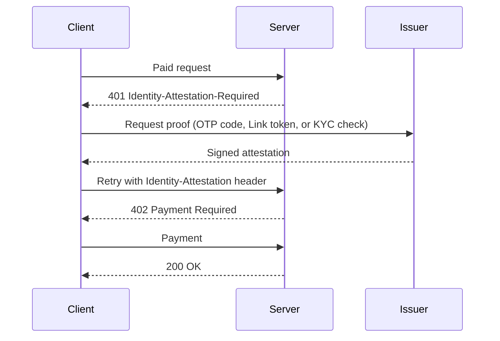

## Abstract

Three items cleared the bar this window, and for once none of them is a payment protocol shipping a bug fix. mppx spent three days building out an identity layer (email OTP, a reusable attestation module, a Link agent-identity integration, and Persona KYC bound to a wallet), so a paid request can now carry proof of who or what is asking, not just proof of payment[^s01][^s02][^s03][^s04]. OpenAI let verified U.S. ecommerce businesses put their own agent inside ChatGPT to answer for themselves instead of being described by the model[^s05][^s06]. Adobe shipped a local MCP server that lets any MCP-speaking agent reach into Photoshop, Illustrator, After Effects, and Premiere[^s07]. None of this is a new protocol launch; all three are existing systems making room for an agent to show up as a recognized party.

## Introduction

This edition covers **2026-11-08 through 2026-11-11**. Background on the payment-rail landscape lives in the site's [agent commerce protocol comparison](../agent-commerce-protocol/); mppx's session design is covered in [Machine Payments Protocol: spec and payment flows](../mpp-spec-and-payment-flows/). The previous edition, 2026-11-08, covered Stripe's agent data-access tools, a Google study of stale bug-reference comments derailing coding agents, and an earlier mppx addition letting a Tempo charge settle from a Zone balance. Today's three items pick up a different thread: identity, not settlement.

## What moved

### mppx adds an identity layer: email, a public attestation module, Link agent identity, and Persona KYC

Four pull requests merged into mppx between 2026-11-08 and 2026-11-10 build one stack. The first, merged 2026-11-08, adds email OTP attestations: a server can answer a request with `401 Identity-Attestation-Required: email`, the client gets a code, exchanges it for a signed JWS bound to the server's origin, and retries, at which point it gets the usual `402` and pays[^s01]. The next day, that email-specific code moved into a public `Attestation` module with a generic verifier/prover interface, so a route can require one of several issuer types without hand-coding each one and without the user burning a separate code per issuer it tries[^s02]. On 2026-11-10, two more issuers landed on top of that module. A Link integration checks a Privacy Pass token and SD-JWT claims; it is the first of the four PRs that verifies the agent's own identity, where the other three verify the human behind it[^s03]. A Persona KYC check binds a wallet address to a KYC inquiry outcome, so one approved inquiry gates every later paid request from that wallet instead of re-checking per session[^s04].

*Each arrow is a claim the four PRs make about the shared contract: identity is checked before payment, not instead of it, and the same four-step shape covers an email code, a Link agent token, and a Persona KYC check alike.*

The reviewers who caught this as it merged flagged real gaps that are still open: an attestation can expire in the gap between the `402` challenge and the paid retry, and the Link integration's claims-rejection reason can get lost if a route accepts several issuers at once. mppx is treating identity as infrastructure now, not as a one-off feature — but it is infrastructure that shipped before its own review comments closed.

### OpenAI lets a business's own agent answer for it inside ChatGPT

OpenAI introduced "Businesses in ChatGPT" in beta on 2026-11-10: a Business Hub where a company claims and verifies its profile, and a Business Agent that eligible U.S. ecommerce and online-service businesses can stand up to answer directly when their business comes up in a ChatGPT conversation[^s05][^s06]. The agent speaks from the company's own product and policy information, must disclose that it is AI representing the business, and its conversations are labeled and kept separate from ChatGPT's own answers. Purchases, bookings, and anything requiring the user's information still need explicit authorization through an approved feature, and for now a purchase sends the user off to the business's own site: the agent answers questions, but it does not take payment[^s06]. _(vendor-stated — eligibility criteria beyond "eligible US ecommerce and online-service businesses" were not published by OpenAI in any source this harness could read)_

This is the same move Stripe made with merchant data access in the last edition, aimed one layer further out: instead of a PSP letting an agent read a merchant's own numbers, a platform is letting the merchant's own agent speak in the platform's voice, inside the platform's product, to the platform's users.

### Adobe opens Creative Cloud to third-party agents through a local MCP server

Adobe released a local Model Context Protocol server exposing Photoshop, Illustrator, After Effects, and Premiere to any MCP-speaking agent (ChatGPT, Claude, Gemini, or otherwise) alongside its Max 2026 announcements[^s07]. Adobe VP Deepa Subramaniam told TechCrunch the company isn't drawing a line yet on what the endpoint should expose: "We don't have any need or desire to sort of limit what the MCP endpoint can expose... We're just going to see how people use it, what they're trying to do, and keep showing more"[^s07]. Adobe already had narrower, product-specific integrations with ChatGPT and Claude; the MCP server generalizes that into one interface instead of a growing list of point integrations.

## Why it matters

None of these three is a new protocol, a card-network move, or even a contested one. AP2, UCP, and the card networks again produced nothing dated inside this window. What moved instead is more mundane, and over three days it is more consistent than that sounds: a payment protocol building out who-is-this checks, a chat platform letting a business speak as itself instead of being summarized, and a creative suite opening a standard door for agents instead of several custom ones. Agents are now a kind of party each of these systems has to recognize, not just a kind of traffic it has to handle, and none of the three companies coordinated with the others to get there.

## Signals to watch

- mppx's open review findings on the attestation-expiry race and the Link claims-rejection path: fixed before the next identity PR ships on top of them, or not.
- Independent reporting or user testing of OpenAI's Business Agents beyond OpenAI's own framing: the eligibility bar, the claimed-profile verification process, and whether "eligible" businesses outside Shopify's ecosystem can actually get in.
- Does Adobe publish developer documentation for the MCP server's tool schemas, or does "we'll see how people use it" stay the policy?
- The eBay/Muse blocking report that surfaced in The Verge's feed: it isn't used as a claim this edition for lack of a second source (see Limitations), so a second outlet confirming it would settle the question.

## Limitations

Card-network and PSP agent-commerce products again produced no dated primary announcement this window. AP2's canonical repository and UCP's repository saw no behavior-changing merges inside the window beyond one schema addition in UCP (an optional `list_price` field, not evaluated here as a standalone item). x402-foundation/x402 merged a handful of SDK and network-support changes, including adding Robinhood Chain as a supported EVM network — routine hardening, not a new story. OpenAI's own announcement page returned a 403 to this harness's fetcher on two attempts; this edition's account of Business Agents rests on two independent outlets that read the page rather than on OpenAI's own text.

A reader-sourced report that eBay has started blocking Meta's Muse shopping agent surfaced in The Verge's feed on 2026-11-10, but The Verge's site refused this harness's fetch and no second outlet corroborated it, so it is not used as a claim here. A separate headline about Google's Gemini 4 Carbon mentioning an agent "swarm" feature likewise turned up no independent coverage describing such a feature, so it is also left out. Bluesky and Reddit remain uncredentialed in this environment; Hacker News returned no hits for any of the five query variants tried this window.
