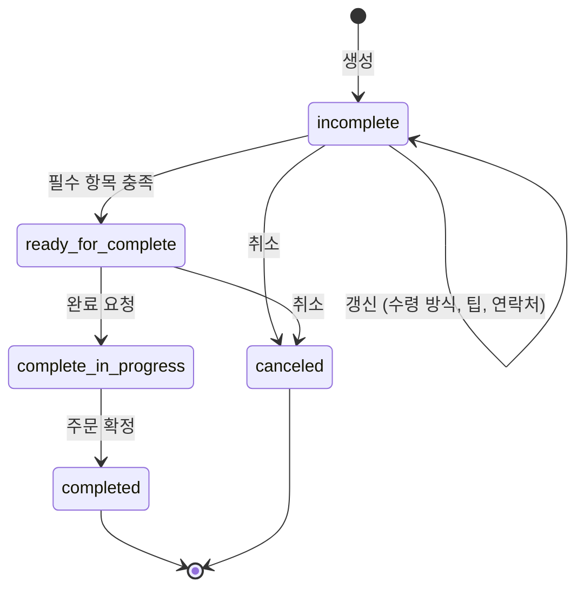

## 초록

OpenAI가 ChatGPT 월렛을 출시했다. dots 에이전트가 사용자 카드로 구매를 완료할 수 있게 됐지만, 매 결제마다 Face ID로 확인을 받아야 한다. 상시 위임 승인은 아니다[^s01][^s02]. Universal Commerce Protocol(UCP)은 음식 주문 기능을 "출시 예정" 배너에서 끌어내려 버전이 붙은 스펙으로 공개했다. 이 브리핑이 UCP 쪽에서 아무것도 머지되지 않은 걸 네 번 연속 확인한 끝에 나온 변화다[^s03][^s04][^s05]. 그리고 mppx는 72시간 사이에 리모트 서명, 템포 ID, 월드 ID라는 세 개의 개별 아이덴티티 확장을 하나의 인터페이스로 수렴시켰다[^s06][^s07][^s08]. 셋 다 AP2 백서급의 프로토콜 발표는 아니다. 각각은 기존 시스템이 에이전트의 결제 완료나 신원 증명을 이제 직접 설계할 만한 일로 판단했다는 뜻이다.

## 서론

이번 호는 **2026-11-11부터 2026-11-14까지**를 다룬다. 결제 레일 전반의 배경은 사이트의 [에이전트 커머스 프로토콜 비교](../agent-commerce-protocol/)에, UCP의 설계는 [에이전트 결제를 위한 구글의 UCP](../google-ucp-agent-payments/)에, mppx의 아이덴티티 작업은 [MPP: 스펙과 결제 흐름](../mpp-spec-and-payment-flows/)에 정리돼 있다. 전호(2026-11-13)는 x402로 가격을 매긴 Brave의 검색 API, GA에 도달한 구글의 Organization Policy MCP 서버, mppx의 통화 처리 수정을 다뤘다. 카드 네트워크는 이번 창에서도 조용했다. 마스터카드, 비자, AP2 소식 없이 다섯 번째 호가 지나갔다.

## 무엇이 움직였나

### ChatGPT 월렛, 에이전트에 카드를 쥐여주되 탭은 사람이 한다

OpenAI는 2026-11-13 ChatGPT Work, Codex, dots에 있는 에이전트를 위해 ChatGPT 월렛을 출시했다[^s02]. 사용자가 미국에서 발행된 비자, 마스터카드, 아멕스 카드를 한 번 등록하면 에이전트가 장바구니를 구성해 품목과 총액, 사용할 카드를 사용자에게 보여주고, 사용자는 Face ID나 지문으로 승인한다. 이 승인은 거래 기록을 남긴다[^s01]. 결제는 토큰을 통해 이뤄져 카드 번호 자체는 에이전트나 가맹점에 노출되지 않고, 기존 카드 보호(적립, 분쟁 처리)도 그대로 유지된다[^s01].

눈에 띄는 설계 선택은 이것이다. 모든 구매에 여전히 사람의 탭이 필요하다. OpenAI는 사용자가 예산을 미리 승인해두면 에이전트가 매번 확인 없이 그 안에서 움직이게 하는 지출 한도와 카테고리·시간대 규칙을 계획 중이라고 밝혔다[^s01]_(벤더 발표)_. 다만 이번에 나온 건 그게 아니다. 출시된 건 건별 승인이고, 이는 이 분야가 추적해온 두 아키텍처 중 더 보수적인 쪽이다(다른 하나는 AP2와 UCP 자체의 AP2-Mandates 확장이 지향하는 상시 위임 모델이다). 롤아웃 범위도 좁다. 미국 ChatGPT Pro 구독자 중 일부, 18세 이상으로 한정된다[^s01]. 가맹점 지원은 OpenAI가 좌우할 수 있는 영역이 아니다. TechCrunch는 일부 가맹점이 AI 에이전트의 구매를 원천 차단하고 있으며, 아마존이 가장 큰 사례라고 전한다[^s01]_(단일 매체 확인)_. 쓸 곳이 없는 월렛은 베타일 뿐 제품이 아니다. 앞으로 몇 주간 어떤 가맹점이 참여하는지가 월렛 자체의 작동 방식보다 지켜볼 지점이다.

### UCP, 첫 실사용 기능을 내놓다: Food Checkout이 "출시 예정"에서 벗어나다

2026-11-11, UCP 문서 사이트는 "음식 기능 출시 예정" 배너를 내리고 Food Checkout 기능(`dev.ucp.food.checkout`, 확장으로 `dev.ucp.food.fulfillment`와 `dev.ucp.food.tip`)을 스키마로 검증된 예제와 시작 링크가 달린 작동하는 스펙으로 공개했다[^s03]. 바탕이 된 스키마 작업은 전날 머지됐다[^s05]. 이 브리핑이 "아무것도 머지되지 않는다"는 공백을 네 호 연속 확인해온 UCP에서, 초안 단계를 벗어나 문서화까지 간 첫 기능이다. 지난 호가 미해결로 남긴 질문, 즉 UCP의 열려 있는 기능 작업이 실제로 들어갈지에 대한 답이기도 하다.

체크아웃 자체는 작은 상태 머신이다. 생성한 뒤 수령 방식과 팁을 갱신하고, 완료하거나 취소하며, 기본 만료 시간은 6시간이다[^s04].

*UCP Food Checkout 기능에서 에이전트가 거치는 상태 전이. 스펙의 체크아웃 생명주기를 따른다[^s04].*

스펙은 에이전트가 단독으로 할 수 있는 일에 선을 긋는다. "AP2 Mandates 확장이 지원되지 않는 한, 체크아웃은 신뢰할 수 있는 UI를 통해 구매자가 직접 마무리해야 한다"고 명시하며, 사업자는 여전히 가맹점 책임을 진다[^s04]. 에이전트는 메뉴를 훑고 장바구니를 구성해 수령 방식과 팁까지 끝에서 끝까지 처리할 수 있지만, 기본 스펙에서 실제 결제 승인은 결국 사람을 거친다. ChatGPT 월렛이 택한 것과 같은 구조다. 도어대시, 스퀘어, 토스트, 우버이츠가 "업계 선도 기업과 공동 개발"이라는 로고로 기능 홈페이지에 등장하지만, 넷 중 어디도 실사용이 확인되지는 않았다. 공동 개발 참여가 상용 사용을 뜻하지는 않기 때문이다[^s03].

### mppx, 세 개의 아이덴티티 확장을 하나의 서명 인터페이스로 모으다

2026-11-12부터 2026-11-13 사이 mppx에 세 개의 PR이 머지됐다. Web Bot Auth, TAP, 어테스테이션 서명을 위한 리모트 서명자 인터페이스[^s06], 결제 전 사용자의 템포 계정과 컴플라이언스 상태를 검증하는 템포 ID 확장[^s07], 검증된 인간임을 증명하도록 서버가 요구할 수 있게 하는 월드 ID 확장이다. 월드 ID는 대상별로 해시된 식별자를 써서 두 서버가 같은 사람을 서로 연결해 알아볼 수 없게 한다[^s08]. 이 중 리모트 서명자 PR이 나머지를 다시 짜는 역할을 한다. 로컬 키 쌍이든 클라우드 KMS, HSM, Turnkey가 뒷받침하는 서명자 객체든 하나로 받는 `SigningKey` 타입을 정의했고, Web Bot Auth, TAP, 어테스테이션, 이제 월드 ID 발급자까지 기존 아이덴티티 프로버 전부가 평문 개인키 대신 이 타입을 쓰게 됐다[^s06].

이건 하위 호환을 깨는 변경이고, mppx 자체의 `!` 표기로 명시돼 있다. 평문 개인키를 넘기던 모든 호출부가 키 쌍이나 서명자 객체를 넘기도록 마이그레이션해야 한다[^s06]. 이 변화의 성과는, 이 브리핑이 지난 세 주간 디스패치 우회 수정이나 통화 타입 통합처럼 조각조각 다뤄온 mppx의 아이덴티티 작업이 이제 하나의 공통 뼈대를 갖췄다는 점이다. 서버가 어떤 아이덴티티 방식(봇 인증, 결제자 컴플라이언스 심사, 인간 증명 중 무엇이든)을 고르든 서명 키는 코드가 아니라 KMS에 둘 수 있고, 검증 로직은 방식마다 바뀌지 않는다. 한 창 안에서 세 개의 서로 다른 확장이 하나의 인터페이스로 수렴한 건 그중 하나만 봤을 때보다 더 큰 통합이다.

## 왜 중요한가

소비자용 제품, 프로토콜 스펙, SDK 내부 구조라는 세 개의 다른 층위가 이번 창에서 각각 에이전트 결제나 아이덴티티 쪽으로 움직였고, 그중 둘은 똑같은 설계 결론에 도달했다. 에이전트가 구매를 완전히 준비할 수는 있어도 결제는 결국 사람이 탭해야 한다는 것이다. ChatGPT 월렛은 건별로, UCP의 기본 Food Checkout 스펙은 AP2 Mandates 확장이 없는 한 그렇게 요구한다. 이 일치는 "에이전트 커머스"의 업계 기본값이 지금은 에이전트가 준비하고 사람이 승인하는 쪽이라는 걸 보여준다. 상시 위임, 즉 AP2의 만다트 모델이나 OpenAI가 예고한 지출 한도는 아직 구축 중일 뿐 어느 시스템도 실제로 내놓지는 않았다. mppx의 아이덴티티 통합은 그 한 층 아래에 있다. 어떤 시스템이 결국 상시 권한을 부여하게 되든, mppx가 그 경로에 실제로 들어가는지와 무관하게, 지금 막 만들어진 것과 같은 이동 가능하고 KMS 기반인 서명 키가 필요할 것이다.

## 지켜볼 신호

- 초기 제한된 롤아웃을 넘어 어떤 가맹점이 실제로 ChatGPT 월렛을 통합하는지, 아마존의 차단이 유지되는지 혹은 풀리는지
- OpenAI가 예고한 지출 한도·카테고리 규칙: 실제로 나오는가, 나온다면 건별 승인에서 상시 위임으로 넘어가는 전환점인가
- 도어대시, 스퀘어, 토스트, 우버이츠의 UCP Food Checkout 실사용. 공동 개발 표기를 넘어서는 증거가 나오는지
- 카드 네트워크나 AP2 소식 없이 여섯 호째가 지나간다면, 그 침묵 자체가 이야기가 된다

## 한계

OpenAI의 ChatGPT 월렛 발표 글 원문은 이번 수집 과정에서 가져오지 못해 오류가 반환됐다. 에이전트 범위(ChatGPT Work, Codex, dots) 관련 서술은 본문 전체가 아니라 글의 제목과 RSS 요약에 의존했다. 같은 출시를 다룬 The Verge의 독립 보도는 전혀 가져오지 못해, 롤아웃과 가맹점 차단 관련 세부 사항에서 TechCrunch가 유일한 독립 매체 보도로 남았다. UCP의 Food Checkout 출시를 다룬 업계 매체 보도는 없었다. 이 항목은 전적으로 UCP 자체 저장소와 사이트에 의존하며, 이는 무엇이 나왔는지는 보여주지만 프로젝트 외부에서 실제로 채택했는지는 보여주지 않는다.
