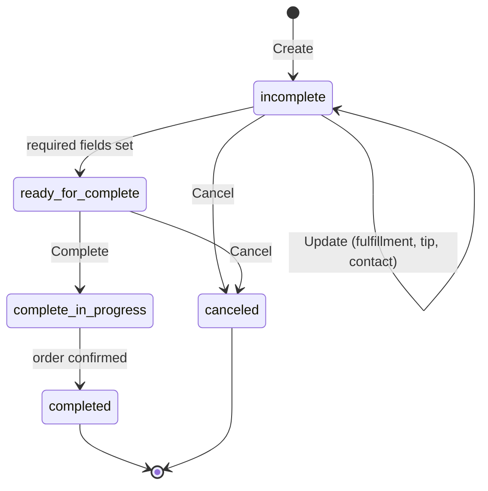

## Abstract

OpenAI shipped ChatGPT Wallet, letting its dots agents complete a purchase on a user's card with a Face-ID tap, not a standing authorization[^s01][^s02]. The Universal Commerce Protocol took its food-ordering capability out of "coming soon" and into a versioned spec, after four straight editions of this brief finding nothing merged there[^s03][^s04][^s05]. And mppx converged three separate identity extensions (remote signing, Tempo ID, World ID) on one interface in a single 72-hour window[^s06][^s07][^s08]. None of the three is a protocol launch in the AP2-whitepaper sense; each is an existing system deciding that an agent completing a purchase, or proving who it's acting for, is now worth building for directly.

## Introduction

This edition covers **2026-11-11 through 2026-11-14**. Background on the payment-rail landscape lives in the site's [agent commerce protocol comparison](../agent-commerce-protocol/); UCP's broader design is covered in [Google's UCP for agent payments](../google-ucp-agent-payments/), and mppx's identity work follows up on [MPP: spec and payment flows](../mpp-spec-and-payment-flows/). The previous edition, 2026-11-13, covered Brave's x402 search pricing, Google's Organization Policy MCP server reaching GA, and an earlier mppx currency-handling fix. Card networks remained quiet again this window, the fifth straight edition without a Mastercard, Visa, or AP2 item.

## What moved

### ChatGPT Wallet gives OpenAI's agents a card to spend, with a human still tapping to confirm

OpenAI launched ChatGPT Wallet on 2026-11-13 for agents in ChatGPT Work, Codex, and dots[^s02]. A user adds a U.S.-issued Visa, Mastercard, or Amex card once; the agent then builds a cart and hands it to the user for review (items, total, which card), and the user approves with Face ID or a fingerprint, which creates a transaction record[^s01]. The card is charged through a payment token, so neither the agent nor the merchant sees the actual card number, and existing card protections (rewards, disputes) carry over unchanged[^s01].

The design choice worth noting: every purchase still needs a human tap. OpenAI's own framing describes future spending limits and category or time-window rules that would let a user pre-approve a budget and let the agent act inside it without a tap each time[^s01] _(vendor-stated)_, but that is not what shipped. What shipped is approval-per-transaction, the more conservative of the two architectures this beat has been tracking (the other being a standing mandate, closer to what AP2 and UCP's own AP2-Mandates extension aim for). The rollout itself is narrow: a limited number of U.S. ChatGPT Pro subscribers, 18 and over[^s01]. Retailer support is not OpenAI's to grant. TechCrunch reports some retailers block AI-agent purchases outright, with Amazon named as the largest holdout[^s01]_(single outlet confirmed)_. A wallet with nowhere to spend is a beta, not a product; which retailers opt in over the next few weeks is the thing to watch here, not the wallet mechanics themselves.

### UCP ships its first live capability: Food Checkout comes out of "coming soon"

On 2026-11-11, UCP's documentation site dropped the "Food coming soon" banner and published the Food Checkout capability (`dev.ucp.food.checkout`, with `dev.ucp.food.fulfillment` and `dev.ucp.food.tip` as extensions) as a working spec with a schema-validated example and a Get Started link[^s03]. The underlying schema work had merged the day before[^s05]. This is the first UCP capability this brief has seen go from draft to documented in the four editions it has tracked a standing "nothing merged" gap, and it directly answers a signal the prior brief flagged as unresolved: whether any of UCP's open feature work would actually land.

The checkout itself is a small state machine — create, update fulfillment and tip, then complete or cancel, with a six-hour default expiry[^s04]:

*State transitions an agent drives through UCP's Food Checkout capability, per the spec's checkout lifecycle[^s04].*

The spec caps what an agent can do on its own: "unless the AP2 Mandates extension is supported, the checkout must be finalized manually by the buyer through a trusted UI," and the business stays merchant of record[^s04]. So an agent can browse a menu, build a cart, and set fulfillment and tip end to end — but the base spec still routes the actual payment approval through a human, the same shape OpenAI chose for ChatGPT Wallet. DoorDash, Square, Toast, and Uber Eats appear as "co-developed by industry leaders" logos on the capability's homepage; none of the four is confirmed live on it, since co-development is not the same claim as production use[^s03].

### mppx converges three identity extensions on one signing interface

Three PRs merged into mppx between 2026-11-12 and 2026-11-13: a remote-signer interface for Web Bot Auth, TAP, and attestation signing[^s06]; a Tempo ID extension that verifies a payer's Tempo account and compliance status before settlement[^s07]; and a World ID extension that lets a server require proof of a verified human, with subjects pairwise-hashed per audience so two servers can't link the same person[^s08]. The remote-signer PR is the one that reshapes the others: it defines a single `SigningKey` type that is either a local key pair or a signer object backed by a cloud KMS, an HSM, or Turnkey, and every existing identity prover (Web Bot Auth, TAP, attestations, now World ID's issuer) takes that one type instead of a bare private key[^s06].

That's a breaking change, flagged with mppx's own `!` convention, and it migrates every caller that passed a raw private key to pass a key pair or signer instead[^s06]. The payoff is that mppx's identity story, which this brief has covered piecemeal for three weeks as dispatch-bypass fixes and currency-type unification, now has a shared backbone: whichever identity method a server picks (bot authentication, payer compliance screening, proof-of-humanity), the signing key can live in a KMS instead of in code, and the verification logic doesn't change per method. Three separate extensions converging on one interface in one window is more consolidation than any single one of them would suggest alone.

## Why it matters

Three different layers (a consumer product, a protocol spec, and an SDK's internals) each moved on agent payments or agent identity this window, and two of them landed on the identical design decision: an agent can assemble a purchase completely, but a human still has to tap to pay. ChatGPT Wallet requires it per transaction; UCP's base Food Checkout spec requires it unless AP2's Mandates extension is layered in. That convergence suggests the industry default for "agent commerce" right now is agent-prepares, human-approves. Standing delegated authority, AP2's mandate model or OpenAI's planned spending limits, is still being built toward, not something either system has shipped. mppx's identity consolidation sits one layer down from both: whichever system eventually grants standing authority will need exactly the kind of portable, KMS-backed signing key mppx just built, whether or not mppx itself ends up in the path.

## Signals to watch

- Which retailers actually integrate ChatGPT Wallet beyond the initial limited rollout, and whether Amazon's block holds or softens.
- OpenAI's planned spending-limit and category-rule controls: do they ship, and do they mark the shift from per-transaction approval to standing delegation?
- Production use of UCP's Food Checkout capability by DoorDash, Square, Toast, or Uber Eats, beyond the co-development credit currently shown.
- A sixth straight edition without a card-network or AP2 item would make that silence itself the story.

## Limitations

OpenAI's own ChatGPT Wallet post returned an error to this run's fetch attempt, so the agent-surface claim (ChatGPT Work, Codex, dots) rests on the post's title and RSS summary rather than its full body. The Verge's independent coverage of the same launch could not be fetched at all, leaving TechCrunch as the brief's only independently-reported account of the rollout and retailer-blocking details. No trade press covered UCP's Food Checkout launch; that item rests entirely on UCP's own repository and site, which documents what shipped but not whether anyone outside the project has adopted it.
