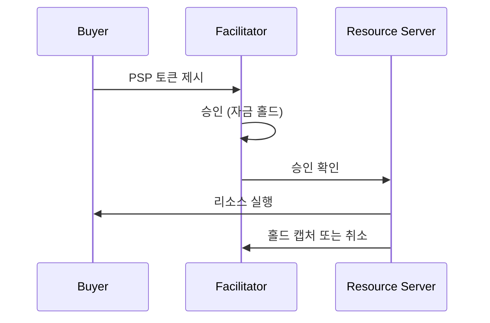

## 초록

이번 주기 x402는 카드 네트워크 바인딩을 처음으로 내놓았다. 자금이 충전된 크립토 지갑이 없는 구매자도 PSP 토큰으로 결제할 수 있도록, 리소스 실행 전에 승인을 걸고 실행 후 캡처하거나 취소하는 구조다[^s01]. 아직 `main`이 아니라 피처 브랜치에 머물러 있지만[^s02], 카드 네트워크와 PSP가 에이전트 결제 비트에서 침묵해 온 여러 주기 끝에 나온 첫 카드 관련 항목이다[^s01]. 결제와는 별도로 LangChain은 30억 달러 밸류에이션으로 3억 달러 시리즈 C를 유치했고[^s03], Cloudflare는 에이전트가 올라탈 수 있는 무상태 브라우저 엔진 Kitesurf를 오픈소스로 공개했다[^s04] — 결제 레이어가 조금씩 움직이는 동안 자본과 인프라는 프레임워크 레이어에서 움직이고 있다.

## 서론

이번 호는 **2026-11-12부터 2026-11-15까지**를 다룬다. 결제 레일 지형에 대한 배경은 사이트의 [에이전트 커머스 프로토콜 비교](../agent-commerce-protocol/)에, x402의 전반적인 설계는 [x402와 에이전틱 커머스](../x402-agentic-commerce/)에 실려 있다. 전편(2026-11-14)은 OpenAI의 ChatGPT Wallet 출시, UCP의 Food Checkout 기능 공개, mppx의 아이덴티티 서명 통합을 다루며 Mastercard·Visa·AP2 관련 항목이 다섯 호 연속 없었다고 지적했다. 카드 네트워크 쪽에서는 이번 창에도 그 침묵이 이어졌지만, 별도 레일인 x402는 카드 수용을 향해 처음으로 눈에 보이는 발을 뗐다.

## 이번 주 움직임

### x402, 지갑 기반 프로토콜에 카드가 결제할 길을 그리다

2026-11-12, "spec(auth-capture): propose card network binding"이라는 제목의 PR이 x402-foundation/x402에 머지됐다 — `main`이 아니라 전용 피처 브랜치 `feat/auth-capture-card`에[^s01]. 이 제안은 x402의 기존 auth-capture 흐름을 확장해, 충전된 크립토 지갑이 없는 구매자도 결제할 수 있게 한다. 클라이언트가 불투명한 PSP 토큰을 제시하면 facilitator가 리소스 실행 전에 홀드를 승인하고, 리소스 서버가 실행 후 그 홀드를 캡처하거나 취소한다[^s01].

*x402 #3707이 제안하는 auth-capture-card 흐름: 리소스 실행 전에 홀드를 걸고, 실행 후 정산한다[^s01].*

범위는 의도적으로 좁다. 위임된 권한, 카드 소액결제, 추가 인증 단계, 정산 후 이벤트는 모두 후속 제안으로 미뤄졌고, 스펙은 특정 카드 네트워크를 지목하지 않은 채 범용 PSP 토큰만 언급한다[^s01]. 같은 날 열린 또 다른 PR #4241은 같은 내용을 피처 브랜치에서 `main` 쪽으로 재조준한다[^s02]. 이 브리프 작성 시점까지도 그것은 여전히 초안이다. 정직하게 읽으면: 메인테이너 한 명이 온체인 지갑을 중심으로 만들어진 프로토콜에 카드를 어떻게 끼워 넣을 수 있는지 구체적으로 적어두었을 뿐, 프로젝트가 그것을 받아들이기로 결정한 것은 아니다. 그래도 카드 네트워크 쪽에서 지난 다섯 호 내내 아무것도 나오지 않은 것보다는 한 걸음 더 나간 셈이다 — Visa와 Mastercard 자체 채널에서는 이번 창에도 아무 소식이 없었다.

### LangChain, 30억 달러 밸류에이션으로 3억 달러 시리즈 C 유치

LangChain은 2026-11-13 CapitalG 주도로 3억 달러 시리즈 C를 마감했고, 밸류에이션은 지난해 1억 2,500만 달러 라운드 당시의 12억 5,000만 달러보다 약 2.4배 높은 30억 달러다[^s03]. LangChain 프레임워크, 상태 기반 오케스트레이션을 담당하는 LangGraph, 상용 플랫폼 LangSmith로 이어지는 이 회사의 스택은 최종 사용자가 보는 제품이 아니라 다른 에이전트 개발사들이 의존하는 인프라다. 그래서 이 숫자는 특정 에이전트 애플리케이션이 아니라 프레임워크 레이어 자체에 건 베팅이다. 수치는 회사 자체 발표에 근거한 것으로, 이번 창에서는 독립적인 재무 공시로 뒷받침되지 않았다.

### Cloudflare, 에이전트용 브라우저 Kitesurf를 오픈소스로 공개

Cloudflare는 2026-11-13 Kitesurf 코드를 Apache 2.0으로 공개했다. 이는 8월 엔진 출시 당시, 9월 WebMCP 지원 추가 당시 각각 내놓았던 약속을 지킨 것이다[^s04]. Kitesurf는 Chromium 컨테이너 없이 Workers 위에서 HTML을 파싱하고 CSS를 적용하고 JavaScript를 실행하며 스크린샷을 렌더링하고, Chrome DevTools Protocol을 지원해 기존 Puppeteer 코드를 그대로 겨냥할 수 있다[^s04]. Cloudflare 측 설명으로는 이 방식이 세션마다 완전한 Chromium을 띄우는 것보다 CPU와 메모리를 덜 쓴다고 하지만, 이는 그 제품을 만든 회사의 주장일 뿐 아직 독립적으로 측정된 값은 아니며, 공개 글 스스로도 엔진을 "한창 개발 중"이라고 못 박았다.

## 의미

세 항목 중 어느 것도 서로 조율된 움직임은 아니지만, 각각 에이전트가 혼자서 할 수 있는 일을 가로막던 장벽을 조금씩 다른 방식으로 낮췄다. x402의 카드 제안은 지갑 요건을 겨냥한다 — 크립토가 없는 에이전트(또는 그 뒤의 사람)는 초안 단계에서조차 이 레일에 올라탈 방법이 지금까지 없었다. LangChain의 라운드는 애초에 이런 에이전트들을 만드는 레이어로 흘러드는 자본이다. Kitesurf는 사이트가 일부러 열어준 API를 거치지 않고 에이전트가 웹을 직접 돌아다니는 데 드는 컴퓨팅 비용을 겨냥한다. 결제, 자본, 브라우징 접근은 자율 에이전트가 사람의 개입 없이 할 수 있는 일을 제한하는 서로 다른 세 가지 제약이며, 이번 창에서 셋 다 조금씩 움직였다 — 그중 결제 쪽 움직임이 가장 잠정적인데, 아직 자기 프로젝트의 main 브랜치에도 올라가지 못했기 때문이다.

## 지켜볼 신호

- PR #4241이 auth-capture-card를 `main`에 머지하는지, 그리고 그 이후 특정 카드 네트워크나 PSP가 이 제안에 반응하는지.
- Visa·Mastercard·AP2 관련 날짜가 찍힌 항목이 일곱 호 연속 없는지 — 그렇다면 그 침묵 자체가 이 브리프가 전할 이야기가 된다.
- LangChain의 30억 달러 수치를 회사 자체 발표 외에 독립적으로 확인해주는 보도가 나오는지.
- Kitesurf가 Cloudflare 자체 레퍼런스 구현에 머무는지, 이름 있는 에이전트 제품에 실제로 쓰이는지.

## 한계

PR #3707 설명이 언급한 "다섯 가지 미결 항목"은 직접 확인하지 못했다 — 이번 브리프의 시도에서 GitHub의 diff 보기가 파일 내용을 불러오지 못해, PR 설명과 커밋 메시지까지만 반영했고 스펙 본문은 반영하지 못했다. x402 카드 바인딩 제안을 다룬 전문 매체 보도는 아직 없어 전적으로 프로젝트 자체 GitHub 기록에 의존했다. 전편에서 지켜볼 신호로 꼽았던 ChatGPT Wallet 리테일러 채택 현황은 이번 창에서 새로운 보도가 없어 이번 호에는 다루지 않았다.
