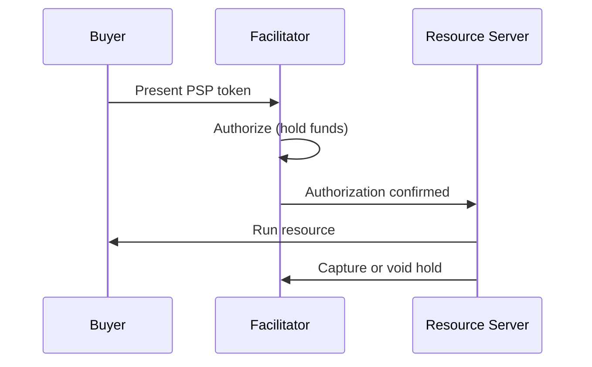

## Abstract

x402 proposed its first card-network binding this window: a buyer without a funded crypto wallet could pay over x402 using a PSP token, authorized before a resource runs and captured or voided after[^s01]. It is still sitting on a feature branch, not merged to `main`[^s02], but it is the first card-adjacent item this brief has logged after a run of editions that found card networks and PSPs silent on the agent-payments beat[^s01]. Away from payments, LangChain raised a $300 million Series C at a $3 billion valuation[^s03], and Cloudflare open-sourced Kitesurf, a stateless browser engine built for agents to run on[^s04] — capital and infrastructure moving at the framework layer while the payment layer inches forward.

## Introduction

This edition covers **2026-11-12 through 2026-11-15**. Background on the payment-rail landscape lives in the site's [agent commerce protocol comparison](../agent-commerce-protocol/); x402's broader design is covered in [x402 and agentic commerce](../x402-agentic-commerce/). The previous edition, 2026-11-14, covered OpenAI's ChatGPT Wallet launch, UCP's Food Checkout capability shipping, and mppx's identity-signing consolidation, and noted five straight editions without a Mastercard, Visa, or AP2 item. That streak continues through this window on the card-network side proper — but x402, a separate rail, took its first visible step toward card acceptance.

## What moved

### x402 drafts a path for cards to pay over a wallet-based protocol

On 2026-11-12, a PR titled "spec(auth-capture): propose card network binding" merged into x402-foundation/x402 — not into `main`, but into a dedicated feature branch, `feat/auth-capture-card`[^s01]. The proposal extends x402's existing auth-capture flow so a buyer without a funded crypto wallet can still pay: the client presents an opaque PSP token, a facilitator authorizes a hold before the resource runs, and the resource server captures or voids that hold afterward[^s01].

*The auth-capture-card flow x402's #3707 proposes: a hold placed before the resource runs, settled after[^s01].*

The scope is deliberately narrow. Delegated authority, card micropayments, step-up challenges, and post-settlement events are all deferred to follow-up proposals, and the spec names no specific card network — it refers only to a generic PSP token[^s01]. A second PR opened the same day, #4241, re-targets the same content from the feature branch toward `main`[^s02]; as of this brief, it is still a draft. So the honest read is: a maintainer wrote down, in detail, how cards could plug into a protocol built around on-chain wallets, and the project has not yet decided to adopt it. That is still more than the five prior editions found from the card-network side of this beat, where Visa and Mastercard's own channels produced nothing in the window.

### LangChain raises a $300M Series C at a $3B valuation

LangChain closed a $300 million Series C led by CapitalG on 2026-11-13, roughly 2.4x the $1.25 billion valuation it carried after last year's $125 million round[^s03]. The company's stack — the LangChain framework, LangGraph for stateful orchestration, and the commercial LangSmith platform — is infrastructure other agent builders depend on rather than a product end users see, so the number is a bet on the framework layer itself, not on any single agent application. The figure comes from the company's own announcement; no independent financial disclosure corroborates it in this window.

### Cloudflare open-sources Kitesurf, its browser for agents

Cloudflare released Kitesurf's code under Apache 2.0 on 2026-11-13, fulfilling a commitment made when the engine launched in August and gained WebMCP support in September[^s04]. Kitesurf parses HTML, applies CSS, executes JavaScript, and renders screenshots entirely on Workers, without a Chromium container, and speaks the Chrome DevTools Protocol so existing Puppeteer code can target it[^s04]. Cloudflare's own framing is that an agent browsing the web costs less CPU and memory this way than it would running full Chromium per session — a claim from the vendor building the product, not yet an independently measured one, and one the post itself qualifies by calling the engine "under heavy development."

## Why it matters

None of these three is a coordinated move, but each lowers a different barrier to agents acting on their own. x402's card proposal targets the wallet requirement: an agent (or the person behind it) without crypto has had no way onto that particular rail until now, even in draft form. LangChain's round is capital flowing into the layer that builds the agents doing any of this in the first place. Kitesurf targets the compute cost of letting an agent browse the open web directly, rather than through an API a site chose to expose. Payment, capital, and browsing access are three separate constraints on what an autonomous agent can do unassisted, and this window moved each one slightly — the payment move being the most provisional of the three, since it has not even landed in its own project's main branch yet.

## Signals to watch

- Whether PR #4241 merges auth-capture-card into `main`, and whether any named card network or PSP engages with the proposal once it does.
- A seventh straight edition without a dated Visa, Mastercard, or AP2 item, which would make the silence itself the story this brief has to tell.
- Independent confirmation of LangChain's $3B figure beyond the company's own announcement.
- Whether Kitesurf gets used by a named agent product, versus remaining a Cloudflare-only reference implementation.

## Limitations

The x402 spec file's "five open items," referenced in PR #3707's description, could not be read directly — GitHub's diff view did not load the file content for this brief's fetch attempts, so this edition reports the PR description and commit message only, not the spec text itself. No trade press has covered the x402 card-binding proposal; it rests entirely on the project's own GitHub history. ChatGPT Wallet retailer adoption, flagged as a signal to watch in the prior edition, produced no new reporting in this window and is not covered here.
