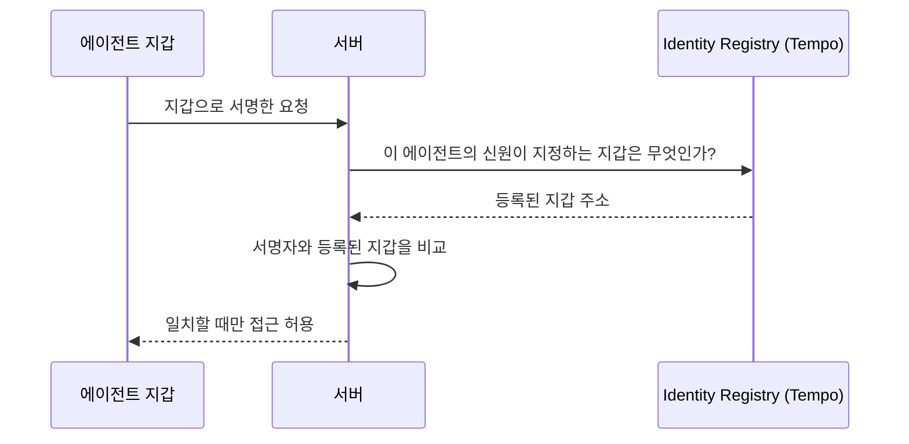

## 초록

이번 주 이 분야에서 가장 구체적으로 움직인 지점은 보도자료가 아니라 어떤 프로젝트의 체인지로그였다. Tempo·Stripe가 뒷받침하는 Machine Payments Protocol의 SDK인 wevm의 mppx는 2026년 11월 16일 ERC-8004 신원 프로바이더와 x402 sign-in-with-x 지원을 함께 출시했다. 문서로만 존재하던 결제 확장 기능이 서버가 당장 실행할 수 있는 코드로 바뀐 것이다[^s01][^s02]. 하루 뒤 Daydream은 결제 수단을 전혀 밝히지 않은 채 원클릭 체크아웃으로 실제 구매를 끝내는 스타일리스트 에이전트를 출시했다[^s04]. 그 사이 에이전트 툴링 스타트업 두 곳이 투자를 받았다[^s05][^s06]. 함께 놓고 보면, 이 분야가 추적하는 신원 계층과 커머스 계층은 서로 다른 트랙에서 각자 진행되고 있고, 이번 주 둘을 잇는 연결고리는 없다.

## 서론

이번 호는 **2026년 11월 15일부터 11월 18일까지**를 다룬다. 결제 레일 전반의 배경은 사이트에 실린 [에이전트 커머스 프로토콜 비교](../agent-commerce-protocol/), [Tempo MPP와 AI 에이전트 결제](../tempo-mpp-ai-agent-payments/), [x402와 에이전틱 커머스](../x402-agentic-commerce/)에서 다뤘고, 신원·검증 배경은 [에이전트 신원과 평판 레지스트리](../agent-identity-reputation-registry/)와 [ERC-8126](../erc-8126-ai-agent-verification/)에서 다뤘다. 직전 호(11월 17일)는 캘리포니아주의 OpenAI 제소와 구글 위협 인텔리전스팀의 완전 자율 공격 체인 보고서를 다뤘고, Visa·Mastercard·AP2 쪽에서 날짜가 찍힌 소식이 나오지 않은 지 여섯 호째라고 짚었다. 이번 주에도 카드사나 PSP 발 소식이 없어 이제 여덟 호 연속이다. 대신 이번 호의 소식은 SDK와 제품 계층에서 나왔다: 에이전트가 자신이 누구인지 증명하는 방식, 그리고 에이전트가 실제로 구매에 나설 때 벌어지는 일.

## 이번 주 동향

### mppx, ERC-8004 신원 프로바이더와 x402 sign-in-with-x 지원 출시

Wevm이 Tempo Labs와 함께 Machine Payments Protocol용으로 공동 관리하는 TypeScript SDK mppx는 x402도 함께 지원하는데, 11월 16일 두 건의 릴리스를 냈다[^s01][^s02]. 첫 번째인 0.20.0은 `mppx/extensions/identity/erc8004`를 추가했다. ERC-8004 에이전트 신원 프로바이더로, 클라이언트가 각 요청에 에이전트 지갑으로 서명하면 서버의 검증기는 그 서명자가 온체인 Identity Registry(기본값은 Tempo 메인넷)가 지정한 지갑과 실제로 일치하는지 요구한다[^s01]. 두 번째인 0.20.1은 x402 sign-in-with-x 지원과 신원 증명(attestation) 발급기를 추가했다. 402 챌린지에 서명한 지갑은 그 서명이 승인(grant)되면 결제 없이 자원을 받을 수 있고, 새로 추가된 `Attestation.Issuer`는 이메일, GitHub 계정, X 계정처럼 서로 연결된 여러 계정을 하나의 서명된 신원으로 묶을 수 있다[^s02].

*mppx 0.20.0의 ERC-8004 신원 프로바이더가 접근을 허용하기 전에 확인하는 것: 서명이 유효하다는 사실만으로는 부족하고, 요청에 서명한 주체가 온체인 레지스트리가 그 에이전트의 지갑으로 지정한 주소와 일치해야 한다[^s01].*

sign-in-with-x 확장 자체는 새로운 것이 아니다. `@x402/extensions`에 이미 문서화돼 있었고, 11월 10일 등록된 버그(`#4206`)는 바로 그 확장이 문서로 설명하는 인증 전용 라우트를 핵심 스키마가 거부하는 문제를 지적하고 있었다[^s03]. 이번 주 바뀐 것은, 유지보수되는 SDK가 참조 구현의 알려진 결함을 그대로 둔 채 확장을 스펙으로만 남겨두지 않고 실제로 쓸 수 있는 클라이언트·서버 코드를 출시했다는 점이다. 결제 계층에서의 신원 검증을 어떤 파실리테이터나 PSP가 채택을 선언하기도 전에 구현해 출시하는 이런 움직임은, 보통 카드사나 표준화 기구가 입을 열기 몇 호 앞서 일어난다. _(벤더 발표 기준)_ — 두 확장 기능 모두 아직 파실리테이터나 가맹점의 채택 신호는 나오지 않았다.

### Daydream, 결제 수단을 밝히지 않은 쇼핑 에이전트로 자체 결제까지

Stitch Fix 전 COO 줄리 번스틴이 세운 패션 검색 스타트업 Daydream은 11월 17일 "Daydream Agent"를 출시했다. 사용자의 핏과 예산을 기억하고, 업로드한 사진에 저장한 옷을 가상으로 입혀보고, 1만 개가 넘는 브랜드 카탈로그에서 실시간 가격을 끌어오는 스타일리스트다[^s04]. 이 분야에 실제로 의미 있는 기능은 스타일리스트라는 홍보 포인트보다 좁다. "마음에 드는 상품을 찾으면 에이전트가 원클릭 체크아웃으로 구매를 완료할 수 있다"[^s04]. 이전 챗봇은 옷을 추천만 할 수 있었지만, 이번 버전은 실제로 결제까지 한다.

그런데 발표 어디에도 결제 레일 이름이 없다. 카드 온파일 연동도, 결제대행사도, ACP·UCP·x402 언급도 보도 어디에서도 찾을 수 없다. 이 침묵 자체가 기록해둘 만하다. 수천 개 가맹점을 상대로 실제 구매를 끝내는 소비자용 에이전트가 이번 주 등장했는데, 그 체크아웃이 어떤 배관을 타는지는 이 분야가 지금 전혀 들여다볼 수 없고, 바로 아래 계층에서 진행 중인 mppx의 공개 신원 작업과도 눈에 보이는 연결점이 없다.

### 에이전트 툴링 투자 두 건: Model ML과 Pedestal AI

버티컬 에이전트 제품에 대한 투자는 계속됐다. Model ML은 은행원의 재무 모델과 프레젠테이션을 자동으로 갱신하는 에이전트로 15억 달러 밸류에이션에 시리즈 B 2억 5천만 달러를 유치했고, 오픈소스 모델로 돌려서 프런티어 모델 대비 비용이 약 2%라고 주장한다. 다만 이는 회사 측 주장일 뿐 독립적으로 검증되지는 않았다[^s05]. Pedestal AI는 공급망 에이전트로 시드 470만 달러를 유치했는데, 공개된 사례는 하나뿐이다. 배송 전 고객에게 전화해 특이사항을 미리 받아두는 에이전트로, 이름을 밝히지 않은 한 가구 회사는 배송 실패율이 20% 줄었다고 평가했다[^s06]. 두 회사 모두 밑바탕이 되는 프레임워크나 모델 스택은 공개하지 않았다.

## 왜 중요한가

이 분야가 추적하는 신원 작업과 커머스 작업은 이번 주에도 서로 맞닿지 않았다. mppx는 어떤 지갑, 나아가 어떤 에이전트가 요청을 보내는지 증명하는 실제 암호학적 장치를 출시했다. 이는 이전 호들이 미해결 과제로 짚어온 바로 그 인가(authorization) 문제다. Daydream은 사용자의 돈을 1만 개 가맹점에 걸쳐 쓸 수 있게 하는 제품을 출시하면서, 그 에이전트를 어떻게 검증하고 결제를 어떻게 보호하는지는 아무것도 밝히지 않았다. 둘 다 이 분야의 두 핵심 질문, 즉 이 에이전트는 누구인가와 이 에이전트는 어떻게 결제하는가 중 각각 한쪽에 답하지만, 서로 다른 절반에 서로 다른 방에서 답하고 있다. 소비자 대상 커머스 에이전트가 그 밑에 깔린 레일을 밝히거나, Daydream 같은 제품이 실제로 쓸 파실리테이터가 공개 신원 확장을 채택하기 전까지는, 두 트랙이 수렴하고 있다는 증거는 없다.

## 지켜볼 신호

- mppx가 방금 출시한 sign-in-with-x 확장을 어떤 x402 파실리테이터나 PSP가 채택하는지, 그리고 `#4206`의 핵심 스키마 버그가 그에 맞춰 고쳐지는지.
- Daydream이나 비슷한 규모의 쇼핑 에이전트가 원클릭 체크아웃 뒤의 결제 메커니즘을 공개하는지.
- Visa·Mastercard·AP2 쪽 날짜 찍힌 소식의 부재가 이제 여덟 호 연속으로 이어지는 것.

## 한계

mppx의 두 릴리스는 자체 체인지로그만으로 확인했으며, ERC-8004 신원 프로바이더나 증명 발급기에 대한 독립적인 보안 검토는 찾지 못했다. Daydream의 체크아웃 메커니즘과 이용자 수, Pedestal AI의 배송 개선 수치는 모두 해당 회사의 자체 주장으로, 독립적으로 검증되지 않았다. 이번 주 널리 퍼진 xAI "Grok Bot"의 무단 계정 접근 시도 기사는 조사 후 제외했다. 유일한 출처가 자사 제품을 해법으로 내세우는 보안 벤더의 홍보성 게시물이었고, 어느 회사의 플랫폼인지에 대한 설명조차 그 글 안에서 서로 맞지 않았다. 자세한 내용은 `working/gaps.md`에 적어두었다.
