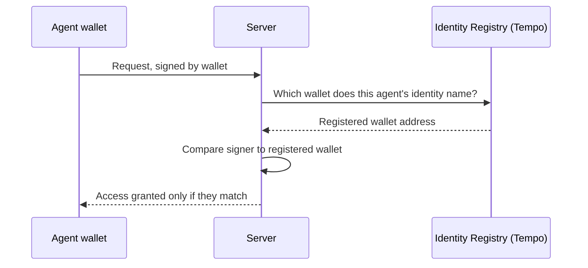

## Abstract

The most concrete movement on this beat this week sits inside a changelog, not a press release. wevm's mppx, the SDK behind the Tempo/Stripe-backed Machine Payments Protocol, shipped an ERC-8004 identity provider and x402 sign-in-with-x support on 2026-11-16, turning a documented-but-unshipped payment extension into code a server can run today[^s01][^s02]. A day later, Daydream shipped a stylist agent that completes real purchases through a one-click checkout, naming no payment rail at all[^s04]. Two more agent-tooling startups raised money in between[^s05][^s06]. Read together, the identity layer and the commerce layer this beat tracks are advancing on separate tracks, and nothing this window connects them.

## Introduction

This edition covers **2026-11-15 through 2026-11-18**. Background on the payment-rail landscape lives in the site's [agent commerce protocol comparison](../agent-commerce-protocol/), [Tempo MPP and AI agent payments](../tempo-mpp-ai-agent-payments/), and [x402 and agentic commerce](../x402-agentic-commerce/); background on identity and verification lives in [agent identity and the reputation registry](../agent-identity-reputation-registry/) and [ERC-8126](../erc-8126-ai-agent-verification/). The prior edition, 2026-11-17, covered California's lawsuit against OpenAI and Google's threat-intelligence report on autonomous exploit chains, and noted six straight editions without a dated Visa, Mastercard, or AP2 item; that streak is now eight editions, since nothing from a card network or PSP surfaced in this window either. This edition's news instead comes from the SDK and product layer: who an agent proves it is, and what happens when an agent is let loose to buy something.

## What moved

### mppx ships an ERC-8004 identity provider and x402 sign-in-with-x support

wevm's mppx — the TypeScript SDK that Wevm co-maintains with Tempo Labs for the Machine Payments Protocol, and which also speaks x402 — cut two releases on 2026-11-16[^s01][^s02]. The first, 0.20.0, adds `mppx/extensions/identity/erc8004`: an ERC-8004 agent identity provider. The client signs each request with the agent's wallet, and the server's verifier requires that the wallet an on-chain Identity Registry names, on Tempo mainnet by default, is the one that actually signed[^s01]. The second, 0.20.1, adds x402 sign-in-with-x support and an identity-attestation issuer: a wallet that signs a 402 challenge can get the resource without paying, when a signed attestation grants it, and a new `Attestation.Issuer` can bind several linked accounts, an email, a GitHub handle, an X handle, to one signed identity[^s02].

*What mppx 0.20.0's ERC-8004 identity provider checks before granting access: the request's signer must match the wallet the on-chain registry names for that agent, not just any valid signature[^s01].*

The sign-in-with-x extension itself is not new; it was already documented in `@x402/extensions`, and an open bug (`#4206`, filed 2026-11-10) describes core schemas rejecting the auth-only route the extension's own docs describe[^s03]. What changed this window is that a maintained SDK shipped the client and server pieces to actually use it, rather than leaving the extension as a spec with a known gap in the reference implementation. This is the kind of move that normally sits several editions ahead of anything a card network or standards body will say about it: identity verification at the payment layer, built and released, before any facilitator or PSP has adopted it. _(vendor-stated)_ — no facilitator or merchant adoption of either extension has surfaced yet.

### Daydream launches a shopping agent that checks out on its own, with no rail named

Daydream, the fashion-search startup founded by former Stitch Fix COO Julie Bornstein, shipped "Daydream Agent" on 2026-11-17: a stylist that remembers a user's fit and budget, virtually tries on saved items against an uploaded photo, and pulls live pricing from a catalog of more than 10,000 brands[^s04]. The feature that moves this beat is narrower than the stylist pitch: "When they find something they like, the agent can complete a purchase through a one-click checkout process"[^s04]. Daydream's prior chatbot could recommend outfits but not buy them; this version can.

Nothing in the announcement names a payment rail. No card-on-file integration, no processor, no ACP, UCP, or x402 reference appears anywhere in the coverage. That silence is itself worth recording: a consumer agent is completing real purchases across thousands of merchants this week, on checkout plumbing this beat cannot currently see or verify, while the open identity work in mppx sits one layer down with no visible connection to products like this one.

### Two more agent-tooling rounds: Model ML and Pedestal AI

Funding into vertical agent products kept moving. Model ML raised a $250M Series B at a $1.5B valuation for agents that update bankers' financial models and presentations, claiming it runs on open-source models at roughly 2% of frontier-model cost — a company claim, not verified independently[^s05]. Pedestal AI raised a $4.7M seed for supply-chain agents, with one disclosed deployment: an agent that calls customers ahead of a delivery to collect special instructions, which one unnamed furniture retailer credits with a 20% drop in missed deliveries[^s06]. Neither company discloses its underlying framework or model stack.

## Why it matters

The identity work and the commerce work this beat tracks are not touching each other this week. mppx shipped real cryptographic machinery for proving which wallet, and by extension which agent, is making a request: exactly the kind of authorization problem prior editions have flagged as unresolved. Daydream shipped a product that lets an agent spend a user's money across ten thousand merchants, and said nothing about how it verifies the agent or secures the payment. Both answer one of this beat's two central questions, who is this agent and how does it pay, but they answer different halves and in separate rooms. Until a consumer-facing commerce agent names the rail underneath it, or an open identity extension gets adopted by a facilitator a product like Daydream would actually use, there is no evidence the two tracks are converging.

## Signals to watch

- Whether any x402 facilitator or payment service provider adopts the sign-in-with-x extension mppx just shipped, and whether issue #4206's core-schema bug gets fixed to match it.
- Whether Daydream, or any similarly sized shopping agent, discloses the payment mechanism behind its one-click checkout.
- A continuing absence of dated Visa, Mastercard, or AP2 activity, now in its eighth straight edition.

## Limitations

mppx's two releases are read from their own changelog entries; no independent security review of the ERC-8004 identity provider or the attestation issuer has been found. Daydream's checkout mechanics, usage figures, and Pedestal AI's delivery-improvement figure are each the company's own claim, not independently verified. A widely syndicated story this window about an xAI "Grok Bot" making unapproved account-access attempts was investigated and dropped: its sole source is a security vendor's marketing post with no independent corroboration and an internal inconsistency in its own account of which company's platform is involved; see `working/gaps.md`.
