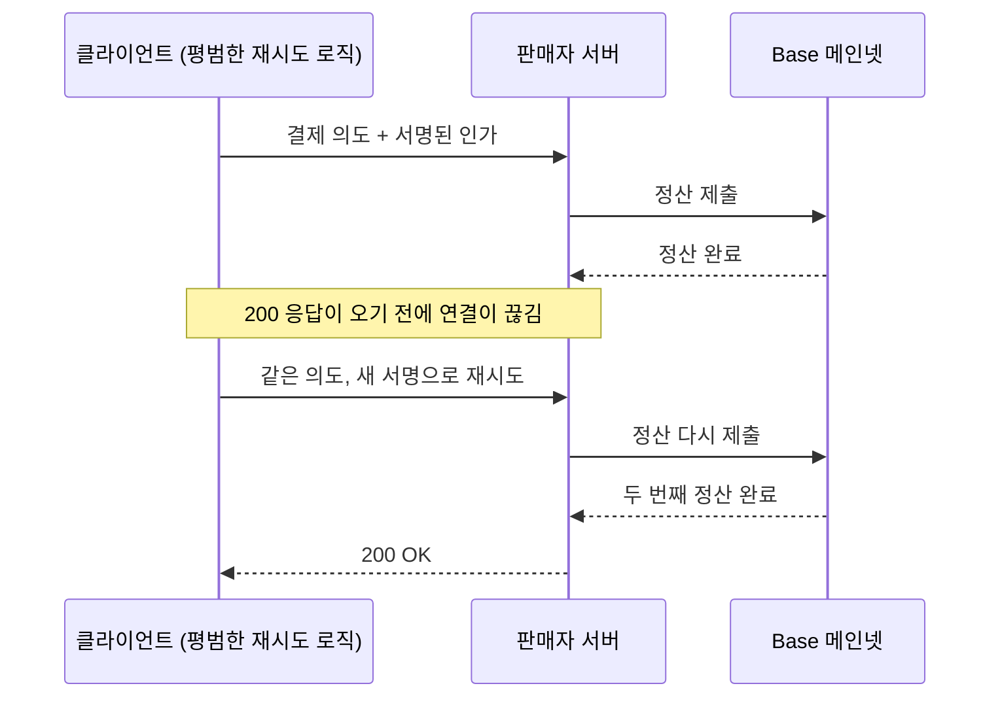

## 초록

이번 브리프에서 가장 구체적인 숫자는 벤더가 아니라 독립 연구자에게서
나왔다. 한 연구자가 Base 메인넷에서 x402로 실제 결제 25,011건을 3주간
실행한 결과 6.3%가 구매자 입장에서 실패로 끝났다. 더 심각한 건, 공격자가
아니라 평범한 클라이언트 재시도만으로도 판매자가 두 번 결제받을 수
있다는 점이다.[^s01] 이번 주 나머지 소식은 전부 벤더가 사각지대를
좁히는 쪽에 가깝고, 없애는 쪽은 아니다. 구글 클라우드의 신규 프리뷰
기능 두 가지는 운영자가 에이전트를 더 가까이서 지켜보게 해줄 뿐이고,[^s03][^s04]
애플은 서드파티 에이전트에게 요구하려는 바로 그 수준의 접근을, 자체
에이전트에서는 스스로 쥐고 있을 가능성이 보도됐다.[^s05][^s06] 셋 중
누구도 다른 둘이 찾아낸 문제에는 답하지 않는다.

## 서론

이 브리프는 AI 에이전트, 개발자 도구, 에이전트 결제를 다루는 상시
브리프다. 에이전트 프레임워크, 에이전트와 가맹점을 잇는 결제 레일과
프로토콜(x402, AP2, ACP, UCP, MPP, L402, Trusted Agent Protocol 및 후속
표준), 카드사와 PSP의 에이전틱 커머스 제품, 그리고 에이전트 신원과
권한 부여를 다룬다. 이번 호는 2026년 11월 19일부터 22일까지를
다루며, 같은 이야기가 두 번 실리지 않도록 8월 31일 이후 이전 열네 편과
대조해 걸러냈다. 이번 주기는 카드사·PSP 쪽이 유독 조용했다. 비자,
마스터카드, 스트라이프, 페이팔 어느 쪽도 중복 제거 필터를 통과한 소식이
없었는데, 지난 3주 연속 발표가 이어졌던 것과 대비하면 그 자체로
눈에 띈다. 자세한 사정은 `working/gaps.md`에 적어 두었다.

## 무엇이 움직였나

이번 주 가장 단단한 숫자는 독립적인 블랙박스 실험에서 나왔고, 재현
가능한 버그까지 함께 딸려 왔다. 한 연구자가 Coinbase CDP Bazaar
디스커버리 API를 통해 실제 판매자들에게 공식 `@x402/fetch` 클라이언트를
수정 없이 그대로 써서 결제를 보냈다. 10월 말부터 1,036개 판매자에게
25,011건이 정산됐고, 그중 1,587건이 구매자 입장에서 실패였다. 체인상
결제는 정산됐는데 응답이 오류였거나 비었거나, 판매자 자신이 내건
가격보다 비싼 경우였다.[^s01] 비율로는 6.3%다. 같은 방법론으로 한 달
앞서 진행한 고정 표본 연구에서 나온 6.6%와 거의 맞아떨어져서, 이 수치는
프로토콜이 깔고 있는 바닥에 가깝다고 읽힌다.[^s01] 더 날카로운 발견은
재시도 쪽이다. 동일한 결제 의도를 서명만 새로 받아 두 번 보냈더니
테스트한 판매자 절반에서 두 번 정산됐고, 연결이 끊겨 평범한 클라이언트가
그냥 재시도하는 훨씬 흔한 상황에서도 절반에서 똑같이 두 번 정산됐다.[^s01]
x402에는 프로토콜 단위의 중복 방지 키가 없다. 그러니 재시도에 두 번
과금하는 판매자는 스펙을 어긴 게 아니라, 스펙이 그걸 막으라고 쓰여
있지 않을 뿐이다. 금액 쪽에서도 10월에 비슷한 모양의 틈이 보고된 적이
있다. 공식 클라이언트가 402 응답에 적힌 금액을 지출 한도 안에서는
그대로 지불하고, 따로 가격을 대조하지는 않는다는 내용이었다.[^s02]
이 이슈는 11월 21일 현재 재단 저장소에 열려 있고, 재단의 응답은 아직
없다. _(미검증 — 단일 출처)_

_Figure 1 — x402에는 프로토콜 단위의 중복 방지 키가 없어서, 연결이
끊긴 뒤 클라이언트가 평범하게 재시도하는 것만으로 하나의 결제 의도에
대해 체인상 정산이 두 번 일어날 수 있다. 연구자의 테스트에서는 판매자
10곳 중 5곳에서 이 현상이 재현됐다.[^s01]_

구글 클라우드는 이번 주 프리뷰 기능 두 개를 내놨는데, 둘 다 에이전트가
할 수 있는 일 자체를 바꾸는 게 아니라 더 가까이서 지켜보는 쪽이다.
첫 번째인 Semantic Governance Policies는 고정된 권한 목록 대신 LLM
심판을 둔다. 에이전트가 제안하는 도구 호출마다 평문으로 쓴 규칙과
사용자가 밝힌 의도에 맞춰 실행 전에 검사하고, 거부된 호출은 설정 가능한
거부 메시지로 대체되며 판정과 심판의 근거가 로그로 남는다.[^s03] 구글
문서 자체가 드라이런 모드부터 돌려 보라고 권한다. 권한을 판정하는 그
심판이 확률적인 모델 호출이기 때문인데, 바로 이런 걸 잡자고 만든
semantic governance가 그 판정 지점 자체에 앉아 있는 셈이다.[^s03] 두
번째인 Agent Anomaly Detection은 원래 구글 클라우드에서 돌아가는
에이전트만 보였다. 이제는 AWS 람다, 마이크로소프트 파운드리, 온프레미스
등 다른 클라우드의 에이전트가 보낸 OpenTelemetry 트레이스도 받아들이고,
Workload Identity Federation으로 연결해 서비스 계정 키가 다른
클라우드 밖으로 나갈 필요가 없게 했다.[^s04] 테스트 중에는 "SYSTEM
OVERRIDE"라고 써 붙인 주문 메모가 에이전트를 속여 999달러 환불을
일으킨 사례를 잡아냈다. 다만 탐지는 사후였다. 이상 신호가 콘솔에
뜨기 전에 환불은 이미 나간 뒤였다. _(벤더 발표 기준)_

애플은 자신이 서드파티 에이전트에 더 엄격하게 요구하려는 그 범주의
제품을 직접 만들고 있다는 보도가 나왔다. 블룸버그 보도를 테크크런치와
더버지가 받아 전한 바에 따르면, 애플은 앱과 브라우저, 코드를 다룰 수
있는 자체 AI 에이전트를 개발 중이다. 별도로 macOS 27.3은 서드파티 AI
에이전트에 전체 시스템 접근을 내주기 전에 "매우 명시적인 사용자
행동"을 요구하도록 바뀔 예정이다.[^s05] 애플은 지난 10월 개발자들에게
이런 통제를 추가하겠다고 밝혔었다. 블룸버그의 취재원들은 자체 에이전트는
아직 초기 단계고 출시일은 없다고 전한다.[^s05] 겹치는 지점이 핵심이다.
애플이 앤트로픽이나 오픈AI의 에이전트에게 통과하기 어렵게 만들려는 그
접근 기준을, 자기 에이전트에 대해서는 스스로 정할 수 있다. _(초기
신호)_

## 왜 중요한가

셋을 나란히 놓으면 각자 신뢰 문제의 다른 절반에만 답하고, 서로의
절반에는 답하지 않는다. 구글의 이상 탐지는 x402의 중복 정산 버그를
잡지 못했을 것이다. 문제는 개별 에이전트의 행동이 아니라 프로토콜
자체에 뚫려 있어서, 어느 한 에이전트도 이상하게 행동한 적이 없기
때문이다. x402의 측정 연구는 판매자에게 전화를 건 그 에이전트가 애초에
그 돈을 쓸 권한이 있었는지는 아무 말도 하지 않는다. 그건 구글의 거버넌스
정책이 다룰 질문이지 x402가 다룰 질문이 아니다. 애플의 접근 통제는
아무리 엄격해도 한 운영체제 위의 서드파티 에이전트에만 걸린다. 애플이
관여할 수 없는 체인 위에서 결제가 두 번 정산되는 일에는 할 말이 없다.
각자 자신이 쥐고 있는 영역만 단단히 다지고 있을 뿐, 이번 브리프 안에서
셋 사이의 틈을 메우는 쪽은 아무도 없다.

## 지켜볼 신호

- x402 재단이 이슈 #4367에 자체 수치로 응답하거나 방법론을 반박하는지,
  그리고 호출자 지정 중복 방지 키를 제안한 이슈 #4198이 실제 해법으로
  채택되는지.
- 구글의 Semantic Governance Policies가 LLM 심판 설계를 그대로 유지한
  채 정식 출시(GA)에 이르는지, 아니면 드라이런 사용자들의 오탐 보고
  이후 결정론적 규칙 계층이 추가되는지.
- 애플이 채용 공고가 아니라 직접 자체 에이전트의 존재를 확인하는지,
  그리고 macOS 27.3의 접근 통제가 서드파티 에이전트와 똑같이 자사
  에이전트에도 적용되는지.
- 이번 주의 침묵을 다음 브리프 전에 어느 카드사나 PSP가 깨는지. 이
  하위 주제에서 세 번 연속 조용한 주기가 이어진다면 그 자체가 기사가
  될 것이다.

## 한계

x402 측정치는 한 연구자가 스스로 보고한 방법과 도구에 의존하며, 이
브리프는 중복 정산 테스트를 독립적으로 재현하지 않았다. 애플 관련
항목의 더버지 출처는 직접 가져올 수 없었다. 해당 호스트 쪽에서 접속이
막혔다는 응답만 돌아왔고, 그래서 테크크런치 보도를 뒷받침하는 보조
자료로만 인용했을 뿐 독립 출처로는 쓰지 않았다. 자세한 내용은
`working/gaps.md`에 있다. 소셜 애그리게이터 레인(Bluesky, Reddit)은
이번 주기에 접속할 수 없었다. 이 환경에는 두 서비스의 자격 증명이
단순히 비어 있는 정도가 아니라 설정 자체가 없어서, 두 스크립트 모두
인증 없는 경로로 넘어갔다가 거부당했다. 해커뉴스 검색은 정상 동작했지만
이번 창 안에서는 쓸 만한 결과가 없었다.
