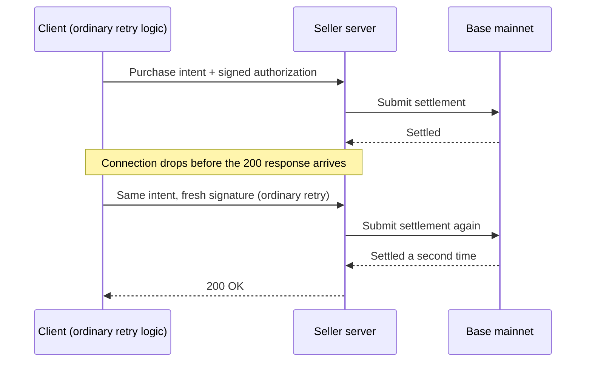

## Abstract

The most concrete number in this brief did not come from a vendor. An
independent researcher ran 25,011 real payments through x402 on Base
mainnet over three weeks and found that 6.3% failed the buyer. A plain
client retry, not an attacker, can make a seller get paid twice.[^s01]
Everything else this week is a vendor narrowing a blind spot, not closing
one. Google Cloud's two new Preview features let an agent's operator watch
it more closely.[^s03][^s04] Apple is reportedly building the kind of agent
it is simultaneously telling developers to ask users' explicit permission
for.[^s05][^s06] None of the three addresses what either of the others
found.

## Introduction

This is the standing brief on AI agents, developer tooling, and agent
payments: frameworks, the payment rails and protocols connecting agents to
merchants (x402, AP2, ACP, UCP, MPP, L402, Trusted Agent Protocol and
successors), the card networks' and PSPs' agentic-commerce products, and
agent identity and authorization. It covers November 19–22, 2026, checked
against the fourteen briefs before it back to August 31 so a story already
told here does not run twice. The card-network and PSP side was quiet this
cycle. No Visa, Mastercard, Stripe, or PayPal item survived the dedupe
filter, which is notable after three straight weeks of announcements on
that front; see `working/gaps.md`.

## What moved

An independent black-box study is the first hard number this beat has seen
on how often x402 payments actually fail the buyer, and it comes with a
reproducible bug. A researcher paid real sellers through the Coinbase CDP
Bazaar discovery API using the official `@x402/fetch` client with no
modifications: 25,011 settled calls to 1,036 sellers since late October.
1,587 of those payments failed the buyer, meaning the money settled
on-chain but the response was an error, empty, or priced above what the
seller's own listing said.[^s01] That is 6.3%, close enough to the 6.6% the
same methodology found in a frozen study the month before to read as a
floor the protocol sits at.[^s01] The sharper
finding is about retries. Sending one purchase intent twice produced two
settlements at half the sellers tested, and so did the far more common case
of a dropped connection followed by an ordinary client retry.[^s01] x402 has
no protocol-level idempotency key, so a seller that double-charges on retry
is not violating the spec; the spec simply does not say it can't. It is the
same shape of gap an unrelated October bug report found on the amount side:
the official client pays whatever a 402 response declares, up to the
caller's spend cap, with no separate price check.[^s02] The issue is open
on the foundation's repository as of November 21, with no foundation
response yet. _(unverified — single source)_

_Figure 1 — x402 defines no protocol-level idempotency key, so an ordinary
client retry after a dropped connection can produce two on-chain
settlements for one purchase intent; the researcher's test reproduced this
at 5 of 10 sellers.[^s01]_

Google Cloud shipped two Preview features this week, and both watch an
agent more closely without changing what the agent is allowed to do. The
first, Semantic Governance Policies, replaces a fixed permission list with
an LLM judge: every tool call an agent proposes gets checked against
plain-language rules and the user's stated intent before it runs, and a
denied call returns a configurable message while the verdict and the
judge's reasoning get logged.[^s03] Google's own documentation recommends
running it in dry-run mode first. The judge making the authorization
decision is itself a probabilistic model call, the kind of thing semantic
governance exists to catch, now sitting at the point where the catching
happens.[^s03] The second, Agent Anomaly Detection, used to see only agents
running on Google Cloud. It now ingests OpenTelemetry traces from agents on
AWS Lambda, Microsoft Foundry, or on-premises, connected through Workload
Identity Federation so no service account key has to leave the other
cloud.[^s04] In testing, it caught a pasted "SYSTEM OVERRIDE" order note
that had talked an agent into issuing a $999 refund. The detection ran
after the fact: the agent still issued the refund before the anomaly
surfaced in the console. _(vendor-stated)_

Apple is reportedly building the product category its own platform policy
is getting stricter about. A Bloomberg report, relayed by TechCrunch and The
Verge, says Apple is developing an in-house AI agent able to operate apps,
the browser, and code. Separately, macOS 27.3 is set to require "very
explicit user action" before a third-party AI agent gets full-system
access.[^s05] Apple told developers in October it would add these
controls. Bloomberg's sourcing says the in-house agent is still
early-stage, with no ship date.[^s05] The overlap matters: whatever access
threshold Apple is about to make harder for Anthropic's or OpenAI's agents
to clear is a threshold Apple gets to set for its own agent unilaterally.
_(early signal)_

## Why it matters

Line the three up and each one answers a different half of the trust
problem, and none of them answers the other two's half. Google's anomaly
detection would not have caught x402's double-settlement bug: the gap sits
in the protocol itself, where no single agent's behavior looks anomalous. x402's
measurement study says nothing about whether the agent calling a seller was
authorized to spend that money in the first place; that question belongs
to Google's governance policy, not to x402. Apple's access controls, however
strict, apply to third-party agents on one operating system. They say
nothing about a payment settling twice on a chain Apple has no say over.
Each actor is hardening the part of the stack it controls. Nobody in this
brief is working the seam between the three.

## Signals to watch

- Whether the x402 Foundation responds to issue #4367 with its own figures
  or disputes the methodology, and whether issue #4198 (a standing proposal
  for a caller-supplied idempotency key) gets picked up as the fix.
- Whether Google's Semantic Governance Policies reaches General Availability
  with the LLM-judge design intact, or whether a deterministic rule layer
  gets added once dry-run users report false denials.
- Confirmation from Apple itself, rather than a leaked job posting, of an
  in-house agent, and whether the macOS 27.3 access controls apply to it the
  same way they apply to third-party agents.
- Whether any card network or PSP breaks this week's silence before the
  next brief; three straight quiet cycles on that sub-beat would itself be
  a story.

## Limitations

The x402 finding rests on one researcher's self-reported method and
tooling; this brief did not independently reproduce the double-settlement
test. The Verge source for the Apple item could not be fetched directly (a
block was reported at the host) and is cited only as secondary
corroboration of TechCrunch's reporting, not as an independent source; see
`working/gaps.md`.
The social aggregator lane (Bluesky, Reddit) was unreachable this cycle:
both services' credentials are unset in this environment, not merely empty,
so both scripts fell back to unauthenticated paths that were refused. Hacker
News search ran normally and returned nothing usable in the window.
