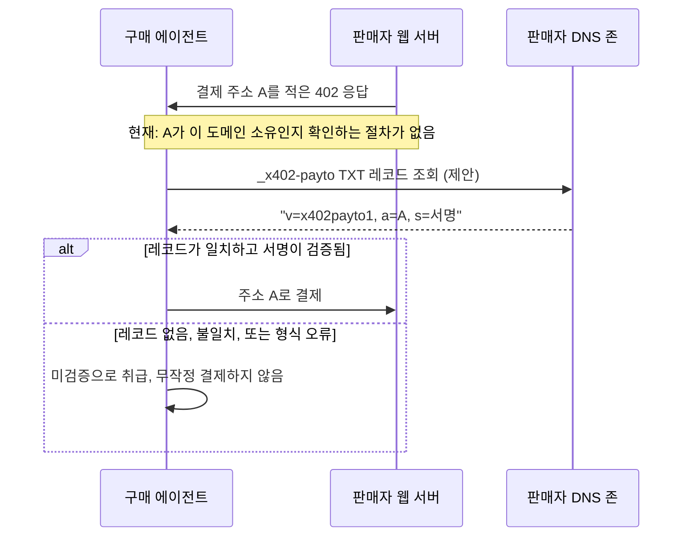

## 초록

이번 주에는 새 제품이 하나도 나오지 않았다. 대신 에이전트 스택의 세 부분이
각자 자신의 간판 기능 바로 아래 있던 틈을 메웠다. 가장 흥미로운 사례는
벤더가 아닌 쪽에서 나왔다. x402 재단의 저장소에 올라온 워킹그룹 제안은
결제 주소가 그것을 제시하는 도메인 소유자의 것인지 처음으로 확인할 방법을
제시하는데, 올라온 지 며칠이 지나도록 답이 없다. 제안을 뒷받침한 약식
스캔은 이 틈이 이론에 그치지 않는다는 것도 함께 보여줬다.[^s01][^s02]
OpenAI의 Agents SDK는 자사 코딩 에이전트를 런타임에 선택 가능한 모델
제공자로 끌어들이며 v0.x를 벗어나는 첫걸음을 뗐다.[^s03] 구글 ADK는 MCP
도구 계층의 인자 주입 경로를 막으면서, 같은 릴리스에서 몇 버전 전에 내놓은
비주얼 빌더를 통째로 걷어냈다.[^s04]

## 서론

이 브리프는 AI 에이전트, 개발자 도구, 에이전트 결제를 다루는 상시 브리핑
이다. 에이전트 프레임워크, 에이전트와 가맹점을 잇는 결제 레일(x402, AP2,
ACP, UCP, MPP, L402, Trusted Agent Protocol과 그 후속), 카드 네트워크와
PSP의 에이전트 커머스 제품, 에이전트 신원·인가가 범위에 든다. 2026년 11월
20일부터 23일까지를 다루며, 이미 다룬 이야기가 다시 실리지 않도록 이전
14건의 브리프와 대조했다. 카드 네트워크와 PSP 쪽은 두 사이클째 조용했다.
Visa, Mastercard, Stripe, PayPal 중 중복 제거 필터를 통과한 소식이 하나도
없었는데, 이제는 그냥 지나칠 일이 아니라 지켜볼 대상이다. `working/gaps.md`
참조.

## 무엇이 움직였나

x402와 MPP 판매자는 402 응답에 결제 주소를 적어 보낸다. 이번 주 전까지는
그 주소가 그것을 제시하는 도메인의 것인지 확인하는 절차가 아예 없었다.
구매자가 읽는 매니페스트와 실제로 결제가 이뤄지는 402 응답 모두 같은 웹
서버가 내보내므로, 그 서버나 배포 파이프라인, 프런트엔드 프록시 중 하나만
털려도 프로토콜은 아무 반응 없이 구매자를 공격자의 지갑으로 보낼 수
있다.[^s01] 제안자가 Coinbase CDP Bazaar와 Circle Agent Marketplace의
목록을 상대로 돌린 스캔을 보면, 이 틈은 가만히 있는 게 아니라 이미
들쭉날쭉하게 이용되고 있었다. 결제 주소 소유를 증명하겠다고 서명을 올린
호스트 중 두 자릿수 비율이 실제로는 자신의 payTo 주소가 아닌 다른 지갑의
서명이었고, 훨씬 많은 호스트는 서명란에 그냥 주소 자체를 다시 적어
넣었다 — 형식은 채웠지만 내용은 비워둔 셈이다.[^s01] 별개로 253개 경로가
30일 안에 결제 주소를 바꿨는데, 이는 정상적인 지갑 교체일 수도 있고
방금 설명한 틈이 로그에 남긴 자국일 수도 있어 스캔만으로는 구분이
안 된다.[^s01]

지금 올라온 해법은 `_x402-payto`라는 DNS TXT 레코드다. 결제 주소마다
하나씩 게시하며, 해당 지갑의 서명을 선택적으로 덧붙인다.[^s02] DNS를
쓰는 이유는 명확하다. 판매자의 배포 파이프라인이 건드릴 수 없는
영역이라서다. 프런트엔드가 털려도 매니페스트는 거짓으로 꾸밀 수 있지만,
공격자가 판매자의 DNS 존 파일까지 고쳐 쓸 수는 없다. 제안서는 검사기가
돌려줄 판정 다섯 가지(verified, mismatch, malformed, absent, unchecked)를
명시했고, 이 레코드가 하지 않는 일도 분명히 밝혔다. 도메인 소유자의
것이라는 사실만 증명할 뿐, 그 소유자가 누구인지나 신뢰할 만한지는 전혀
말해주지 않는다.[^s02] 동작하는 코드는 이미 나와 있다. 클라이언트 훅,
파이썬 검증기, 기존 스캐너에 추가된 CLI 플래그까지. 제안자는 전체 약
3,300개 등록 호스트 중 열에서 스무 곳 정도가 이를 채택했다고
집계했다.[^s02] 글을 쓰는 시점까지 x402
재단 쪽에서는 11월 22일에 올라온 문제 제보와 해법 제안 어느 쪽에도
응답이 없었다.

_(검증 안 됨 — 단일 출처; 스캔 수치 자체는 이 브리프가
직접 확인하지 않은 다른 이슈에서 가져온 것)_

_그림 1 — 제안된 `_x402-payto` DNS 레코드가 있으면 구매 에이전트가 제시된
결제 주소를, 판매자의 웹 서버가 털려도 고쳐 쓸 수 없는 레코드와 대조해
확인할 수 있다. 지금은 이런 확인 절차가 전혀 없다.[^s01][^s02]_

OpenAI의 Agents SDK는 버전 체계를 v1.0.0-alpha.1로 끌어올리면서, 자사
코딩 에이전트 런타임인 Codex를 모든 실행에서 선택할 수 있는 모델
제공자로 편입시켰다. 별도 프로세스를 띄워 호출하는 대신 PyO3를 통해
Codex Core를 직접 심었다.[^s03] 이전보다 범용 에이전트 SDK와 코딩
전용 SDK 사이의 결합이 한층 단단해진 셈이다. 파이썬 에이전트가 이제
Codex에 작업을 바로 넘길 수 있고, Codex 자체 런타임이 쓰던 승인
대기와 샌드박스 실행도 그대로 따라온다. 이번 릴리스는 호환성 초기화도
함께 가져왔다. 새 `SessionState` 형식으로 저장한 세션 체크포인트는
이전 `RunState` 형식으로 읽을 수 없어서, 네이티브 실행이나 승인이
대기 중이던 사용자는 업그레이드 전에 그것부터 끝내야 한다.[^s03]
릴리스 노트는 이를 alpha.1이라 부를 뿐, semver 정책이나 정식 출시
일정은 밝히지 않았다. 이 모습 그대로 v1.0이 나올지, 그 전에 다시
손볼 가지일지는 OpenAI가 아직 말하지 않았다. _(벤더 발표 내용)_

구글 ADK 2.15.0은 더 좁지만 구체적인 틈을 막았다. `McpInstructionProvider`는
그동안 도구의 프롬프트 인자를 세션 상태에서 자동으로 채워 넣었는데,
릴리스 노트는 이를 보안 수정이라고만 적었을 뿐 어떤 공격을 막는지는
말하지 않았다.[^s04] 이번 릴리스부터는 호출하는 쪽이 인자를 직접
넘겨야 한다 — 편리했던 자동화가 옵트인 단계로 바뀐 셈인데, 보통
이런 변화는 그 자동화가 알고 보니 주입 경로였을 때 일어난다. 같은
릴리스에서 ADK Web의 Visual Agent Builder도 완전히 빠졌다. 그걸로
만든 에이전트는 그냥 평범한 Agent Config YAML로 계속 돌아가지만,
드래그 앤 드롭 편집기 자체는 나온 지 몇 버전 만에 사라졌다.

## 왜 중요한가

이번 주 세 가지 모두 각 주체가 실제로 쥐고 있는 층위 바로 아래에 있던
틈을 메웠다. x402 제안이 다루는 건 어느 벤더도 소유하지 않은 영역이다 —
구매자도 프로토콜도 독립적으로 감사할 수 없는 서버가 내놓는 결제 주소
자체다. 반면 OpenAI와 구글의 수정은 둘 다 자사가 처음부터 끝까지 쥐고
있는 도구 안쪽에 있다. 그래서 이 둘은 포인트 릴리스 하나로 끝낼 수
있었고, x402 제안은 닷새가 지나도록 조직 간 합의를 기다리는 미답
GitHub 이슈로 남아 있다. 이 응답 속도의 격차가 겉으로 드러난 소식보다
더 말해주는 바가 크다. 벤더가 통제하는 보안 틈은 릴리스 한 번으로
막히지만, 업계 전체가 공유 DNS 관례를 받아들여야 막히는 틈은 그 전
단계에서 멈춰 있다.

## 지켜볼 신호

- x402 재단 담당자의 응답 여부 — wg-domain-discovery#17과 wg-identity#52
  어느 쪽에도 아직 반응이 없다. 응답이 온다면 `_x402-payto`를 채택할지,
  이슈가 묻고 있는 대로 다른 바인딩 방식과 함께 묶어 공유 판정 체계
  아래 둘지가 관전 포인트다.
- 제안을 뒷받침한 스캔 수치의 독립 재조사. 이 브리프는 아직 직접
  검증하지 못했다.
- Agents SDK v1.0.0 라인이 alpha를 벗어나기 전에 OpenAI가 안정성이나
  semver 정책을 문서화할지, Codex-제공자 경로가 안정 버전까지 그대로
  남을지.
- "보안 강화"라는 한 줄 너머의 설명 — 권고문, CVE, 발표 등 실제 공격
  형태를 밝히는 후속 자료가 구글 쪽에서 나오는지.

## 한계

이번 브리프의 카드 네트워크·PSP 쪽 보도는 두 사이클째 조용하다. 실제로
아무 일이 없었을 수도 있고, 이번 사이클의 피드·검색 레인이 업계지가
다룬 소식을 놓쳤을 수도 있다. x402 스캔 수치는 단일 출처이며, 그
출처가 해법 제안을 올린 사람과 동일인이라는 구조적 이해관계 문제가
있다 — 이 브리프는 근거가 된 스캔 이슈를 직접 확인하지 못해 이를
해소하지 못했다. 이번 브리프의 두 핵심 GitHub 이슈 모두 로그인 없이
가져온 것이라, 가져온 이후에 달린 댓글이나 로그인해야 보이는 내용은
반영되지 않았다.
