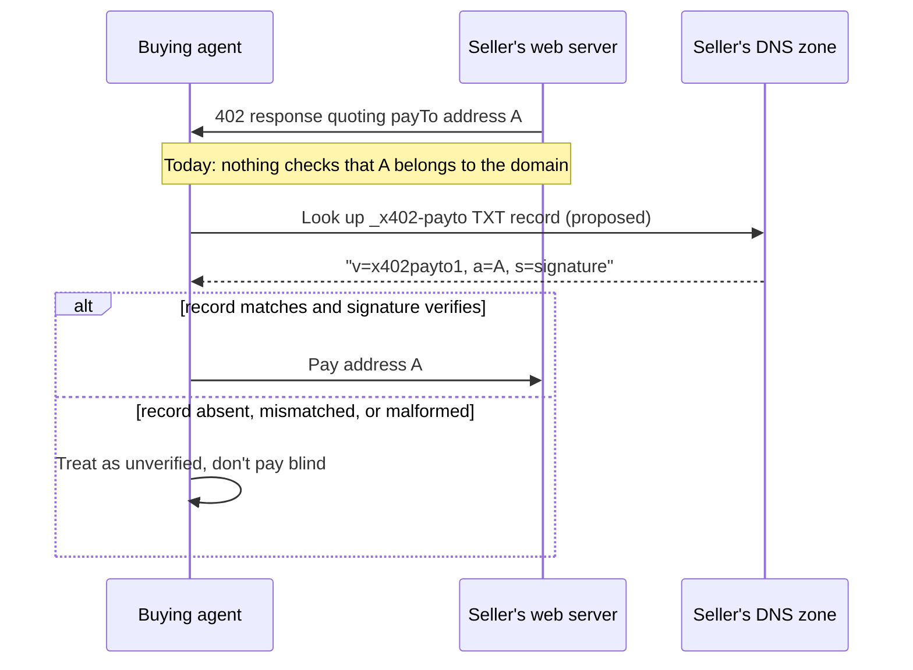

## Abstract

Nobody shipped a new product this week. Instead, three separate parts of the
agent stack each closed a gap one layer below their headline feature. The
most interesting is the one that isn't a vendor's: a working-group proposal
now sitting unanswered in the x402 Foundation's repos would make it possible,
for the first time, to check whether a payment address actually belongs to
the domain quoting it — and an informal scan backing the proposal found the
gap isn't just theoretical.[^s01][^s02] OpenAI's Agents SDK took its first
step past v0.x by folding its own coding agent into the runtime as a
selectable provider.[^s03] Google's ADK closed an argument-injection path in
its MCP tool layer and, in the same release, tore out the visual builder it
shipped a few versions ago.[^s04]

## Introduction

This is the standing brief on AI agents, developer tooling, and agent
payments: frameworks, the payment rails connecting agents to merchants (x402,
AP2, ACP, UCP, MPP, L402, Trusted Agent Protocol and successors), the card
networks' and PSPs' agentic-commerce products, and agent identity and
authorization. It covers November 20–23, 2026, checked against the fourteen
briefs before it so nothing already told here runs twice. Card networks and
PSPs stayed quiet for a second straight cycle — no Visa, Mastercard, Stripe,
or PayPal item cleared the dedupe filter, which is now worth watching rather
than just noting; see `working/gaps.md`.

## What moved

x402 and MPP sellers quote a payout address in their 402 response, and
nothing before this week checked whether that address belonged to the domain
quoting it. The manifest a buyer reads and the live 402 it pays against are
both served by the same web server, so a compromised server, deploy
pipeline, or front-end proxy can point every buyer at an attacker's wallet
without the protocol objecting.[^s01] A scan the proposal's author ran
against listings on Coinbase's CDP Bazaar and Circle's Agent Marketplace
found the gap already being exercised unevenly rather than sitting idle: of
the hosts that published a signature meant to prove control of their payout
address, a double-digit share turned out to be signed by a wallet that
wasn't any of the host's actual payTo addresses, and a much larger group had
put the raw address where the signature was supposed to go — a field left
blank in substance, filled in form.[^s01] Separately, 253 routes had changed
their payout address within 30 days, which is either normal wallet rotation
or exactly what the gap being described would look like in logs; the scan
can't tell the two apart.[^s01]

The fix now on the table is a DNS TXT record, `_x402-payto`, published once
per payout address and optionally signed by the wallet it names.[^s02] DNS
sits outside the web server a seller's own deploy pipeline controls, which is
the whole point: a hijacked front end can still serve a bad manifest, but it
can't rewrite the seller's zone file to match. The proposal spells out five
checker verdicts: verified, mismatch, malformed, absent, unchecked. It is
also explicit about what it doesn't try to solve. It proves an address
belongs to whoever controls the domain, not who that person is, and it says
nothing about trustworthiness or fraud history.[^s02] Running code already
exists (a client-side hook, a Python verifier, a CLI flag in an existing
scanner), and the author counts ten to twenty sites that have adopted it
against roughly 3,300 listed hosts total.[^s02] As of the fetch, no one from
the x402 Foundation has responded to either the problem report or the
proposed fix, both filed November 22.

_(unverified — single source; the scan's own numbers come from a linked
issue this brief did not fetch directly)_

_Figure 1 — The proposed `_x402-payto` DNS record would let a buying agent
check a quoted payout address against a record the seller's own compromised
web server cannot rewrite; today that check does not exist at all.[^s01][^s02]_

OpenAI's Agents SDK jumped its version scheme to v1.0.0-alpha.1 by making
Codex (the company's own coding-agent runtime) a model provider developers
can select for any run, embedding Codex Core directly through PyO3 rather
than shelling out to a separate process.[^s03] That's a tighter coupling
between OpenAI's general-purpose agent SDK and its coding-specific one than
existed before: a Python agent can now hand work to Codex in-process, with
approval pauses and sandboxed execution carried over from Codex's own
runtime. The release comes with a compatibility reset to go with it.
Session checkpoints saved under the new `SessionState` format can't be read
by the prior `RunState` format, so anyone with native runs or approvals
pending on the previous alpha has to finish them before upgrading.[^s03] The
release notes call this alpha.1 and give no semver policy or GA date, so
whether this is the shape v1.0 ships in or a branch that gets reworked before
then isn't something OpenAI has said yet. _(vendor-stated)_

Google's ADK 2.15.0 closed a narrower but concrete gap: `McpInstructionProvider`
used to auto-fill a tool's prompt arguments from session state, which the
release notes label a security fix without saying what exploit it
closes.[^s04] After this release, a caller has to pass those arguments
explicitly — convenient automation becomes an opt-in step, which is usually
what happens when the automatic version turned out to be an injection path.
The same release removes the Visual Agent Builder from ADK Web outright;
agents built with it keep running as ordinary Agent Config YAML, but the
drag-and-drop editor itself is gone, a few versions after it shipped.

## Why it matters

Each of these closes a gap sitting one layer under the part of the stack its
owner actually controls. The x402 proposal addresses something no vendor
owns: a payment address quoted by a server neither the buyer nor the
protocol can independently audit. OpenAI's and Google's fixes sit entirely
inside tools each company ships end to end, which is why they could ship a
fix in a point release instead of a cross-organization proposal still
waiting for a reply five days later. That gap in response time is the
story underneath the story — a security hardening a vendor controls reaches
production in one release cycle, while one that depends on an industry body
adopting a shared DNS convention is still sitting in an unanswered GitHub
issue.

## Signals to watch

- Does an x402 Foundation maintainer respond to wg-domain-discovery#17 or
  wg-identity#52 at all, and does the Foundation pick `_x402-payto` or a
  competing binding method? The issue itself asks whether more than one
  method should be supported under a shared verdict vocabulary.
- Independent re-scanning of the numbers behind the payout-proof proposal —
  this brief has not verified them itself.
- A published stability or semver policy for the Agents SDK v1.0.0 line
  before it leaves alpha, and whether the Codex-as-provider path survives
  into a stable release unchanged.
- Anything beyond "security hardening" on Google's MCP argument auto-fill
  fix: an advisory, a CVE, a conference talk that names the exploit it
  closed.

## Limitations

This brief's card-network and PSP coverage is now quiet for a second
consecutive cycle; that silence could mean nothing shipped, or could mean
this cycle's feeds and search lanes missed something trade press covered.
The x402 scan numbers are single-source and self-reported by the same person
who filed the proposed fix, a structural conflict this brief could not
resolve by fetching the underlying scan issue directly. Both GitHub issues at
the center of this brief were fetched without authentication, so comments
added after the fetch, or hidden behind a login wall, are not reflected here.
