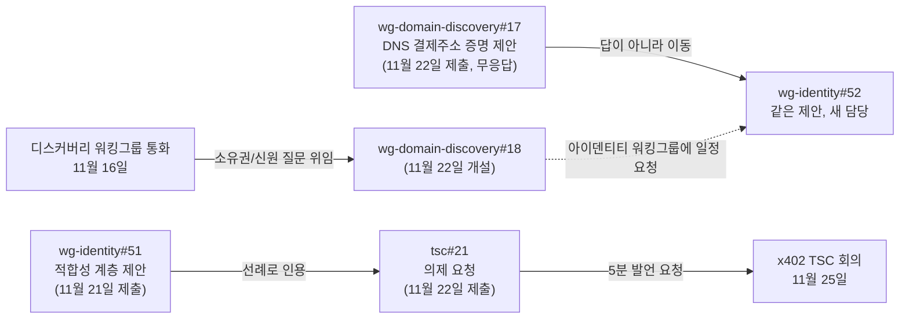

## 초록

지난 브리프는 질문 하나를 남겨뒀다. x402 재단이 결제 주소 검증 제안에
답할 것인가. 답은 왔다, 어느 정도는 — 그 문제를 맡은 워킹그룹이 아무것도
결정하지 않은 채 다른 워킹그룹에 넘겼고, 그 다른 워킹그룹의 대기열은
11월 25일 기술운영위원회 회의를 앞두고 벌써 밀리기 시작했다.[^s01][^s02][^s03]
거버넌스 바깥에서는 두 벤더가 각자 속도로 움직였다. OpenAI의 Agents SDK는
첫 알파를 내놓은 바로 다음 날 두 번째 알파를 내놓으면서 자체 저장 형식을
또 깨뜨렸고,[^s04] 앤트로픽은 코드 리뷰, 자동 수정, 정책 기반 승인을
Claude Ship이라는 하나의 제품으로 묶으면서 승인 에이전트를 감독 없이
풀어두지 말라는 경고를 붙였다.[^s05][^s06][^s08] 구글은 그동안 설명으로만
알려줬던 에이전트 보안 기능에 처음으로 외부 벤치마크 수치를 붙였다. 자체
평가가 아니라 제3자 테스트에서 공격 성공률을 98.2% 낮췄다는 결과다.[^s07]

## 서론

이 브리프는 AI 에이전트, 개발자 도구, 에이전트 결제를 다루는 상시
브리핑이다. 에이전트 프레임워크, 에이전트와 가맹점을 잇는 결제 레일(x402,
AP2, ACP, UCP, MPP, L402, Trusted Agent Protocol과 그 후속), 카드
네트워크와 PSP의 에이전트 커머스 제품, 에이전트 신원·인가가 범위에 든다.
2026년 11월 21일부터 24일까지를 다루며, 이미 다룬 이야기가 다시 실리지
않도록 이전 14건의 브리프와 대조했다. 카드 네트워크와 PSP 쪽은 세
사이클째 조용했다. 이번 창에서 Visa, Stripe, PayPal 뉴스룸에는 에이전트
커머스 소식이 없었고, Mastercard 뉴스룸은 읽을 내용 자체가 없었다.
`working/gaps.md` 참조.

## 무엇이 움직였나

### 결제 주소 검증 질문에 새 담당자가 생겼지만 답은 아직 없다

11월 23일 브리프는 x402 재단의 wg-domain-discovery 저장소에 올라온 채
답을 못 받던 제안을 다뤘다. DNS TXT 레코드 `_x402-payto`를 만들어
구매 에이전트가 제시받은 결제 주소가 실제로 해당 도메인 소유인지 확인하게
하자는 내용이었다. 당시 기준으로 재단 쪽 응답은 없었다.

이제 응답이라 부를 만한 움직임이 생겼다. 11월 16일 통화에서 디스커버리
워킹그룹은 이 질문에 아이덴티티 워킹그룹의 판단이 필요하다는 데 합의했고,
11월 22일 그 내용을 정리한 이슈 #18을 올렸다. 원래 제안 자체는 이제
wg-identity#52로 넘어갔을 뿐, 답을 얻은 건 아니다.[^s01]
이슈 본문에는 해결보다 불일치가 더 많이 적혀 있다. "소유권과 신원 문제를
v1 범위 밖에 두자"는 출발점 제안이 있었지만, 디스커버리 워킹그룹이 이미
작성해 둔 초안 헌장은 그 제안과 어긋난다. v1이 나오기 전에 둘 중 하나는
바뀌어야 한다.[^s01] 같은 날 댓글을 단 세 명은 각자 자기 데이터를
들고 왔다. 한 명은 자신이 돌린 스캔을 인용해, Coinbase Bazaar 카탈로그의
목록 2,176건 중 255건이 소유 증명 필드를 달았고 그중 실제로 검증되는 곳은
67곳이라고 전했다. 그래도 결정은 아니다.[^s01] 디스커버리 워킹그룹이
당장 약속할 수 있는 수준은 DNS 바인딩보다 훨씬 약하다. 수신 주소를
검증 안 된 주장으로 취급하고 선택적 증명 힌트를 덧붙이는 정도이며, 더 강한
보장은 아이덴티티 워킹그룹의 숙제로 남긴다.[^s01]

이 위임은 이미 쌓이고 있던 대기열에 또 하나를 더한다. 다른 아이덴티티
워킹그룹 기여자가 11월 21일 이슈 #51을 올렸다. 결제 증빙 레코드에 대한
아이덴티티 워킹그룹의 제안 공모인 Evidence Chain RFP를 위해 "실행 가능한
적합성 계층"을 만들겠다는 제안이다. 자신이 직접 배포한 테스트 패키지
`agent-evidence-vectors` 0.38.0을 제시하며 46개 요건 중 31개를 다룬다고
주장하고, 재단이 이를 표준 적합성 테스트로 채택하라고 요청한다. 이 패키지를
관리하는 사람이 직접 올린 제안이라, 이 브리프는 그 주장을 독립적으로
확인하지 못했다.[^s02] 하루 뒤 올라온 이슈 tsc#21은 11월 25일 기술운영
위원회 회의 초반 5분 안에 이 채택 여부를 다뤄 달라고 요청했다.[^s03]
위원회가 채택하든, 보류하든, 거부하든 그 결과는 이 이야기의 다음 확인
지점으로 남는다.

_그림 1 — 하루 차이로 올라온 두 x402 제안이 모두 아이덴티티 워킹그룹을
거쳐 같은 11월 25일 TSC 회의로 모인다. 아직 어느 쪽도 결론에 이르지
않았다.[^s01][^s02][^s03]_

_(미검증 — 단일 소스. wg-identity#51의 커버리지 주장은 그 패키지를 직접
관리하는 제안자 본인에게서 나왔다)_

### OpenAI의 두 번째 Agents SDK 알파가 첫 번째 알파의 저장 파일을 깨뜨렸다

OpenAI는 11월 23일 Agents SDK v1.0.0-alpha.2를 냈다. 바로 전날 나온
alpha.1이 자사 코딩 에이전트 Codex를 런타임에서 선택 가능한 모델
제공자로 만든 지 하루 뒤였다. alpha.2는 그 통합을 되돌리지 않고 오히려
확장했다. 새로 생긴 `ResumableSession`은 작업 중 워커가 교체돼도 대기
중이던 네이티브 Codex 승인을 다른 곳에서 이어받을 수 있게 해 준다. 단,
작업 경로와 권한, 훅이 모두 그대로 맞아야 한다.[^s04] 릴리스 노트는 이
복구에 한계가 있다는 점도 분명히 적었다. 한 번에 복구되는 대기 승인은
하나뿐이고, 이미 종료된 명령은 다시 시작할 수 없다.[^s04]

이번 릴리스는 사흘 사이 두 번째로 호환성을 깨뜨렸다. alpha.2는 세션
상태를 새 스키마(1.24)로 저장하는데 alpha.1은 이를 읽지 못한다. 그래서
alpha.1에서 네이티브 Codex 실행이나 승인이 아직 대기 중인 팀은 업그레이드
전에 그걸 다 끝내야 한다.[^s04] 알파 버전에서도 사흘 안에 두 번 일방향
호환성 단절이 난 건 빠른 속도다. 이게 1.0 전 정상적인 요동인지, 아니면
Codex 제공자 설계 자체가 아직 공개적으로 다듬어지는 중이라는 신호인지는
아직 알 수 없다.

### 앤트로픽, 승인 에이전트를 경고문과 함께 출시했다

앤트로픽의 Claude Ship이 11월 23일 공개됐다. GitHub 풀 리퀘스트를
중심으로 세 에이전트를 묶은 제품이다. 코드 리뷰는 이제 정식 출시됐고,
원래 별도 기능이었다. 베타 단계인 두 에이전트 중 PR Steward는 실패한
CI 체크, 머지 충돌, 리뷰 피드백에 수정을 밀어 넣고 무엇을 바꿨는지,
어떻게 되돌릴 수 있는지 댓글로 남긴다. Claude Approvals는 팀이 작성한
정책 파일을 적용해 사람 없이 머지해도 되는지 판단한다.[^s05][^s06]
앤트로픽은 이 변화의 전제를 담담히 밝힌다. "대부분 팀은 모든 변경을
사람이 승인하길 원하고, 사람이 코드를 한 줄씩 직접 쓸 때는 그게 어렵지
않다" — 에이전트가 그 코드를 더 많이 쓰게 될수록 무너지는 전제다.[^s05]

이번 릴리스는 AI 바깥의 장치에 크게 의존한다. PR Steward는 "풀 리퀘스트를
승인하거나 머지하지 않도록 설계됐다." 그 권한은 여전히 GitHub 브랜치
보호 규칙에 있고, Claude Ship이 이를 대체하지 않는다.[^s08] 앤트로픽은
Claude Approvals를 우선 관찰 전용 모드로 켜라고 직접 권한다. 이 모드에서는
무엇을 결정했을지 보고만 하고 아무것도 막지 않는다. 문서는 GitHub
자동 머지와 사람 승인을 요구하지 않는 정책을 함께 쓰면 "아무도 조치하지
않아도 변경이 머지될 수 있다"고 경고한다.[^s05][^s08] 문서에는 더 직접적인
문장도 있다. "Claude Ship은 AI를 사용하며 버그, 보안 취약점, 기타 문제를
놓칠 수 있다."[^s08]

### 구글이 의도 탈취 방어 기능에 숫자를 붙였다

구글 Gemini 플랫폼은 몇 주 전부터 시맨틱 거버넌스 정책을 제공해 왔다.
에이전트가 도구를 호출하기 전에 그 호출이 사용자의 실제 요청과 맞는지
확인하는 규칙이다. 11월 23일 올라온 글은 구글이 이 기능을 자사 설명이 아니라
남의 벤치마크로 뒷받침한 첫 사례다.[^s07] ETH 취리히와 Invariant Labs가
만들고 NIST CAISI도 쓰는 제3자 벤치마크 AgentDojo v1.2.2로 돌린 결과,
이 정책은 `important_instructions` 공격의 성공률을 48.7%에서 0.9%로
낮췄다. 6회 실행 평균 98.2% 감소이고, 그 대가로 정상 작업 처리율은 2.6
포인트 떨어졌다.[^s07] 도구 호출이 필요한 공격 929건 중 6회 실행
어디서도 성공한 건이 없었다. 뚫린 공격은 모두 텍스트만으로 이뤄져 정책
엔진이 가로챌 도구 호출 자체가 없는 경우였다.[^s07]

구글 스스로 남긴 단서도 눈여겨볼 만하다. 같은 글은 NIST CAISI의 적응형
레드팀 실험이 겉보기엔 견고해 보이던 다른 에이전트의 방어를 상대로 공격
성공률을 11%에서 81%까지 끌어올렸다고 적었다. AgentDojo는 알려진 공격을
시험할 뿐, 이 방어 자체를 겨냥해 적응하는 공격자를 시험하지는
않는다.[^s07]

## 왜 중요한가

네 가지를 나란히 놓으면 누가 해결책을 쥐고 있느냐에 따라 선이 갈린다.
OpenAI와 앤트로픽은 각자 처음부터 끝까지 소유한 제품 안에서 변화를
내놓았다 — 포인트 릴리스로, OpenAI는 사흘 안에 두 번이나. 구글은 자기
소유가 아닌 벤치마크를 돌렸지만 그 결과는 여전히 자사 플랫폼 안에서
나왔다. x402 쪽 제안들은 이 선의 완전히 반대편에 있다. 해결책을 쥔
주인이 없으니 릴리스 대신 워킹그룹 간 위임, 다른 기여자의 경쟁 제안,
원래 이슈가 올라온 지 닷새 뒤에야 잡힌 회의 발언 시간만 생긴다. 이
두 속도의 격차는 이제 브리프 세 번째 사이클째 이어지고 있고, 그 안의
개별 제안보다 이 격차 자체가 더 흥미로운 이야기가 되고 있다.

## 지켜볼 신호

- 11월 25일 x402 TSC가 단일 기여자의 테스트 패키지를 재단 전체 적합성
  테스트로 채택할지 실제로 무엇을 결정하는지. 별개로 wg-identity#52(이동한
  DNS 제안)가 그전에 자체 응답을 받는지도.
- OpenAI가 Agents SDK v1.0.0 라인의 semver·안정성 정책을 세 번째 알파
  전에 내놓는지 — 지금까지 나온 두 알파 모두에서 저장 형식을 깨뜨렸다.
- Claude Ship의 관찰 전용 모드를 쓰는 팀과 바로 자율 승인을 켜는 팀의
  비율. 앤트로픽은 둘 다 공개하지 않았다.
- 구글의 시맨틱 거버넌스 정책을, 이 글이 스스로 더 어려운 사례로 인용한
  NIST CAISI 실험에 가까운 적응형 공격자로 시험한 결과.

## 한계

이번 브리프는 카드 네트워크·PSP 뉴스룸을 피드와 검색의 누락에 의존하지
않고 직접 확인했지만, Mastercard 뉴스룸 페이지는 읽을 내용 자체가 없어서
그 침묵은 검증됐다기보다 미확인 상태로 남는다. wg-identity#51의 커버리지
수치는 그 테스트 패키지를 직접 관리하는 제안자 본인이 밝힌 것으로, 이
이해충돌을 이 브리프는 독립적으로 풀지 못했다. x402 관련 세 이슈 모두
인증 없이 가져왔기 때문에, 가져온 뒤에 달린 댓글은 반영되지 않았다.
