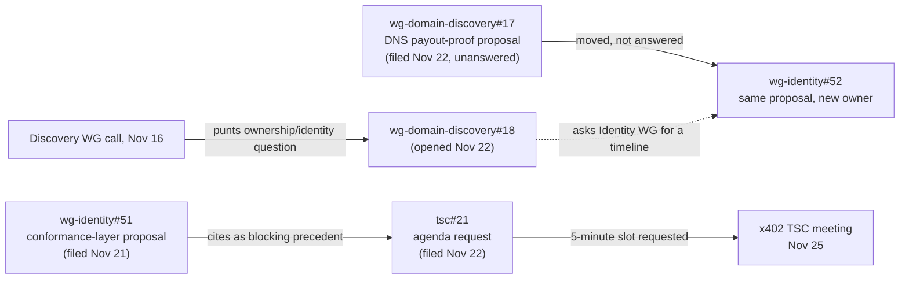

## Abstract

Yesterday's brief left a question open: would the x402 Foundation respond to
an unanswered proposal for verifying payout addresses? It did, sort of — the
working group that owns the problem punted it to a second working group
without deciding anything, and that second group's own queue is now backing
up ahead of a Nov 25 standards-committee meeting.[^s01][^s02][^s03] Away from
governance, two vendors shipped on their own clock: OpenAI's Agents SDK took
a second alpha one day after the first, breaking its own save format again in
the process,[^s04] and Anthropic bundled code review, auto-fix, and
policy-based approval into a single product called Claude Ship, with an
explicit warning against turning the approval agent loose without
supervision.[^s05][^s06][^s08] Google, meanwhile, published the first
outside-benchmark numbers for an agent-security feature it had previously
only described: a 98.2% cut in a standard attack's success rate, measured
against a third party's test, not its own.[^s07]

## Introduction

This is the standing brief on AI agents, developer tooling, and agent
payments: frameworks, the payment rails connecting agents to merchants (x402,
AP2, ACP, UCP, MPP, L402, Trusted Agent Protocol and successors), the card
networks' and PSPs' agentic-commerce products, and agent identity and
authorization. It covers November 21–24, 2026, checked against the fourteen
briefs before it so nothing already told here runs twice. Card networks and
PSPs stayed quiet for a third straight cycle — Visa's, Stripe's, and PayPal's
newsrooms carried nothing on agent commerce in the window, and Mastercard's
returned no readable content at all; see `working/gaps.md`.

## What moved

### The x402 payout-address question has a second owner, and still no answer

The Nov 23 brief covered a proposal sitting unanswered in the x402
Foundation's wg-domain-discovery repo: a DNS TXT record, `_x402-payto`, that
would let a buying agent check whether a quoted payout address actually
belongs to the domain quoting it. As of that fetch, nobody from the
Foundation had responded.

Someone has now responded, in a specific sense: on a Nov 16 call, the
Discovery WG agreed the question needs the Identity WG's input, and on Nov 22
it opened issue #18 to formalize that. The DNS proposal itself is now tracked
as wg-identity#52; it has moved, not been answered.[^s01] The issue records
disagreement, not resolution. The "starting suggestion" was to keep
ownership and identity out of scope for the Discovery WG's v1, but the
group's own draft charter already conflicts with that suggestion, so one of
the two has to change before v1 ships.[^s01] Three commenters filled in the
gap with their own data the same day: one cited a fresh scan putting proof
adoption at 255 of 2,176 listings in Coinbase's Bazaar catalog, with 67 hosts
actually verifying, but none of it amounts to a decision.[^s01] What the
Discovery WG is willing to commit to in the meantime is thinner than a DNS
binding: treat recipient addresses as unverified claims, plus an optional
proof hint, and leave the stronger guarantee for the Identity WG to work
out.[^s01]

That handoff adds to a queue that was already growing. A different Identity
WG contributor filed wg-identity#51 on Nov 21: an "executable conformance
layer" for the Evidence Chain RFP, the Identity WG's open call for proposals
on payment evidence records. It offers a self-published test package,
`agent-evidence-vectors` 0.38.0, claiming coverage of 31 of 46 requirements,
and proposes the Foundation adopt it as the standard conformance test — filed
by the same person who maintains the package, a claim this brief could not
verify independently.[^s02] A day later, issue tsc#21 asked the Technical
Steering Committee to take up that adoption question in the first five
minutes of its Nov 25 meeting.[^s03] Whatever the TSC decides there is this
story's next checkpoint, not today's.

_Figure 1 — Two x402 proposals filed within a day of each other both route
through the Identity WG and converge on the same Nov 25 TSC meeting; neither
has reached a decision yet.[^s01][^s02][^s03]_

_(unverified — single source; the wg-identity#51 coverage claim comes from
the proposal's own author, who also maintains the package it proposes
adopting)_

### OpenAI's second Agents SDK alpha breaks the first alpha's save files

OpenAI shipped v1.0.0-alpha.2 of its Agents SDK on Nov 23, one day after
alpha.1 made Codex a selectable in-process model provider. Alpha.2 extends
that integration instead of walking it back: a new `ResumableSession` lets a
worker that gets replaced mid-run recover its pending native-Codex approvals
elsewhere, provided the workspace path, permissions, and hooks all still
match.[^s04] The release notes are explicit that this recovery has limits —
only one pending approval recovers at a time, and a command that was already
terminated cannot restart.[^s04]

The release also resets compatibility a second time in three days. Alpha.2
writes session state in a new schema (1.24) that alpha.1 cannot read, so a
team with native Codex runs or approvals still pending on alpha.1 has to
drain them before upgrading.[^s04] Two one-way compatibility breaks inside
three days is a fast cadence even for an alpha; it leaves open whether this
is normal pre-1.0 churn or a sign the Codex-provider design is still being
worked out in public.

### Anthropic ships the approval agent, with a warning attached

Anthropic's Claude Ship, announced Nov 23, bundles three agents around a
GitHub pull request. Code Review is now generally available, having
previously shipped as a standalone feature. PR Steward, new and in beta,
pushes fixes for failing CI checks, merge conflicts, and review feedback and
comments on what it changed and how to undo it. Claude Approvals, also new
and in beta, applies a team-written policy file to decide whether a PR can
merge without a person.[^s05][^s06] Anthropic frames the shift plainly: "Most
teams want a person to approve every change, and that's easy to keep up with
when people write every line" — the premise that gets harder as agents write
more of that code themselves.[^s05]

The release leans hard on guardrails that sit outside the AI itself. PR
Steward "is designed not to approve or merge pull requests"; that stays with
GitHub branch protection, which Claude Ship does not replace.[^s08]
Anthropic's own recommendation is to run Claude Approvals in observe-only
mode first, where it reports what it would have decided without blocking
anything, and its docs warn that combining GitHub auto-merge with a policy
that doesn't require a human sign-off means "a change can merge without
anyone acting."[^s05][^s08] The docs also carry a blunter line: "Claude Ship
uses AI and may miss bugs, security vulnerabilities, or other issues."[^s08]

### Google puts a number on its intent-hijacking defense

For a few weeks, Google's Gemini platform has offered semantic governance
policies: rules that check a proposed tool call against the user's actual
request before an agent executes it. A Nov 23 post is the first time Google
has backed that feature with somebody else's benchmark rather than its own
description.[^s07] Run against AgentDojo v1.2.2, a third-party benchmark from
ETH Zurich and Invariant Labs also used by NIST's CAISI, the policies cut the
`important_instructions` attack's success rate from 48.7% to 0.9%, a 98.2%
reduction averaged over six runs, while benign-task utility fell 2.6
points.[^s07] None of 929 attacks that required a tool call succeeded in any
of the six runs; the attacks that did get through were text-only, with no
tool call for the policy engine to intercept.[^s07]

Google's own post supplies the caveat worth keeping: a NIST CAISI adaptive
red-team exercise pushed a different agent's attack success rate from 11% to
81% against defenses that looked solid under a fixed benchmark. AgentDojo
tests a known attack, not an adversary adapting to this specific
defense.[^s07]

## Why it matters

Set side by side, these four items split cleanly along who controls the fix.
OpenAI and Anthropic each shipped a change inside a product they own end to
end — a point release, in OpenAI's case twice in three days. Google ran a
benchmark it also doesn't own, but still inside its own platform. The x402
proposals sit on the other side of that line entirely: nobody owns the fix,
so instead of a release there is a working-group handoff, a second
contributor's competing proposal, and a meeting slot requested five days
after the original issue was filed. The gap between those two speeds is now
three brief cycles old, and it is becoming the more interesting story than
any single proposal inside it.

## Signals to watch

- What the x402 TSC actually decides on Nov 25 about adopting a
  single-contributor test package as Foundation-wide conformance tests —
  and separately, whether wg-identity#52 (the moved DNS proposal) gets any
  response of its own before then.
- Whether OpenAI publishes a semver or stability policy for the Agents SDK
  v1.0.0 line before a third alpha, given it has broken its own save format
  in both alphas released so far.
- Adoption numbers for Claude Ship's observe-only mode versus teams that
  enable autonomous approval directly — Anthropic has not published either.
- An adaptive-attacker test of Google's semantic governance policies, closer
  to the NIST CAISI exercise the post itself cites as the harder case.

## Limitations

This brief checked card-network and PSP newsrooms directly this cycle
instead of relying on feed and search misses, but Mastercard's newsroom page
returned no readable content, so that one source's silence stays unconfirmed.
The wg-identity#51 coverage numbers are self-reported
by the proposal's own author, who also maintains the test package being
proposed, a conflict of interest this brief could not resolve independently.
All three x402 GitHub issues were fetched without authentication, so comments
added afterward are not reflected here.
