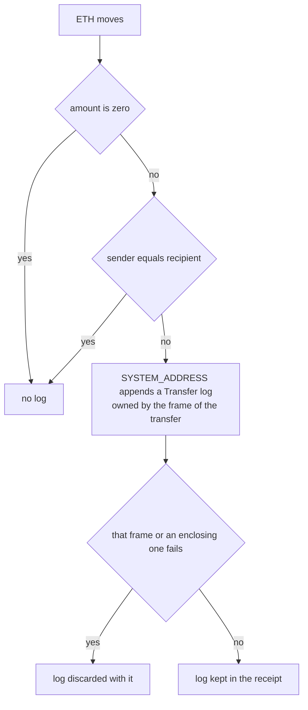

## Abstract

EIP-7708 makes the protocol emit a log, shaped exactly like an ERC-20 `Transfer`, whenever ETH moves[^s01]. ERC-20 tokens have always been traceable through logs, but ETH sent by a contract was recorded nowhere, so exchanges and indexers had to trace transactions one by one[^s01][^s05]. Vitalik Buterin proposed it in May 2024. It went Stagnant after a year, revived in January 2026, gained burn logs in February and lost them in May in exchange for EIP-8246. It reached Review in July and Last Call in October[^s02][^s04]. It is scheduled for Glamsterdam[^s06]. This report tested the spec on Sepolia, where Glamsterdam is already live. Over the latest 200 blocks and 27,647 transactions there were no violations. All 1,957 value-carrying transactions emitted the transaction-level transfer log as their first log, and the logs started exactly at the fork block[^s12]. Costs matched too. The 6,000-gas gap between a 21,000-gas transfer and a 15,000-gas zero-value one is exactly what EIP-2780 charges for "recipient balance write and EIP-7708 transfer log"[^s07][^s12]. Gaps remain. A PR opened the day after Last Call closed notes that the text never covers contract-creation transactions or what happens to logs in reverted frames. It also asks whether a creation transaction's log is free[^s09]. Fees and withdrawals are excluded by design, so these logs alone cannot rebuild balances[^s01][^s04].

## 1. Introduction

Logs are how Ethereum tracks assets. Every ERC-20 transfer emits a `Transfer` event, so a single `eth_getLogs` collects deposits and withdrawals. ETH is the exception. ETH sent from an EOA shows up in the block's transaction list, but ETH sent by a smart contract wallet "is not automatically logged anywhere"[^s01]. The EIP points to the consequence: early exchanges often failed to credit deposits from contract wallets, or credited them much later[^s01].

Practitioners say the same. In the discussion thread an indexer operator called tracking ETH transfers for smart accounts "the #1 pain", solved with `debug_` tracing across several chains at real infrastructure cost[^s05]. Because ETH moved inside a contract call leaves nothing for `eth_getLogs` to find, wallets, exchanges and indexers rebuild ETH flows by tracing every transaction[^s13].

EIP-7708's answer is blunt. Wherever ETH moves, the protocol emits one ERC-20-shaped log[^s01]. This report sets out the spec and how it evolved, checks how it fits with the fork's gas repricing, and measures it on Sepolia.

## 2. Specification

A log equivalent to LOG3 is emitted in four cases: a nonzero-value transaction to a different account, and nonzero-value `CALL`, `SELFDESTRUCT`, and `CREATE`/`CREATE2`. The transaction-level log comes "before any other logs created by EVM execution", and the others appear when the transfer executes[^s01].

| Field | Value |
|---|---|
| emitting address | `0xfff…fffe` (EIP-4788's `SYSTEM_ADDRESS`) |
| `topics[0]` | `keccak256('Transfer(address,address,uint256)')` |
| `topics[1]`, `topics[2]` | sender, recipient |
| `data` | amount in wei |

_Table 1 — The transfer log, identical in shape to the ERC-20 `Transfer` event.[^s01]_

The reference implementation in execution-specs reduces this to two guards. The log helper does nothing for a zero amount. Message calls log only when caller and target differ, and `SELFDESTRUCT` logs only when the beneficiary is not the contract itself[^s08]. A log belongs to the frame where the transfer happened, so it disappears if that frame or an enclosing one reverts. The test list implies this, but the normative text never says it[^s01][^s09].

_Figure 1 — When the reference implementation emits a transfer log. The last branch, discard on failure, is in the code and tests but not yet in the EIP text.[^s08][^s09]_

The emitting address was argued over for a long time. One camp wanted a nil address so the log could not be forged. Another wanted `0xEeee…EEeE`, already used by `eth_simulateV1`, as a de facto standard[^s05]. The spec settled on `SYSTEM_ADDRESS`, which EIP-4788 already uses for protocol actions. Reusing it keeps protocol-originated operations consistent and distinguishes these logs from logs emitted by user contracts[^s01].

## 3. Two years of revisions

The commit history shows a bumpy road[^s02].

| Date | Change |
|---|---|
| 2024-06 | proposed by Vitalik Buterin |
| 2025-04 | moved to Stagnant |
| 2026-01 | revived as Draft; `SELFDESTRUCT` handling clarified |
| 2026-02 | `Burn(address,uint256)` logs added |
| 2026-04 | `CREATE`/`CREATE2` added |
| 2026-05-04 | interop decisions: open questions replaced by rationale |
| 2026-05-16 | burn logs removed in favour of EIP-8246 |
| 2026-07 | Review |
| 2026-10 | Last Call (deadline 2026-11-01) |

_Table 2 — EIP-7708 revision history.[^s02][^s01]_

Burn logs were the biggest detour. Even after EIP-6780, a contract created and self-destructed to itself within one transaction could still burn ETH. The February revision added a separate `Burn` log for that case, which meant sorting accounts marked for deletion by address at transaction finalization[^s02]. A client developer objected that this "requires dedicated sorting" and is risky[^s05].

A working session in Svalbard on 1 May changed course. Burn logs would go if a new `SELFDESTRUCT` EIP made the same fork, and stay if it did not. The deciding argument was frequency: about 50 such burns before Cancun and 2 after[^s04]. That condition is EIP-8246, which abolishes the burn altogether. A replay of mainnet to roughly block 25M found two post-Cancun burns on this path and none at finalization. With it goes "the last EVM mechanism by which ETH can leave total supply"[^s03]. EIP-8246 is scheduled for Glamsterdam, with Last Call ending on 4 November[^s06][^s03]. The cost lands on L2s such as OP Stack chains, whose `L2ToL1MessagePasser` relies on this burn and will need a migration plan[^s03].

The same session kept fees and withdrawals out. Priority fees and the base-fee burn can be computed from receipts and headers, and per-transaction fee logs would bloat blocks. Withdrawals have no transaction to attach to[^s04]. Those decisions became the EIP's rationale section verbatim[^s01].

## 4. Cost

Gas was the loudest early objection. One commenter put a log at roughly 1,700 gas and called that "obscene" next to a 21,000-gas transfer[^s05]. The May session estimated about 1,756 gas per log and provisionally agreed to fold it into the cost of `CALL`. At that point the direction of EIP-2780, which governs the transaction side, was still unsettled[^s04].

In the settled picture, the transaction-level log sits inside EIP-2780's `TX_VALUE_COST` of 6,000 gas. That charge covers both "recipient balance write and EIP-7708 transfer log"[^s07]. A self-transfer emits no log and pays no such charge[^s07]. On the `CALL` side, EIP-8038 raises the account-write cost of a value transfer from 6,700 to 9,000, but its text never mentions EIP-7708[^s14]. Whether the log is priced into that number, as the working session intended, cannot be confirmed from the documents.

The EIP's own security argument leans on these figures. An ETH transfer costs at least 6,700 gas and LOG3 costs 1,500, so the worst-case number of logs per block does not rise[^s01]. With EIP-8038 that floor becomes 9,000, which only strengthens the conclusion[^s14].

## 5. What Sepolia shows

Sepolia switched to Glamsterdam at block 11,856,337. In the 100 blocks before it, `SYSTEM_ADDRESS` emitted no logs; in the 100 blocks from it, 7,225, the first in the fork block itself[^s12].

For the latest 200 blocks (12,054,249 to 12,054,448), every transaction and receipt was pulled and checked against the spec[^s12].

| Check | Result |
|---|---|
| transactions / logs / transfer logs | 27,647 / 66,195 / 3,681 |
| successful value transactions whose first log is the correct transfer log | 1,957 / 1,957 |
| value-carrying self-transfers with no transaction-level log | 16 / 16 |
| failed transactions carrying logs | 0 / 3,722 |
| malformed logs (topics, data length, zero amount, self transfer) | 0 |
| internal contract transfer logs | 1,724, in 6.0% of successful transactions |

_Table 3 — Verification over 200 Sepolia blocks (author's measurement, 3 November 2026)[^s12]_

The last row is the reason the EIP exists. Forty-seven percent of transfer logs recorded movements inside contracts that the transaction list never showed[^s12]. Transfer logs were 5.6% of all logs. That is a testnet mix and says little about mainnet growth.

Gas was checked on plain transactions without calldata. A zero-value transfer to an existing account used 15,000 gas and no log, and a self-transfer used 12,000. A value transfer used 21,000 with one log, and a transfer that created an account used 204,600[^s12]. The 6,000 difference between 21,000 and 15,000 is exactly `TX_VALUE_COST`. Subtracting 21,000 from 204,600 leaves the 183,600 of state gas that EIP-2780 lists for a new account[^s07][^s12].

## 6. Discussion

**Filter on the address, not the topic.** Any contract can craft a LOG3 that looks like an ETH transfer, as a client developer warned[^s05]. `SYSTEM_ADDRESS` answers that, since only the protocol can emit from it[^s01]. The protection holds only for consumers who filter on the address. The topic is the ERC-20 `Transfer` hash, so an indexer that collects by topic alone will mix ETH transfers, token transfers and forgeries together. That is the flip side of letting existing ERC-20 parsers read the logs unchanged.

**These logs cannot rebuild balances on their own.** Fees, the base-fee burn and withdrawals are excluded by design[^s01][^s04]. A full balance ledger still has to add fees from headers and receipts. In November 2025 a co-author argued against shipping the logs without system logs along the lines of EIP-7799[^s05]. The EIP instead says clients "MAY" expose an aggregating RPC[^s01]. That is enough to detect exchange deposits. Reconciling accounts still needs the fee data.

**Tooling is already adjusting.** Geth merged its implementation in March. In October it fixed `eth_simulateV1`, whose synthetic transfer logs duplicated the protocol's, so every transfer was being reported twice[^s10][^s11]. Other tools that synthesize similar logs should check for the same duplication after Glamsterdam.

**The text still needs work at the end of Last Call.** PR #12613, opened the day after the deadline, raises three gaps. Value-carrying contract-creation transactions are not in the list. Nothing says what happens to a log when its frame fails. Failures that occur before the transfer, such as an address collision, are not covered either. The reference implementation and tests already behave consistently on all three[^s09]. The sharper question is about cost. A creation transaction pays no `TX_VALUE_COST`, yet in t8n a creation used the same 207,606 gas at value 0 and value 7, emitting a log only in the second case. Is that log free[^s09]? No value-carrying creation appeared in this sample, so it could not be checked on chain.

## 7. Limitations

- Measurements cover Sepolia: the latest 200 blocks and 200 blocks around the fork. Mainnet is not live, so log growth there was not measured.
- Only geth's implementation PRs were reviewed. Other clients are inferred only from their participation in Sepolia consensus.
- No value-carrying creation transaction or `SELFDESTRUCT` transfer appeared in the sample.
- Whether EIP-8038's numbers include the `CALL`-level log could not be confirmed from the documents.
- The outcomes of PR #12613 and of EIP-8246 (Last Call ends 4 November) were open at the time of writing. Under the working session's decision, burn logs could return if EIP-8246 is dropped[^s04].
