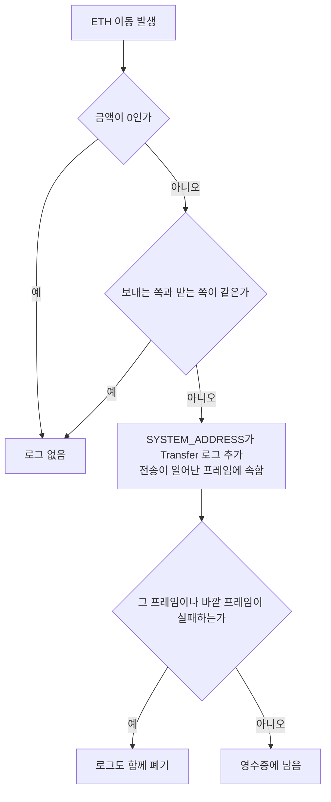

## 초록

EIP-7708은 ETH가 움직일 때마다 ERC-20의 `Transfer`와 똑같은 모양의 로그를 프로토콜이 자동으로 남기게 하는 제안이다[^s01]. 지금까지 ERC-20 토큰은 로그로 추적할 수 있었지만, 컨트랙트가 보내는 ETH는 어디에도 기록되지 않았다. 그래서 거래소와 인덱서는 트랜잭션을 하나하나 트레이싱해야 했다[^s01][^s05]. 2024년 5월 Vitalik Buterin이 제안한 뒤 1년 가까이 방치돼 정체(Stagnant) 상태에 들어갔다. 2026년 1월 다시 살아났고, 2월에 소각 로그가 추가됐다가 5월에 EIP-8246과 맞바꾸는 조건으로 삭제됐다. 7월에 Review, 10월에 Last Call로 넘어갔다[^s02][^s04]. 지금은 Glamsterdam에 포함이 확정돼 있다[^s06]. 이 보고서는 Glamsterdam이 이미 켜진 Sepolia에서 스펙을 직접 검증했다. 최근 200블록, 트랜잭션 27,647건에서 위반은 0건이었고, 값을 보낸 트랜잭션 1,957건 모두 첫 로그로 거래 수준 전송 로그를 남겼다. 로그는 포크 블록부터 정확히 시작됐다[^s12]. 비용 쪽도 실측과 맞았다. 일반 송금의 21,000가스와 0원 송금의 15,000가스 차이 6,000이 EIP-2780이 "잔액 기록과 7708 로그"에 매긴 값과 같았다[^s07][^s12]. 남은 공백도 있다. Last Call 마감 다음 날 열린 PR이 생성 트랜잭션과 되돌려진 프레임의 처리가 본문에 없다고 지적했다. 생성 트랜잭션의 로그가 공짜인지도 묻는다[^s09]. 수수료와 인출은 설계상 제외됐으므로, 이 로그만으로 잔액 전체를 재구성할 수는 없다[^s01][^s04].

## 1. 서론

이더리움에서 자산의 움직임을 따라가는 표준 수단은 로그다. ERC-20 토큰은 이전할 때마다 `Transfer` 이벤트를 남기므로 `eth_getLogs` 한 번으로 입출금을 모을 수 있다. ETH는 다르다. EOA가 보낸 ETH는 블록의 트랜잭션 목록에서 읽을 수 있지만, 스마트 컨트랙트 지갑이 보낸 ETH는 "어디에도 자동으로 기록되지 않는다"[^s01]. EIP 본문은 그 결과를 이렇게 든다. 초기 거래소들은 컨트랙트 지갑에서 오는 입금을 제대로 처리하지 못하거나, 처리하더라도 훨씬 오래 걸렸다[^s01].

현장의 목소리도 같다. 토론 스레드에서 한 인덱서 운영자는 스마트 계정의 ETH 전송 추적이 "1순위 고통"이며, 여러 체인에서 `debug_` 트레이싱을 돌리느라 상당한 인프라 비용을 쓴다고 했다[^s05]. 컨트랙트 안에서 움직인 ETH는 `eth_getLogs`로 찾을 수 없으니, 지갑과 거래소와 인덱서는 결국 모든 트랜잭션을 트레이싱해 ETH 흐름을 재구성한다[^s13].

EIP-7708의 해법은 단순하다. ETH가 움직이는 모든 지점에서 프로토콜이 ERC-20과 같은 형식의 로그를 하나씩 남긴다[^s01]. 이 보고서는 명세와 그 변천을 정리하고, 같은 포크의 가스 개편과 어떻게 맞물리는지 확인한 뒤, Sepolia에서 실제 동작을 측정한다.

## 2. 명세

LOG3과 같은 로그가 네 경우에 나온다. 다른 계정에 0이 아닌 값을 보내는 트랜잭션, 같은 조건의 `CALL`, `SELFDESTRUCT`, 그리고 값을 실어 보내는 `CREATE`/`CREATE2`다. 트랜잭션 수준 로그는 "EVM 실행이 만드는 다른 모든 로그보다 먼저" 나오고, 나머지는 값 이전이 실행되는 시점에 나온다[^s01].

| 필드 | 값 |
|---|---|
| 로그를 내는 주소 | `0xfff…fffe` (EIP-4788의 `SYSTEM_ADDRESS`) |
| `topics[0]` | `keccak256('Transfer(address,address,uint256)')` |
| `topics[1]`, `topics[2]` | 보내는 주소, 받는 주소 |
| `data` | wei 단위 금액 |

_표 1 — 전송 로그의 형식. ERC-20 `Transfer` 이벤트와 같다.[^s01]_

참조 구현(execution-specs)은 이 규칙을 두 개의 조건으로 옮겼다. 로그 함수는 금액이 0이면 아무것도 하지 않는다. 메시지 호출에서는 호출자와 대상이 다를 때만, `SELFDESTRUCT`에서는 수령인이 자기 자신이 아닐 때만 로그를 낸다[^s08]. 로그는 전송이 일어난 프레임에 속하므로, 그 프레임이나 바깥 프레임이 되돌려지면 함께 사라진다. 이 동작은 테스트 목록에는 있지만 본문에는 명시돼 있지 않다[^s01][^s09].

_그림 1 — 참조 구현이 전송 로그를 남기는 조건. 마지막 분기(실패 시 폐기)는 테스트와 구현에는 있지만 EIP 본문에는 아직 없다.[^s08][^s09]_

로그를 내는 주소는 오래 논쟁거리였다. 위조할 수 없도록 nil 주소를 쓰자는 의견이 있었다. `eth_simulateV1`이 이미 쓰는 `0xEeee…EEeE`를 사실상 표준으로 삼자는 의견도 있었다[^s05]. 결국 EIP-4788에서 이미 프로토콜 동작용으로 쓰는 `SYSTEM_ADDRESS`가 채택됐다. 근거는 다른 프로토콜 동작과의 일관성, 그리고 사용자 컨트랙트의 로그와 구별된다는 점이다[^s01].

## 3. 2년의 변천

개정 이력은 이 EIP가 순탄하지 않았음을 보여 준다[^s02].

| 날짜 | 변화 |
|---|---|
| 2024-06 | Vitalik Buterin이 제안 |
| 2025-04 | 정체(Stagnant)로 이동 |
| 2026-01 | Draft로 부활, `SELFDESTRUCT` 처리 명확화 |
| 2026-02 | 소각 로그 `Burn(address,uint256)` 추가 |
| 2026-04 | `CREATE`/`CREATE2` 추가 |
| 2026-05-04 | 인터롭 결정 반영: 미해결 질문을 근거 절로 교체 |
| 2026-05-16 | EIP-8246을 전제로 소각 로그 삭제 |
| 2026-07 | Review |
| 2026-10 | Last Call (마감 2026-11-01) |

_표 2 — EIP-7708 개정 이력.[^s02][^s01]_

가장 큰 굴곡은 소각 로그였다. EIP-6780 이후에도 같은 트랜잭션에서 생성된 컨트랙트가 자기 자신을 수령인으로 `SELFDESTRUCT`하면 ETH가 소각될 수 있었다. 2월 개정은 이 경우를 위해 별도의 `Burn` 로그를 만들었다. 그러려면 트랜잭션 마무리 단계에서 삭제 표시된 계정들을 주소의 사전순으로 정렬해 로그를 내야 했다[^s02]. 이 정렬 규칙은 "전용 정렬이 필요해 위험하다"는 지적을 받았다[^s05].

5월 1일 Svalbard 작업 세션이 방향을 틀었다. 새 `SELFDESTRUCT` EIP가 같은 포크에 들어온다는 조건으로 소각 로그를 빼기로 했고, 그 EIP가 거절되면 소각 로그를 남기기로 했다. 근거는 실제 빈도였다. Cancun 이전 소각 사건은 약 50건, 이후는 2건뿐이었다[^s04]. 그 조건이 된 EIP-8246은 소각을 아예 없앤다. 메인넷을 약 2,500만 블록까지 재실행한 결과 Cancun 이후 이 경로의 소각은 2건, 마무리 단계 소각은 0건이었다. 이 변경으로 "ETH가 총공급량에서 빠져나갈 수 있는 마지막 EVM 경로"가 사라진다[^s03]. EIP-8246은 Glamsterdam에 포함이 확정됐고 Last Call 마감은 11월 4일이다[^s06][^s03]. 대가도 있다. OP Stack의 `L2ToL1MessagePasser`처럼 이 소각에 기대는 L2는 별도의 이전 계획이 필요하다[^s03].

같은 세션은 수수료와 인출도 범위 밖에 두었다. 우선순위 수수료와 기본 수수료 소각은 영수증과 헤더로 계산할 수 있고, 트랜잭션마다 로그를 붙이면 블록이 부푼다. 인출은 붙일 트랜잭션이 없다[^s04]. 이 결정은 그대로 본문의 근거 절이 됐다[^s01].

## 4. 비용

초기 토론의 가장 큰 반발은 가스였다. 로그 하나에 약 1,700가스가 든다는 계산에, 21,000짜리 송금에 비하면 "터무니없다"는 반응이 나왔다[^s05]. 5월 작업 세션은 로그 비용을 약 1,756가스로 보고, 이를 `CALL` 비용에 접어 넣는 쪽으로 잠정 합의했다. 트랜잭션 쪽을 다룰 EIP-2780의 방향은 그때 미정이었다[^s04].

지금 확정된 그림에서 트랜잭션 수준 로그는 EIP-2780의 `TX_VALUE_COST` 6,000가스 안에 들어 있다. 이 항목은 "수령인 잔액 기록과 EIP-7708 전송 로그"를 함께 덮는다[^s07]. 자기 송금은 로그가 없으므로 이 비용도 내지 않는다[^s07]. `CALL` 쪽에서는 EIP-8038이 값 이전에 드는 계정 쓰기 비용을 6,700에서 9,000으로 올린다. 다만 8038 본문은 7708을 언급하지 않는다[^s14]. 작업 세션의 의도대로 로그 비용이 이 숫자에 녹아 있는지는 문서만으로는 확인할 수 없다.

EIP 본문의 보안 논증은 이 숫자들에 기대고 있다. ETH 전송에는 최소 6,700가스가 들고 LOG3은 1,500가스이므로, 블록당 최악의 로그 수가 늘지 않는다는 것이다[^s01]. 8038 이후 그 하한은 9,000으로 오르므로 결론은 오히려 강해진다[^s14].

## 5. Sepolia에서 확인한 것

Sepolia는 블록 11,856,337에서 Glamsterdam으로 넘어갔다. 그 직전 100블록에서 `SYSTEM_ADDRESS`가 낸 로그는 0개였고, 포크 블록부터 100블록 사이에는 7,225개였다. 첫 로그는 정확히 포크 블록에 있었다[^s12].

최근 200블록(12,054,249~12,054,448)은 블록마다 전체 트랜잭션과 영수증을 받아 스펙과 하나하나 대조했다[^s12].

| 검사 항목 | 결과 |
|---|---|
| 트랜잭션 / 로그 / 전송 로그 | 27,647 / 66,195 / 3,681 |
| 값을 보낸 성공 트랜잭션 중 첫 로그가 올바른 전송 로그인 것 | 1,957 / 1,957 |
| 값을 실은 자기 송금 중 거래 수준 로그가 없는 것 | 16 / 16 |
| 로그가 남은 실패 트랜잭션 | 0 / 3,722 |
| 형식 위반(토픽, 데이터 길이, 0원, 자기 전송) | 0 |
| 컨트랙트 내부 전송 로그 | 1,724건, 성공 트랜잭션의 6.0%에서 발생 |

_표 3 — Sepolia 200블록 검증(필자 측정, 2026-11-03)[^s12]_

마지막 줄이 이 EIP가 존재하는 이유다. 전송 로그의 47%가 트랜잭션 목록만으로는 보이지 않던 컨트랙트 내부 이전이었다[^s12]. 전송 로그는 전체 로그의 5.6%였다. 테스트넷 분포이므로 메인넷 증가율로 옮길 수는 없다.

가스는 데이터 없는 단순 송금으로 확인했다. 기존 계정에 0원을 보내면 15,000가스에 로그 0개, 자기 송금은 12,000가스, 값을 보내면 21,000가스에 로그 1개였다. 새 계정을 만드는 송금은 204,600가스였다[^s12]. 21,000과 15,000의 차이는 정확히 `TX_VALUE_COST` 6,000이다. 204,600에서 21,000을 빼면 EIP-2780 표의 신규 계정 상태 가스 183,600이 남는다[^s07][^s12].

## 6. 논의

**로그를 걸러 낼 때는 주소가 중요하다.** 어떤 컨트랙트든 LOG3 스택을 꾸며 ETH 전송처럼 보이는 로그를 만들 수 있다는 경고가 있었다[^s05]. `SYSTEM_ADDRESS`는 이에 대한 답이다. 프로토콜만 이 주소로 로그를 낼 수 있다[^s01]. 단 그 보호는 소비자가 주소로 거를 때만 성립한다. 토픽이 ERC-20 `Transfer`와 같으므로, 토픽만으로 모으는 인덱서는 ETH 이전과 토큰 이전, 그리고 위조 로그를 한데 섞게 된다. 기존 ERC-20 파서가 그대로 읽을 수 있다는 장점의 이면이다.

**이 로그만으로 잔액을 다시 만들 수는 없다.** 수수료, 기본 수수료 소각, 인출은 설계상 빠져 있다[^s01][^s04]. 잔액 장부를 완성하려면 여전히 헤더와 영수증의 수수료를 합쳐야 한다. 2025년 11월 한 공저자는 EIP-7799 같은 시스템 로그 없이 이 로그만 따로 넣는 데 반대했다[^s05]. EIP는 대신 클라이언트가 통합 RPC를 둘 "수 있다"고만 적었다[^s01]. 거래소의 입금 감지에는 충분하다. 회계 대사에는 충분하지 않다.

**도구는 이미 적응하고 있다.** geth는 3월에 구현을 병합했다. 10월에는 `eth_simulateV1`의 합성 전송 로그가 프로토콜 로그와 겹쳐 모든 이전이 두 번 보고되는 문제를 고쳤다[^s10][^s11]. 비슷한 합성 로그를 만들던 다른 도구들도 Glamsterdam 이후 같은 중복을 점검해야 한다.

**명세는 Last Call 막바지에 손볼 곳이 남았다.** 마감 다음 날 열린 PR #12613은 세 가지를 지적했다. 값을 실은 생성 트랜잭션이 목록에 없고, 프레임이 실패할 때 로그가 어떻게 되는지 본문에 없으며, 주소 충돌처럼 전송 전에 실패하는 경우도 다뤄지지 않았다는 것이다. 참조 구현과 테스트는 이미 그렇게 동작한다[^s09]. 더 실질적인 질문도 있다. 생성 트랜잭션은 `TX_VALUE_COST`를 내지 않는데, t8n에서 값 0과 값 7의 생성이 같은 207,606가스를 쓰면서 후자만 로그를 남긴다. 그 로그는 공짜인가[^s09]. 이번 표본에는 값을 실은 생성 트랜잭션이 없어 실측으로 확인하지 못했다.

## 7. 한계

- 실측은 Sepolia 테스트넷의 최근 200블록과 포크 전후 200블록이다. 메인넷은 아직 활성화되지 않아 로그 증가량을 측정할 수 없다.
- 클라이언트 구현은 geth의 PR만 확인했다. 다른 클라이언트는 Sepolia 합의에 참여한다는 사실로 간접 추정할 뿐이다.
- 값을 실은 생성 트랜잭션과 `SELFDESTRUCT` 전송은 표본에 없어 실측하지 못했다.
- `CALL` 수준 로그의 비용이 EIP-8038 숫자에 포함됐는지는 문서로 확인하지 못했다.
- PR #12613과 EIP-8246(마감 11월 4일)의 처리 결과는 작성 시점에 미정이다. 작업 세션의 결정상 8246이 빠지면 소각 로그가 되살아날 수 있다[^s04].
