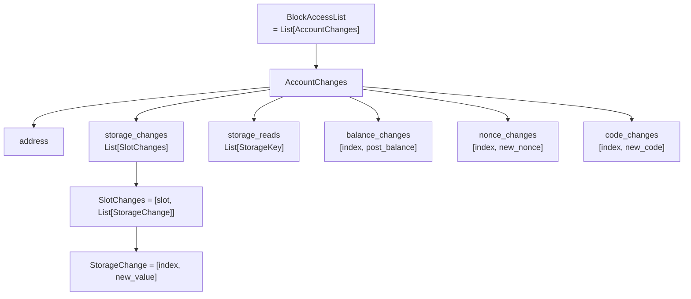
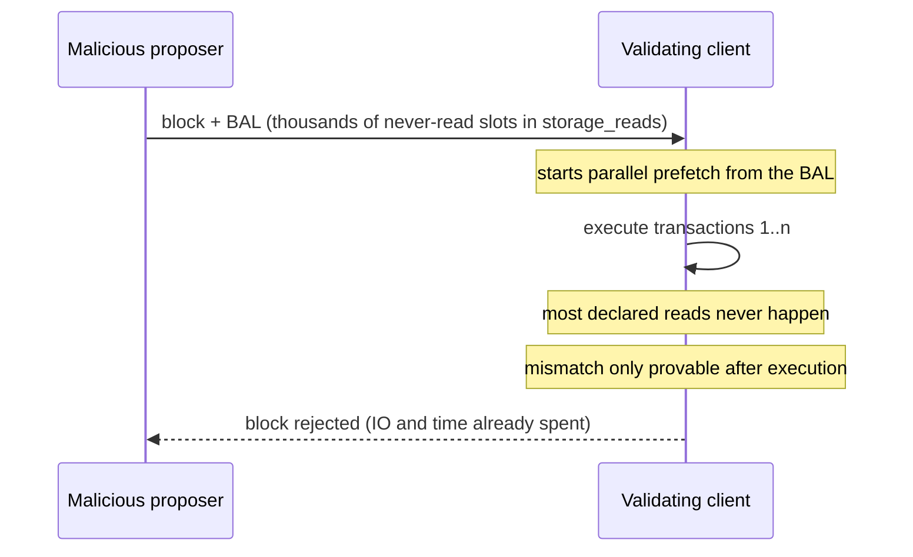

## Abstract

EIP-7928, Block-Level Access Lists (BALs), requires every block to record each account and storage slot its execution touched, together with the value after each transaction. The aim is to parallelise disk reads, transaction validation and state-root computation, and to update state without executing anything[^s01]. As of 2026-10-19 it is in Last Call with a 1 November deadline, and it is scheduled for Ethereum's next hard fork, Glamsterdam[^s01][^s13].

We read the specification page the request pointed to in full and checked whatever could be checked. Three things came out of that.

The rules hold on a live network. Glamsterdam is already active on Sepolia, so forty consecutive BALs were pulled from a public beacon node's payload envelopes, matched against each execution header's `blockAccessListHash`, and machine-checked for every ordering, uniqueness, index-range and size rule. The hash matched in 40 of 40 blocks and there were zero rule violations[^s08].

The specification disagrees with itself in two places. Executed verbatim, the pseudocode in its State Transition Function section puts a slot that one transaction reads and a later transaction writes into both `storage_reads` and `storage_changes`, which the same document forbids with a MUST NOT. The reference implementation, execution-specs, filters this at build time, so real blocks are unaffected[^s01][^s04]. The retention rule, "the weak subjectivity period (3533 epochs)", is unsettled too: the number is the pre-fork value of about 15.7 days, out of step with EIP-8061's roughly 7 days in the same fork, while an open PR argues the opposite, that 3533 epochs is far too short because the consensus layer must serve payloads for 14,299 epochs, and the lead author opened a follow-up along those lines today[^s01][^s06][^s15][^s16].

The design argument is not over. On the discussion thread, participants worried that BALs double block size and proposed lighter alternatives; the authors declined them on the grounds that the worst-case block must still parallelise[^s07]. Independent evidence is mixed: in BNB Chain's benchmark, an EIP-7928 implementation raised average throughput by 18.6% but made p95 block processing 32.1% slower[^s11].

## 1. What changes, and why

Execution cannot be parallelised without knowing in advance which addresses and slots a transaction will touch. EIP-2930 introduced transaction-level access lists, but they are optional and unenforced[^s01][^s14]. EIP-7928 moves the list to the block and enforces it. The specification names four benefits: parallel disk reads and execution, parallel post-state root calculation, state reconstruction without executing transactions, and execution time reduced to "parallel IO + parallel EVM"[^s01].

The decisive choice is to record not only locations but **the values each transaction left behind**. As the lead author put it on the thread, this means that "even if a block contains transactions that depend on one another in sequence, we can achieve the same level of parallelization as if all transactions were completely independent": a client could even run a block bottom to top, reading earlier transactions' effects from the list[^s07].

The relationship to EIP-2930 is explicit too. Entries from a transaction's access list are not copied into the BAL automatically; only what was actually touched or changed is recorded[^s01].

## 2. Structure and commitment

### 2.1 Only a hash in the header

The header gains `block_access_list_hash`, the Keccak-256 of the RLP-encoded list. The list itself is not part of the block body: the execution layer stores it separately and exchanges it with the consensus layer as a field of `ExecutionPayload` over the Engine API[^s01]. On the consensus side it sits in the SSZ `ExecutionPayload` as `block_access_list`, a `ProgressiveList[Byte]`[^s10].

The hash of an empty BAL is `keccak256(rlp([]))`, i.e. `0x1dcc4de8…49347`[^s01]. We recomputed it; it is byte-for-byte the empty-ommers hash that Ethereum headers have carried for years, because both are the hash of the empty RLP list `0xc0`.

### 2.2 RLP layout

The list is organised address → field → index → change[^s01].



_Figure 1 — the RLP structure of a BAL. Only `storage_reads` carries bare slot keys with no index[^s01]._

`BlockAccessIndex` is a `uint32`: 0 for pre-execution system calls, 1 through n for transactions in block order, and n+1 for post-execution system calls and withdrawals[^s01].

### 2.3 Ordering and uniqueness

Determinism is strict. Accounts sort lexicographically by address, slots and read keys ascend, and each change list ascends by index. An address appears exactly once; within an account a key appears at most once in `storage_changes`, at most once in `storage_reads`, and **never in both**; every `SlotChanges` must hold at least one change[^s01]. The last rule was added in June 2026[^s02].

### 2.4 Size bound

There is no fixed item count; the bound follows the gas limit. `bal_items`, the number of storage keys plus addresses, may not exceed `block_gas_limit // 2000`[^s01]. The reasoning: the cheapest way to add an item is a cold `SLOAD` at 2,100 gas, and pricing items at 2,000 deliberately leaves roughly `block_gas_limit / 42000` spare items to absorb entries from system contracts and withdrawal recipients that consume no block gas[^s01]. The arithmetic is exact. At 60M gas the cap is 30,000 items, cold `SLOAD`s alone can produce 28,571, and the difference of 1,429 equals 60,000,000 / 42,000.

## 3. What gets recorded

### 3.1 Scope

A BAL lists every address **accessed**, not only those whose state changed: targets of `BALANCE` and `EXTCODE*`, targets of `CALL`-family opcodes even when they revert, transaction senders and recipients including zero-value transfers, `SELFDESTRUCT` beneficiaries, system contracts before and after execution, withdrawal recipients even for zero amounts, and precompiles that are called. An address with nothing to report appears with empty lists[^s01]. The system caller `0xff…fe` is left out unless it experiences state access itself[^s01].

### 3.2 Gas checks decide inclusion

The boundary is whether state was actually touched, and the specification defines that through the order of gas checks. Costs computable without state, such as memory expansion, the base cost and cold/warm access, are checked first. Only if that pre-state validation passes is the target accessed and therefore included; if it fails, the target was never touched and must not appear[^s01]. A table gives the pre-state checks per opcode.

`SSTORE` has an extra condition: before reading the slot's current value, the frame must cover the access cost and also have more gas left than `GAS_CALL_STIPEND`. The specification explains that "because the access cost can exceed `GAS_CALL_STIPEND` after repricing, the stipend sentry alone is no longer sufficient"[^s01]. That rule arrived in July 2026[^s02]. For an EIP-7702-delegated call target, resolving the delegation also touches the delegated address, so both are recorded if that second access cost can be paid[^s01].

### 3.3 Semantics by change type

- **Storage:** writes that change a value, including zeroing, go in `storage_changes`; slots only `SLOAD`ed, and "no-op writes" that store the existing value, go in `storage_reads`. A write counts as a no-op by comparison with the cumulative state just before the current index, not with the start of the block[^s01].
- **Balances:** the post-transaction balance is recorded, unless it ends where it started even if it moved in between. A zero-value block reward does not, on its own, pull the recipient in[^s01].
- **Code and nonces:** deployed or modified runtime code and EIP-7702 delegation indicators; nonces of EOA senders, contracts that performed `CREATE`, new contracts and 7702 authorities[^s01].

For system contracts, even the slot counts are fixed: one ring-buffer slot for EIP-2935, two for EIP-4788, and slots 0–3 for EIP-7002 and EIP-7251, plus the queue data slots they read, as `storage_reads`[^s01].

## 4. Transport and retention

BALs move over the Engine API. `ExecutionPayloadV4` gains a `blockAccessList` field; `engine_newPayloadV5` returns `INVALID` when the computed list differs from the one supplied; `engine_getPayloadV6` fills it during block building. Historical lists come back through `engine_getPayloadBodiesByHashV2` and `ByRangeV2`, as `null` once pruned[^s01]. For long-term storage the consensus layer may drop the bytes and keep only their SSZ `hash_tree_root`, preserving the Merkle commitment[^s01].

For outside users the door is still narrow. On a public Sepolia node running Geth v1.17.7, four plausible method names including `eth_getBlockAccessList` and `debug_getBlockAccessList` all returned "method does not exist". In Geth's public API file (`internal/ethapi/api.go`) the BAL appears only as a hash field in block results, and on the debug side it is used by bad-block replay[^s09] _(other files, including the Engine API and simulation code, were not checked)_. We obtained BALs instead through the consensus layer's beacon API, via the execution payload envelope route[^s08][^s10].

Retention is currently the most contested sentence in the specification. The text requires the execution layer to keep BALs "for at least the duration of the weak subjectivity period (3533 epochs)", so that a node offline for less than that can catch up by re-execution[^s01].

That number is wrong in two directions. The smaller problem: according to EIP-8061, 3533 epochs is the **current** weak subjectivity period, about 15.7 days, and EIP-8061, also in Glamsterdam, reduces it to about 7.0 days[^s06]. After the fork the number and the thing it claims to describe disagree, though in that direction the error only asks for more storage than needed.

The larger problem runs the other way. PR #12347, opened on 2026-09-16, argues that 3533 epochs is **too short**. After Glamsterdam the BAL is a field of the consensus layer's `ExecutionPayload`, and consensus clients must serve execution payloads for `HISTORY_PRUNE_EPOCHS`, 14,299 epochs. Clients that store payloads blinded rebuild them from the execution client; once the BAL is pruned first, `engine_getPayloadBodiesBy*V2` returns `null` for that field and "the payload can no longer be rebuilt". The PR proposes 14,299 epochs instead[^s15]. The objection is on record: a Nethermind developer wrote that "BAL is just optimisation structure, node can validate block without BAL's, thus we don't really need big retention window for it", to which the proposer replied that "this is not about what the EL needs, the problem is that the CL needs to serve blocks and payloads"[^s15]. On 19 October the lead author opened a follow-up PR aligning EIP-8159 with the change[^s16]. The direction looks settled, but at the time of writing the PR is unmerged.

The cost difference is large. Using the specification's October 2026 average of 92.1 KiB per block after snappy compression, 3533 epochs (113,056 blocks) is about 9.9 GiB; 14,299 epochs (457,568 blocks, about 63.6 days) is about 40.2 GiB, or about 59.6 GiB raw[^s03]. Matching EIP-8061's shorter period instead would take about 4.4 GiB.

## 5. Measured: forty Sepolia blocks, and the specification's pseudocode

### 5.1 Real BALs follow the rules

BALs for Sepolia blocks 11,947,422 to 11,947,461, forty in a row, were taken from a public beacon node (Lighthouse v8.3.0-rc.0) and compared with the execution headers of the same numbers (Geth v1.17.7)[^s08].

| Check | Result |
|---|---|
| `keccak256(BAL)` equals header `blockAccessListHash` | 40/40 |
| decoded and re-encoded RLP is byte-identical (canonical) | 0 violations |
| addresses sorted and unique; slots and read keys ascending | 0 violations |
| a slot present in both reads and changes | 0 cases |
| every index ≤ transactions + 1, ascending and unique per list | 0 violations |
| `bal_items` ≤ `gas_limit // 2000` | max 4,513 (4.5% of the 100,000 cap) |
| addresses with index-0 changes | only the EIP-2935 and EIP-4788 system contracts |

_Scripts: `working/verify/fetch.mjs`, `check.mjs`; log in `working/verify/results.txt`[^s08]._

The average list held 383 addresses and 1,299 storage keys, at 58.4 KiB of RLP and 41.3 KiB gzipped. The span included several external builders (indices 0, 1, 3, 4, 7 and 9) as well as proposer self-builds, so lists produced by different block producers all met the same rules[^s08].

These figures do not compare directly with the specification's size analysis. That analysis computes BALs for 1,000 mainnet blocks (26,095,544 to 26,096,543; 60M gas limit, 30.3M average used, 305 transactions on average) and reports 136.6 KiB raw and 92.1 KiB snappy-compressed on average, with a compressed maximum of 234.6 KiB[^s03]. Mainnet has no BALs yet, so those are computed values; ours come from a testnet at a 200M limit and use gzip. Network and compressor both differ.

### 5.2 The specification's pseudocode breaks its own rule

The State Transition Function section gives `track_state_changes` and `build_bal` in pseudocode. The read-tracking part reads:

```python
for slot in get_storage_reads(addr):
    if slot not in accesses[addr]['storage_writes']:
        accesses[addr]['storage_reads'].add(slot)
```

The check sees only the writes recorded **so far**[^s01]. If transaction 1 reads slot 5 and transaction 2 later writes it, the slot enters the reads while processing transaction 1, when no write exists yet, and the writes while processing transaction 2, and nothing ever removes it from the reads. Running the pseudocode unmodified confirms it. The specification leaves helpers such as `get_storage_reads` undefined, so they were filled in with the most natural reading, the slots that transaction read:

```
slot in storage_changes: [5] | slot in storage_reads: [5]
violates 'MUST NOT appear in both storage_changes and storage_reads': True
reversed order (write in tx1, read in tx2) overlap: False
```

The ordering and uniqueness section of the same document says a key "MUST NOT appear in both `storage_changes` and `storage_reads` for the same account"[^s01]. An implementer who followed the pseudocode would produce invalid blocks.

The reference implementation does not have this problem. execution-specs' `_build_from_builder` filters the whole read set against the write set when it assembles the final list, which catches the case regardless of order[^s04], and its cross-index tests exercise such interactions between indices separately[^s05]. Zero overlaps in forty Sepolia blocks suggest that real clients follow the reference implementation. The pseudocode is presented under an implementation note and names execution-specs as the approach actually used, so the defect lives in the document, not the protocol.

## 6. Debate and counter-evidence

### 6.1 Alternatives sized against the worst case

Size dominated the 35-post Magicians thread[^s07]. One participant argued that the 40 KiB average of the then-current design doubled block size and raised p95 by 1.55×, bandwidth that could otherwise go to a higher gas limit, and proposed shipping a "deterministic, canonical, parallelizable tx execution plan" instead of state diffs. Others suggested partial lists that omit independent transactions, per-transaction pointers to a single parent dependency, and XOR byte diffs in place of new values to help compression[^s07].

The authors' answer was consistent. Execution plans and dependency hints cannot parallelise a worst-case block filled by ten large, interdependent transactions, and dropping state diffs also gives up executionless state updates and the list's use in sync. To the idea of capping dependency-chain length in protocol, they replied that an attacker could compute heavily and then touch a shared slot at the end, extending the chain past the cap and invalidating a builder's block[^s07]. "Size vs parallelization" is still listed as the first reason in the specification's rationale[^s01].

### 6.2 Independent results disagree

Early evidence was encouraging. In April 2025, an early form carrying only addresses and keys, with no state diffs, reportedly improved Geth's live sync by about 30% _(single report, predating the current design)_[^s07].

BNB Chain's December 2025 report is less tidy. On 165M-gas blocks on AWS i7i.8xlarge, its EIP-7928 implementation lifted average throughput from 583 to 691.48 MGas/s, up 18.6%, but p95 block processing time rose from 333.44 ms to 440.43 ms, up 32.1%. BNB Chain called this "instability in block processing time", said it needed refinement, and shipped its own header-free format BEP-592 first, which reached 653.71 MGas/s at 302.22 ms p95[^s11] _(an early implementation in the BSC client; it does not represent Ethereum clients)_. Better averages with a worse tail cut directly against a design whose stated purpose is guaranteeing the worst case.

World Chain published a variant in August 2026 that adds 200 ms flashblock slices to the upstream EIP-7928 primitives. On test networks, sweeping throughput from 1.7 Mgas/s to 1 Ggas/s, validation latency reached a knee near 100 Mgas/s and then flattened. It differs from the L1 design by committing the hash in signed flashblock deltas rather than the header and by switching on through a runtime flag rather than a fork[^s12].

### 6.3 Stalling with fake reads

One attack is named in the text itself. Because `storage_reads` carry no transaction index, whether a declared read really happened can only be confirmed after every transaction has run. A malicious proposer can declare large numbers of slots that are never read, forcing clients into useless prefetching and downloading, and the block cannot be rejected until execution completes[^s01]. The only defence written into the protocol is the `bal_items` cap; clients are encouraged to detect infeasible reads during execution and reject early, with the caveats that such a mechanism must never reject a valid block and that system-call reads are not paid for in block gas and so cannot be bounded by it[^s01].



_Figure 2 — the cost structure of false `storage_reads`. The `bal_items` cap bounds how many can be declared[^s01]._

The size of that bound can be worked out. At 200M gas the cap is 100,000 items, and the Sepolia blocks we examined used 4.5% of it[^s08], leaving an attacker room to declare more than twenty times a normal block's reads. Whether clients have implemented early detection, we did not investigate.

## 7. Limitations

- **The specification is in Last Call and changed today.** A 2026-10-19 commit revised the size figures and wording[^s02]; the text may change again before the 1 November deadline.
- **The measurements cover forty Sepolia blocks.** That is testnet load at a 200M gas limit. Mainnet has no BALs yet, and the specification's mainnet numbers are computed.
- **Compressed sizes were measured with gzip.** The specification uses snappy, so the figures are not directly comparable.
- **No independent, reproducible measurement of parallel-execution speedup was found.** The 30% Geth figure predates state diffs; BNB Chain and World Chain report their own benchmarks.
- **The pseudocode defect has limited weight.** The reference implementation and real blocks obey the rule; the defect matters to a reader who takes the pseudocode as an implementation guide.
- **Retention is unsettled.** If PR #12347 merges, the requirement becomes 14,299 epochs; this report describes the pre-merge text[^s15].
- **eth/71 (EIP-8159) and snap/2 (EIP-8189) were not read.** BAL exchange and BAL-based state healing are separate EIPs[^s13].
- **Client implementations of early detection for fake `storage_reads` were not surveyed.**
