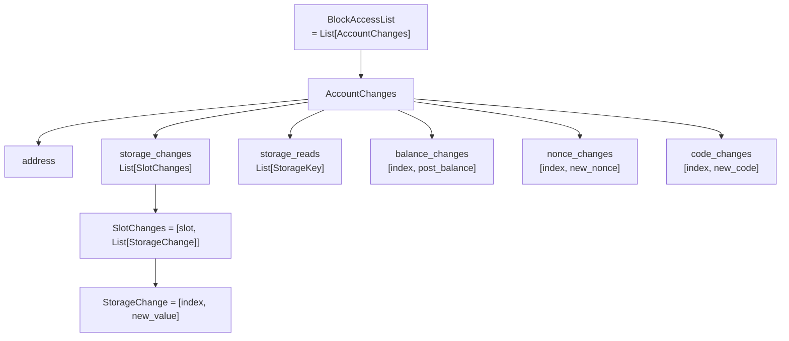
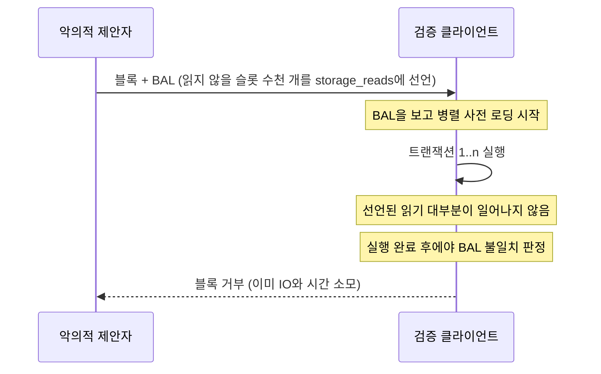

## 초록

EIP-7928 블록 수준 접근 목록(Block-Level Access Lists, BAL)은 블록이 실행 중에 건드린 모든 계정과 저장 슬롯, 그리고 각 트랜잭션 직후의 값을 블록마다 기록하게 하는 제안이다. 목적은 디스크 읽기, 트랜잭션 검증, 상태 루트 계산을 병렬로 돌리고 실행 없이 상태를 갱신하는 것이다[^s01]. 2026-10-19 현재 Last Call 상태이고 마감은 11월 1일이며, 이더리움의 다음 하드포크 글램스테르담에 확정 포함되어 있다[^s01][^s13].

사용자가 준 명세 페이지를 기준으로 읽되, 확인할 수 있는 것은 직접 확인했다. 세 가지가 나왔다.

첫째, 명세는 실제 네트워크에서 지켜지고 있다. 이미 글램스테르담이 활성화된 Sepolia에서 공개 비콘 노드의 페이로드 엔벨로프로 연속 40블록의 BAL을 받아, 실행 헤더의 `blockAccessListHash`와 대조하고 정렬·유일성·인덱스 범위·크기 상한 규칙을 모두 기계적으로 검사했다. 해시는 40/40 일치했고 규칙 위반은 0건이었다[^s08].

둘째, 명세 본문 안에 두 군데 어긋남이 있다. 명세가 상태 전이 함수 절에 제시한 의사코드를 그대로 실행하면, 앞선 트랜잭션이 읽고 뒤 트랜잭션이 쓴 슬롯이 `storage_reads`와 `storage_changes`에 동시에 들어가, 같은 명세의 "둘 다에 나타나면 안 된다(MUST NOT)"를 어긴다. 참조 구현인 execution-specs는 빌드 단계에서 이를 걸러 내므로 실제 블록에는 문제가 없다[^s01][^s04]. BAL 보관 기간 "약한 주관성 기간(3533에폭)"도 흔들린다. 그 숫자는 포크 이전 값(약 15.7일)이라 같은 포크의 EIP-8061(약 7일)과 어긋나고, 반대로 열린 PR은 합의 계층이 페이로드를 14,299에폭 동안 제공해야 하므로 3533에폭은 너무 짧다며 네 배로 늘리자고 제안한다. 명세 저자는 이 방향을 따르는 후속 PR을 오늘 열었다[^s01][^s06][^s15][^s16].

셋째, 설계 논쟁은 끝나지 않았다. 토론 스레드에서는 블록 크기가 두 배로 늘어난다는 우려와 함께 더 가벼운 대안들이 제안되었고, 저자는 최악의 블록에서도 병렬화가 보장되어야 한다는 이유로 이를 받아들이지 않았다[^s07]. 독립 구현 쪽 증거도 엇갈린다. BNB Chain의 벤치마크에서 EIP-7928 구현은 평균 처리량을 18.6% 높였지만 p95 블록 처리 시간은 32.1% 나빠졌다[^s11].

## 1. 무엇을 왜 바꾸나

트랜잭션 실행은 어떤 주소와 저장 슬롯을 건드릴지 미리 알지 못하면 병렬화할 수 없다. EIP-2930이 트랜잭션 단위 접근 목록을 도입했지만 선택 사항이고 강제되지 않는다[^s01][^s14]. EIP-7928은 접근 목록을 블록 단위로 옮기고 강제한다. 명세가 드는 효과는 넷이다. 디스크 읽기와 트랜잭션 실행의 병렬화, 사후 상태 루트 계산의 병렬화, 트랜잭션을 실행하지 않고 상태를 재구성하는 것, 그리고 블록 처리 시간을 "병렬 IO + 병렬 EVM"으로 줄이는 것이다[^s01].

결정적인 설계 선택은 접근한 위치뿐 아니라 **트랜잭션마다 바뀐 값**까지 담는다는 점이다. 저자는 토론에서 이 덕분에 트랜잭션들이 서로 의존하더라도 "모두 완전히 독립적인 것처럼 같은 수준의 병렬화"가 가능하다고 설명한다. 블록을 아래에서 위로 실행해도 앞 트랜잭션의 결과를 BAL에서 바로 읽을 수 있기 때문이다[^s07].

EIP-2930 목록과의 관계도 명시되어 있다. 트랜잭션에 실린 EIP-2930 항목은 BAL에 자동으로 들어가지 않고, 실제로 접근하거나 바꾼 것만 기록된다[^s01].

## 2. 자료구조와 커밋

### 2.1 헤더에는 해시만

블록 헤더에 `block_access_list_hash` 필드가 추가된다. RLP로 인코딩한 BAL의 Keccak-256 해시다. BAL 자체는 블록 본문에 들어가지 않는다. 실행 계층은 BAL을 따로 저장하고, Engine API의 `ExecutionPayload` 필드로 합의 계층과 주고받는다[^s01]. 합의 계층은 이를 SSZ `ExecutionPayload`의 `block_access_list` 필드에 `ProgressiveList[Byte]`로 담는다[^s10].

빈 BAL의 해시는 `keccak256(rlp([]))`, 곧 `0x1dcc4de8…49347`이다[^s01]. 직접 계산해 확인했고, 이 값은 이더리움 헤더에서 오래 써 온 빈 엉클(ommers) 목록의 해시와 같은 바이트열이다. 둘 다 빈 RLP 리스트 `0xc0`의 해시이기 때문이다.

### 2.2 RLP 구조

BAL은 "주소 → 필드 → 인덱스 → 변경"의 순서로 짜인다[^s01].



_Figure 1 — BAL의 RLP 구조. `storage_reads`만 인덱스 없이 슬롯 키만 담는다[^s01]._

`BlockAccessIndex`는 `uint32`다. 블록 실행 전 시스템 계약 호출은 0, 트랜잭션은 블록 순서대로 1부터 n, 실행 후 시스템 호출과 출금(withdrawal)은 n+1이다[^s01].

### 2.3 정렬과 유일성

결정성 규칙은 엄격하다. 계정은 주소의 사전순, 저장 슬롯은 키 오름차순, 각 변경 목록은 인덱스 오름차순이어야 한다. 주소는 정확히 한 번만 나타나고, 한 계정 안에서 같은 키는 `storage_changes`에 최대 한 번, `storage_reads`에 최대 한 번 나타나며, **두 목록에 동시에 나타날 수 없다**. 각 `SlotChanges`에는 변경이 하나 이상 있어야 한다[^s01]. 이 마지막 규칙은 2026년 6월에 추가되었다[^s02].

### 2.4 크기 상한

BAL에는 고정 항목 수 상한이 없고 블록 가스 한도에 묶인다. `bal_items = 저장 키 수 + 주소 수`가 `block_gas_limit // 2000`을 넘으면 안 된다[^s01]. 명세의 근거는 이렇다. BAL에 항목 하나를 추가하는 가장 싼 방법은 2,100가스짜리 콜드 `SLOAD`인데, 상한을 일부러 2,000으로 잡아 대략 `block_gas_limit / 42000`개의 여유를 둔다. 이 여유는 블록 가스를 쓰지 않는 시스템 계약 실행과 출금 수신자가 만드는 항목을 흡수한다[^s01]. 계산해 보면 정확히 맞는다. 6천만 가스에서 상한은 30,000개, 콜드 `SLOAD`만으로 채울 수 있는 최대는 28,571개로 차이가 1,429개이고, 이는 60,000,000/42,000과 같다.

## 3. 무엇을 기록하나

### 3.1 포함 범위

BAL에는 상태가 바뀐 주소 외에 **접근만 한 주소**도 들어간다. `BALANCE`·`EXTCODE*` 대상, 되돌려진 호출을 포함한 `CALL`류 대상, 트랜잭션 송신자와 수신자(0원 송금 포함), `SELFDESTRUCT` 수혜자, 실행 전후 시스템 계약, 출금 수신자(금액이 0이어도), 호출된 프리컴파일이 모두 포함되고, 변경이 없으면 빈 목록으로 남는다[^s01]. 시스템 호출자 주소 `0xff…fe`는 그 자체가 상태 접근을 겪지 않는 한 넣지 않는다[^s01].

### 3.2 가스 검증이 포함 여부를 정한다

포함 여부의 경계는 "실제로 상태에 손을 댔는가"이고, 명세는 이를 가스 검증 순서로 정의한다. 상태를 읽지 않고 계산할 수 있는 비용(메모리 확장, 기본 비용, 콜드/웜 접근 비용)을 먼저 검사하고, 이 사전 검증을 통과해야 대상에 접근하며, 그때 비로소 BAL에 들어간다. 사전 검증에서 가스가 모자라면 대상은 접근된 적이 없으므로 BAL에 넣으면 안 된다[^s01]. 명세는 opcode별 사전 검증 항목을 표로 정해 둔다.

`SSTORE`에는 별도 조건이 붙는다. 슬롯의 현재 값을 읽기 전에 접근 비용을 낼 수 있어야 하고 동시에 남은 가스가 `GAS_CALL_STIPEND`보다 커야 한다. 명세는 그 이유를 "재가격화 이후 접근 비용이 스티펜드를 넘을 수 있어 스티펜드 조건만으로는 더 이상 충분하지 않다"고 적는다[^s01]. 이 조건은 2026년 7월에 들어왔다[^s02]. EIP-7702 위임이 걸린 호출 대상은 위임을 풀기 위해 위임된 주소까지 접근하므로, 그 주소의 접근 비용을 낼 수 있으면 둘 다 기록된다[^s01].

### 3.3 변경 유형별 의미

- **저장 슬롯:** 값이 실제로 바뀐 쓰기와 0으로 지운 쓰기는 `storage_changes`에, `SLOAD`만 한 슬롯과 같은 값을 다시 쓴 "무변화 쓰기"는 `storage_reads`에 들어간다. 무변화 여부는 블록 시작 값과 비교하지 않고, 바로 앞 인덱스까지의 누적 상태와 비교해 판정한다[^s01].
- **잔고:** 트랜잭션 직후의 잔고를 기록하되, 트랜잭션 중에 바뀌었어도 끝에서 원래 값과 같으면 기록하지 않는다. 0원짜리 블록 보상은 그것만으로 수신자를 포함시키지 않는다[^s01].
- **코드와 논스:** 배포·변경된 런타임 바이트코드와 EIP-7702 위임 지시자, EOA 송신자·`CREATE` 수행 계약·새 계약·7702 권한자의 논스를 기록한다[^s01].

시스템 계약에 대해서는 기록할 슬롯 수까지 정해져 있다. EIP-2935는 링 버퍼 슬롯 하나, EIP-4788은 둘, EIP-7002와 EIP-7251은 0~3번 네 슬롯에 더해 대기열에서 읽은 데이터 슬롯을 `storage_reads`로 남긴다[^s01].

## 4. 운반과 보관

BAL은 Engine API로 오간다. `ExecutionPayloadV4`에 `blockAccessList` 필드가 생기고, `engine_newPayloadV5`는 계산한 BAL이 받은 것과 다르면 `INVALID`를 돌려주며, `engine_getPayloadV6`는 블록을 만들면서 BAL을 채운다. 과거 BAL은 `engine_getPayloadBodiesByHashV2`/`ByRangeV2`로 꺼낼 수 있고, 가지치기한 경우 `null`이다[^s01]. 합의 계층은 장기 보관 시 BAL 바이트를 지우고 그 SSZ `hash_tree_root`만 남겨 머클 약속을 유지해도 된다[^s01].

외부 사용자에게는 아직 길이 좁다. 공개 Sepolia 노드(Geth v1.17.7)에 `eth_getBlockAccessList`, `debug_getBlockAccessList` 등 네 가지 이름으로 호출해 보았으나 모두 "존재하지 않는 메서드" 오류가 돌아왔다. Geth 소스의 공개 API 파일(`internal/ethapi/api.go`)에서 BAL은 블록 조회 결과의 해시 필드로만 나타났고, 디버그 쪽에서는 잘못된 블록 재실행 기능에 쓰인다[^s09] _(Engine API·시뮬레이션 코드 등 다른 파일은 확인하지 않았다)_. 이 리포트는 대신 합의 계층 비콘 API의 실행 페이로드 엔벨로프 경로로 BAL을 받았다[^s08][^s10].

보관 기간은 지금 이 명세에서 가장 활발하게 다퉈지는 문장이다. 현재 본문은 실행 계층이 BAL을 "최소한 약한 주관성 기간(3533에폭) 동안" 보관하라고 요구한다. 오프라인이었던 노드가 재실행으로 따라잡을 수 있게 하려는 것이다[^s01].

이 숫자에는 두 방향의 문제가 걸려 있다. 하나는 작은 것이다. 3533에폭은 EIP-8061 본문에 따르면 **현재**의 약한 주관성 기간, 약 15.7일이고, 같은 글램스테르담에 포함된 EIP-8061이 이 기간을 약 7.0일로 줄인다[^s06]. 포크 이후에는 숫자와 그 숫자가 설명한다는 대상이 어긋난다. 이 방향만 보면 더 오래 보관하라는 것이니 안전 쪽 오차다.

더 큰 문제는 반대 방향이다. 2026-09-16 열린 PR #12347은 3533에폭이 오히려 **너무 짧다**고 주장한다. 글램스테르담 이후 BAL은 합의 계층 `ExecutionPayload`의 한 필드인데, 합의 클라이언트는 실행 페이로드를 `HISTORY_PRUNE_EPOCHS`(14,299에폭) 동안 제공해야 한다. 페이로드를 축약(blinded) 저장하는 클라이언트는 실행 클라이언트에서 본문을 받아 재구성하는데, BAL이 먼저 지워지면 `engine_getPayloadBodiesBy*V2`가 그 필드에 `null`을 돌려주어 "페이로드를 더 이상 재구성할 수 없다"는 것이다. PR은 보관 기간을 14,299에폭으로 바꾸자고 제안한다[^s15]. 반론도 기록되어 있다. Nethermind 개발자는 "BAL은 최적화 구조일 뿐이고 노드는 BAL 없이도 블록을 검증할 수 있어 긴 보관 기간이 필요 없다"고 했고, 제안자는 "실행 계층이 무엇을 필요로 하는가의 문제가 아니라 합의 계층이 블록과 페이로드를 제공해야 하는 문제"라고 답했다[^s15]. 10월 19일에는 명세의 대표 저자가 이 PR을 전제로 EIP-8159를 맞추는 후속 PR을 열었다[^s16]. 방향은 정해진 듯하지만 이 글을 쓰는 시점에 PR은 병합되지 않았다.

비용 차이는 크다. 명세의 2026년 10월 분석 평균(snappy 92.1 KiB)으로 환산하면 3533에폭(113,056블록)은 약 9.9 GiB, 14,299에폭(457,568블록, 약 63.6일)은 약 40.2 GiB이고, 원시 크기로는 약 59.6 GiB다[^s03]. 반대로 EIP-8061의 줄어든 기간(약 7일)에 맞추면 약 4.4 GiB면 된다.

## 5. 실측: Sepolia 40블록과 명세의 의사코드

### 5.1 실제 BAL은 규칙을 지킨다

Sepolia 블록 11,947,422~11,947,461 연속 40블록의 BAL을 공개 비콘 노드(Lighthouse v8.3.0-rc.0)에서 받아, 같은 번호의 실행 헤더(Geth v1.17.7)와 대조했다[^s08]. 검사 항목은 다음과 같다.

| 검사 | 결과 |
|---|---|
| `keccak256(BAL)` = 헤더 `blockAccessListHash` | 40/40 일치 |
| 디코딩 후 재인코딩한 RLP가 원본과 동일(정준 인코딩) | 위반 0 |
| 주소 사전순·유일, 슬롯·읽기 키 오름차순 | 위반 0 |
| 같은 슬롯이 읽기·쓰기 양쪽에 등장 | 0건 |
| 모든 인덱스 ≤ 트랜잭션 수 + 1, 목록별 오름차순·유일 | 위반 0 |
| `bal_items` ≤ `gas_limit // 2000` | 최대 4,513개(상한 100,000의 4.5%) |
| 인덱스 0에 변경이 있는 주소 | EIP-2935·EIP-4788 시스템 계약뿐 |

_스크립트: `working/verify/fetch.mjs`, `check.mjs`. 실행 로그: `working/verify/results.txt`[^s08]._

평균 BAL은 주소 383개, 저장 키 1,299개, RLP 58.4 KiB, gzip 41.3 KiB였다. 같은 구간에 외부 빌더 여러 명(인덱스 0·1·3·4·7·9)과 제안자 자체 빌드가 섞여 있었으므로, 서로 다른 블록 생산자가 만든 BAL이 모두 같은 규칙을 지켰다[^s08].

이 수치를 명세의 크기 분석과 바로 비교하기는 어렵다. 명세는 메인넷 1,000블록(26,095,544~26,096,543, 가스 한도 6천만, 평균 사용 3,030만, 평균 305건)에 대해 BAL을 계산한 결과로 평균 원시 136.6 KiB, snappy 압축 92.1 KiB, 최대 압축 234.6 KiB를 보고한다[^s03]. 메인넷에는 아직 BAL이 없으므로 이는 계산된 값이고, 내 측정은 2억 가스 한도의 테스트넷 부하에 gzip을 썼다. 네트워크도 압축 방식도 다르다.

### 5.2 명세 의사코드는 자기 규칙을 어긴다

명세의 상태 전이 함수 절은 `track_state_changes`와 `build_bal` 의사코드를 제시한다. 읽기를 기록하는 부분은 이렇다.

```python
for slot in get_storage_reads(addr):
    if slot not in accesses[addr]['storage_writes']:
        accesses[addr]['storage_reads'].add(slot)
```

이 검사는 트랜잭션을 처리하는 **그 시점**까지의 쓰기만 본다[^s01]. 트랜잭션 1이 슬롯 5를 읽고 트랜잭션 2가 같은 슬롯에 쓰면, 1을 처리할 때는 아직 쓰기가 없으므로 읽기에 들어가고, 2를 처리할 때 쓰기에도 들어간다. 이후 어디서도 읽기를 지우지 않는다. 이 의사코드를 바꾸지 않고 실행해 확인했다. 명세는 `get_storage_reads` 같은 보조 함수를 정의하지 않으므로, 이 함수들은 "해당 트랜잭션이 읽은 슬롯"을 돌려준다는 가장 자연스러운 해석으로 채웠다.

```
slot in storage_changes: [5] | slot in storage_reads: [5]
violates 'MUST NOT appear in both storage_changes and storage_reads': True
reversed order (write in tx1, read in tx2) overlap: False
```

같은 명세의 정렬·유일성 절은 "같은 계정에서 한 키가 `storage_changes`와 `storage_reads` 양쪽에 나타나면 안 된다(MUST NOT)"고 정한다[^s01]. 의사코드를 구현 지침으로 따라 하면 무효 블록을 만든다.

참조 구현은 이 문제를 갖고 있지 않다. execution-specs의 `_build_from_builder`는 BAL을 최종 조립할 때 읽기 집합 전체를 쓰기 집합과 대조해 겹치는 슬롯을 뺀다[^s04]. 실행 순서와 무관하게 마지막에 거르므로 위 경우가 걸러진다. execution-specs의 교차 인덱스 테스트에는 앞 트랜잭션 쓰기 이후의 왕복 같은 인덱스 간 상호작용 사례가 별도로 있다[^s05]. Sepolia 40블록에서 겹침이 0건이었던 것도 실제 클라이언트가 참조 구현 쪽을 따랐다는 정황이다. 명세는 이 의사코드를 "구현 노트"와 함께 제시하고 실제 검증 방식으로 execution-specs를 가리키므로, 결함은 문서의 것이지 프로토콜의 것은 아니다.

## 6. 논쟁과 반대 증거

### 6.1 크기를 둘러싼 대안들

Magicians 토론 35개 글의 가장 큰 쟁점은 크기였다[^s07]. 한 참여자는 당시 설계의 평균 40 KiB가 블록 크기를 두 배로, p95를 1.55배로 늘린다며, 그 대역폭이면 가스 한도를 올리는 데 쓸 수도 있다고 지적하고, 상태 차이 대신 제안자가 계산한 "결정적 병렬 실행 계획"을 싣자고 제안했다. 다른 참여자들은 의존성이 없는 트랜잭션은 빼는 부분 BAL, 트랜잭션마다 직전 부모 인덱스만 적는 의존성 힌트, 새 값 대신 XOR 바이트 차이를 실어 압축률을 높이는 방식을 내놓았다[^s07].

저자의 반론은 일관되다. 실행 계획이나 의존성 힌트로는 서로 얽힌 큰 트랜잭션 열 개로 가스를 다 채운 최악의 블록을 병렬화할 수 없고, 상태 차이가 없으면 실행 없는 상태 갱신과 동기화 용도도 잃는다는 것이다. 의존성 사슬 길이를 프로토콜로 제한하자는 제안에는, 공격자가 연산을 많이 한 뒤 마지막에 공유 슬롯을 건드려 사슬을 늘려서 빌더가 만든 블록을 무효로 만드는 DoS가 가능하다고 답했다[^s07]. 현재 명세의 근거 절에도 "크기 대 병렬화"의 선택이 첫 번째 이유로 적혀 있다[^s01].

### 6.2 독립 구현의 결과는 엇갈린다

초기 증거는 긍정적이었다. 2025년 4월, 주소와 키만 담고 상태 차이는 없는 초기 형태의 BAL로 Geth의 실시간 동기화 성능이 약 30% 좋아졌다는 보고가 있었다 _(단일 보고, 현재 설계 이전)_[^s07].

BNB Chain의 2025년 12월 자료는 더 복잡하다. 1억 6,500만 가스 블록, AWS i7i.8xlarge에서 측정한 결과, EIP-7928 구현은 평균 처리량을 583에서 691.48 MGas/s로 18.6% 높였지만, p95 블록 처리 시간은 333.44 ms에서 440.43 ms로 32.1% 늘었다. BNB Chain은 이를 "블록 처리 시간의 불안정성"이라 부르고 추가 개선이 필요하다고 적었으며, 대신 해시를 헤더에 넣지 않는 자체 형식 BEP-592를 먼저 배포했다. BEP-592는 처리량 653.71, p95 302.22 ms였다[^s11] _(BSC 클라이언트의 초기 구현 결과이며 이더리움 클라이언트를 대표하지 않는다)_. 평균은 좋아지고 꼬리는 나빠졌다는 결과는, 최악의 경우를 보장하려는 이 설계의 목표와 정면으로 관련된다.

World Chain은 2026년 8월, 업스트림 EIP-7928의 기본 요소에 200 ms 플래시블록 단위의 조각(slice)을 더한 변형을 공개했다. 테스트 네트워크에서 처리량을 초당 170만 가스에서 10억 가스까지 올리는 동안 검증 지연이 초당 약 1억 가스 지점에서 꺾인 뒤 평탄해졌다고 보고한다. 헤더 대신 서명된 플래시블록 델타에 해시를 싣고, 하드포크가 아닌 실행 플래그로 켠다는 점에서 L1 설계와 다르다[^s12].

### 6.3 가짜 읽기로 시간 끌기

명세 스스로 짚은 공격이 있다. `storage_reads`에는 트랜잭션 인덱스가 없어서, 그 읽기가 정말 일어났는지는 모든 트랜잭션을 실행한 뒤에야 확인된다. 악의적 제안자는 실제로는 읽지 않을 슬롯을 잔뜩 선언해 다른 클라이언트에 불필요한 사전 로딩과 다운로드를 강요할 수 있고, 그 블록은 실행이 끝날 때까지 거부할 수 없다[^s01]. 명세의 방어는 `bal_items` 상한 하나이고, 클라이언트에 실행 중 실현 불가능한 읽기를 감지해 일찍 거부하는 장치를 고려하라고 권한다. 단 그런 장치가 정상 블록을 거부해서는 안 되며, 시스템 호출의 읽기는 블록 가스로 지불되지 않으므로 가스로 묶을 수 없다는 단서가 붙는다[^s01].



_Figure 2 — 거짓 `storage_reads`의 비용 구조. `bal_items` 상한이 선언 가능한 양을 묶는다[^s01]._

상한이 실제로 얼마나 큰지는 계산해 볼 수 있다. 2억 가스면 10만 항목이고, 내가 본 Sepolia 블록들은 그 4.5%만 썼다[^s08]. 공격자는 정상 블록보다 20배 이상 많은 읽기를 선언할 여지가 있다는 뜻이다. 클라이언트들이 조기 감지를 구현했는지는 조사하지 못했다.

## 7. Limitations

- **명세는 Last Call 중이고 오늘도 수정됐다.** 2026-10-19 커밋이 크기 수치와 문구를 고쳤다[^s02]. 마감(11월 1일) 전에 본문이 더 바뀔 수 있다.
- **실측은 Sepolia 40블록이다.** 테스트넷 부하이고 2억 가스 한도다. 메인넷에는 아직 BAL이 없으며, 명세의 메인넷 수치는 계산된 값이다.
- **압축 크기는 gzip으로 쟀다.** 명세는 snappy를 쓰므로 직접 비교할 수 없다.
- **병렬 실행 속도 향상에 대한 독립적이고 재현 가능한 측정은 찾지 못했다.** Geth 30%는 상태 차이가 없던 초기 설계, BNB Chain과 World Chain은 각자의 벤치마크다.
- **의사코드 결함의 무게는 제한적이다.** 참조 구현과 실제 블록은 규칙을 지킨다. 결함은 의사코드를 구현 지침으로 읽는 독자에게 해당한다.
- **보관 기간은 미확정이다.** PR #12347이 병합되면 요구가 14,299에폭으로 바뀐다. 이 리포트는 병합 전 본문을 기준으로 한다[^s15].
- **eth/71(EIP-8159)과 snap/2(EIP-8189) 본문은 읽지 않았다.** BAL 교환과 BAL 기반 상태 복구는 별도 EIP다[^s13].
- **가짜 `storage_reads` 조기 감지를 클라이언트가 구현했는지는 조사하지 않았다.**
