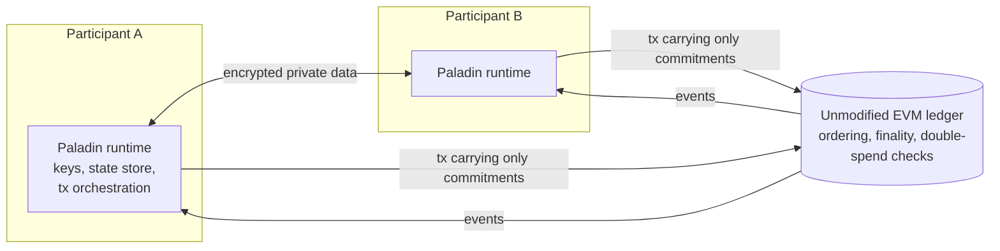
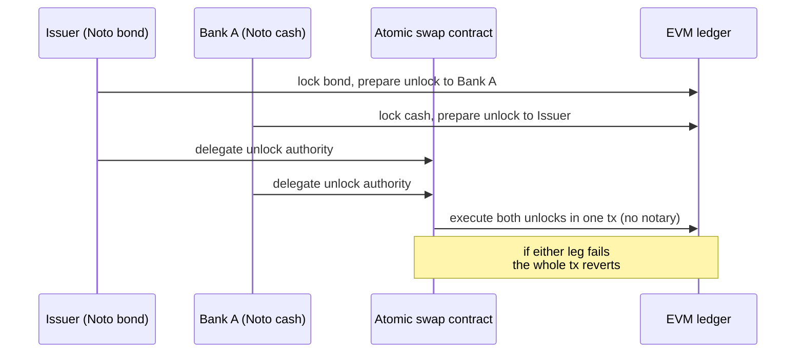

## Abstract

Paladin is a Linux Foundation Decentralized Trust (LFDT) project that adds enterprise privacy to unmodified EVM chains through a sidecar runtime[^s01][^s02]. It started as a lab in February 2025, became a full project that November, and shipped v1.0 on 25 June 2026[^s09][^s10][^s08]. One shared runtime hosts three domains with very different trust models. Noto is a token whose single notary sees and validates every private state. Zeto enforces its rules with zero-knowledge proofs. Pente is a private EVM that runs only inside a group[^s03][^s06][^s04]. All three keep only hashed commitments on chain, and locks plus delegation let them settle against each other atomically[^s02][^s03]. Reading the repositories turned up constraints the marketing omits. Pente requires 100% of a group to endorse, so one silent member halts the group[^s05]. Paladin pins Zeto contracts at v0.2.2, and the post-quantum circuits in Zeto's latest release appear nowhere in the Paladin repo[^s08][^s07]. All seven maintainers work for Kaleido. The claim that central banks have adopted Paladin names no institution, and no third-party security audit report was found[^s08][^s10][^s11].

## 1. Introduction

The project site promises "true financial privacy to the world's most popular smart contract platform". It is Apache-2.0 licensed under "Paladin a Series of LF Projects, LLC"[^s01]. The docs put it more plainly: "a privacy preserving transaction manager for Ethereum"[^s02].

Private transactions on EVM have a long history, from Constellation in 2016 through Quorum and Tessera. Paladin's docs name two flaws in that lineage. State gets locked inside a single private contract, and overlapping privacy groups let "the states diverge so there is no single source of truth". Tessera itself was deprecated in 2024[^s04]. LFDT's launch post diagnosed EVM privacy work as "fractured into many individual research projects" and pitched Paladin as the runtime that pulls the pieces together[^s09].

This report reads the docs and both repositories, paladin and zeto, and checks the architecture, the trust models and the maturity claims against the code.

## 2. Architecture: a sidecar and two ledgers

Paladin is a separate process that sits beside an EVM node such as Besu. It exchanges private data with other Paladin nodes over secure channels and discloses it selectively[^s02]. Every privacy-preserving contract has two halves. One is an ordinary contract on an unmodified EVM, and the other runs inside Paladin. The base EVM ledger is the source of truth for ordering and finality, and on-chain state is stored "in a securely masked format"[^s02].

_Figure 1 — Paladin's two layers. Private data moves only between runtimes, and the ledger holds commitments and signatures.[^s02][^s03]_

## 3. Three domains, three trust models

### 3.1 Noto: trust the notary

Noto tokens are confidential UTXO tokens "managed by a single party, referred to as the notary". Each state holds an owner, an amount and a random salt. Only its hash reaches the ledger, and the data itself travels over private channels[^s03]. The notary checks the sender's EIP-712 signature and whether the proposed states validly express the request. For anything but mint and burn, it also checks that inputs and outputs sum to the same value[^s03].

The privacy here is privacy from outsiders. The notary sees every transfer, and the docs' own walkthrough has the notary checking that "the total balance of Party A will be above a threshold"[^s03]. An independent profile likewise notes that Noto enforcement "depends on notary/issuer EIP-712 certificates"[^s14]. Policy comes in two modes. Basic mode offers a few switches for mint, burn and lock. Hooks mode hands policy to a private Pente contract, and then "none of the basic notary constraints ... will be active". A buggy hook leaves no fallback control[^s03].

### 3.2 Zeto: trust the proof system

Zeto is a family of Circom-based zero-knowledge UTXO tokens. It offers sender and receiver anonymity, encrypted secrets, history masking, KYC and non-repudiation toward a designated auditor[^s07]. An on-chain verifier replaces the notary, and the Paladin runtime does the indexing, coin selection and proof generation[^s06].

Trust does not disappear; it moves. Zeto's README warns that its test setup "is not sufficient to establish trust in the generated proofs". Proving keys must come from a documented decentralized ceremony or a single trusted party[^s07].

### 3.3 Pente: trust every member

Pente gives each privacy group its own world state, one base-ledger contract per group, which the docs call "just like a mini-blockchain"[^s04]. Transactions are pre-executed in ephemeral Besu EVMs inside the runtime. Members then endorse the exact input and output states, and the ledger verifies those signatures against the commitments, with no change to the base EVM[^s04].

The docs call this "threshold signature verification"[^s04]. The code allows exactly one threshold. `PenteDomain.java` accepts a single endorsement type, `group_scoped_identities`. A comment states that "the threshold is 100% right now", because a member who skipped endorsing would later have to catch up on transitions it missed[^s05]. The on-chain contract reverts below the threshold[^s08]. One offline member therefore stops the whole group. M-of-N endorsement appears in LFDT's post only as a future wish[^s10].

| Domain | Who enforces the rules | Who sees private data | Main trust point |
|---|---|---|---|
| Noto | notary signature | parties and the notary | the notary, or hook code |
| Zeto | on-chain ZK verifier | parties | proving-key ceremony |
| Pente | EIP-712 signatures of all members | group members | liveness of every member |

_Table 1 — Trust in the three domains, compiled from the docs and code.[^s03][^s05][^s07]_

## 4. Atomic interoperability

What most separates Paladin from the Tessera lineage is atomic settlement across domains[^s04]. Under Noto, the notary pre-verifies a transaction and records its signature, the hash of masked inputs and outputs, inside a lock. The owner delegates that lock to a settlement contract, which can commit or roll back "directly on-chain without involvement of the notary"[^s03]. One settlement can combine Noto tokens with different notaries, plain ERC-20 legs, Zeto legs and transactions prepared inside Pente groups[^s03].

_Figure 2 — A simplified version of the bond/CBDC DvP demo shown at LFDT's July 2026 workshop.[^s03][^s13]_

Kaleido engineers are trying to standardize this lock model. In July 2026 two drafts went up on Ethereum Magicians. ERC-8316 defines a lock lifecycle for settlement across systems with different privacy models, and ERC-8322 defines a notary-backed confidential token[^s16][^s15]. The ERC-8322 author handle resembles a Paladin maintainer's GitHub ID, though the post never mentions Paladin, and it had drawn no replies[^s15].

## 5. Maturity and governance

**Releases.** v1.0.0 shipped as a GitHub release on 25 June 2026, and v1.0.1-rc.1 followed as a prerelease on 28 September[^s08][^s13].

**One company.** Every one of the seven active maintainers in `MAINTAINERS.md` lists Kaleido as their affiliation. Over the last year, 1,747 commits came from kaleido.io addresses, 402 from GitHub noreply and 26 from anything else[^s08]. The launch posts were written by Kaleido's co-founder and engineers[^s09][^s10]. Governance is open, but one firm does the development. The repo has 92 stars and 77 forks[^s08].

**Adoption claims.** LFDT says Paladin "has already been deployed in a number of projects including central banks" and names none[^s10]. Ledger Insights repeated it as "multiple central and commercial banks adopting it", again without names. The Bank of Korea's LFDT membership in the same article is not tied to Paladin[^s11]. The only named case is Kaleido's own story on Bank Indonesia's Project Garuda. Even there Paladin appears only in a "built with" list. The page states neither its role nor which of the two evaluated protocols was chosen[^s12] _(vendor-stated)_.

**Docs versus code.** LFDT's post celebrates post-quantum encrypted storage in Zeto, contributed by researchers at UC Berkeley and UNC Chapel Hill[^s10]. It exists in the Zeto repo as `Zeto_AnonNullifierQurrency`, built on ML-KEM[^s07]. Paladin, however, depends on Zeto contracts v0.2.2 from January 2026. Its Zeto domain knows six Anon-family variants, and a repo-wide search for "qurrency" returns nothing[^s08]. Railgun, listed as a plugin in Kaleido's July 2026 deck, is also absent from the repo[^s13][^s08]. The Hardhat config lifts the contract-size limit because "a small number of verifiers are bigger than the default 24576 bytes"[^s08]. Whether those verifiers can deploy on a chain that enforces EIP-170, such as Ethereum mainnet, was not tested.

**Security.** No third-party audit report turned up in either repo's documentation. The security policy lives in the organization's `.github` repository[^s08]. EthSystems lists "operator access to client data in certain operating modes" and "centralization and custodial key management trade-offs" as risks[^s14].

## 6. Discussion

**Paladin is a runtime binding three different trust contracts.** The site presents the domains as peers, but their guarantees diverge. Noto shows everything to its notary, Zeto rests on a ceremony, and Pente needs every member awake (Table 1). Atomic settlement ties them into one transaction, and its privacy is only as strong as its weakest leg. In the Figure 2 DvP with Noto on both sides, both notaries see the whole trade.

**What suits the target customer constrains everyone else.** Notary checks, unanimous endorsement and KYC hooks fit a supervised bank consortium. The site shows Ethereum, Base and Arbitrum logos and claims compatibility with "any unmodified EVM"[^s01]. Yet the docs' default picture is a sidecar beside a Besu node, and the workshop demo ran on a private QBFT network[^s02][^s13].

**Three questions for anyone evaluating it.** Is the Zeto variant you need actually wired into Paladin's domain? How will you keep every Pente group member online? And will the vendor show audits and name deployments? Public material answers none of them.

## 7. Limitations

- Nothing was executed. A CI-style Solidity build failed at dependency install (npm ETARGET), and the Go domain tests need Gradle-generated artefacts. Code claims rest on reading the source.
- The absence of an audit is bounded by a markdown search of both repos and a web search; a private audit may exist.
- No named deployments, performance figures or independent benchmarks were found, and the only independent analysis is one EthSystems profile.
- Which verifiers exceed 24,576 bytes, and whether they deploy on real chains, was not measured.
- Everything reflects main as of 23 October 2026 (paladin `6937b943a`, zeto `dd49549`) and may change in v1.0.1 and later.
