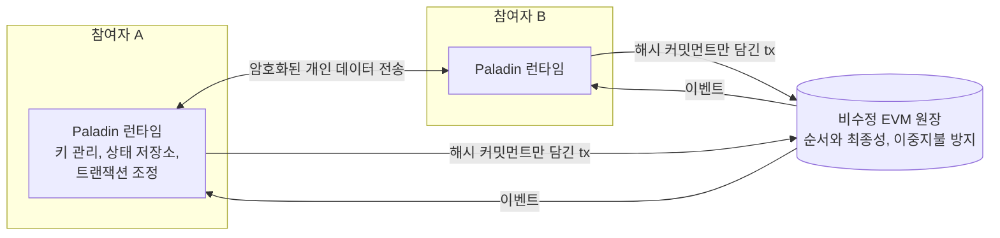
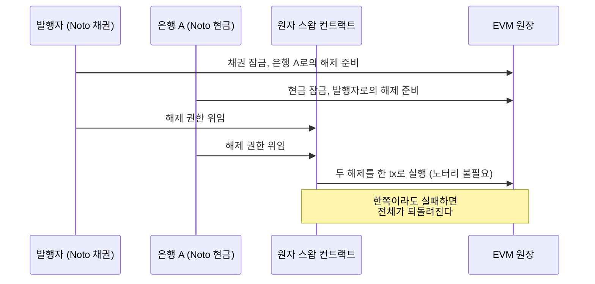

## 초록

Paladin은 비수정 EVM 체인 위에 사이드카 런타임으로 붙어 기업용 프라이버시를 제공하는 Linux Foundation Decentralized Trust(LFDT) 프로젝트다[^s01][^s02]. 2025년 2월 랩으로 시작해 같은 해 11월 정식 프로젝트가 됐고, v1.0은 2026년 6월 25일에 나왔다[^s09][^s10][^s08]. 구조의 핵심은 공통 런타임 하나에 신뢰 모델이 다른 세 도메인을 꽂는 것이다. Noto는 단일 노터리가 모든 개인 상태를 보고 검증하는 토큰이고, Zeto는 영지식 증명으로 규칙을 강제하는 토큰이며, Pente는 그룹 안에서만 실행되는 사설 EVM이다[^s03][^s06][^s04]. 셋 모두 상태를 체인에 해시 커밋먼트로만 남기고, 잠금과 위임을 통해 서로 다른 도메인의 거래를 원자적으로 묶는다[^s02][^s03]. 저장소를 직접 읽어 확인한 제약도 있다. Pente는 그룹 구성원 100%의 승인을 요구하므로 한 명만 응답하지 않아도 거래가 멈춘다[^s05]. Paladin이 쓰는 Zeto는 v0.2.2이고, Zeto 최신판의 양자내성 회로는 Paladin 저장소에 한 줄도 없다[^s08][^s07]. 유지관리자 7명은 모두 Kaleido 소속이다. "중앙은행 채택" 주장에는 기관 이름이 없고, 공개된 제3자 보안 감사 보고서도 찾지 못했다[^s08][^s10][^s11].

## 1. 서론

프로젝트 사이트는 Paladin을 "세계에서 가장 많이 쓰이는 스마트 컨트랙트 플랫폼에 진정한 금융 프라이버시를 가져온다"고 소개한다. Apache-2.0 라이선스이고, 저작권 표기는 "Paladin a Series of LF Projects, LLC"다[^s01]. 문서는 더 건조하게 정의한다. Paladin은 "이더리움을 위한 프라이버시 보존 트랜잭션 관리자"다[^s02].

이런 시도가 처음은 아니다. 2016년 Constellation부터 Quorum, Tessera로 이어진 사설 트랜잭션 계보가 있었다. Paladin 문서는 그 모델의 근본 문제로 두 가지를 든다. 상태가 한 사설 컨트랙트 안에 갇혀 다른 컨트랙트와 거래하기 어렵고, 프라이버시 그룹이 겹치면 참여자마다 다른 상태를 갖게 되어 "단일한 진실의 원천이 없다"는 것이다. Tessera는 2024년에 지원이 중단됐다[^s04]. 2025년 2월 LFDT 발표문은 EVM 프라이버시 혁신이 "여러 개별 연구 프로젝트로 쪼개져 있다"고 진단하고, Paladin을 그 조각들을 하나의 런타임으로 묶는 시도로 내세웠다[^s09].

이 보고서는 공식 문서와 두 저장소(paladin, zeto)의 코드를 직접 읽어, 구조와 신뢰 모델, 그리고 성숙도 주장을 대조한다.

## 2. 구조: 사이드카와 두 층의 원장

Paladin은 Besu 같은 EVM 노드 옆에서 도는 별도 프로세스다. 다른 Paladin 노드와 암호화된 채널로 개인 데이터를 선택적으로 주고받는다[^s02]. 각 프라이버시 컨트랙트는 두 부분으로 나뉜다. 한 부분은 비수정 EVM 위의 일반 스마트 컨트랙트이고, 다른 부분은 Paladin 런타임 안에서 돈다. 모든 도메인은 거래의 순서와 최종성을 베이스 EVM 원장에 맡긴다. 상태는 체인에 "안전하게 마스킹된 형식"으로 저장되고, 데이터는 알아야 할 당사자에게만 공개된다[^s02].

_그림 1 — Paladin의 두 층. 개인 데이터는 런타임 사이에서만 오가고, 원장에는 커밋먼트와 서명만 남는다.[^s02][^s03]_

## 3. 세 도메인, 세 가지 신뢰 모델

### 3.1 Noto: 노터리를 믿는 토큰

Noto 토큰은 "노터리라 불리는 단일 당사자가 관리"하는 기밀 UTXO 토큰이다. 각 상태는 소유자, 금액, 무작위 salt를 담는다. 원장에는 상태 데이터의 해시만 올라가고, 실제 데이터는 사설 채널로만 오간다[^s03]. 노터리는 세 가지를 검증한다. 요청자의 EIP-712 서명, 입출력 상태가 요청된 연산을 올바르게 표현하는지, 그리고 mint와 burn을 뺀 연산에서 입력 합과 출력 합이 같은지다[^s03].

이 구조에서 프라이버시는 외부 관찰자에 대한 것이다. 노터리는 모든 이전의 내용을 본다. 문서의 예시도 노터리가 "A의 잔액이 거래 뒤에도 기준 이상인지"까지 확인하는 장면을 든다[^s03]. 독립 프로필도 Noto의 강제력이 "노터리·발행자의 EIP-712 증명서에 의존"한다고 정리한다[^s14]. 정책은 두 모드로 정한다. basic 모드에서는 mint 제한, burn 허용, lock 허용 같은 옵션만 고른다. hooks 모드에서는 Pente 사설 컨트랙트의 훅이 정책을 맡는데, 이때 "basic 노터리 제약은 하나도 활성화되지 않는다". 훅 구현이 잘못되면 통제가 그대로 비게 된다는 뜻이다[^s03].

### 3.2 Zeto: 증명을 믿는 토큰

Zeto는 Circom으로 구현한 영지식 증명 기반 UTXO 토큰 모음이다. 내세우는 성질은 송수신자 익명성, 거래 내 암호화된 비밀, 이력 은닉, KYC, 그리고 미리 지정한 감사 기관에 대한 부인 방지다[^s07]. 이 모델에서는 노터리 대신 체인 위의 검증자 컨트랙트가 증명을 확인한다. Paladin 런타임은 UTXO 인덱싱, 코인 선택, 증명 생성을 맡는다[^s06].

신뢰가 사라지지는 않는다. 자리를 옮길 뿐이다. Zeto README는 테스트용 설정만으로는 "생성된 증명을 신뢰하기에 충분하지 않다"고 경고한다. 증명 키는 잘 문서화된 탈중앙 세레모니나 신뢰할 수 있는 단일 주체가 만들어야 한다[^s07].

### 3.3 Pente: 그룹 전원을 믿는 사설 EVM

Pente는 프라이버시 그룹마다 독립된 world state를 둔다. 그룹 하나가 베이스 원장 위 컨트랙트 하나이고, 문서의 표현으로는 그 안에 든 "작은 블록체인"이다[^s04]. 거래는 Paladin 런타임 안의 일회용 Besu EVM에서 먼저 실행된다. 그다음 그룹 구성원이 정확한 입력·출력 상태에 서명하고, 원장은 그 서명과 상태 커밋먼트를 검증한다. 베이스 EVM은 손대지 않는다[^s04].

문서는 이 검증을 "임계값 서명 검증"이라고 부른다[^s04]. 그런데 실제 임계값은 하나뿐이다. `PenteDomain.java`는 승인 방식 `group_scoped_identities` 하나만 받는다. 주석은 "임계값은 지금 100%"라고 적고, 일부 구성원이 승인하지 않은 거래를 그 구성원이 나중에 따라잡는 문제를 이유로 든다[^s05]. 온체인 컨트랙트도 서명 수가 임계값에 못 미치면 되돌린다[^s08]. 구성원 하나가 오프라인이면 그 그룹의 모든 거래가 멈춘다. M-of-N 승인은 LFDT 발표문에서 계획으로만 언급된다[^s10].

| 도메인 | 규칙을 강제하는 주체 | 개인 데이터를 보는 주체 | 주요 신뢰 지점 |
|---|---|---|---|
| Noto | 노터리 서명 | 거래 당사자와 노터리 | 노터리(hooks 사용 시 훅 코드) |
| Zeto | 온체인 ZK 검증자 | 거래 당사자 | 증명 키 생성(세레모니) |
| Pente | 그룹 전원의 EIP-712 서명 | 그룹 구성원 | 구성원 전원의 가용성 |

_표 1 — 세 도메인의 신뢰 구조. 문서와 코드에서 정리했다.[^s03][^s05][^s07]_

## 4. 원자적 상호운용

Paladin이 Tessera 계열과 가장 크게 다른 점은 도메인 사이의 원자적 결제다[^s04]. Noto 문서는 그 메커니즘을 이렇게 설명한다. 노터리가 거래의 서명, 즉 마스킹된 입출력의 해시를 잠금 안에 미리 검증해 기록한다. 소유자는 그 잠금을 결제 컨트랙트에 위임한다. 위임받은 컨트랙트는 "노터리의 관여 없이" 온체인에서 커밋하거나 롤백할 수 있다[^s03]. 한 결제에 여러 노터리의 Noto 토큰, 투명한 ERC-20, Zeto, Pente 그룹 안에서 준비한 거래를 함께 넣을 수 있다[^s03].

_그림 2 — 2026년 7월 LFDT 워크숍에서 시연된 채권·CBDC DvP 흐름을 단순화한 것.[^s03][^s13]_

Kaleido 쪽은 이 잠금 모델을 표준으로 만들려 하고 있다. 2026년 7월 Ethereum Magicians에는 프라이버시 모델이 서로 다른 시스템 간 결제용 잠금 생명주기 ERC-8316과 노터리 기반 기밀 토큰 ERC-8322가 올라왔다[^s16][^s15]. ERC-8322 작성자 계정은 Paladin 유지관리자의 GitHub ID와 비슷하지만, 게시물 자체는 Paladin을 언급하지 않는다. 글에는 답글도 없었다[^s15].

## 5. 성숙도와 거버넌스

**릴리스.** v1.0.0은 2026년 6월 25일 GitHub 릴리스로 나왔고, v1.0.1-rc.1이 9월 28일 프리릴리스로 올라와 있다[^s08][^s13].

**단일 회사 집중.** `MAINTAINERS.md`의 현직 유지관리자 7명은 모두 소속이 Kaleido다. 최근 1년 커밋 작성자 메일도 kaleido.io가 1,747건이었고, GitHub noreply 402건, 그 밖의 주소는 26건이었다[^s08]. 발표문들의 저자도 Kaleido 공동창업자와 엔지니어다[^s09][^s10]. 오픈 거버넌스 아래 있지만 실제 개발은 한 회사가 이끈다. 저장소 규모는 스타 92개, 포크 77개다[^s08].

**채택 주장.** LFDT 발표문은 Paladin이 "중앙은행을 포함한 여러 프로젝트에 이미 배포됐다"고 쓴다. 그러나 기관 이름은 하나도 없다[^s10]. Ledger Insights는 같은 주장을 "여러 중앙은행과 상업은행이 채택"이라고 옮겼고, 이 역시 이름은 없다. 같은 기사에 나온 한국은행의 LFDT 가입은 Paladin 사용과 연결되어 있지 않다[^s11]. 이름이 나오는 유일한 사례는 Kaleido의 인도네시아 중앙은행 Project Garuda 고객 사례다. 그런데 거기서도 Paladin은 "built with" 목록에만 있고 맡은 역할은 나오지 않는다. 두 프로토콜 후보 중 무엇이 선택됐는지도 없다[^s12] _(vendor-stated)_.

**문서와 코드의 간극.** LFDT 발표문은 UC Berkeley와 UNC Chapel Hill 연구자가 기여한 Zeto의 양자내성 암호 저장을 소개했다[^s10]. 이 기능은 Zeto 저장소에 `Zeto_AnonNullifierQurrency`(ML-KEM)로 존재한다[^s07]. 그러나 Paladin은 Zeto 계약 v0.2.2(2026년 1월)에 의존한다. Paladin의 Zeto 도메인 코드가 아는 변형은 Anon 계열 여섯 가지이고, 저장소 전체에서 "qurrency"를 검색하면 0건이다[^s08]. 2026년 7월 Kaleido 발표 자료가 플러그인으로 든 Railgun도 저장소에서 검색되지 않는다[^s13][^s08]. Hardhat 설정에는 "일부 검증자 컨트랙트가 기본 24,576바이트를 넘어" 테스트에서 크기 제한을 해제한다는 주석이 있다[^s08]. 메인넷처럼 EIP-170 한도를 지키는 체인에 그 검증자를 배포할 수 있는지는 확인하지 못했다.

**보안.** 두 저장소의 문서에서 제3자 보안 감사 보고서는 찾지 못했다. 보안 정책은 조직 단위 `.github` 저장소에 있다[^s08]. EthSystems 프로필은 "일부 운영 모드에서 운영자의 클라이언트 데이터 접근"과 "중앙화·수탁형 키 관리의 절충"을 위험으로 꼽는다[^s14].

## 6. 논의

**Paladin은 하나의 프라이버시가 아니라 세 개의 신뢰 계약을 묶은 런타임이다.** 사이트는 세 도메인을 나란히 두지만 보장은 크게 다르다. Noto는 노터리에게 모든 것을 보여 주고, Zeto는 세레모니를 믿어야 하며, Pente는 구성원 전원이 깨어 있어야 한다(표 1). 원자적 상호운용은 이 셋을 한 거래로 묶어 준다. 다만 한 결제의 신뢰 수준은 그 안에서 가장 약한 다리를 따른다. 그림 2의 DvP에서 채권과 현금이 모두 Noto라면, 거래 전체가 두 노터리에게 보인다.

**목표 고객에게는 장점인 것이 공개 체인 관점에서는 제약이다.** 노터리 검증, 그룹 전원 승인, KYC 훅은 규제 기관이 감독하는 은행 컨소시엄에 맞는 설계다. 사이트가 Ethereum, Base, Arbitrum 로고를 내걸고 "비수정 EVM 어디서나"를 말하긴 한다[^s01]. 그러나 문서의 기본 그림은 Besu 노드 옆의 사이드카이고, 워크숍 시연도 QBFT 사설망 위에서 이뤄졌다[^s02][^s13].

**도입을 검토한다면 확인할 것은 셋이다.** 첫째, 쓰려는 Zeto 변형이 Paladin 도메인에 실제로 연결돼 있는지. 둘째, Pente 그룹 구성원의 가용성을 어떻게 보장할지. 셋째, 감사 보고서와 실제 배포 기관에 대한 근거를 공급사에 직접 요구하는 것이다. 공개 자료만으로는 셋 모두 답이 나오지 않는다.

## 7. 한계

- 실행 검증을 하지 못했다. CI 방식으로 Solidity 테스트를 돌리려 했으나 의존성 설치가 실패했고(npm ETARGET), Go 도메인 테스트는 Gradle 생성물이 필요해 따로 돌릴 수 없었다. 본문의 코드 관련 주장은 소스를 읽어 확인한 것이다.
- 감사 보고서의 부재는 두 저장소 마크다운 검색과 웹 검색 범위 안의 확인이다. 비공개 감사가 있을 수 있다.
- 실제 배포 기관, 성능 수치, 독립 벤치마크는 공개 자료에서 찾지 못했다. 독립 분석은 EthSystems 프로필 하나뿐이다.
- 24,576바이트를 넘는 검증자가 무엇인지, 실제 체인에 배포할 수 있는지는 측정하지 못했다.
- 분석은 2026년 10월 23일 main(paladin `6937b943a`, zeto `dd49549`) 기준이며, v1.0.1과 이후 버전에서 달라질 수 있다.
