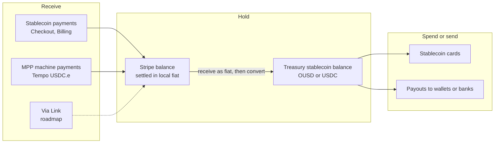
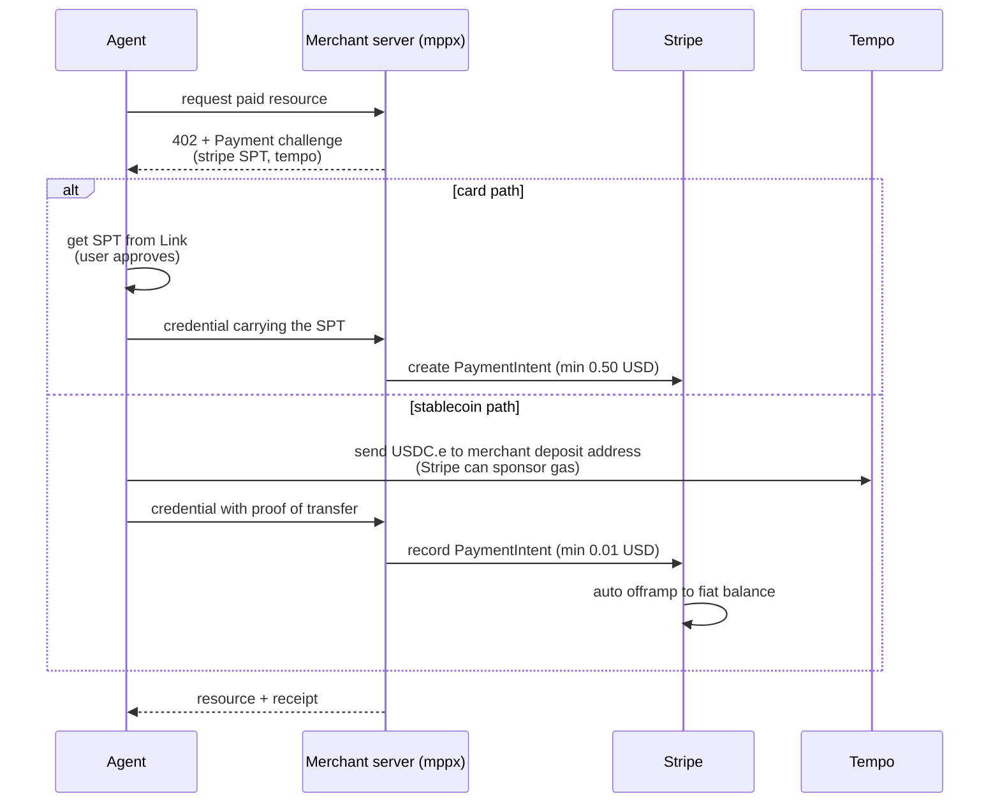

## Abstract

Businesses on Stripe processed $1.9 trillion in 2025, up 34%, and Stripe's Link wallet passed 200 million users[^s01]. In 2026 Stripe is stretching that network in two directions. Link is becoming a wallet that agents can spend from. Bridge, Privy and Tempo are pushing stablecoins into payments, accounts, cards and payouts[^s02][^s04]. On 30 September, OUSD on Tempo became Stripe's default stablecoin configuration. OUSD is issued for a consortium led by a Bridge co-founder[^s13][^s14]. Most of what was announced is still in preview. Stablecoin balances are a public preview in the US and a private preview in 101 other countries, and stablecoin payments support neither disputes nor manual capture[^s09][^s08]. MPP, the machine payments protocol Stripe co-wrote with Tempo, lets a Stripe merchant take cards through Shared Payment Tokens (minimum $0.50) and USDC.e on Tempo (minimum $0.01). Both land as ordinary payments[^s06][^s07]. Its IETF draft is still an individual submission, not adopted by any working group[^s21]. A census of the public MPP directory found 135 of 138 services accepting Tempo and only 10 accepting Stripe's card path. Of 19 services that answered an unpaid request with a 402, one offered the Stripe method[^s24]. For now MPP runs on Tempo's stablecoin rail far more than on Stripe's card network.

## 1. Introduction

Stripe's 2025 annual letter, dated 24 February 2026, reports $1.9 trillion of volume on Stripe in 2025. Link had "more than 200 million" users. During the year Stripe bought Privy, which powers over 110 million programmable wallets, and Metronome, a usage-billing platform[^s01] _(unverified — single source)_.

The letter spends most of its energy on stablecoins and agentic commerce. "It may be a crypto winter, but it's a stablecoin summer," it says. Stablecoin payments volume roughly doubled to $400 billion, an estimated 60% of it B2B, and Bridge's volume more than quadrupled[^s01]. On agents, the letter lays out five levels of agentic commerce and lists a year of launches: ACP, Shared Payment Tokens, the Agentic Commerce Suite and machine payments[^s01].

Between May and June 2026 this site covered Stripe's agent-payments strategy ([stripe-ai-agent-payments](../../stripe-ai-agent-payments/en/)), Tempo and MPP ([tempo-mpp-ai-agent-payments](../../tempo-mpp-ai-agent-payments/en/), [mpp-machine-payments-protocol](../../mpp-machine-payments-protocol/en/)) and ACP ([openai-stripe-acp](../../openai-stripe-acp/)). This report tracks what has changed since then. It reads Stripe's documentation as of 27 October 2026 to see what is actually open, and it weights stablecoins and MPP most heavily.

## 2. The stack at a glance

Stripe announced 288 products and features at Sessions 2026 on 29 April[^s02]. The relevant strands:

| Area | 2026 change | Status |
|---|---|---|
| Payments and Checkout | Checkout studio, embedded checkout form, Authorization Boost (+3.8% average acceptance) | partly preview |
| Link | agent wallet; US merchants accept Pix and stablecoins via Link | launched; stablecoins via Link on roadmap |
| Connect | 16,000+ platforms, 11 million businesses, one-click onboarding for Link users | partly preview |
| Billing | Metronome; streaming payments built from Metronome and Tempo | mixed |
| Treasury and Issuing | agent-ready financial accounts, single-use cards for agents, stablecoin balances and cards | mostly preview |
| Stablecoins | 32 more markets, new Bridge chains including Tempo, Privy wallets | preview |
| MPP | cards and BNPL via SPTs, stablecoins via Tempo | launched |

_Table 1 — Sessions 2026 items relevant here, with figures as Stripe reported them.[^s02]_

One caveat governs the dated items below. The same page publishes a 334-entry roadmap and says it "is not a commitment to deliver any material, code, or functionality"[^s02].

## 3. Link: from checkout wallet to agent wallet

Link stores a customer's payment methods and shipping details and fills them in at checkout. It holds cards, US bank accounts and BNPL, and Instant Bank Payments are "available exclusively through Link"[^s03]. Customers are recognized by email, phone number or browser cookie and confirm with a one-time code. For the merchant, a Link payment settles "on the same timeline as card payments, regardless of the funding method"[^s03]. A bank-funded payment looks like a card payment to the merchant, which makes bank payments easy to accept. Link is unavailable in India[^s03].

The only official user count is the letter's "more than 200 million"[^s01]. A 250 million figure circulates, but no Stripe primary source for it turned up.

The agent wallet is the big 2026 change. TechCrunch described the April launch. A user grants an agent access through OAuth, and the agent files a spend request with context. The user reviews it on phone or web, and only then is a payment credential released to the agent. It is built on Stripe's Issuing for agents[^s05]. Today link.com/agents goes further. It invites users to "approve a budget and let your agent handle the rest", and its sample screen shows a $100 per-purchase cap. It also stresses that the agent buys "without ever seeing your payment details"[^s04]. The spending limits promised as "soon" at launch appear to have arrived, though the only evidence is the product page's copy and mock-up.

Link also feeds MPP. Stripe's MPP guide issues test SPTs from `link-cli`, and `link-cli mpp pay` pays an MPP endpoint directly[^s07]. That repository was created on 23 April and had 881 stars by 27 October[^s23]. Link is now both a human checkout wallet and the place an agent fetches a card credential for an MPP payment.

## 4. Stablecoins

### 4.1 Four parts

Stripe's stablecoin business rests on four pieces, bought or co-built. Bridge orchestrates issuance, conversion and accounts, and Privy supplies wallet infrastructure[^s01][^s15]. Tempo is the payments L1 incubated with Paradigm, sold on dedicated payment lanes, sub-second finality and opt-in privacy[^s01]. The letter is frank about why Tempo exists: "one of the major blockchains delayed payouts for one Bridge user by over 12 hours"[^s01]. Tempo's mainnet opened on 18 March 2026. It had raised $500 million at a $5 billion valuation in an October 2025 Series A, a round in which neither Stripe nor Paradigm took part[^s18][^s19].

The fourth piece is OUSD. On 30 June a consortium called Open Standard announced Open USD, with Stripe, Visa, BlackRock and over 140 others as members. Most reserve interest flows back to participants, and the interim CEO is Bridge co-founder Zach Abrams[^s14]. On 30 September Stripe said "OUSD on Tempo is now Stripe's default stablecoin configuration". It is the default across Treasury, Issuing, Global Payouts, Crypto Onramp and Payments, on Base, Ethereum, Solana and Tempo[^s13]. Fortune, citing USDT at 62% of the market and USDC at 25%, called it "a serious challenge" to both issuers[^s14]. On 1 October, Privy CEO Henri Stern took charge of stablecoins and crypto across Stripe[^s15].

_Figure 1 — How stablecoins move inside Stripe. Stablecoins received as payments settle to the merchant in fiat, and holding them as stablecoins means converting again in Treasury. Dashed lines are roadmap items.[^s02][^s07][^s08][^s09]_

### 4.2 Accepting them

A paying customer is sent to crypto.stripe.com to choose a wallet and network, and the merchant settles "in your local currency"[^s08]. Accepted tokens are USDC (Tempo, Ethereum, Solana, Polygon, Base), USDP and USDG. OUSD is missing, despite the 30 September post naming Payments among its defaults[^s08][^s13]. Merchants outside the US need a private preview: the docs list 32 countries, including the EU, Hong Kong, Mexico and Switzerland. That matches Sessions' "32 additional markets" and contradicts the roadmap's 33[^s08][^s02].

The limits are spelled out. Dispute support is "No" and manual capture is "Not supported". Refunds always go back as stablecoins to the original wallet, and each payment is capped at $10,000[^s08]. The disputes paragraph justifies the absence of chargebacks because "the customer must authenticate the payment with their bank". That is an odd fit for a wallet-signed payment and reads like text carried over from card docs.

### 4.3 Holding them

A Treasury financial account can hold one stablecoin balance, in OUSD or USDC. It is a public preview in the US and a private preview elsewhere[^s09]. Counting the docs' list gives 101 countries, exactly the "101 countries" Stripe announced in May 2025[^s09][^s12]. Eighteen months on, everywhere outside the US is still invitation-only. Money cannot go straight from an outside bank into a stablecoin balance; it has to land as fiat and be converted[^s09].

On 21 October Stripe announced Treasury for agents. Agents connect over MCP to check balances, send and convert money and set up recipients. Any live money movement needs a human's approval by default[^s10][^s11]. Spending limits for agents were due "in the coming weeks"[^s11].

### 4.4 Spending them

Cards that spend from a stablecoin balance are growing fast. CoinDesk quoted Stern as expecting Stripe's stablecoin card programs to reach "more than 100 countries by year-end", with Kraken, Ramp and Morse among customers[^s15]. Two weeks later PYMNTS covered the 15 October multi-currency card launch with Plasma. It said the cards work in more than 30 countries now and will reach 100 "in 2027"[^s16]. The two reports give the same target different dates, and this report does not pick one.

The wider market needs scale, too. Allium counts $482 billion of stablecoin payments in January–September 2026, up 45%. Over the same period supply was flat at about $305 billion, up 0.4% on the year. Only 2.5% of $97.9 trillion in raw transfers counted as end-user activity, and second-quarter stablecoin card spend was about 0.03% of Visa's volume[^s17]. Read against that, the letter's "$400 billion" looks like an industry figure rather than Stripe's own, though the letter never says so[^s01].

## 5. MPP

### 5.1 Where the standard stands

Earlier reports on this site cover MPP's mechanics, so this section only checks its status. The core document, the "Payment" HTTP authentication scheme, was renamed in September from `draft-ryan-httpauth-payment` to `draft-httpauth-payment`. Dropping the personal name changed nothing formal. Datatracker still files it under "Individual Submissions" with no stream, the old-name draft has expired, and the httpauth working group it sounds like has concluded[^s21].

mpp.dev lists Tempo, Stripe, cards, Lightning, Solana, XRP Ledger, Stellar, Monad and NEAR Intents as payment methods, with SDKs in TypeScript, Python, Rust, Go and Ruby[^s20]. The reference implementation, `mppx`, shipped 0.14.0, 0.14.1 and 0.15.0 on a single day, 21 October[^s23]. It is pre-1.0 and moving fast.

### 5.2 Stripe's integration

Stripe's docs say machine payments "works best with" MPP, and that x402 is supported for stablecoins only[^s06]. Three combinations are accepted. MPP takes USDC.e on Tempo and USDC on Solana, and x402 takes USDC on Base[^s06].

_Figure 2 — The MPP flow Stripe's docs describe. Either way the result is an ordinary payment in the merchant's Stripe balance.[^s06][^s07]_

For merchants the draw is bookkeeping. Both paths are recorded as PaymentIntents, so refunds, reporting and payouts work as for any other payment[^s06][^s07]. Economically the paths differ sharply. An SPT card payment has a $0.50 floor, and a stablecoin payment has a $0.01 floor. Sessions can bill in sub-cent increments but still settle in units of at least $0.01[^s06]. Stripe's gas sponsorship, `hostedFeePayer`, is unavailable to Connect integrations[^s07]. Stablecoin acceptance covers every US state except New York[^s06].

### 5.3 Counting the directory

The MPP directory has a machine-readable API at `mpp.dev/api/services`, which was pulled and tallied on 27 October[^s24].

| Measure | Value |
|---|---|
| services / endpoints | 138 / 1,573 |
| services accepting Tempo | 135 |
| services accepting the Stripe method | 10 (2 Stripe-only) |
| other (EVM) | 1 |
| services using the session intent | 8, all Tempo |
| median Tempo per-request price | $0.02 (n=1,044) |

_Table 2 — MPP directory census (author's measurement, 27 October 2026)[^s24]_

None of the cards, Lightning or Solana options on mpp.dev's front page appears in a single directory listing[^s20][^s24]. Listings can be stale, so live behavior was checked too. One unpaid GET went to each of 39 services that had a fixed-path, priced GET endpoint. Nineteen answered with a 402 carrying a Payment challenge, and the rest returned 400, 404, 401 or 410. The 19 challenges offered Tempo alone 13 times, EVM plus Tempo 4 times, EVM alone once, and Stripe plus Tempo once. In four cases the methods offered differed from the listing[^s24].

None of this is transaction volume, which nobody publishes. The supply side is still clear. MPP is pitched as co-written by Stripe and able to take cards and BNPL, yet the services actually opening up take Tempo stablecoins almost exclusively. The median price explains why: at $0.02 a request, the card path's $0.50 floor rules cards out[^s06][^s24].

## 6. Discussion

**Stripe's choice is to make stablecoins invisible to merchants.** Stablecoin payments settle in fiat, Link bank payments settle like cards, and MPP's Tempo payments are offramped automatically[^s03][^s07][^s08]. A merchant adds a payment method without touching its ledger. Anyone who wants to hold stablecoins has to open a Treasury account, and outside the US that is still a preview by application[^s09].

**Protection varies by path.** Cards and Link come with disputes. Stablecoin payments have no disputes and no manual capture, so refunds are at the merchant's discretion[^s08]. MPP's stablecoin path sits on the same payment method. That hardly matters for a two-cent API call. If Link brings stablecoins to human checkout, as the roadmap says[^s02], shoppers lose the chargeback they take for granted with cards, and merchant refund policy has to fill the gap.

**With OUSD, Stripe is choosing the money as well as the rails.** Making OUSD on Tempo the default puts issuance, chain, wallets, and acceptance and cards inside one family. Issuance sits with Open Standard, run by former Bridge leadership. The chain is Tempo, the wallets are Privy's, and acceptance and cards are Stripe's[^s13][^s14][^s15]. Sharing reserve income with participants is the lure against USDC and USDT[^s14]. Yet the public token list for accepting payments does not include OUSD[^s08]. Whether that is a month-old documentation lag or a staged rollout could not be determined.

**In practice MPP is Tempo stablecoin billing.** The official story is a rail-agnostic standard spanning cards, wallets and Lightning[^s18][^s20]. The directory and live 402s show something narrower: APIs charging a few cents a call in USDC.e on Tempo[^s24]. That suits Stripe well enough, because the offramp into a merchant balance runs through Stripe[^s07]. While the formal standard sits as an IETF individual submission[^s21], the de facto standard is being written by 135 Tempo services in a directory.

## 7. Limitations

- MPP transaction volume is not published and was not measured. The directory census and the 402 probe are a one-day snapshot that sent only unpaid GET requests.
- Scale figures ($1.9 trillion, 200 million users, $400 billion) rest on Stripe's annual letter alone, which does not say whether the $400 billion is industry-wide.
- Two reports disagree on when stablecoin cards reach 100 countries (year-end versus 2027), and this report does not resolve it.
- Link's budget approvals and limits were confirmed only from the product page's copy and sample screen.
- Sessions roadmap items are plans Stripe says it is not committed to, and most stablecoin and agent features are previews whose terms may change.
- Why OUSD is absent from the accepted-token list was not established.
