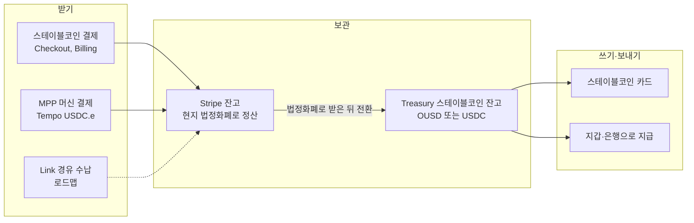
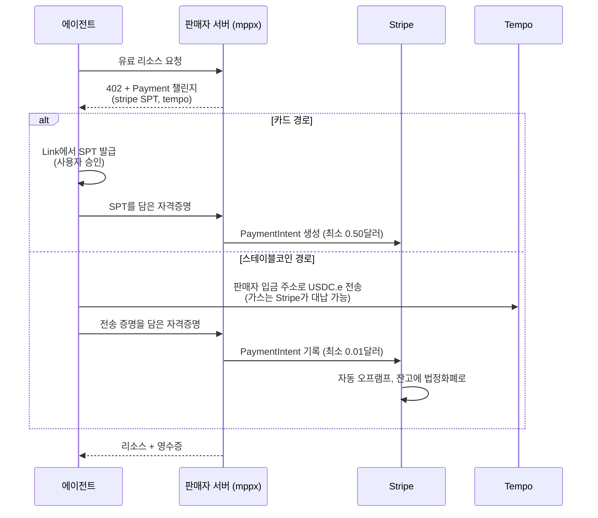

## 초록

Stripe의 2025년 총 처리액은 1.9조 달러로 전년보다 34% 늘었고, 지갑 Link의 사용자는 2억 명을 넘었다[^s01]. 2026년 들어 Stripe는 이 결제망을 두 방향으로 넓히고 있다. 하나는 Link를 사람 대신 결제하는 에이전트의 지갑으로 바꾸는 것이다. 다른 하나는 Bridge, Privy, Tempo를 묶어 결제, 계좌, 카드, 송금 전반에 스테이블코인을 넣는 것이다[^s02][^s04]. 9월 30일부터는 Bridge 공동창업자가 이끄는 컨소시엄의 OUSD가 Tempo 위에서 Stripe의 기본 스테이블코인 구성이 됐다[^s13][^s14]. 다만 상품 상태는 대부분 프리뷰다. 스테이블코인 계좌는 미국에서 공개 프리뷰이고 101개국에서는 비공개 프리뷰다. 스테이블코인 결제는 분쟁과 수동 캡처를 지원하지 않는다[^s09][^s08]. MPP는 Stripe와 Tempo가 함께 쓴 기계 결제 프로토콜이다. Stripe 쪽 통합은 카드(Shared Payment Token, 최소 0.50달러)와 Tempo의 USDC.e(최소 0.01달러)를 받아 일반 결제처럼 장부에 기록한다[^s06][^s07]. 표준화는 IETF 개인 제출 단계이며 워킹그룹 채택 전이다[^s21]. 공개 디렉터리를 직접 집계하자 138개 서비스 중 135개가 Tempo 결제를 받았고, Stripe 카드 경로를 받는 곳은 10개뿐이었다. 결제 없이 요청을 보내 402 응답을 받은 19곳 중 Stripe 방식을 제시한 곳은 하나였다[^s24]. 지금의 MPP는 Stripe의 카드망보다 Tempo의 스테이블코인 레일로 먼저 쓰이고 있다.

## 1. 서론

Stripe의 2025년 연례 서한(2026년 2월 24일)은 Stripe 위의 사업자들이 2025년에 1.9조 달러를 처리했다고 밝혔다. 같은 서한에서 Link 사용자는 "2억 명 이상"이었고, 한 해 동안 Privy(프로그래머블 지갑 1억 1천만 개 이상)와 Metronome(사용량 과금)을 인수했다[^s01] _(unverified — single source)_.

서한이 가장 공을 들인 대목은 스테이블코인과 에이전트 커머스다. 스테이블코인에 대해서는 "크립토 겨울이지만 스테이블코인의 여름"이라고 쓰고, 스테이블코인 결제액이 약 4,000억 달러로 두 배가 됐으며 그중 60%가 B2B로 추정된다고 했다. Bridge의 거래량은 네 배 넘게 늘었다[^s01]. 에이전트 커머스에 대해서는 단계를 다섯으로 나누고, 그해에 ACP, Shared Payment Token, Agentic Commerce Suite, 머신 결제를 내놓았다고 정리했다[^s01].

이 사이트는 2026년 5~6월에 Stripe의 에이전트 결제 전략([stripe-ai-agent-payments](../stripe-ai-agent-payments/)), Tempo와 MPP([tempo-mpp-ai-agent-payments](../tempo-mpp-ai-agent-payments/), [mpp-machine-payments-protocol](../mpp-machine-payments-protocol/)), ACP([openai-stripe-acp](../openai-stripe-acp/ko/))를 다뤘다. 이 보고서는 그 뒤 반년 동안의 변화를 따라가며, 2026년 10월 27일 현재의 공식 문서를 기준으로 무엇이 실제로 열려 있는지를 확인한다. 비중은 스테이블코인과 MPP에 더 둔다.

## 2. 결제 스택 개관

Stripe는 4월 29일 Sessions 2026에서 288개 제품·기능을 발표했다[^s02]. 이 보고서와 관련된 줄기만 추리면 아래와 같다.

| 영역 | 2026년 주요 변화 | 상태 |
|---|---|---|
| Payments·Checkout | Checkout studio, 임베디드 결제 폼, Authorization Boost(평균 승인율 +3.8%) | 일부 프리뷰 |
| Link | 에이전트 지갑, 미국 사업자의 Pix·스테이블코인 수납 | 출시, 스테이블코인 수납은 로드맵 |
| Connect | 16,000+ 플랫폼, 1,100만 사업자, Link 사용자의 원클릭 온보딩 | 일부 프리뷰 |
| Billing | Metronome 통합, Metronome과 Tempo를 엮은 스트리밍 결제 | 출시·프리뷰 혼재 |
| Treasury·Issuing | 에이전트용 금융계좌, 에이전트용 일회용 카드, 스테이블코인 잔고·카드 | 대부분 프리뷰 |
| 스테이블코인 | 32개 시장 추가, Bridge 체인 추가(Tempo 등), Privy 지갑 | 프리뷰 |
| MPP | 카드·BNPL은 SPT로, 스테이블코인은 Tempo로 수납 | 출시 |

_표 1 — Sessions 2026 발표 중 이 보고서와 관련된 항목. 수치는 Stripe 발표 기준이다.[^s02]_

이 목록에는 주의할 점이 있다. Sessions 페이지가 함께 공개한 로드맵 334개 항목에 대해 Stripe는 "어떤 자료, 코드, 기능을 제공하겠다는 약속이 아니다"라고 적어 두었다[^s02]. 아래에서 시점이 붙은 항목은 그 전제 위에서 읽어야 한다.

## 3. Link: 지갑에서 에이전트 지갑으로

Link는 결제수단과 배송지를 저장해 두었다가 자동으로 채워 주는 Stripe의 지갑이다. 카드, 미국 은행계좌, BNPL을 담을 수 있고, 은행 이체인 Instant Bank Payments는 "Link를 통해서만" 쓸 수 있다[^s03]. 고객은 이메일, 전화번호, 브라우저 쿠키로 식별되고 일회용 코드로 인증한다. 판매자 쪽에서 보면 Link 결제는 "자금원과 관계없이 카드 결제와 같은 일정으로" 정산된다[^s03]. 은행 이체로 낸 돈도 판매자에게는 카드처럼 보인다는 뜻이며, 판매자가 은행 결제를 받아들이기 쉬운 이유가 여기에 있다. 인도에서는 쓸 수 없다[^s03].

사용자 수의 공식 수치는 연례 서한의 "2억 명 이상" 하나다[^s01]. 2억 5천만 명이라는 수치도 돌지만 Stripe 1차 자료에서는 확인하지 못했다.

2026년의 큰 변화는 에이전트 지갑이다. TechCrunch(4월 30일)에 따르면 사용자는 OAuth로 에이전트에 Link 접근을 허락한다. 에이전트가 맥락을 붙인 지출 요청을 만들면, 사용자가 휴대폰이나 웹에서 거래를 검토한 뒤에야 결제 자격증명이 에이전트에 넘어간다. 기능 기반은 Stripe의 Issuing for agents다[^s05]. 지금의 link.com/agents는 한발 더 나아가 "예산을 승인하고 나머지는 에이전트에게 맡기라"고 안내하고, 예시 화면에는 건당 최대 100달러 같은 한도가 보인다. 에이전트가 "결제 정보를 보지 않는다"는 점도 강조한다[^s04]. 출시 때 "곧"이라던 지출 한도가 그 사이 들어온 것으로 보인다. 다만 이를 확인한 근거는 제품 페이지의 안내와 예시 화면뿐이다.

Link는 MPP와도 맞물린다. Stripe의 MPP 문서는 테스트용 SPT를 `link-cli`로 발급받게 하고, `link-cli mpp pay`로 MPP 엔드포인트에 직접 결제하는 방법을 보여 준다[^s07]. 이 CLI 저장소는 4월 23일에 만들어져 10월 27일 현재 스타 881개다[^s23]. Link는 사람이 체크아웃에서 쓰는 지갑인 동시에, 에이전트가 MPP 카드 결제를 할 때 자격증명을 꺼내 오는 곳이 됐다.

## 4. 스테이블코인

### 4.1 네 개의 부품

Stripe의 스테이블코인 사업은 인수와 공동 개발로 모은 네 부품 위에 서 있다. Bridge는 발행·전환·계좌를 맡는 오케스트레이션 플랫폼이고, Privy는 지갑 인프라다[^s01][^s15]. Tempo는 Paradigm과 함께 인큐베이트한 결제 전용 L1이다. 서한은 이를 결제 전용 레인, 1초 미만 최종성, 선택적 프라이버시로 설명한다[^s01]. 서한은 Tempo를 만든 이유도 숨기지 않는다. "주요 블록체인 중 하나"가 Bridge 사용자 한 명의 지급을 12시간 넘게 지연시킨 일이 있었다는 것이다[^s01]. Tempo는 2026년 3월 18일 메인넷을 열었다. 2025년 10월 시리즈 A에서 50억 달러 가치로 5억 달러를 모았고, 그 라운드에 Stripe와 Paradigm은 참여하지 않았다[^s18][^s19].

넷째 부품이 OUSD다. 6월 30일 Stripe, Visa, BlackRock과 140여 곳이 모인 컨소시엄 Open Standard가 Open USD를 발표했다. 준비금 이자의 대부분을 참여사에 돌려준다는 구조이고, 임시 CEO는 Bridge 공동창업자 Zach Abrams다[^s14]. 9월 30일 Stripe는 "Tempo 위의 OUSD가 이제 Stripe의 기본 스테이블코인 구성"이라고 발표했다. Treasury, Issuing, Global Payouts, Crypto Onramp, Payments에 기본으로 들어가고, 지원 체인은 Base, Ethereum, Solana, Tempo다[^s13]. 경쟁 구도도 분명하다. Fortune은 USDT 62%, USDC 25%의 점유율을 인용하며 OUSD를 두 발행사에 대한 "심각한 도전"으로 보도했다[^s14]. 10월 1일에는 Privy CEO Henri Stern이 Stripe 전체의 스테이블코인과 크립토를 맡게 됐다[^s15].

_그림 1 — Stripe 안에서 스테이블코인이 움직이는 경로. 결제로 받은 스테이블코인은 판매자 잔고에 법정화폐로 정산된다. 스테이블코인으로 보관하려면 Treasury에서 다시 전환해야 한다. 점선은 로드맵 항목이다.[^s02][^s07][^s08][^s09]_

### 4.2 결제로 받기

스테이블코인 결제에서 고객은 crypto.stripe.com으로 넘어가 지갑과 네트워크를 고른다. 판매자는 "현지 통화로" 정산받는다[^s08]. 받는 토큰은 USDC(Tempo, Ethereum, Solana, Polygon, Base), USDP, USDG다. OUSD는 이 목록에 없다. 9월 30일 발표가 OUSD를 Payments에도 기본 적용한다고 한 것과 맞지 않는다[^s08][^s13]. 판매자가 이 지역에 있어야 수납할 수 있다. 미국 외에는 EU, 홍콩, 멕시코, 스위스 등이 비공개 프리뷰이고, 문서의 국가 목록을 세면 32개국이다. Sessions의 "32개 시장 추가"와는 맞고, 로드맵의 33개와는 하나가 다르다[^s08][^s02].

제약은 문서에 분명히 적혀 있다. 분쟁 지원은 "없음", 수동 캡처는 "지원하지 않음"이고, 환불은 항상 고객의 원래 지갑으로 스테이블코인으로 돌아가며, 거래당 한도는 1만 달러다[^s08]. 문서의 분쟁 단락은 "고객이 은행에서 결제를 인증해야 하므로" 분쟁이 차지백으로 이어지지 않는다고 설명한다[^s08]. 지갑 서명으로 결제하는 흐름과는 맞지 않는 문구여서, 카드 문서의 표현을 옮겨 온 것으로 보인다.

### 4.3 계좌에 보관하기

Treasury의 금융계좌는 스테이블코인 잔고를 OUSD나 USDC 중 하나로 가질 수 있다. 미국에서는 공개 프리뷰이고, 그 밖의 적격 국가에서는 비공개 프리뷰다[^s09]. 문서의 비공개 프리뷰 국가 목록을 세면 101개국으로, 2025년 5월 발표의 "101개국"과 일치한다[^s09][^s12]. 1년 반이 지났지만 미국 밖은 여전히 신청을 받아 여는 단계라는 뜻이다. 외부 은행에서 스테이블코인 잔고로 바로 입금할 수는 없다. 먼저 법정화폐 잔고로 받은 뒤 전환해야 한다[^s09].

10월 21일 Stripe는 Treasury for agents를 발표했다. 에이전트가 MCP로 잔고를 조회하고 송금, 환전, 수취인 등록을 할 수 있고, 실제 돈이 움직이는 동작은 기본적으로 사람이 승인한다[^s10][^s11]. 발표 시점에 에이전트용 지출 한도는 "몇 주 안에" 나올 예정이었다[^s11].

### 4.4 카드로 쓰기

스테이블코인 잔고로 결제하는 카드는 빠르게 커지는 영역이다. CoinDesk는 Stern의 인터뷰를 인용해 Stripe의 스테이블코인 카드가 "연말까지 100개국 이상"으로 확대된다고 보도했다. 고객으로는 Kraken, Ramp, Morse를 들었다[^s15]. 그런데 10월 15일 Plasma와의 다통화 카드 발표를 다룬 PYMNTS는 지금 30개국 이상에서 쓸 수 있고 100개국 확대는 "2027년"이라고 썼다[^s16]. 두 보도는 같은 목표를 서로 다른 시점으로 전한다. 이 보고서는 어느 쪽이 맞는지 판단하지 않는다.

시장 규모도 함께 봐야 한다. Allium 집계로 2026년 1~9월 스테이블코인 결제는 4,820억 달러로 45% 늘었다. 같은 기간 스테이블코인 공급은 연초 대비 0.4% 증가한 약 3,050억 달러에 머물렀다. 원시 전송액 97.9조 달러 중 최종 사용자 활동으로 분류된 것은 2.5%뿐이고, 2분기 스테이블코인 카드 지출은 Visa 처리액의 약 0.03%였다[^s17]. 서한의 "약 4,000억 달러"도 Stripe만의 수치라기보다 업계 전체의 결제액으로 읽힌다. 다만 서한은 이를 명시하지 않는다[^s01].

## 5. MPP

### 5.1 표준의 위치

MPP의 기술 구조는 이 사이트의 이전 보고서들이 자세히 다뤘다. 여기서는 상태만 확인한다. 핵심 스펙인 "Payment" HTTP 인증 스킴 초안은 9월에 `draft-ryan-httpauth-payment`에서 `draft-httpauth-payment`로 이름이 바뀌었다. 이름에서 개인 이름이 빠졌지만 IETF Datatracker상 그룹은 여전히 "Individual Submissions"이고 스트림도 없다. 옛 이름의 초안은 만료됐고, 이름이 겹치는 httpauth 워킹그룹은 이미 종료된 상태다[^s21]. 워킹그룹이 채택한 표준 트랙 문서가 아니라는 점은 이름이 바뀐 뒤에도 그대로다.

mpp.dev는 결제 방식으로 Tempo, Stripe, 카드, Lightning, Solana, XRP Ledger, Stellar, Monad, NEAR Intents 등을 나열한다. SDK도 TypeScript, Python, Rust, Go, Ruby로 제공한다[^s20]. 레퍼런스 구현 `mppx`는 10월 21일 하루에 0.14.0, 0.14.1, 0.15.0이 나왔다[^s23]. 아직 1.0 전이고 빠르게 바뀌는 중이다.

### 5.2 Stripe 쪽 통합

Stripe 문서는 머신 결제가 "MPP에서 가장 잘 동작한다"고 쓰고, x402로는 스테이블코인 결제만 지원한다고 밝힌다[^s06]. 수납 가능한 조합은 세 가지다. MPP로는 Tempo의 USDC.e와 Solana의 USDC를, x402로는 Base의 USDC를 받는다[^s06].

_그림 2 — Stripe 문서가 안내하는 MPP 수납 흐름. 두 경로 모두 결과는 판매자의 Stripe 잔고에 쌓이는 일반 결제다.[^s06][^s07]_

판매자 쪽 장점은 회계다. 두 경로 모두 PaymentIntent로 기록되므로 환불, 리포트, 정산이 다른 결제와 같은 방식으로 돌아간다[^s06][^s07]. 비용 구조는 두 경로가 크게 다르다. 카드(SPT)의 최소액은 0.50달러이고, 스테이블코인은 0.01달러다. 세션을 쓰면 1센트 미만으로도 과금할 수 있지만 정산 최소액은 여전히 0.01달러다[^s06]. Stripe가 Tempo 가스비를 대신 내 주는 `hostedFeePayer`는 Connect 통합에서는 쓸 수 없다[^s07]. 스테이블코인 수납은 미국 전 주에서 가능하지만 뉴욕주는 빠진다[^s06].

### 5.3 디렉터리를 세어 보면

MPP 공개 디렉터리는 기계가 읽을 수 있는 API(`mpp.dev/api/services`)로도 제공된다. 10월 27일 이를 받아 집계했다[^s24].

| 항목 | 값 |
|---|---|
| 등록 서비스 / 엔드포인트 | 138 / 1,573 |
| Tempo를 받는 서비스 | 135 |
| Stripe 방식(SPT 등)을 받는 서비스 | 10 (Stripe만 받는 곳 2) |
| 기타(EVM) | 1 |
| session 인텐트를 쓰는 서비스 | 8 (모두 Tempo) |
| Tempo 건당 가격 중앙값 | 0.02달러 (n=1,044) |

_표 2 — MPP 서비스 디렉터리 집계(필자 측정, 2026-10-27)[^s24]_

mpp.dev 첫 화면이 나열하는 카드, Lightning, Solana 같은 방식은 디렉터리 등록 기준으로는 한 곳에서도 쓰이지 않았다[^s20][^s24]. 등록 정보만 볼 수는 없어서 실제 응답도 확인했다. 고정 경로의 유료 GET 엔드포인트가 있는 39곳에 결제 없이 한 번씩 요청을 보냈다. 19곳이 Payment 챌린지를 담은 402를 돌려줬고, 나머지는 400, 404, 401, 410이었다. 19개 챌린지가 제시한 방식은 Tempo만 13곳, EVM과 Tempo 4곳, EVM만 1곳, Stripe와 Tempo 1곳이었다. 4곳은 디렉터리에 적힌 방식과 실제 제시 방식이 달랐다[^s24].

이 수치는 거래량이 아니다. 결제가 실제로 얼마나 일어나는지는 공개 지표가 없어 알 수 없다. 그래도 공급 쪽의 모습은 분명하다. MPP는 Stripe가 공동 저자이고 카드·BNPL까지 받을 수 있다고 소개되지만, 지금 서비스를 여는 쪽은 압도적으로 Tempo 스테이블코인으로 받는다. 건당 2센트라는 가격대도 그 이유를 설명한다. 카드 경로의 최소 0.50달러로는 받을 수 없는 금액이기 때문이다[^s06][^s24].

## 6. 논의

**Stripe는 스테이블코인을 판매자에게 보이지 않게 만드는 쪽을 택했다.** 결제로 받은 스테이블코인은 법정화폐로 정산되고, Link의 은행 결제는 카드처럼 정산되며, MPP의 Tempo 결제는 자동으로 오프램프된다[^s03][^s07][^s08]. 판매자는 새 결제수단을 위해 장부를 바꿀 필요가 없다. 스테이블코인을 쥐고 싶은 쪽은 Treasury 계좌로 가야 하는데, 그곳은 아직 미국 밖에서 신청제 프리뷰다[^s09].

**보호 수준은 경로마다 다르다.** 카드와 Link에는 분쟁 절차가 있다. 스테이블코인 결제는 분쟁을 지원하지 않고 수동 캡처도 없으며, 환불은 판매자의 선택이다[^s08]. MPP의 스테이블코인 경로도 같은 결제수단 위에 있다. 에이전트가 2센트짜리 API를 부를 때는 문제가 되지 않는다. 그러나 Stripe가 로드맵에서 말하는 것처럼 Link가 스테이블코인을 사람의 체크아웃에 가져오면[^s02], 구매자는 카드에서 당연하던 차지백을 잃는다. 판매자의 환불 정책이 그 공백을 메워야 한다.

**OUSD는 Stripe가 레일뿐 아니라 화폐까지 정하려는 시도다.** 기본 스테이블코인 구성이 OUSD on Tempo가 되면서 발행(Open Standard, Bridge 출신 경영진), 체인(Tempo), 지갑(Privy), 수납·카드(Stripe)가 한 생태계 안에 들어왔다[^s13][^s14][^s15]. 준비금 수익을 참여사에 돌려주는 구조는 USDC와 USDT에 맞선 유인책이다[^s14]. 하지만 공개 문서에는 아직 OUSD를 결제로 받는 토큰 목록이 반영되지 않았다[^s08]. 출시 한 달 시점의 문서 지연인지, 경로별로 순차 적용되는 것인지는 확인하지 못했다.

**MPP의 실제 모습은 Tempo의 스테이블코인 과금이다.** 공식 서사 속 MPP는 카드, 지갑, Lightning을 아우르는 결제 무관 표준이다[^s18][^s20]. 디렉터리와 실제 402 응답에서 보이는 MPP는 Tempo USDC.e로 건당 몇 센트를 받는 API 과금이다[^s24]. Stripe에게 이 구도가 나쁘지만은 않다. 판매자 잔고로 오프램프되는 경로가 Stripe를 거치기 때문이다[^s07]. 표준이 IETF 개인 제출 단계에 머물러 있는 동안[^s21], 사실상의 표준은 디렉터리에 올라 있는 135개 Tempo 서비스가 만들어 가고 있다.

## 7. 한계

- MPP 거래량과 금액은 공개 지표가 없어 측정하지 못했다. 디렉터리 집계와 402 탐침은 하루치 스냅샷이고, 결제 없는 GET 요청만 보냈다.
- 1.9조 달러, 2억 명, 4,000억 달러 같은 규모 수치는 Stripe 연례 서한 하나에 의존한다. 4,000억 달러가 업계 전체 수치인지는 서한에 명시되어 있지 않다.
- 스테이블코인 카드 100개국 확대 시점은 두 보도(연말, 2027년)가 엇갈려 판단하지 않았다.
- Link 에이전트 지갑의 예산 승인과 한도 기능은 제품 페이지의 안내와 예시 화면으로만 확인했다.
- Sessions 로드맵 항목은 Stripe 스스로 약속이 아니라고 밝힌 계획이다. 대부분의 스테이블코인·에이전트 기능이 프리뷰 상태라 조건이 바뀔 수 있다.
- OUSD가 결제 수납 토큰 목록에 없는 이유는 확인하지 못했다.
